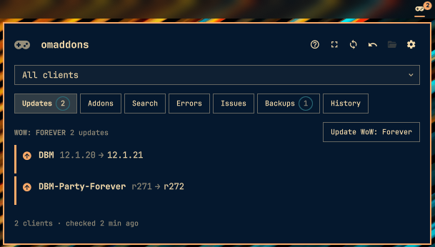
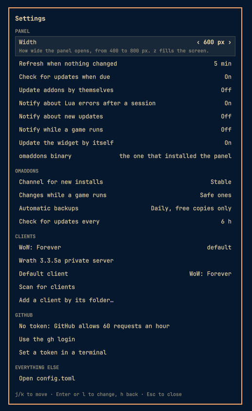
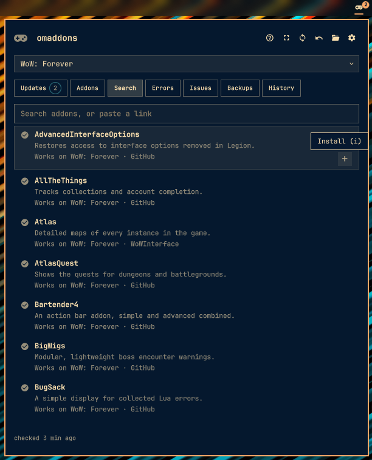
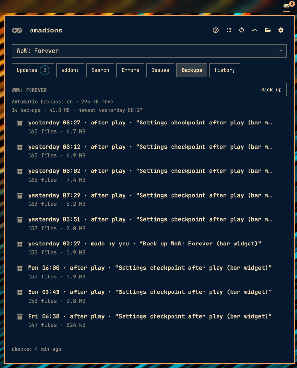

# omaddons

<div align="center">

**One binary that finds every World of Warcraft client on a Linux machine, installs only the addons each client will actually load, and can undo every change it makes.**


</div>

<table>
<tr>
<td valign="top" width="50%">


</td>
<td valign="top" width="50%">


</td>
</tr>
</table>

<sub>The [Omarchy bar widget](#omarchy): updates, search, backups and settings.</sub>

```text
$ omaddons status
Nothing needs doing
anniversary  tbc                                           2.5.6.70006   live  anniversary (battlenet)  0 addons · 0 unmanaged · 0 protected folders
classic      mists                                         5.5.4.70268   live  classic (battlenet)      0 addons · 0 unmanaged · 0 protected folders
era          Classic Era · Hardcore · Season of Discovery  1.15.9.70003  live  era (battlenet)          0 addons · 0 unmanaged · 0 protected folders
forever      forever                                       1.60.1.70245  live  forever (battlenet)      0 addons · 3 unmanaged · 0 protected folders · 3 adoptable
retail       mainline                                      12.1.5.70391  live  retail (battlenet)       2 addons in 2 folders · 0 unmanaged · 0 protected folders
wotlk        wrath-legacy                                  3.3.5.12340   live  localhost                0 addons · 0 unmanaged · 23 protected folders
Next: omaddons adopt -t forever
```

<sub>Output from a test home laid out like the development machine: five Battle.net clients in one Proton prefix and a 3.3.5a private-server client in another, found with no configuration. Trimmed: today's `status` also prints a `backups:` line under each client, and may recommend more than one next step (see [`status`](#status)).</sub>

<div align="center">
<h3>Build and install</h3>

```bash
git clone https://github.com/a44-io/omaddons.git && cd omaddons
cargo install --locked --path .
```

</div>

Each [release](https://github.com/a44-io/omaddons/releases) carries a prebuilt Linux x86_64 binary; see [Installation](#installation).

> [!NOTE]
> **Alpha: milestones 1 to 4 are done, and the JSON contract is frozen at `v0.1.0`.** omaddons runs daily on the development machine, where every client it has managed (retail, Mists Classic, Classic Era, Anniversary, WoW: Forever and a 3.3.5a server) has been seen in game loading the addons it installed.
>
> - **Done (M1 to M3):** discovery and the load rules, transactions and undo, keyless GitHub, git, WoWInterface, Tukui and WowAce sources, `outdated`, `update`, `pin`, `adopt`, dependencies, `sync`, `export`, `copy`, `search`, `errors` (Lua errors from BugGrabber), `backup` (`WTF/` settings, with automatic checkpoints and undoable restores) and the Omarchy bar widget.
> - **Done (M4):** `capabilities`, `robot-docs guide`, `schema`, `errors` and `install-skill`, shell completions, intent inference (a client named in the wrong place or mistyped is corrected in the fix), stored plans with `apply`, `plans show` and `--if-match`, the doctor (`doctor`, `explain`, `fix`, `diff`, `undo`, `gc` and `--online`), `status`'s issues taken from the doctor's cheap checks, bare help's line naming the commands agents start from, the pre-freeze contract audit, verbosity levels (`-vv` traces the release memo, discovery and the global lock on stderr), and the contract's golden (the semantic manifest, compared with the code in every gate).
> - **The first tag, `v0.1.0` (2026-11-08):** contract 1.0 is frozen; a contract change now carries its `schema_version` bump ([Stability](#stability)).
> - **`v0.2.0` (2026-11-12):** the first prebuilt release (mise installs it); the widget moved to `plugins/a44.omaddons`.
>
> M5 is next. See [What works today](#what-works-today), [Known issues](#known-issues) and the [Roadmap](#roadmap).

---

## Contents

- [TL;DR](#tldr)
- [Quick example](#quick-example)
- [What works today](#what-works-today)
- [Design philosophy](#design-philosophy)
- [How omaddons compares](#how-omaddons-compares)
- [Installation](#installation)
- [Quick start](#quick-start)
- [Concepts: targets, families and load rules](#concepts-targets-families-and-load-rules)
- [Sources and refs](#sources-and-refs)
- [The built-in catalog](#the-built-in-catalog)
- [Command reference](#command-reference)
- [The JSON contract](#the-json-contract)
- [Safety model](#safety-model)
- [Network and privacy](#network-and-privacy)
- [Configuration](#configuration)
- [Files and state](#files-and-state)
- [Architecture](#architecture)
- [Troubleshooting](#troubleshooting)
- [Limitations and known issues](#limitations-and-known-issues)
- [Roadmap](#roadmap)
- [Development](#development)
- [FAQ](#faq)
- [For coding agents](#for-coding-agents)
- [License](#license)

---

## TL;DR

**The problem.** On Linux, World of Warcraft lives inside Wine prefixes: Battle.net under Proton or umu, Steam, Lutris, Heroic and Bottles each in their own, and a private-server client wherever it was unzipped. One machine can hold six clients, each with its own `Interface/AddOns`. Addon managers built for Windows want to be pointed at each folder and lean on CurseForge; unzipping by hand installs builds the client never loads, half-replaces folders on failure, and cannot be undone. Coding agents get nothing they can parse.

**The solution.** omaddons finds every client with no configuration and reads its real version. It then installs only what that client will load: the client's own TOC rules are applied to the files inside the archive before anything is written. Every change is a journaled transaction. It is staged, swapped in atomically and recorded with its actor, its argv and the reason given, and `omaddons undo` reverts it, SavedVariables included. Every command can answer with one JSON envelope, and every error in it names a fix, as a runnable argv whenever the fix is a command.

### Why use omaddons?

| Feature | What it does |
|---|---|
| **Zero-config discovery** | Reads Battle.net's `product.db`, `.build.info` and `.flavor.info`, the Lutris, Heroic, Steam and Bottles configs, and scans `~/Games` and `~/.wine`. Knows all 12 Battle.net WoW products and identifies private-server clients 1.12.1 to 5.4.8 from their executable. |
| **The game's rules decide** | TOC suffix precedence, `## Interface:` lists, `AllowLoadGameType`, family interface ranges, retail 12's floor and the legacy single-TOC rules, applied to what is inside the archive. A build the client never loads is never installed. |
| **Multi-flavor archives** | DBM and BigWigs ship retail-only modules in the zip with their Classic ones; on Classic or Forever, folders the client would not load are skipped (`folders.skipped`), and a file labeled for other clients only is refused. |
| **Atomic, journaled changes** | Folders are staged on the same filesystem, then swapped in with `renameat2(RENAME_EXCHANGE)` under a journal. A crash leaves each folder wholly old or wholly new, and the next change finishes or rolls it back. |
| **Undo any change** | Each change snapshots what it replaces; `undo` restores folders exactly and SavedVariables only where they changed. An undo is itself undoable, and `undo --last-by agent` reverts the last thing an agent did. |
| **Keyless** | Stable GitHub releases come from `release.json` without the REST API, git branches through GitHub's commits feed and codeload. No account, token or API key is needed for anything that works today. |
| **Safe around a running game** | Updates that keep the loaded TOC land while you play (`/reload`), a new addon asks for a restart, removing a loaded addon waits for the client to exit, and SavedVariables are never written while it runs. |
| **Verifiable privacy** | A hard host allowlist on every redirect hop, every request and git run logged locally (`omaddons net-log`), `--offline` refusing all network access, and no telemetry. |
| **Built for agents** | One `--json` envelope, success or failure; typed errors with fixes as argv arrays; documented exit codes; actor and argv recorded on every change; `capabilities --json` and `robot-docs` describe the build offline; a `--dry-run` stores a plan that `apply` runs exactly. |
| **A doctor that repairs** | `omaddons doctor` checks 32 failure modes with evidence and a fix for each finding; `doctor fix` repairs what its fixers cover as one undoable transaction (a retention prune excepted; forced repairs only with `--force --yes`). |
| **Settings backups** | Each client's `WTF/` is backed up before the day's first change and after play, cloned on btrfs and xfs at no space at first; `backup restore` puts back all of it or one addon's settings, undoably. |
| **Lua errors, attributed** | `omaddons errors` reads BugGrabber on every client, names the likely source and how sure it is, marks new errors, and says whether an update may fix them. |
| **A bar widget** | On [Omarchy](https://omarchy.org), `omaddons omarchy install` puts a button on the bar that says what needs you, with a panel for everything above, by keys or mouse. Every action runs an omaddons command, so History and undo cover it. |

### Quick example

```bash
# Every client on the machine, no setup
omaddons status

# Preview, then install exactly what the preview showed (its plan id)
omaddons install dbm bigwigs -t retail --dry-run    # Plan 01M8Q2VA… stored for 24 hours
omaddons apply 01M8Q2VA

# Season of Discovery runs in the Classic Era client: -t sod selects it
omaddons install questie -t sod

# A 3.3.5a private server: a git branch, fetched without the git binary
omaddons install gbb -t wotlk

# Anything on GitHub: a pasted link works
omaddons install https://github.com/tullamods/OmniCC -t retail

# What changed, by whom, and take it back
omaddons history
omaddons undo

# Something wrong? The evidence and the fix, then the repair, previewed first
omaddons doctor
omaddons doctor fix --dry-run

# The same thing, for an agent
omaddons install plater -t forever --json --actor agent --reason "user asked for nameplates"
```

---

## What works today

Milestones 1 (the working slice), 2 (updates, dependencies, adoption and desired state), 3 (the Omarchy widget, Lua errors and `WTF/` backups) and 4 (the agent surface) are complete. Milestone 4 ended with the first tag, `v0.1.0`, which froze the JSON contract at 1.0. Everything in this README describes code that exists and is tested, unless it is marked as planned. Bugs the code has today, where it differs from what this README says, are listed under [Known issues](#known-issues).

| Area | State |
|---|---|
| Discovery of Battle.net, Steam, Lutris, Heroic, Bottles and custom clients | ✅ Done |
| The TOC load-rule engine (`ClientRules`) for all 12 Battle.net products and five legacy private-server versions | ✅ Done |
| The transaction engine: plan, stage, journal, atomic swap, crash recovery, undo, retention | ✅ Done |
| Keyless sources: GitHub releases, git (GitHub without the binary, other hosts with it), direct URLs, local zips and folders | ✅ Done |
| A catalog of 63 verified addons in 66 entries (46 GitHub release entries, 9 WoWInterface entries, ElvUI and Tukui from Tukui, 5 legacy private-server addons from git, and BugGrabber's 4 builds from WowAce) | ✅ Done (BugGrabber in milestone 3) |
| The CLI contract: one JSON envelope, typed errors with fixes (an argv whenever the fix is a command), exit codes 0 to 6, contract snapshot tests | ✅ Done (frozen at the first tag, `v0.1.0`: contract 1.0) |
| Commands: `status`, `install`, `remove`, `undo`, `history`, `list`, `targets`, `info`, `config`, `net-log`, `help` | ✅ Done |
| `outdated`, `update`, `pin` and `unpin`: every client's updates in one run, undone with one `undo`; an addon held at its release | ✅ Done (milestone 2) |
| `adopt`: where unmanaged addons come from, whether they are exactly a release, and bringing them under management as they are (undoable) | ✅ Done (milestone 2) |
| Drift (managed files changed or missing, repaired by `install --reinstall`) and dependencies (installed from the catalog, Tukui or WoWInterface; `required_by` kept current, orphans reported) | ✅ Done (milestone 2) |
| `sync` (every client made to match `addons.toml`; `--locked`, `--prune`), `export` and `copy` | ✅ Done (milestone 2) |
| WoWInterface and Tukui: keyless refs and links, every download checked against its published MD5 (`download_unverified` without one) | ✅ Done (milestone 2) |
| `search`, changelogs (`info --changelog`, `outdated --changelog`) and `auth github` (an opt-in token) | ✅ Done (milestone 2) |
| In-game load checks: retail, Mists Classic, Classic Era, Anniversary, WoW: Forever and 3.3.5a each wrote the SavedVariables of the addons omaddons installed, so the client loaded them | ✅ Observed on the development machine (2026-10-20 and 21) |
| [`backup`](#backup) of `WTF/`: copy-on-write captures that say what they prove, whole or `--addon` restores (refused while the game runs, undoable), pruning, export and import as verified `.tar.zst`, verification; automatic checkpoints before the day's first change and after play | ✅ Done (milestone 3) |
| [`errors`](#errors): which addon most likely throws Lua errors, from BugGrabber on every client (3.3.5a included), with confidence and nothing an addon wrote shown unless asked; `errors dismiss` | ✅ Done (milestone 3) |
| WowAce: keyless `wowace:` refs and links at one pinned revision; `omaddons install buggrabber` installs each client's own build | ✅ Done (milestone 3) |
| [`status`](#status) as triage for the widget and agents, `--cached` in a few milliseconds without a scan | ✅ Done (milestone 3) |
| [Previews that bind](#previews-plans-and---if-match) (`--dry-run`, then `--if-match`), stored plans and [`apply`](#apply-plan_id) | ✅ Done (milestone 3; the engine commands, stored plans and `apply` in milestone 4) |
| The Omarchy bar widget ([`omarchy`](#omarchy)): a button that says what needs you, and a panel by keys and mouse with seven views, a page per addon, error, problem, backup and change, a plan sheet before every confirmation, settings and a first run that needs no terminal; it follows play sessions on its own | ✅ Done (milestone 3; rebuilt user-first after `v0.1.0`) |
| [`completions`](#completions-shell) for five shells (values in bash, zsh and fish) and [`install-completions`](#install-completions-shell) | ✅ Done (milestone 4; values and the installer after `v0.1.0`) |
| [`robot-docs`](#robot-docs) (`guide`, `schema`, `errors`, `install-skill`) and [`capabilities`](#capabilities): the agent guide, every JSON Schema, the code catalog and the whole build, from the binary, offline | ✅ Done (milestone 4) |
| The [doctor](#doctor): 32 failure modes with evidence and remediation, `explain`, `fix` (11 fixers, one journaled transaction, forced repairs only with `--force --yes`), `diff`, `undo`, `gc` and `--online`; `status`'s issues come from its registry | ✅ Done (milestone 4) |
| Intent inference: a misplaced or mistyped client, flag or value gets a fix that corrects only that word, and a typo never gets a fix that runs a different command that changes addons | ✅ Done (milestone 4) |
| The pre-freeze contract audit ([naming rules](#naming-rules)), verbosity levels (`-v`, `-vv`), and the contract's golden and released baseline ([Stability](#stability)) | ✅ Done (milestone 4) |
| The first tag, `v0.1.0`: contract 1.0 frozen and its released baseline committed, after a checkpoint run on the real machine (WoW: Forever and the 3.3.5a client; the four clients uninstalled before it are checked again once they are back) | ✅ Done (milestone 4, 2026-11-08) |
| The widget's [accessibility](#accessibility) pass, opt-in [automatic updates](#play-sessions-and-notifications), and sharing an addon set by clipboard ([What it does](#what-it-does)) | ✅ Done (after `v0.1.0`) |
| Launch-week fixes: the [Known issues](#known-issues) of launch day, a `--help` overhaul, and the binary cut from 24.9 MB to about 15.5 MB | ✅ Done (2026-11-10) |
| [`skip` and `unskip`](#skip-addon-and-unskip-addon): releases to pass over, marked by hand (the one waiting, one by id, or a label) and cleared again, records-only and undoable, with a preview bound to the release it marks; `update`, `install`, `outdated`, `list`, `info` and `status` honor the marks, and `undo` marks the release it moves back from (contract 1.2) | 🚧 Regression guard, slice 1 |
| Optional CurseForge and Wago (bring your own key), release packaging | 🗓️ Milestone 5 |

---

## Design philosophy

**1. The game's rules decide.** A host's flavor tags, a `release.json` and a file name order the candidates; they never make a folder install that the client would not load. Each folder in the archive is judged by the TOC the client would load from it, under that client's rules row (suffixes, interface range, game types).

**2. Every change is a transaction.** One engine and one filesystem writer (`src/fsx/`): every change stages its folders on the client's own filesystem, swaps them in under a journal and a lock held only for the commit window, and records the actor, the argv and the reason. A gate test fails if any `std::fs` write call appears outside `src/fsx/`.

**3. Keyless and private by default.** Everything that works today needs no account. The network is a closed allowlist of hosts, every request is logged locally, and `--offline` refuses all network access. CurseForge and Wago will be opt-in, bring your own credential, and their data will never be cached.

**4. The CLI is the product.** Humans read the terminal output, agents read the JSON envelope, and the Omarchy widget renders the same envelope without logic of its own. Commands never print: they return typed outcomes that one output layer renders, and clippy denies `print!`. Every error names its fix: an argv an agent can run, or a sentence when no command would help.

**5. Detection is data.** Products, the version-to-family table, interface ranges and client-rules rows are tables in `src/rules.rs`. Each can be patched from `config.toml`: a new product code, a changed version range or load rule for a known family, or a misdetected private server is a config change, not a release. A new family (an expansion line with its own `release.json` flavor) still needs a release, because families are a closed set in code.

---

## How omaddons compares

| | **omaddons** | WowUp | CurseForge app | instawow | Unzip by hand |
|---|---|---|---|---|---|
| Interface | CLI + JSON | GUI (Electron) | GUI | CLI, optional GUI | File manager |
| Native on Linux | ✅ Linux only | ✅ | ✅ AppImage, .deb | ✅ | ✅ |
| Finds clients inside Wine/Proton, Steam, Lutris, Heroic and Bottles prefixes with no setup | ✅ | ⚠️ ¹ | ⚠️ ¹ | ⚠️ ¹ | ❌ |
| Supports private-server clients 1.12.1 to 5.4.8 | ✅ | ❌ | ❌ | ❌ | ⚠️ by hand |
| Checks the archive's TOCs against the client's load rules before writing | ✅ | ⚠️ host metadata | ⚠️ host metadata | ⚠️ host metadata | ❌ |
| Undo installs and removals byte for byte, SavedVariables included | ✅ | ❌ | ❌ | ⚠️ `rollback` of updates | ❌ |
| Settings (`WTF/`) backups and restore | ✅ automatic, whole or one addon's, undoable | ✅ by hand, whole | ❌ ² | ❌ | ⚠️ copy `WTF/` |
| Lua error triage: which addon, how often, whether an update may fix it | ✅ `errors`, every client | ❌ | ❌ | ❌ | ⚠️ BugSack in game |
| Update everything in one command | ✅ `update`, every client in one run | ✅ | ✅ | ✅ | ❌ |
| GitHub releases | ✅ keyless | ✅ | ❌ | ✅ | ⚠️ |
| WoWInterface, Tukui | ✅ keyless | ✅ | ❌ | ✅ | ⚠️ |
| CurseForge | 🗓️ M5, opt-in | ✅ WowUp-CF build | ✅ | ✅ | ⚠️ |
| Wago Addons | 🗓️ M5, opt-in | ✅ | ❌ | ✅ | ⚠️ |
| Documented machine contract for agents | ✅ | ❌ | ❌ | ❌ | ❌ |

¹ They detect standard install locations; other clients are added by pointing the app at their folder.

² The CurseForge app documents no settings backup: its support FAQ suggests a sync profile, or copying the `AddOns` folders.

This comparison is from each project's own documentation as of October 2026. Corrections are welcome.

**Use omaddons when:**

- you run several WoW clients on Linux, especially across Wine prefixes, launchers or private servers;
- you want every change to be reversible, with SavedVariables included;
- a coding agent or a script manages your addons and needs a stable, typed interface;
- you want to know and limit exactly which hosts are contacted.

**Use something else when:**

- you depend on CurseForge-only or Wago-only addons today (CurseForge app, WowUp-CF, WowUp);
- you want a graphical app (WowUp, the CurseForge app, or [strongbox](https://github.com/ogri-la/strongbox), which covers WoWInterface, GitHub and GitLab);
- you play on Windows or macOS (omaddons is Linux only, by design).

---

## Installation

### Prebuilt (Linux x86_64)

Each [release](https://github.com/a44-io/omaddons/releases) has a stripped x86_64 binary (glibc 2.39+, as on Arch and Omarchy) and a `checksums.txt`. On Omarchy, install it as Omarchy installs CLI tools; the wrapper it writes in `~/.local/bin` installs the newest release and checks for newer ones:

```bash
omarchy-mise-install github:a44-io/omaddons omaddons   # or: mise use -g github:a44-io/omaddons
omaddons --version
```

Or download `omaddons-<version>-x86_64-unknown-linux-gnu.tar.gz`, check it with `sha256sum -c checksums.txt --ignore-missing`, and put `omaddons` on your `PATH`.

### From source

#### Requirements

- Linux. Development and testing happen on x86_64; the dependency policy also covers aarch64.
- [rustup](https://rustup.rs). The toolchain is pinned to Rust 1.97.1 in `rust-toolchain.toml`, and rustup installs it automatically on the first build.
- Optional: `git` 2.32 or newer, needed only for `git:` refs on hosts other than github.com (see [`git_hosts`](#configuration)).

**Install into `~/.cargo/bin`:**

```bash
git clone https://github.com/a44-io/omaddons.git
cd omaddons
cargo install --locked --path .
omaddons --version          # omaddons 0.2.1
```

**Or build without installing:**

```bash
cargo build --locked --release
./target/release/omaddons status
```

The release profile is built for size: `opt-level = "s"`, fat LTO, a single codegen unit and stripped symbols. The binary is about 15.5 MB, with the catalog, the agent guide, the bar widget and every published JSON Schema embedded, and it keeps every speed budget. It links no schema generator: it prints the schemas a test generated (see [The embedded schemas](#the-embedded-schemas)). A release rebuild takes about two and a half minutes on the development machine. Milestone 5 keeps the binary under 18 MB with its new sources included.

For Claude Code: `omaddons robot-docs install-skill` installs the agent guide as a skill (see [`robot-docs install-skill`](#robot-docs-install-skill)).

### Shell completions

`omaddons completions <SHELL>` prints a completion script for bash, zsh, fish, elvish or PowerShell, generated from this build's own command tree. For bash, zsh and fish, `omaddons install-completions <SHELL>` writes it where that shell looks for your own completions (see [`install-completions`](#install-completions-shell)):

```bash
omaddons install-completions bash    # or zsh, or fish; --dry-run says where first
```

Run it again after upgrading. To place a script yourself instead, save what `completions` prints (a file saved this way has no marker, so `install-completions` then replaces it only with `--force`):

- **bash:** `omaddons completions bash > "${XDG_DATA_HOME:-$HOME/.local/share}/bash-completion/completions/omaddons"` (create the folder first), or without bash-completion, `source <(omaddons completions bash)` in `.bashrc`.
- **zsh:** `omaddons completions zsh > "$HOME/.zfunc/_omaddons"`, with `fpath=("$HOME/.zfunc" $fpath)` in `.zshrc` before `compinit` (or any directory of yours on `$fpath`); delete `~/.zcompdump` if a new script is not picked up.
- **fish:** `omaddons completions fish > "${XDG_CONFIG_HOME:-$HOME/.config}/fish/completions/omaddons.fish"`.
- **elvish:** `eval (omaddons completions elvish | slurp)` in `rc.elv`. **PowerShell:** `omaddons completions powershell | Out-String | Invoke-Expression` in `$PROFILE`.

Every shell completes commands, subcommands, aliases, flags and fixed values (`--format json`, `search --source`, the shells…). In bash, zsh and fish, the values omaddons' own files hold complete too:

| Where | What completes |
|---|---|
| `-t`, `copy --to`, `targets rename` and `default` | Client ids: the registered ones, then each client the last plain `status` discovered that is not registered yet, by the id `-t` resolves for it |
| `copy --from`, `targets rm` | Registered client ids |
| `update`, `remove`, `pin`, `unpin`, `skip`, `unskip`, `copy`, `errors --addon`, `backup restore --addon` | Managed addon names: the `-t` client's (for `copy`, the `--from` client's), else every registered client's |
| `apply`, `plans show` | Stored plan ids, newest first |
| `backup list`, `restore`, `prune`, `export`, `verify` | Backup ids: the `-t` client's, else every client's, newest first |
| `undo`, `unskip --tx`; `undo --run`, `history --run` | Transactions undo can revert; run ids. Newest first, from the recent history |
| `doctor --since`, `doctor diff`, `doctor undo` | `latest`, then the doctor's run ids, newest first |
| `doctor explain`, `--only`, `--skip` | Failure-mode ids; in a comma-separated `--only` or `--skip`, the next one |

At each Tab on one of those, the script runs `omaddons __complete`, a hidden reader of `registry.json`, the discovery cache a plain `status` writes, the records, the plan store, the backup inventory, the history projection and the doctor's run listing. It never scans, locks, writes or makes a request, so on a fresh install `-t` completes clients once a plain `status` has found them. With nothing to offer, or for a word starting with `/`, `.` or `~`, the script falls back to file names.

### Packages and CI

The source is on GitHub under the MIT license, and each release carries a prebuilt binary ([Prebuilt](#prebuilt-linux-x86_64)); there is no AUR package yet. There is no CI; a local gate must pass before every code commit instead (vision decision D16, see [The local gate](#the-local-gate)), and `argc release <tag>` builds and publishes a tag from a clean clone, with notes from `br changelog`. Shell completion scripts come from `omaddons completions`, and `omaddons install-completions` puts them in your own folders (see [Shell completions](#shell-completions)); packaged completions, a `PKGBUILD` and a man page are planned for milestone 5.

### Uninstall

```bash
omaddons omarchy remove                # if you installed the bar widget
cargo uninstall omaddons
rm -rf ~/.config/omaddons ~/.local/state/omaddons ~/.cache/omaddons
rm -rf ~/.claude/skills/omaddons       # if you installed the agent skill (or the --dir folder)
rm -f ~/.local/share/bash-completion/completions/omaddons ~/.zfunc/_omaddons \
  ~/.config/fish/completions/omaddons.fish   # the scripts install-completions wrote, if any
```

Deleting the state directory loses the history and every undo snapshot. Each client managed by omaddons also has an `Interface/.omaddons/` folder that holds its identity marker, staging area, folder snapshots and `WTF/` backups; deleting it loses them. The addons themselves stay where they are.

---

## Quick start

**1. See what was found.** No configuration is needed:

```bash
omaddons status            # every client, its addons, running state, what needs attention
omaddons targets           # the same clients with their paths and registration state
```

**2. Add a client that discovery missed** (for example a private server unpacked outside `~/Games`):

```bash
omaddons targets add /mnt/games/turtle --name turtle
# or scan another root on every run:
omaddons config set extra_roots '["/mnt/games"]'
```

**3. Choose a default target**, so `install` needs no `-t`:

```bash
omaddons targets default retail
```

**4. Preview, then install:**

```bash
omaddons install dbm bigwigs --dry-run
omaddons install dbm bigwigs
```

**5. Check and, if needed, undo:**

```bash
omaddons list -t retail
omaddons history
omaddons undo
```

**6. Optionally:** read the last session's Lua errors (BugGrabber captures them; `omaddons install buggrabber` adds it), back up a client's settings by hand, and, on Omarchy, put the widget on your bar:

```bash
omaddons errors
omaddons backup create -t retail
omaddons omarchy install
```

### A whole session

This is real output from a test home with a retail and a Classic Era client and two local addons; absolute paths are shortened to `~`. The installs come from a folder and a zip, so the session works offline.

```text
$ omaddons install ./HelloWorld ./Bar-2.1.0.zip -t retail --dry-run
retail: would install HelloWorld 1.0.0 (1 folder)
retail: would install Bar 2.1.0 (1 folder)

$ omaddons install ./HelloWorld ./Bar-2.1.0.zip -t retail --reason "set up retail UI"
retail: installed HelloWorld 1.0.0 (1 folder)
retail: installed Bar 2.1.0 (1 folder)
tx 01M59Z5RTVMBBHR4FKNZ3FN39K · undo: omaddons undo 01M59Z5RTVMBBHR4FKNZ3FN39K

$ omaddons list -t retail
retail (12.1.5.70391, mainline)
  Bar         2.1.0    file:~/Downloads/Bar-2.1.0.zip  stable
  HelloWorld  1.0.0    file:~/Downloads/HelloWorld     stable
  2 addons in 2 folders · 1 unmanaged · 1 protected · 0 linked folders

$ omaddons remove Bar -t retail --actor agent --reason "Bar conflicts with ElvUI"
warning: On retail, 01M59Z5RWG5MH458YF524HJPG5's snapshot holds the only copy of Bar: `omaddons undo 01M59Z5RWG5MH458YF524HJPG5` brings them back until retention prunes it (kept at least 24 hours; then pruned once 10 newer transactions on this client exist, after 7 days, or past the 2 GiB snapshot cap)
  fix: omaddons undo 01M59Z5RWG5MH458YF524HJPG5
retail: removed Bar 2.1.0 (1 folder)
tx 01M59Z5RWG5MH458YF524HJPG5 · undo: omaddons undo 01M59Z5RWG5MH458YF524HJPG5

$ omaddons undo --last-by agent --actor agent --reason "the user wants Bar back"
reverted 01M59Z5RWG5MH458… (remove by agent, 2026-10-19 06:36) on retail
restored 1 folder, removed 0 · SavedVariables: 0 restored, 0 unchanged
tx 01M59Z5RX2ECD3E5ZVXFYZPVH0 · undo this: omaddons undo 01M59Z5RX2ECD3E5ZVXFYZPVH0

$ omaddons history
01M59Z5RX2ECD3E5…  2026-10-19 06:36  agent  undo     retail  +1 ~0 -0  "the user wants Bar back"
01M59Z5RWG5MH458…  2026-10-19 06:36  agent  remove   retail  +0 ~0 -1  "Bar conflicts with ElvUI"
01M59Z5RTVMBBHR4…  2026-10-19 06:36  human  install  retail  +2 ~0 -0  "set up retail UI"
```

And what a refusal looks like:

```text
$ omaddons install ./EraOnly.zip -t retail
error[wrong_flavor]: file:~/Downloads/EraOnly.zip does not load on retail (Mainline)
fix: use an archive built for this client

$ omaddons install gh:o/oldthing -t retail
error[unmanaged_folder]: OldThing is not managed by omaddons
fix: omaddons adopt OldThing --ref gh:o/oldthing -t retail
  or: omaddons install gh:o/oldthing -t retail --force

$ omaddons install ./Bar-2.1.0.zip
error[target_ambiguous]: ./Bar-2.1.0.zip is compatible with 2 targets: era, retail
fix: omaddons install ./Bar-2.1.0.zip -t era
  or: omaddons install ./Bar-2.1.0.zip -t retail
```

---

## Concepts: targets, families and load rules

### Targets

A **target** is one WoW client: one flavor folder such as `_retail_`, with its own `Interface/AddOns` and `WTF/`. Each target has:

- an **id** you type with `-t`: `retail`, `era`, `forever`, `wotlk`;
- a **key**, a ULID assigned on registration that never changes;
- a **family** derived from the client's version, which picks its load rules;
- zero or more **game modes**: Classic Era, Hardcore and Season of Discovery all run in the Classic Era client and share its addons.

A target is **registered** on its first change (or with `targets add`, `rename` or `default`), which writes `<client>/Interface/.omaddons/target.json`, so a moved or renamed install keeps its identity. A copied install carries the same marker: the client at the registered directory (else the first found) keeps the key, and the other is reported as a copy (`target_key_duplicate`) and gets a new key on its first change. A second install of the same flavor gets a qualified id (`retail@steam`, `retail@lutris`, `retail@wine`, then `retail@steam-2`…); the first registered keeps the bare id.

### Where discovery looks

Discovery runs whenever a command needs the clients: every command except `auth`, `config`, `net-log`, `help`, `completions`, `install-completions`, `robot-docs`, `capabilities`, `plans show` and `targets rm` (but `targets rm --purge`, which checks that the client is no longer installed). The doctor's checks scan only when one of them needs the clients, and never write the discovery cache. Each walk goes at most 4 levels deep, and all the walks in one run share a budget of 50,000 directories.

It first collects the Wine prefixes (directories containing `drive_c/`):

- the prefixes that **launcher configs** name:
  - Lutris: `games/*.yml` under the config and data directories, native and Flatpak (prefix and exe);
  - Heroic: every `winePrefix` in `GamesConfig/*.json` (a Proton game's `pfx` inside it), the shared prefix and the prefixes in its per-game prefix folder (`~/Games/Heroic/Prefixes` unless `config.json` names another), and the exes of sideloaded apps, native and Flatpak;
  - Steam: the `compatdata/*/pfx` Proton prefixes of every library in `libraryfolders.vdf`, native, Flatpak and Snap (WoW is usually a non-Steam shortcut with its own compatdata id);
  - Bottles: every bottle, including a bottles directory moved in Bottles' preferences and bottles created at a custom path, native and Flatpak;
- the prefixes of **running WoW and Battle.net processes** (their `WINEPREFIX`, your own processes only), when the prefix is under your home: a client in a nested prefix such as `~/Games/umu/umu-default` is found while it or the Battle.net app runs, and remembered after they exit (route 8 below). Under Wine the app runs as `CrBrowserMain`, so it is recognized by its agent, an `Agent.exe` run from Battle.net's `ProgramData` folder;
- the **direct children of `~/Games`** that are prefixes;
- **`~/.wine`**.

Then it looks for clients in this order. The first route that finds a client decides how it was found and its qualifier.

1. **Battle.net's `product.db`** in every prefix (`drive_c/ProgramData/Battle.net/Agent/product.db`). Windows drive letters are mapped through `dosdevices/`, so a game on `D:` outside the prefix is found.
2. **Executables named by launcher configs**: Lutris's `exe:` lines, Heroic's sideloaded apps, and the `Exe` of each non-Steam shortcut in Steam's `userdata/*/config/shortcuts.vdf`.
3. **A walk of the `drive_c` of each launcher-named prefix and each running process's prefix**, skipping `windows`, `users` and `ProgramData`.
4. **`extra_roots`** from `config.toml`, and the roots of manually added targets.
5. **A walk of the `drive_c` of each `~/Games` prefix and of `~/.wine`**, with the same skips.
6. **A plain walk of `~/Games`** for clients outside any prefix.
7. **The roots of registered targets** (`found_by: registered`) that no route above reached, while they are still WoW roots.
8. **Roots found earlier while a client or the Battle.net app ran** (`found_by: remembered`), kept in `~/.cache/omaddons/discovery.json` while they are still WoW roots under your home. A client found once that way is still found after the process exits, registered or not. Deleting the cache file forgets them.

A directory with `.build.info` is a **Battle.net root**: each `_<flavor>_` folder in it becomes a target, identified by its `.flavor.info`, product.db or the folder table. Battle.net installs other Blizzard games the same way, so a folder whose product is not WoW's (Warcraft III: Reforged's `_retail_` is product `w3`) is skipped without a warning. A product counts as WoW when the rules table lists it or its code starts with `wow`, and a folder whose product cannot be read stays a target (a registered one whose product turns out not to be WoW's shows as `target_missing`). An unknown flavor folder `_xyz_` gets the id `xyz`, and counts as a test client when its folder or product name contains `ptr` or `beta`.

**An uninstalled client is no target.** Battle.net uninstalls a client by dropping its row from `.build.info` and deleting its files except `Interface/`, so the flavor folder stays, holding omaddons' `Interface/.omaddons/` and the AddOns. Such a folder is no client and is skipped without a warning, but only when all of these hold:

- it has no `.flavor.info`;
- `.build.info` has a `Product` column, and no row names the folder's product;
- the folder holds no `wow*.exe`;
- `product.db` names neither the folder nor its product.

Anything less certain keeps the folder a target (a client being patched or installed). A registered client that Battle.net uninstalled is `missing`, as one whose directory is gone is (attention `target_missing`, `fm-userland_state-target-vanished` in [`doctor`](#doctor)): `-t` naming it is `target_not_found` and nothing writes to its folder, except that [`backup list`](#backup-list) and [`backup export`](#backup-export) reach its `WTF/` backups by id or key. Reinstalling it through Battle.net brings it back under its old id and key; `omaddons targets rm <id>` forgets it, and `--purge` also deletes what omaddons kept there, after a preview (see [`targets`](#targets)).

A directory with `Interface/` and a `wow*.exe` is a **custom client**: its version comes from the executable's PE version resource. Its label comes from `Data/<locale>/realmlist.wtf`, then the root's `realmlist.wtf`, then the `realmList` setting in `WTF/Config.wtf`, then the directory name. A custom client of family `unknown` takes a slug of its directory name as its id (`My Server_3.3.5` becomes `my-server-3-3-5`).

Parsed results are cached in `~/.cache/omaddons/discovery.json`. A root's parse is reused while its entries (a hash of its directory listing), the route that reached it and its stamped files (`.build.info`, `.flavor.info`, exes, `Config.wtf`, `realmlist.wtf`, `product.db`) are unchanged, and while the rules and the omaddons version are the ones the cache was built with. `targets --rescan` re-parses every root and reuses no cached parse (remembered roots are still looked at), and `status --cached` skips the scan entirely.

### Battle.net products

| Product code | Folder | Exe | Kind | Target id | Family (current version) | Game modes |
|---|---|---|---|---|---|---|
| `wow` | `_retail_` | WoW.exe | live | `retail` | mainline (12.x) | Retail |
| `wowt` | `_ptr_` | WoWT.exe | test | `ptr` | mainline | |
| `wowxptr` | `_xptr_` | WoWT.exe | test | `xptr` | mainline | |
| `wow_beta` | `_beta_` | WoWB.exe | test | `beta` | mainline | |
| `wow_classic` | `_classic_` | WoWClassic.exe | live | `classic` | mists (5.5.x) | Mists of Pandaria Classic (`mists-classic`, `mop`, `mop-classic`) |
| `wow_classic_ptr` | `_classic_ptr_` | WoWClassicT.exe | test | `classic-ptr` | mists | |
| `wow_classic_beta` | `_classic_beta_` | WowB.exe | test | `classic-beta` | forever (1.60.x) | |
| `wow_classic_era` | `_classic_era_` | WoWClassic.exe | live | `era` | vanilla (1.15.x) | Classic Era (`classic-era`), Hardcore (`hardcore`, `hc`), Season of Discovery (`sod`, `season-of-discovery`) |
| `wow_classic_era_ptr` | `_classic_era_ptr_` | WowClassicT.exe | test | `era-ptr` | tbc (2.5.x) | |
| `wow_anniversary` | `_anniversary_` | WoWClassic.exe | live | `anniversary` | tbc (2.5.x) | Burning Crusade Anniversary (`tbc-anniversary`, `bc-anniversary`) |
| `wow_classic_titan` | `_classic_titan_` | WoWClassic.exe | live | `titan` | titan (3.80.x, China) | |
| `wowf` | `_forever_` | Wow.exe | live | `forever` | forever (1.60.x) | WoW: Forever |

The product code does not decide the family; the version does. `wow_classic_era_ptr` runs TBC 2.5.x, and `wow_classic_beta` runs Forever 1.60.x. An unknown flavor folder still becomes a target. If its version cannot be read, it can receive installs only after you set its family (see [Configuration](#per-target-overrides)); the override then gives it that family's current load rules.

### Private-server (legacy) clients

| Client version | Family | Default id | Load rules |
|---|---|---|---|
| 1.12.1 (Vanilla) | `vanilla-legacy` | `vanilla` | plain `<Folder>.toc` only, single interface number |
| 2.4.3 (TBC) | `tbc-legacy` | `tbc` | same |
| 3.3.5a (WotLK) | `wrath-legacy` | `wotlk` | same |
| 4.3.4 (Cataclysm) | `cata-legacy` | `cata` | same |
| 5.4.8 (MoP) | `mists-legacy` | `mists` | same |
| 1.16–1.49 (builds of the 1.12 client that stamp their own version, such as Turtle WoW 1.17 and 1.18) | `vanilla-legacy` | `vanilla` | same, interface 11200 |

Legacy clients are found by their executable (`wow.exe`, then `wow-64.exe`, then any `wow*.exe`) next to an `Interface/` folder. Turtle WoW and other 1.12.1 servers are plain `vanilla-legacy` clients, whatever 1.12 or 1.16–1.49 version their executable reports. Other custom versions follow the modern rows (1.13–1.15 is `vanilla`, 1.50 and up `forever`, 3.4 `wrath`). A custom client with no readable version, or one no family covers (2.6, say), gets family `unknown` and the `fallback-custom` rules (the plain TOC only); a version below its family's rows (a 7.x server, a 1.11 client) keeps the family but gets `fallback-custom` too. While a legacy client runs, the default policy refuses every change except, on 3.3.5a, an update that keeps the loaded TOC (see [Running clients](#running-clients)).

### Families and interface ranges

| Family | Interface range | Clients |
|---|---|---|
| `mainline` | 60000 and up (120000 and up on 12.x clients: the [floor](#how-omaddons-decides-what-loads)) | retail, PTR, XPTR, beta |
| `vanilla` | 11300–14999 | Classic Era (with Hardcore and Season of Discovery) |
| `forever` | 15000–19999 | WoW: Forever and its beta |
| `tbc` | 20500–20599 | Anniversary, the Classic Era PTR |
| `wrath` | 30400–30499 | Wrath Classic (3.4.x, no live product today) |
| `titan` | 38000–38099 | Titan (China) |
| `cata` | 40400–40499 | Cataclysm Classic (4.4.x, no live product today) |
| `mists` | 50500–50599 | Mists Classic |
| `vanilla-legacy` | 11200–11299 | 1.12.1 private servers |
| `tbc-legacy` | 20400–20499 | 2.4.3 private servers |
| `wrath-legacy` | 30300–30399 | 3.3.5a private servers |
| `cata-legacy` | 40300–40399 | 4.3.4 private servers |
| `mists-legacy` | 50400–50499 | 5.4.8 private servers |
| `unknown` | the client's own major.minor | anything else |

A client's interface number is `major×10000 + minor×100 (+ patch on modern clients)`, so 12.1.5 is 120105 and 3.3.5a is 30300. A version rule can pin it instead: a custom 1.16–1.49 client is 11200, the interface its addons declare. On legacy clients, `lastAddonVersion` in `WTF/Config.wtf` overrides either.

### Choosing a target with `-t`

`-t` (alias `--flavor`) accepts any of these. The first kind that matches wins:

1. a target **key** (ULID);
2. a target **id**: `retail`, `era`, `retail@steam`, `turtle`;
3. a **product code**: `wow_classic_era`;
4. a **flavor folder**: `_classic_era_`;
5. a **game mode** or alias: `sod`, `hardcore`, `mop`;
6. a **family**: `mainline`, `vanilla`, `wrath-legacy`;
7. a **path**: the install root, the client directory or its AddOns folder.

Every target the first matching kind matches is selected, so `-t mainline` reads every retail, PTR, XPTR and beta client in commands that cover several. A command that must land on one client (`install`, `remove`, each side of `copy`, `adopt --ref`, `history`, `undo`) refuses a selector (or `default_target`) that matches two with `target_ambiguous` (exit 3): the first candidate is the `fix`, each other an `alternatives` entry.

**A mistyped selector.** When `-t` (or `copy`'s `--from` or `--to`) matches nothing, the error is `target_not_found` (exit 3). If a client id, game mode or family selecting a client here is within two edits (`retial`, `wtolk`), the fix is your own command with that word in its place (it keeps your command even when it changes something, since only the client word changed), other close words follow as `alternatives`, then `omaddons targets`. Nothing is corrected on its own. With no close word, or a selector from config `default_target`, the fix is `omaddons targets`. Product codes, flavor folders, keys and paths are never guessed.

**`-t all`** (any case) selects every client, test clients included, in id order: where a command's default leaves clients out (`backup create`, `backup list`), it includes them, and on a command that lands on one client it is `target_ambiguous` unless there is only one. A target named `all` wins over the keyword, with `target_id_reserved` (rename it with `omaddons targets rename all <new id>`).

An id beats a family, and the legacy default ids `vanilla`, `tbc`, `cata` and `mists` are also family names: with a 1.12.1 server present, `-t vanilla` selects it, not Classic Era. Use `-t era` and `-t classic` (or `-t mop`) for the Battle.net clients, or rename the server's target.

`install` is the only command that picks a target when `-t` is absent: config `default_target`, then the registry default (`targets default`), then the only live client. With several live clients and no default, it dry-runs the refs against every live client and installs only if exactly one loads every ref that loads anywhere. Bare `undo` reverts the most recent run on every target; `undo -t <id>` that target's newest transaction. `remove` finds the target that manages the named addons, else `target_ambiguous` asks for `-t`.

**A client in the wrong place.** A client named where a command or an argument belongs is a usage error whose fix moves it into `-t` and keeps your command: `omaddons retail update` → `omaddons update -t retail`, `omaddons sod install questie` → `omaddons install questie -t sod`, `omaddons info dbm era` → `omaddons info dbm -t era`. A client word is a built-in id, product code, flavor folder, game mode or family, or the id of a registered target. `error.details` is `{target, command}`. Nothing is moved when `-t` is already given, and `config`, `targets`, `net-log`, `auth`, `omarchy`, `copy`, `completions` and `help` keep their usual fix. `install`, `update` and `remove` check their names before anything else: one that is a client and no addon (`omaddons remove dbm retail`) makes the whole command that usage error, so nothing is removed from another client first. A name that is an installed addon, a catalog name or alias, a ref, or (for `install`) a path is never moved; a name that is no client fails alone.

### How omaddons decides what loads

For each top-level folder in the archive:

1. **Pick the TOC the client would load.** Candidates are `<Folder>.toc` and, on clients that support several TOCs, `<Folder>_<Suffix>.toc` or `<Folder>-<Suffix>.toc` (case-insensitive). Precedence follows the client's row (table below): its game suffixes in order, then its family suffix, then the plain TOC. A suffix the row does not list never loads. Legacy clients read the plain TOC only. When two TOC names differ only in case, the byte-wise smallest wins.
2. **Read its lines as the client does.** On retail 12.0.7 and later, every Forever, Classic Era, Anniversary, Titan and Mists client, and a Battle.net client of unknown family, a `##` line may carry inline directives such as `[AllowLoadGameType classic]`, and applies only on the clients they admit; the Wrath and Cataclysm Classic rows, older retail builds and every legacy row read lines as written. A directive that cannot be known offline (a text locale) counts for nothing, and a dependency named only there is reported, never installed. For one key the last applying line wins, except dependencies, `LoadWith`, `LoadManagers`, saved variables and game-type lists, which add up. omaddons reads at most the first 128 MiB of a TOC (`TOC_MAX_BYTES`; Questie's TOCs reach 57 MB), and judges a longer one on what was read, never refusing it.
3. **Game types.** On modern clients, an `AllowLoadGameType` that excludes this client, or an `ExcludeLoadGameType` that names it, means the folder does not load. A game type must name the client: one of its row's game types (Titan answers to both `wrath` and `titan`, Forever to `forever` and `camelot`) or its family suffix, lowercased, so `classic` admits every Classic client and `mainline` admits retail and Forever. An `AllowLoadGameType` that names no game type omaddons knows is treated as excluding the client.
4. **Interface.** Comma-separated `## Interface:` lists are read where the client supports them; otherwise only the leading number counts. The folder loads if a value falls inside the client's family range; an older one than the client's gets an `out_of_date` warning (it loads only with "Load out of date AddOns" enabled). A folder with no value in range is another client's, unless its `AllowLoadGameType` names one of the client's own row game types (`tbc` for Anniversary, `camelot` or `forever` for Forever; never `classic` or `mainline`): then it is `out_of_date` too, listing its interfaces (Titan Panel 9.3.5's TitanAmmo, `## Interface: 11509, 16001, 205056`, installs on Anniversary this way). Legacy clients ignore game types, and an `ExcludeLoadGameType` naming the client still wins.

   **Unverified: a newer-only interface.** Whether a folder whose in-range values are all newer than the client's (`120200` on a 120105 client) is out of date is not known; omaddons reports it current. The client decides in compiled code, and the community sources ([warcraft.wiki.gg, TOC format](https://warcraft.wiki.gg/wiki/TOC_format), [WoWUIBugs #531](https://github.com/Stanzilla/WoWUIBugs/issues/531), two forum posts that disagree) say the interface must *match* without stating or observing the newer case. An in-game check would settle it: install an addon with a newer-only interface, leave "Load out of date AddOns" off, and see whether it writes its SavedVariables.
5. **The floor.** Retail 12.0 and later load no Mainline TOC below interface 120000, "at all (with no player override)" (warcraft.wiki.gg, Patch 12.0.0 API change notes). On such a client a folder whose in-family values are all below 120000 is `wrong_flavor` with reason `below_client_floor` and the `floor`, never `out_of_date`. The floor binds by the client's own interface, not its row (12.0.0 to 12.0.6 share `mainline-10.2.7` with 11.x builds); it is the row field `interface_floor` (see [Rules overrides](#rules-overrides-advanced)).

The rows, as built in (`[client_rules]` can patch them; see [Rules overrides](#rules-overrides-advanced)):

| Row | Clients | Versions | Game suffixes, in order | Family suffix | Game types |
|---|---|---|---|---|---|
| `mainline` | retail, PTR, XPTR, beta | 12.1.5 and up | `_Standard` | `_Mainline` | `standard` |
| `mainline-12.0.7`, `mainline-10.2.7`, `mainline-9.1` | older retail builds | 9.1.0–12.1.4 | | `_Mainline` | `standard` |
| `forever` | WoW: Forever and its beta | 1.50 and up | `_Forever`, `_Camelot` | `_Mainline` | `forever`, `camelot` |
| `vanilla` | Classic Era (Hardcore, Season of Discovery) | 1.13 and up | `_Vanilla` | `_Classic` | `vanilla` |
| `tbc` | Anniversary, the Classic Era PTR | 2.5 and up | `_TBC` | `_Classic` | `tbc` |
| `wrath` | Wrath Classic | 3.4 and up | `_Wrath` | `_Classic` | `wrath` |
| `titan` | Titan (China) | 3.80 and up | `_Wrath` | `_Classic` | `titan`, `wrath` |
| `cata` | Cataclysm Classic | 4.4 and up | `_Cata` | `_Classic` | `cata` |
| `mists` | Mists Classic | 5.5 and up | `_Mists` | `_Classic` | `mists` |
| the five `*-legacy` rows | 1.12.1, 2.4.3, 3.3.5a, 4.3.4 and 5.4.8 servers | | plain TOC only | | |
| `fallback-battlenet` | a Battle.net client no other row covers (usually family `unknown`) | | | `_Mainline`, `_Classic` | |
| `fallback-custom` | a custom client no other row covers (family `unknown`, or below its family's rows) | | plain TOC only | | |

The `mainline`, `mainline-12.0.7` and `mainline-10.2.7` rows carry the interface floor 120000, binding their 12.x clients only; no other row has one. The real Forever client was observed loading `_Camelot` TOCs (2026-10-21); a TOC with the `_Forever` suffix alone, and the client's order when an addon ships both, are not yet observed.

The principle is to install what the author built for this client. Each download is then graded as a whole:

- At least one folder must load.
- **Clean.** The publisher's `release.json` declares this client for this very file, and the folders the client would not load are skipped and listed in `folders.skipped` (that is how DBM's retail-only modules stay out of a Classic install). Or the addon's own folder loads and every skipped folder rules itself out: a game-type gate, TOCs only for other clients, or a dependency on such a folder.
- **Leaves folders out.** The addon's own folder loads, and the other skipped folders are built for other clients only (they list only other clients' interfaces, have no Interface the client reads, lie below its floor, or require such a folder). They are left out, listed in `folders.skipped` with their reason, each with a `folder_left_out` warning ("ArkInventoryRules_Example lists only interface 120105 (mainline), built for other clients, so it is left out (classic would list it as out of date)").
- **Refused** otherwise: nothing loads, or the addon's own folder does not.
- **The publisher's word against it.** A file whose `release.json` entries name no client of this family ("release.json lists Foo.zip for mainline only"), or whose file name names only other clients ("its file name Foo-1.0-retail.zip names mainline only"), is refused even when its TOCs load. An entry names a client by its interface's range, else its flavor name. A file-name word that is part of the addon's own folder or repository names (`Foo_Classic-1.0.zip` shipping `Foo_Classic`) says nothing, a bare `classic` counts only against retail and Forever, and on a legacy or unknown client a `release.json` says nothing. Neither counts when the addon's own folder carries a TOC named for this client (a row game or family suffix, never the plain `Folder.toc`) at an interface in range: Raider.IO's `release.json` names mainline only, but `RaiderIO_Classic.toc` (50504) and `RaiderIO_Vanilla.toc` (11509) install it on Mists Classic and Classic Era. Tukui's patch list and WoWInterface's tags are never evidence; only GitHub's asset names carry file-name hints.

Candidates are tried in rank order: the first clean one with no evidence against it installs, else the first that leaves folders out, else the ref is refused. A reinstall's cached archive wins only clean; otherwise the source is asked again.

When no candidate could be downloaded and none was judged, the error is the download's own (`hash_mismatch` with `tried`, or `network`). Otherwise it is `no_compatible_release`, with every asset tried in `error.details.tried`, each `{asset, code, message}`: `code` is the refusal (`wrong_flavor`, `older_than_installed`, `packaging_unsupported`), `look_back` for a release a look-back passed over, or an unreadable asset's error code. The message says what decided the best-ranked candidate ("Foo.zip: Foo lists only interface 120105 (mainline)", or "retail never loads an addon whose interface is below 120000, whatever the player enables"). For a `url:`, `file:` or `--file` archive it is `wrong_flavor`.

Release metadata orders the candidates: assets whose metadata names this flavor, then a file-name hint for it, then unannotated assets, then hints for other flavors, then metadata for other flavors only (every annotated asset, on a legacy or unknown client). Within a tier, full builds precede `-nolib` builds, and in the metadata tier, exact interface, then same major.minor, then any. Assets are downloaded and verified in that order until a clean one is found. omaddons falls back to an older release only on GitHub ([look-back](#a-release-per-client-github-look-back)), and an update of an addon adopted at its TOC's version never installs a release built for an older interface (`blocked`, `older_than_installed`; see [`adopt`](#adopt)).

#### A release per client (GitHub look-back)

Some authors publish one GitHub release per client (VuhDo tags `v3.218-titan`, then `v3.217-mists`, then `v3.216-bcc`). When no candidate of a `gh:` addon's newest release installs on a client, and its `release.json` declares no build for it, omaddons looks back. On the stable channel it reads `releases.atom` (the 10 newest releases, `LOOK_BACK_MAX_RELEASES`) and each older release's `release.json`, newest first, stopping at the first that declares the client (by interface range, else flavor), or after three in a row that declare the same other clients (`LOOK_BACK_SAME_TRACK`); prerelease-named releases and those without `release.json` neither count nor break the run. The release found installs as any would, with an `older_release_for_client` warning, after one API request confirms it is no prerelease (prerelease-named tags are passed over unasked). When the feed or API cannot be asked, the look-back stops and the refusal's `tried[]` says why (`{asset: "look_back", code: "rate_limited", message: "…"}`), remembering nothing. An [adopted build's floor](#adopt) (`older_than_installed`), or a newest release that declares the client but does not load there, never looks back. When nothing declares the client, `tried[]` lists each release looked at (`{asset: "<tag>/release.json", code: "look_back", message: "…"}`).

- **Remembered against the newest tag**, per client family, so `outdated`, `update`, `status` and `list` reuse it without a request until a new newest release.
- **Never a downgrade.** An installed release that is the one found or newer (by feed position, else dotted version), or one neither places, stays; an older one is an update (`update_available`, `declared`).
- **An alpha series.** When every older release in the feed is prerelease-named, the look-back probes the newest stable tag's siblings, its version with each suffix the feed uses (VuhDo's `v3.218-catac` gives `v3.218-mopc`, `v3.218-tbcc`, `v3.218-vanilla` and `v3.218`), one `release.json` request each. A newest tag that does not start with a version (`Plater-v661`) probes nothing.
- **Beta and alpha** walk the same 20-release API listing with no further request, prereleases included, with the same three-in-a-row stop.
- **Never for a named release.** `--version`, a pasted asset link and `--file` never look back.

---

## Sources and refs

A **ref** names where an addon comes from. Everything that works today is keyless.

| You type | It becomes | Where the release comes from |
|---|---|---|
| `weakauras`, `dbm`, `bw` | a catalog entry | [the built-in catalog](#the-built-in-catalog), by name or alias (case-insensitive), or an installed addon's name. Any other name is `not_found`, with `omaddons search <name>` as the fix, except a client's name, which moves into `-t` |
| `gh:Owner/Repo` or `Owner/Repo` | GitHub | the stable path reads `releases/latest` and its `release.json` from github.com, with **no REST API calls**. The REST API (60 requests an hour without a token) is used only for `--channel beta`/`alpha`, releases or pinned tags without a usable `release.json` (their `.zip` assets become the candidates), once to confirm a [look-back](#a-release-per-client-github-look-back)'s release, and by [`info`](#info-ref) (`about`, once a day per repository, and `--releases`) |
| `https://github.com/o/r` | `gh:o/r` | as above. `/releases/tag/T` pins tag `T`, `/releases/download/T/F` pins tag `T` and installs exactly the asset `F` (or nothing), and `/tree/branch` becomes a `git:` ref. A tag may hold `/` and `+`, as GitHub writes them or percent-encoded. A link naming no repository is `ref_invalid` |
| `git:https://github.com/o/r#branch` | git on GitHub | the commits Atom feed resolves the branch or tag to a commit, and codeload serves a zip of that exact commit (a rev the feed does not serve is fetched as a tag by name). **No git binary.** A 40-hex sha is used as is. No `#rev` means the default branch |
| `git:https://codeberg.org/o/r#tag` | git elsewhere | the `git` binary (2.32+), only for hosts listed in `git_hosts`: argv only, a cleared environment, an empty home and no user or system git config, https only, no redirects and no credentials (see [Network and privacy](#network-and-privacy)). Branches win over tags with the same name (on GitHub, the commits feed decides) |
| `url:https://…/addon.zip` | a direct download | only from the always-allowed hosts: `github.com`, `codeload.github.com`, `objects.githubusercontent.com`, `release-assets.githubusercontent.com`, `api.github.com`, `cdn.wowinterface.com`, `api.mmoui.com`, `api.tukui.org` and `repos.wowace.com`. Any other host, `git_hosts` included, is `host_blocked` |
| `./addon.zip`, `./AddonFolder`, `file:path` | local | a zip (a typed path must end in `.zip`, and the magic bytes are checked) or a folder, read in place |
| `wowi:<id>`; WoWInterface links: `…/downloads/info<id>-Name.html`, `…/downloads/download<id>-Name`, `…/downloads/fileinfo.php?id=<id>`, and the download links `cdn.wowinterface.com/downloads/getfile.php?id=<id>&…` and `www.wowinterface.com/downloads/getfile.php?id=<id>` | WoWInterface | keyless: one `filedetails` request to `api.mmoui.com` per 50 addons, then the file from `cdn.wowinterface.com`, checked against the published MD5 (without one, a `download_unverified` warning, the file identified as `wowi:<id>@d<date>`, else `@v<version>`). Only a project's current file is served, so `--version` matches only it; the same bytes uploaded again are no update. Its compatibility tags never rule a file out; the TOCs decide |
| `tukui:<slug>` (`tukui:elvui`, any case); Tukui links: `tukui.org/addon/<slug>`, `tukui.org/addons/<slug>`, `tukui.org/<slug>`, `download.php?ui=<name>` | Tukui | keyless: one list request to `api.tukui.org` per command, and right before each download a fresh link that expires within seconds and is never stored or logged (`net.log` shows `/v1/download/<slug>/…`). The download is checked against its `ETag` MD5 (without a usable one, `download_unverified`). The list's patches only rank the file; the TOCs decide (ElvUI installs on Forever) |
| `wowace:<slug>` (`wowace:bug-grabber`), `wowace:<slug>#<tag>`, `wowace:<slug>#r<rev>`, `wowace:<slug>#r<rev>:<directory>`; WowAce links: `repos.wowace.com/wow/<slug>/…` (`…/tags/<tag>/`, `…/!svn/bc/<rev>/trunk/`, `…/!svn/bc/<rev>/<directory>/`) and `wowace.com/projects/<slug>` | WowAce | keyless, from WowAce's public Subversion repository at `repos.wowace.com`. One `PROPFIND` of the project's `tags/` gives every tag's revision; the newest stable tag (`v12.1.1`, not `-beta`, `-alpha`, `-rc` or `-pre`) installs, and `#<tag>` names another. `#r<rev>` is trunk as of that revision, with no tag list asked for, and never updates. `#r<rev>:<directory>` is another directory of the project as of that revision (not under `trunk/` or `tags/`; up to 8 segments of letters, digits, `.`, `_`, `+`, `-` or `!`): the addon's folder itself, named after its last segment, versioned `r<rev>` and never updating (BugGrabber's 1.12.1 build is `#r43:tmp/trunk/!BugGrabber`). Everything is fetched under `!svn/bc/<rev>/…`, so a tag edited mid-download cannot mix revisions. The tree is built as the WowAce packager would build a project that needs only `package-as` and `@project-version@` (every file under the `package-as` folder, dotfiles left out, `@project-version@` in each TOC replaced with the tag), packed into a reproducible zip and kept in the download cache. Anything else the packager would do (`.pkgmeta` `externals`, `ignore`, `move-folders`, …, or a keyword such as `--@debug@`) refuses the release with `packaging_unsupported`, naming each, in `no_compatible_release`'s `tried[]`. The server sends no hash, so TLS and the TOCs are the check, with no `download_unverified` warning. No changelog (`not_supported`) |
| `cf:<id>`, `wago:<id>` | CurseForge, Wago | parsed and refused with `source_disabled` ("arrives in M5"), unless `--file` supplies the archive |
| CurseForge and Wago links (`curseforge.com/…`, `addons.wago.io/…`) | | refused with `source_disabled` while the ref is parsed, even with `--file`: use the `cf:` or `wago:` form with `--file` |
| an `https://` link to a `git_hosts` host, or any other non-GitHub link ending in `.git` | `git:` | as `git:` above (`#fragment` becomes the rev). A github.com link ending in `.git` stays `gh:` |
| any other `https://` link | `url:` | refused at plan time with `host_blocked` unless its host is one of the always-allowed hosts above |
| `http://…` (also `url:http://…`, `git:http://…`) | | refused (`ref_invalid`), suggesting the https form when omaddons can fetch it; otherwise the fix is to download the file and install the local path (`details.host`), or for a git host, to add it to `git_hosts` (for a host `git_hosts` cannot list, to use a `gh:`, `url:`, `wowi:` or `tukui:` ref). When the https form is itself refused, its error stands (an `http://` CurseForge link is `source_disabled`) |

**Channels.** `--channel stable|beta|alpha`; the default is the addon's recorded channel, then `default_channel`, then `stable`. On GitHub, `alpha` behaves like `beta`: the newest non-draft release, stable or prerelease, among the 20 most recent (through the REST API), or the newest of them that declares the client ([look-back](#a-release-per-client-github-look-back)). Other sources publish one stream, so there the channel is only recorded. When `releases/latest` finds no stable release, the error is `no_compatible_release` (fix `--channel beta`, alternative the `git:` ref); a 404 is `not_found` (fix the `git:` ref). A renamed repository is followed.

**Pinning.** `--version V` installs exactly that release and pins it: a tag for `gh:` refs, a rev for `git:` refs, or a tag, `r<rev>` or `r<rev>:<directory>` for `wowace:` refs (on the `release.json` path, `1.2.3` also tries `v1.2.3`). It is refused for `url:` and `file:` refs, and is a usage error when it disagrees with a `git:` ref's rev or a pasted release link's tag. A pasted release link pins its tag the same way. Installing a pinned addon again without `--version` changes nothing and warns `addon_pinned`, without fetching; `--version W` moves it to `W`, still pinned; `--version` naming the installed release pins it without reinstalling (a `pin` transaction `undo` unpins). A pin committed by another process while an install plans also holds: the install re-checks it under the lock.

**What an update keeps.** Re-installing keeps the pin and recorded channel unless `--channel` names another. A dependency installed by name becomes `explicit`, except with `--reinstall`. When the release to install is already there, these record changes still happen with no folder moved (item `edited`, `fields: ["channel"]`), and a repeat changes nothing.

**A browser download.** `--file ZIP` installs an archive you downloaded as the release of one ref. `--file` also takes an unpacked folder (one you develop in), identified by a hash of its listing (paths, sizes and modification times, `.git` aside), as for a `file:` folder: unchanged is `unchanged`, edited updates, `--reinstall` installs it regardless. `update` and `outdated` never replace it from upstream (`static`).

**Same name, another ref.** An addon is installed from one ref at a time. Another local archive over a local install (`./Bar-2.2.0.zip` over `./Bar-2.1.0.zip`) is the same addon, `updated`. Any other ref (another repository, or `--file` under a ref, over a local install) is a takeover, refused with `ownership_conflict`: the fix adds `--force` (the item is then `updated`, with `ownership_transferred`, and `undo` restores the original), the alternative removes the installed one. Two refs in one command that would be the same addon conflict within the transaction (`ownership_conflict`, `details.within_transaction`), which `--force` does not settle.

`gh:` and `git:` refs of one repository are different refs. To move an addon to another source on purpose, `omaddons adopt <folder> --ref <ref>` re-points it in place.

**Ambiguity.** `owner/repo` that also exists as a local path, or a bare name that names more than one ref, gives `ref_ambiguous` with every candidate as a runnable `omaddons install …` command; `details.candidates` lists the refs and `details.matches` where each came from (`[{ref, from}]`). A bare name collects its candidates from installed addons on any client (by name or folder), the catalog, and a file or folder of that name in the current directory: a folder `elvui/` beside you and the catalog's ElvUI are ambiguous.

---

## The built-in catalog

66 entries are embedded in the binary: 62 addons with one entry each, and BugGrabber's four builds, each checked against its publisher between 2026-10-14 and 2026-11-07 (its release, `release.json` or API, and the folders and TOCs of the file it hands out). The last column is the families the publisher declares (in `release.json`, or the TOCs' interfaces), less a family whose live client never loads the declared build. It is shown by `info`, gives `search`'s `yes` or `no`, and orders lookups: a dependency or adopted folder matches entries declaring the client's family first (other same-generation entries come after Tukui and WoWInterface for a dependency, and only when no entry declares the family for an adopted folder), and never across generations. For a name without variants it never refuses an install: TOC verification decides (RaiderIO declares only mainline but installs on Mists Classic and Classic Era by its own TOCs).

**Variants.** One name can have a build per set of client families (each a `variant`, never overlapping), so `omaddons install buggrabber` installs the newest WowAce tag on modern clients, trunk r152 on 3.3.5a, r130 on 2.4.3, and the 1.12-era tree at r43 on 1.12.1. A client no variant covers gets `not_found`, never another family's build; BugGrabber has no keyless 4.3.4 or 5.4.8 build (those revisions need the WowAce packager's localization). Without `-t`, a name resolves for the default target's family, or `install` probes every live client with its own build. `info` shows the selected client's variant and lists the others; `update`, `pin` and `unpin` find an installed variant by name or alias; `search` lists one hit per name, its `ref` the selected client's build when exactly one is selected (`search -t wotlk buggrabber` gives `wowace:bug-grabber#r152`).

| Name | Aliases | Ref | Declared families |
|---|---|---|---|
| WeakAuras | `wa`, `weakauras2` | `gh:WeakAuras/WeakAuras2` | vanilla, tbc, cata, mists, titan (**not retail**: 5.22.1 ships no Mainline TOC) |
| DBM | `deadlybossmods`, `dbm-core` | `gh:DeadlyBossMods/DeadlyBossMods` | mainline, vanilla, tbc, wrath, titan, cata, mists, forever |
| BigWigs | `bw` | `gh:BigWigsMods/BigWigs` | mainline, vanilla, tbc, wrath, titan, cata, mists, forever |
| LittleWigs | | `gh:BigWigsMods/LittleWigs` | mainline, vanilla, tbc, wrath, titan, cata, mists |
| Plater | `plater-nameplates` | `gh:Tercioo/Plater-Nameplates` | mainline, vanilla, tbc, titan, mists, forever |
| Bartender4 | `bartender`, `bt4` | `gh:Nevcairiel/Bartender4` | mainline, vanilla, tbc, mists, forever |
| Questie | | `gh:Questie/Questie` | vanilla, tbc, wrath, mists, forever |
| OmniCC | | `gh:tullamods/OmniCC` | vanilla, tbc, titan, mists (11.2.8 declares mainline at 110207, which retail 12.x never loads) |
| Dominos | | `gh:tullamods/Dominos` | mainline, vanilla, tbc, mists, forever |
| Masque | | `gh:SFX-WoW/Masque` | mainline, vanilla, tbc, wrath, titan, cata, mists |
| RaiderIO | `raider.io`, `rio` | `gh:RaiderIO/raiderio-addon` | mainline |
| MythicDungeonTools | `mdt` | `gh:Nnoggie/MythicDungeonTools` | mainline |
| AllTheThings | `att` | `gh:ATTWoWAddon/AllTheThings` | mainline, vanilla, tbc, wrath, titan, cata, mists, forever |
| BugSack | | `gh:funkydude/BugSack` | mainline, vanilla, tbc, wrath, titan, cata, mists, forever (its `!BugGrabber` is BugGrabber below; `install bugsack` does not pull it, since it is an optional dependency: `omaddons install buggrabber bugsack`) |
| TellMeWhen | `tmw` | `gh:ascott18/TellMeWhen` | mainline, vanilla, tbc, mists, forever |
| ThreatPlates | | `gh:Backupiseasy/ThreatPlates` | mainline, vanilla, tbc, mists, forever |
| SilverDragon | | `gh:kemayo/wow-silverdragon` | mainline, vanilla, tbc, wrath, mists, forever |
| Capping | | `gh:BigWigsMods/Capping` | mainline, vanilla, tbc, wrath, titan, cata, mists, forever |
| IceHUD | | `gh:parnic/ice-hud` | mainline, vanilla, tbc, titan, mists |
| Quartz | | `gh:Nevcairiel/Quartz` | vanilla, tbc, mists (3.7.17 declares mainline at 110207, which retail 12.x never loads) |
| Mapster | | `gh:Nevcairiel/Mapster` | mainline, forever |
| BadBoy | | `gh:funkydude/BadBoy` | mainline, vanilla, tbc, wrath, titan, cata, mists |
| NPCScan | | `gh:Torhal/NPCScan` | mainline |
| ClassicCastbars | | `gh:wardz/ClassicCastbars` | vanilla, tbc, wrath, cata, mists |
| AtlasQuest | | `gh:nanderson11/AtlasQuest` | mainline, vanilla, tbc, forever (it needs Atlas, which installs from WoWInterface) |
| VendorPrice | | `gh:ketho-wow/VendorPrice` | vanilla, tbc, mists |
| DBM-Vanilla | | `gh:DeadlyBossMods/DBM-Vanilla` | mainline, vanilla, tbc, wrath, titan, cata, mists, forever (DBM's Vanilla and Season of Discovery mods) |
| Decursive | | `gh:2072/Decursive` | mainline, titan, forever (2.9.0-RC3 ships no other zips) |
| PremadeGroupsFilter | `pgf` | `gh:0xbs/premade-groups-filter` | mainline, mists |
| Rarity | | `gh:WowRarity/Rarity` | vanilla, mists (r751 declares mainline at 110207, which retail 12.x never loads) |
| SavedInstances | | `gh:SavedInstances/SavedInstances` | mainline |
| Simulationcraft | `simc` | `gh:simulationcraft/simc-addon` | mainline, forever |
| WarpDeplete | | `gh:happenslol/WarpDeplete` | mainline |
| RCLootCouncil | `rclc` | `gh:evil-morfar/RCLootCouncil2` | mainline |
| BigDebuffs | | `gh:jordonwow/bigdebuffs` | mainline, vanilla, tbc, titan, mists (v68's mainline interface is 12.0: out of date on 12.1) |
| OmniBar | | `gh:jordonwow/omnibar` | vanilla, tbc, wrath, cata, mists (v34 declares mainline at 110200, which retail 12.x never loads) |
| Cell | | `gh:enderneko/Cell` | vanilla, tbc, titan, cata, mists (r274 declares mainline at 110207, which retail 12.x never loads) |
| LiteMount | | `gh:xod-wow/LiteMount` | mainline, mists, forever |
| Immersion | | `gh:seblindfors/Immersion` | mainline, vanilla, tbc, titan, mists, forever |
| SexyMap | | `gh:funkydude/SexyMap` | mainline, vanilla, tbc, wrath, titan, cata, mists |
| GatherMate2 | | `gh:Nevcairiel/GatherMate2` | mainline |
| ThreatClassic2 | | `gh:dfherr/ThreatClassic2` | mainline, vanilla, tbc, mists, forever (one zip per client) |
| ClassicSpellActivations | | `gh:rgd87/ClassicSpellActivations` | vanilla, tbc, wrath |
| AdvancedInterfaceOptions | `aio` | `gh:Stanzilla/AdvancedInterfaceOptions` | mainline, vanilla, tbc, wrath, cata, mists, forever |
| MountJournalEnhanced | | `gh:exochron/MountJournalEnhanced` | mainline, mists |
| BattlePetBreedID | `bpbid` | `gh:MMOSimca/BattlePetBreedID` | mainline, mists |
| TomTom | | `wowi:7032` | mainline, vanilla, tbc, titan, mists, forever |
| Atlas | | `wowi:3896` | mainline, vanilla, tbc, mists, forever |
| HealBot | | `wowi:6096` | mainline, vanilla, tbc, mists, forever (HealBot Continued) |
| TitanPanel | | `wowi:8092` | mainline, vanilla, tbc, mists, forever (9.3.5's TitanAmmo lists 205056, a typo, under `AllowLoadGameType: tbc`, so it installs on Anniversary out of date) |
| Clique | | `wowi:5108` | mainline, vanilla, tbc, titan, cata, mists, forever |
| Prat | `prat-3.0` | `wowi:10783` | mainline, vanilla, tbc, mists, forever |
| WIM | | `wowi:5342` | mainline, vanilla, tbc, titan, mists, forever |
| GTFO | | `wowi:17996` | mainline, vanilla, tbc, titan, mists, forever |
| HandyNotes | | `wowi:15716` | mainline, vanilla, tbc, mists, forever |
| ElvUI | `elv` | `tukui:elvui` | mainline, vanilla, tbc, titan, mists, forever (one zip for every client) |
| Tukui | | `tukui:tukui` | vanilla, mists (20.463's Mainline TOC is 110207, which retail 12.x never loads) |
| BugGrabber (`modern`) | `!buggrabber`, `bug-grabber` | `wowace:bug-grabber` | mainline, vanilla, tbc, wrath, titan, cata, mists, forever (the newest WowAce tag) |
| BugGrabber (`r152`) | `!buggrabber`, `bug-grabber` | `wowace:bug-grabber#r152` | wrath-legacy (3.3.5a) |
| BugGrabber (`r130`) | `!buggrabber`, `bug-grabber` | `wowace:bug-grabber#r130` | tbc-legacy (2.4.3) |
| BugGrabber (`r43`) | `!buggrabber`, `bug-grabber` | `wowace:bug-grabber#r43:tmp/trunk/!BugGrabber` | vanilla-legacy (1.12.1) |
| pfUI | | `git:https://github.com/shagu/pfUI#master` | vanilla-legacy (1.12.1) |
| PlateBuffer | | `git:https://github.com/nullfoxh/PlateBuffer#master` | tbc-legacy (2.4.3) |
| GroupBulletinBoard | `gbb` | `git:https://github.com/fondlez/GroupBulletinBoard#main` | wrath-legacy (3.3.5a) |
| MikScrollingBattleText | `msbt` | `git:https://github.com/fondlez/MikScrollingBattleText-Cata#main` | cata-legacy (4.3.4) |
| InFlight | | `git:https://github.com/fondlez/InFlight-Taxi-Timer#main` | mists-legacy (5.4.8) |

**Your own entries.** Files in `~/.config/omaddons/catalog.d/*.toml` are applied in file-name order, in the same format. They can add an entry, replace one (the whole entry: fields are not merged), or drop one with `remove = true`. An entry's keys are `name`, `variant`, `aliases`, `summary`, `ref`, `families`, `folders` and `notes`. `summary` is the one sentence `search` and the widget show (one line, sanitized, at most 200 characters); `notes` record how the entry was verified and are never shown. An entry naming a `variant` replaces or removes only that variant (`name = "BugGrabber"` with `variant = "r152"`); one naming only the name replaces or removes every variant (to give a single-entry name variants, remove it first in the same file). Only `folders` makes an entry findable as a dependency or claimable by `adopt`. An entry with no `families` declares every family; a variant must declare some. A file is skipped whole, with `catalog_override_invalid`, when it does not parse, its `schema_version` is not 1.x, it has an unknown key, an entry lacks a name or valid `ref`, has an unknown family, an invalid folder name or variant key, or a `Blizzard_*` folder, a name gets two entries, two variants share a family, or an alias names two addons.

```toml
# ~/.config/omaddons/catalog.d/mine.toml
schema_version = "1.0"

[[addon]]
name = "MyBars"
aliases = ["mb"]
summary = "My action bars, as I like them."
ref = "gh:example/MyBars"
families = ["mainline"]
folders = ["MyBars", "MyBars_Config"]

[[addon]]
name = "Dominos"
remove = true
```

---

## Command reference

Help comes at two depths. Bare `omaddons` (or `omaddons -h`) is one screen: the commands by group, where to start and the exit codes; `omaddons --help` (or `omaddons help`) adds every command's aliases and summary, every global option and the environment variables. `omaddons <command> -h` is the compact page (about, usage, aliases, own options one line each, two or three examples); `omaddons <command> --help`, or `omaddons help <command>` (`omaddons help targets add` for a subcommand), is the whole page, with each option's full help, notes and `See also:`. A page lists `--if-match` only on the commands that bind to a preview, and never `--robot` (`--json` by another name, still accepted everywhere). Pages wrap to the terminal, at most 100 columns (bare help 80), and are styled under the same color policy as all human output. `omaddons help --json` gives `commands` (each with `about`, `aliases` and `group`), `global_flags`, `exit_codes` and `discovery` (the commands an agent starts from; see [`help`](#help-command)); `omaddons help <command> --json` names the command by its canonical path (`data.command`: `install` for `help add`) with its `about`, `usage`, `args` and `flags`.

A mistyped command, flag or value is a usage error. Its fix is the corrected command when that command only reads, and `omaddons help <command>` when the closest command changes something: a typo never hands you a different command that changes addons. A mistyped flag, or a mistyped value of a flag with fixed choices, is corrected in place (`--channel betaa` → `--channel beta`); a bad value with no close match (`--actor robot`) gets `omaddons help <command>`. A misplaced or mistyped client keeps your command and corrects only that word (see [Choosing a target](#choosing-a-target-with--t)). Every suggested command parses.

### Global options

Every global option works before or after the command, except `-V`/`--version`, which works only before the command (`omaddons --json -V` works; after a command, `--version` is that command's flag or a usage error).

| Option | Meaning |
|---|---|
| `--json`, `--robot` | One JSON envelope on stdout (see [The JSON contract](#the-json-contract)) |
| `--format json\|human` | Overrides `--json`; default `human`, or `OMADDONS_FORMAT=json` |
| `-t, --target <TARGET>` (alias `--flavor`) | The client to act on: [any selector](#choosing-a-target-with--t), or `all` |
| `--dry-run` | Show the plan without changing addons or settings. Every command accepts it; one that changes nothing ignores it. When `install`, `update`, `pin`, `unpin`, `skip`, `unskip`, `adopt` (adopting), `sync`, `copy`, `remove`, `undo`, `backup restore` or `backup prune` would change something, its dry run also stores the preview for 24 hours: `data.plan_id`, `data.plan_expires_at` and `data.approval` (see [Stored plans](#stored-plans)) |
| `--actor human\|agent\|widget` | Who is acting, recorded in history by every command that changes something. Default `OMADDONS_ACTOR`, else `human` when stdin is a terminal, else `agent`. In `history` it filters |
| `--reason <TEXT>` | Why, recorded verbatim in history by every command that changes something (at most 200 characters); others accept and ignore it |
| `--offline` | Fail any network access (`OMADDONS_OFFLINE=1`) |
| `--while-running` | Allow folder changes while the client runs (never SavedVariables) |
| `--if-match <TOKEN>` | Change nothing unless the plan is still the one the `--dry-run` that returned this token showed (`data.precondition`); only the binding commands take it (see [Previews, plans and `--if-match`](#previews-plans-and---if-match)), and elsewhere it is a usage error |
| `--no-color` | No ANSI color (also `NO_COLOR`). Color is also off with `--json`, in CI, with `TERM=dumb` and when stderr is not a terminal |
| `--quiet` | Only errors on stderr |
| `-v, --verbose` | `-v` adds detail fields to the output (paths, evidence, every list item) and `debug` events on stderr. `-vv` also adds `trace` events on stderr (release-memo decisions with probe and fetch times, discovery routes and cache reuse, waits for the global lock, and why a change's read of the Lua error files around it recorded less than it looked at) and never changes stdout. Give them together (`-vv`) or side by side (`-v -v`); one before the command and one after count as `-v`; more than two act as `-vv`. `--quiet` drops events of every level |
| `--progress json\|human\|none`, `--no-progress` | Progress of long commands on stderr (`install`, `update`, `outdated`, `adopt`, `sync`, `copy`, `search` and `backup create`, and the stage and commit steps of `remove`, `pin` and `unpin`). Off with `--json`, in CI or when stderr is not a terminal, unless `--progress` names a mode; never with `--quiet` |
| `-h, --help` | Help: `-h` the compact page, `--help` the whole one (see above) |
| `-V, --version` | Version (before the command only; after a command, `--version` is that command's flag or a usage error) |

### `status`

Triage: every client, its addon and folder counts, whether it is running, its new Lua errors and its backups, what needs attention (a missing client, a pending journal, a degraded addon, a newer state version, managed files changed on disk or managed folders gone), its issues, and the bar widget. The issues are the doctor's cheap checks: every `cached` check of its [registry](#doctor) with `--cached`, and every `cached` and `quick` check without.

```bash
omaddons status               # scan, then report (managed files checked stat-first)
omaddons status --cached      # no scan: the cached clients, re-checked on disk (fast; the widget's view)
omaddons status --deep        # re-hash every managed file, not only those whose size or time changed
omaddons status --check       # exit 6 when anything needs attention, or a P0 or P1 issue exists
omaddons status -v --json     # adds client_dir, install_root and exe_name, and changed paths
```

`--deep` with `--cached` is a usage error, and `--cached` before any discovery cache exists suggests `omaddons status` (action `status`). Plain `status` writes one file, the discovery cache `--cached` reads (`~/.cache/omaddons/discovery.json`), when its scan finds a client changed; `--cached` writes nothing, and parses (without walking) any registered client the cache does not hold yet, such as one `targets add` just registered. The human view shows at most 5 changed paths per addon; `-v` shows every path the check listed (at most 50 per kind and folder).

Each client also shows:

- **`display_name`.** The name a player knows it by: `targets.<id>.name` from `config.toml` when set, else its game mode's name ("Retail", "Classic Era", "Mists of Pandaria Classic"), its family's with what it is for a Battle.net client without modes ("Retail PTR"), its family's and version for a custom client ("Wrath 3.3.5a private server"), else its product code or id. Two clients that would share a name are told apart by their id ("Retail (ptr)"). `-t` still takes the id; `targets` carries the same name.
- **`running`.** Whether its game runs now, from `/proc`; `null` when `/proc` could not be read (with `running_unknown`; the human view shows `running?`).
- **`updates`.** Pending update counts (`available`, `pinned`, `skipped`, `blocked`, `failed`, `unchecked`) and `checked_at`, the oldest check, from what earlier `outdated`, `update` and `install` runs remembered, so `status` stays offline. `skipped` counts addons whose newest release is [skipped](#skip-addon-and-unskip-addon) there, which `available` never counts; the human line adds `· N skipped`, so a mark is never out of sight. `stale` is true when that check is older than `check_interval_hours` (default 6).
- **`drift`.** Each managed addon whose files changed on disk (`modified`), whose folder is gone or replaced by a symlink (`missing`), or that has no file index (`unindexed`), with its changed-file count (`files`; the paths with `-v`). A file whose size or time changed is re-hashed, so one merely touched is not reported; `--deep` re-hashes every file, and `--cached` checks only that the folders are there. Drift is never stored. `modified` raises the attention `addon_modified`, `missing` raises `addon_folder_missing`.
- **`adoptable`.** How many unmanaged folders `adopt --apply` would take over, as far as is known offline: those a catalog entry names that is not installed on that client, and those whose own TOC identifies an addon not installed there (a Tukui or WoWInterface id, an `X-Website` naming GitHub, WoWInterface or Tukui). `--cached` reads only the unmanaged folders' TOCs for this. A folder only the WoWInterface index or the Tukui list knows is not counted: `adopt` may still identify it.
- **`orphans`** and **`any_flavor_addons`.** How many dependencies nothing requires any more, and the names of addons installed under [`--any-flavor`](#a-build-not-made-for-this-client---any-flavor) (a standing choice, never attention), both from the record, `--cached` too.
- **`errors`.** Its Lua errors in [`errors`](#errors)' units: `capture` (`buggrabber` or `none`), `state`, `coverage`, `new`, `total` (local errors), `addons`, `received` (sent by other players, never new), `top_addons` (at most 5 `{addon, folder, new, count}`), `last_session_at` and `dismissed_at`. `new` is decided at every call, so errors stop being new as their file passes 7 days old, or once dismissed. Plain `status` reads BugGrabber's files and writes nothing (`state` `ok`, `partial` or `unreadable`); `--cached` opens none and recounts the last `errors` run, saying `stale` when file stamps or names changed since, or `unchecked` when no run has read the client (counts 0).
- **`backups`.** How well its `WTF/` is protected, from the backup inventory (`backups.json`) checked against one listing of the backups folder and one of the undo snapshots, so `--cached` stays fast; `null` for a client whose folder is gone. `count`; `stale` (`true` when the listing differs from the inventory, whose numbers are then shown, or `null` without one, until `backup list` refreshes it); `latest` (`{id, captured_at, kind, trigger}`); `latest_qualifying` (the newest checkpoint, `{id, captured_at}`); `auto` (`{mode, capability, last}`: the `auto_backup` setting, `supported`, `unsupported` or `unknown`, and the last attempt's `{at, result}`, `created` or a skip reason: `unchanged`, `done_today`, `no_reflink`, `space_low`, `running`, `in_progress`, `no_wtf`, `off`, `failed`); `bytes` and `snapshot_bytes` (apparent sizes of its backups and of the `WTF/` trees restores keep for undo); and `free_bytes`.
- **`undo_snapshots`.** The undo snapshots [retention](#retention) counts for it: `count`, `oldest_at`, `prunable` (by count and age, not the size cap), `bytes` (both halves' apparent size, only with `-v`, by a walk of at most `UNDO_SNAPSHOT_SIZE_MAX_ENTRIES`, 200,000 entries) and `truncated` (`bytes` is then a lower bound). `null` under `--cached`, when the history cannot be read, and for a client whose directory is gone.

The human view opens with one summary line (`3 updates on 2 clients · 1 issue (P2) · 4 new Lua errors on 1 client · retail running`, or `Nothing needs doing`) and prints under each client's row its issues (`  P2 Plater's files changed on disk (3 files) → omaddons install Plater -t retail --reinstall`), its Lua errors (`  errors: 4 new (DBM 3, WeakAuras 1) · omaddons errors -t retail`; names and counts only) and its backups (`  backups: 5 (newest today 18:02, after play) · auto: daily, working · 212 GB free`, plus undo snapshots over policy, sizes with `-v`, and why automatic backups cannot work). Then come the issues of no client, a bar-widget line when it needs a word, and the last change (`last change: update on classic, retail by human (2026-10-21 18:04) · undo: omaddons undo --run <run>`). A forced repair's line names its explain command first: `P0 An interrupted change was started by a newer omaddons; … → omaddons doctor explain fm-concurrency_primitives-journal-too-new -t retail (read it before the forced repair: omaddons doctor fix --only fm-concurrency_primitives-journal-too-new -t retail --force --yes)`.

The JSON adds five keys to `data`:

- **`summary`.** The machine at a glance: `targets`, `running` (client ids), `updates` (`available` and the `targets` with some), `issues` (counts `p0` to `p3`, each issue once), `check_due`, `errors` (new local Lua errors and the `targets` with some), `widget_outdated`, and `state`, the most pressing of `attention` (a P0 or P1 issue), `errors`, `updates` and `idle`.
- **`issues`, on each client.** Its findings of the doctor's checks (the status column of the [failure-mode table](#doctor)), computed by the doctor's own loop on what `status` read. Each has an `id` (a failure-mode id; the seven `status` published before the doctor existed are stable across releases), `severity` (`P0` to `P3`), `title`, `addon`, `remediation` (`command`, `argv`, `destructive`; `argv` `null` for advice), `auto_fixable` and `explain` (`omaddons doctor explain <id> [-t <client>]`), as `omaddons doctor` gives them. A repair is `omaddons doctor fix --only <id> [-t <client>]`; a forced one ends `--force --yes`, is never auto-fixable, and the bar widget never runs it. Ranked by severity, id, then addon; an interrupted change is one issue per recovery state and client. Findings about no client, or about a client `status` does not list, are the machine's `issues`. A check whose input could not be read is never reported clean (`-v`: `status: <id> not checked (<reason>)`). A `config.toml` that does not read fails `status` itself, with its line and column.
- **`widget`.** The bar widget, read from its files with no subprocess: `omarchy` (Omarchy's shell is installed), `installed`, `enabled`, `version`, `outdated` and `context_matches` (as in [`omarchy status`](#omarchy-status)); `null` without `~/.config/omarchy`. When an outdated widget serves this run's state, `status` warns `widget_outdated`, recommends `omaddons omarchy install` (`reinstall_widget`), sets `summary.widget_outdated` and lists `fm-plugins-widget-version-drift`; the widget turns read-only. One serving another state gets no recommendation.
- **`github`.** The GitHub token as `omaddons auth github --offline` sees it: `configured` and `source` (`env`, `config`, `file` or `none`), with no request and no credential command run (a `command` credential counts as configured). A configured credential that can't be had is `configured: false` with its source. The token itself is never in it.
- **`last_change` and `last_change_state`.** What bare `omaddons undo` would revert now: its `run`, `kind`, `at`, `actor`, `reason`, `targets`, the folders it changed (`changes`: `added`, `replaced`, `removed`, `recorded`, `restored`) and the `undo` command (`command`, `argv`). Backups and settings changes are never the last change; a repair can be. Plain `status` reads the whole history; `--cached` asks the history projection (`history_tail.json`). `last_change_state` is `ok` (with `last_change` `null` when there is nothing to undo) or `unknown`, which `--cached` reports when the projection is missing or stale, and which never means there is nothing to undo.

Pending updates never count as attention: `status --check` is a health check, and `outdated --check` is the update check. A P0 or P1 issue, a client's or the machine's, fails it as attention does (`data.needs_attention`); P2 and P3 never do. Its message and fix are the first attention item's, then an interrupted change no client carries, then the most urgent issue's (a forced repair's fix is its `doctor explain`). The recommendations:

- `omaddons install <addon> -t <id> --reinstall`, for each modified or missing addon (at most 5);
- `omaddons update`, or `-t <id>` when only one client has updates;
- `omaddons adopt -t <id>`, for each client with `adoptable` folders;
- `omaddons outdated`, when a client was never checked or its check is stale;
- `omaddons errors` (`check_errors`), when a client's Lua errors are `stale` or `unchecked` (so only under `--cached`), never when a read was `partial` or `unreadable`, which reading again would not complete;
- `omaddons backup list -t <id>` (`refresh_backups`), for each client whose `backups` are `stale`;
- `omaddons backup create -t <id>` (`backup_create`), for each client whose `WTF/` holds SavedVariables and that has no checkpoint captured in the last 7 days, whatever `auto_backup` says: automatic backups may be off, or unable to run on this filesystem. An import, a recovered or a best-effort backup does not stop it, and a client never played (no SavedVariables) is not asked. Without an inventory, the refresh comes first;
- `omaddons omarchy install` (`reinstall_widget`), when the bar widget serving this omaddons state is from another build;
- `omaddons remove <orphans…> -t <id>` (`remove_orphans`, destructive), for each client with orphans;
- the attention fixes, and `omaddons list -t <id> -v` (action `inspect`) for a client with degraded addons;
- a look at unmanaged folders, on a client with unmanaged folders none of which is `adoptable`.

`outdated` and `update` also recommend `omaddons adopt -t <id>` for a client that manages nothing yet but has `adoptable` folders.

### `install <REF>...`

Install or update addons in one target (`add` is an alias). Each ref is fetched once and verified against the target's TOC rules before anything is written, and all addons for a target go into one transaction. Re-running `install` on an installed addon updates it to the newest release its channel allows. `url:` refs are never re-checked, pinned addons stay where they are (`addon_pinned`; see [Pinning](#sources-and-refs)), and a release [skipped](#skip-addon-and-unskip-addon) on that client is never installed without `--version` (the item is `unchanged`, with `release_skipped`); `--version` naming it installs it and lifts its marks (`skip_lifted`).

| Flag | Meaning |
|---|---|
| `--channel stable\|beta\|alpha` | Release channel (default: recorded, then `default_channel`, then stable) |
| `--version <V>` | Exactly this release, pinned: a tag for `gh:`, a rev for `git:` |
| `--file <ZIP>` | Use this downloaded archive as the release of the one given ref |
| `--reinstall` | Install the recorded release again, replacing its folders: repairs modified or missing files (undoable) |
| `--force` | Take over another addon's folder or an addon of the same name from another ref, or replace an unmanaged folder (undoable until retention prunes the snapshot; `snapshot_only_copy`) |
| `--strict` | Exit 6 when only some of the addons install |
| `--refresh` | Fetch every release from its source, never from remembered metadata |
| `--no-deps` | Install only the named addons, not the ones their TOCs require (what they require is still checked, and warned about) |
| `--any-flavor` | On this client, install builds the publisher did not make for it, and keep doing so: see [`--any-flavor`](#a-build-not-made-for-this-client---any-flavor) below |
| `--no-any-flavor` | Clear `--any-flavor` for the named addons on this client |

```bash
omaddons install dbm bigwigs littlewigs -t retail
omaddons install questie -t hardcore
omaddons install gh:WeakAuras/WeakAuras2 --channel beta -t era
omaddons install gh:tullamods/Dominos --version 11.4.5 -t retail
omaddons install pfui -t turtle
omaddons install ./MyAddon -t retail --dry-run
omaddons install gh:someone/addon --file ~/Downloads/addon-1.2.zip -t retail
omaddons install Plater -t retail --reinstall   # put back modified or deleted files
```

Each item's `status` is `installed`, `updated`, `unchanged`, `skipped` (the same addon requested twice: `skip_reason: "duplicate"`, with `duplicate_of`) or `failed`, or, when only its record changed, `pinned`, `unpinned` or `edited` (with `fields`). A partial result is still exit 0, with `partial: true` and each failure in `data.items[].error`; with `--strict` it is exit 6. When every addon fails, the command fails with the first item's error, and `error.details.items` lists them all, each `{target, request, error}` as on every command (`target` is `null` when no client was chosen yet). `-v` adds each item's `asset_url`. A never-launched client has no `Interface/AddOns` yet: the first install creates it inside its transaction and reports `creates_addons_dir: true`.

`--dry-run` returns `data.precondition`, and `--if-match <it>` installs exactly what that preview showed, or nothing (`plan_stale`): a release published since, or a client chosen differently without `-t`, makes the bound run stale (see [Previews, plans and `--if-match`](#previews-plans-and---if-match)). With `-v`, a dry run's human output ends with the `--if-match` it takes.

**Reinstalling.** `--reinstall` installs the recorded release again, even when it is current, replacing the addon's folders: files modified by hand come back as released, and deleted folders come back. The archive comes from the download cache when it is there, with no request (offline too); otherwise that exact release is fetched again, never a newer one. Pins and dependency reasons are kept. The item is `updated` from and to the same version, in an `update` transaction, so `undo` brings the replaced files back. Only an installed addon can be reinstalled (`not_managed`, fix `omaddons install <addon> -t <id>`). `omaddons reinstall X` is a usage error whose fix is `omaddons install X --reinstall`.

**Dependencies.** What an addon's TOC requires (`## Dependencies`, `## RequiredDeps`) installs in the same transaction when a keyless source ships it, from `default_channel`. The folder is looked up locally, never sent to a service: the catalog's entries declaring this client's family; the Tukui list, when exactly one project ships it; the WoWInterface index, whose best project wins only when it alone ships that folder or is named like it, and changed in the last two years; then the catalog's other same-generation entries (one that does not load here is `not_shipped`). Each index is read at most once per command, only when the catalog misses (the Tukui list inside 15 minutes, the WoWInterface index while fresh, an hour or the server's longer `max-age`; `--refresh` fetches both, `--offline` reads what is stored with one `stale_check`). A disabled source is skipped, and `missing_dependency` names it. A dependency is recorded as `reason: dependency` with `required_by`, and `undo` removes it with its requester. `## OptionalDeps` never installs anything. Some required folders install nothing:

- `Blizzard_*` folders and folders of the same archive.
- A folder that is already present. A managed owner gains the requester in `required_by`. For unmanaged ones, `commands` offers `omaddons adopt <folders…> -t <id>` (action `adopt`).

`missing_dependency` warns, and the run stays a success, when a required folder:

- cannot be resolved (no keyless source ships it, or several do);
- comes only from a WoWInterface project unchanged for two years (`wowi_abandoned`);
- is not shipped for this client by the project that resolves (`not_shipped`);
- has only a build that is out of date for the client;
- is required only under a condition omaddons cannot decide offline, such as a text locale (`unknown_condition`; the fix searches for it);
- is listed in an installed addon's record, but that folder is gone (`managed_folder_missing`; the fix is `omaddons install <owner> --reinstall -t <id>`);
- is past a dependency limit (4 rounds, 32 dependencies per client);
- was not installed because of `--no-deps`.

A dependency that resolves but fails to install makes the run `partial`, with a warning naming it and what requires it. The requesting addon still installs.

#### A build not made for this client: `--any-flavor`

Some addons the rules refuse still work (many small addons run unchanged everywhere while their TOC lists only retail). `omaddons install <ref> -t <id> --any-flavor` installs such a build on that one client and records the choice, kept by every later `update`, `sync` and reinstall until `--no-any-flavor` clears it. Under it:

- the publisher's word against the file (its `release.json`, its name) is ignored;
- a folder whose TOC the client reads, but whose interfaces are off its range or missing (`interface_not_in_family`, `no_interface`), installs as out of date, with the `out_of_date` warning, the addon's own folder included;
- still refused or left out: a game-type gate (`game_type_excluded`: the author excluded this client), TOCs the client never reads (`no_loadable_toc`), retail 12's interface floor (`below_client_floor`: the client never loads it), and what requires those; the ownership, `Blizzard_*` and symlink rules are unchanged.

Each install that needed it warns `any_flavor`, naming what it allowed. A refusal it would lift offers `omaddons install <ref> -t <id> --any-flavor` among its `alternatives`, never as its fix: agents use it only when the user asks for that addon on that client. Setting or clearing it on an installed addon at its release is a records-only change (`edited`, `fields: ["any_flavor"]`) that `undo` takes back. `status` lists such addons (`any_flavor_addons`, never attention), and `list` and `info` mark them (`any_flavor: true`). A dependency installed for such an addon is judged without it, `copy` never carries it to another client, and `export` writes it (`any_flavor = true`) for `sync` to apply.

**In the output.** Each dependency installed (or failed) is an item of its own, right after the item that required it, with its `request` set to the folder that was required (a dependency's own dependencies follow it). The text says `(dependency of LittleWigs)`:

```text
retail: installed LittleWigs v1 (1 folder)
retail: installed BigWigs v1 (1 folder) (dependency of LittleWigs)
```

Every item carries:

- `reason`: `explicit` or `dependency` (`null` when nothing is known, such as a ref that does not parse);
- `required_by`;
- `bridge_dependencies` (`[{folder, requires}]`): what its other folders (bridges, plugins such as `Masque_Dominos`) work with and nothing installs;
- `unresolved` (`[{folder, reason, candidates}]`): its required folders that were not installed, with up to three candidate refs, best first.

With `-v` it also carries `optional_dependencies` (its `## OptionalDeps`, never installed). A bridge requirement warns `bridge_dependency` once, when the addon is first installed, with a fix that installs it (by catalog name, else by the ref the resolver finds) or searches for it (`omaddons search <folder>`). After the `undo` hint (and any `adopt` hint), `commands` offers at most three more: `omaddons install <candidate> -t <id>` for unresolved candidates in item order (never one that is `not_shipped`), then each bridge requirement's fix, as action `install` or `search`. `update`, `sync` and `pin` items that change an addon carry the same fields, each dependency right after its requester; their skipped, unchanged and failed items leave them out, except a failed dependency.

`required_by` is kept current: an update whose new release no longer requires a dependency drops the addon from its `required_by`, in the same transaction, `--no-deps` or not. A dependency left required by nothing warns `orphaned_dependency` (see [`remove`](#remove-addon)). Installing a dependency by name makes it `explicit`, and an explicit addon is never an orphan.

### `update [ADDON]...`

Every managed addon on every client, or only the named ones, to its newest compatible release. `upgrade` is an alias, and bare `update` is the same as `update --all`.

```text
$ omaddons update
classic: updated 1 addon (tx 01M5Q2VA0JX3N8K2…) — /reload in game
  DBM  12.1.14 → 12.1.15
era: nothing to update (Questie is pinned)
  Questie  skipped: is pinned
retail: updated 2 addons (tx 01M5Q2VA1KR4P9D6…)
  DBM     12.1.14 → 12.1.15
  Plater  Plater-v661 → Plater-v662
Undo all of it with: omaddons undo
```

```bash
omaddons update                     # everything, everywhere
omaddons update dbm plater -t retail
omaddons update dbm --channel beta  # switch to beta and install its newest release
omaddons update --dry-run           # what would change, per client
omaddons update -t all --dry-run    # every client, test clients included; the first line counts them
omaddons update --strict            # exit 6 when only some addons update
omaddons update --no-deps           # not what the new releases' TOCs start requiring
```

When an addon's new release starts requiring another project, `update` installs that project in the same transaction, as `install` does: recorded as a dependency, from `default_channel`, undone with the update. A dependency that resolves but fails to install is a failed item named by the folder required (never `blocked`), and the addon itself still updates.

What to update comes from the same statuses `outdated` shows, fetched once per ref (free inside 15 minutes; `--refresh` asks again). `--all` with addon names, and `--channel` without names, are usage errors. A named addon installed nowhere is a failed `not_managed` item. Each client with updates commits its own transaction, all under one run, so `omaddons undo` reverts every client and `omaddons undo <tx>` one of them; a failure on one client does not roll back another.

Some addons are left alone and say why (`skipped`, with `skip_reason`): `pinned` (by `pin` or `install --version`; naming it adds an `addon_pinned` warning, fix `omaddons unpin <addon> -t <target>`), `skipped_release` (the release it would move to, named by the item's `to_version`, is [skipped](#skip-addon-and-unskip-addon) on that client; naming it adds a `release_skipped` warning whose fix, `omaddons unskip <addon> --release <id> -t <target>`, offers that one release again; the line reads `OneForAll  left at 6.1.3 · 6.2.5 is skipped`), `ahead`, `static` (a local file, a URL or an archive given with `--file`), `unchecked`, and `blocked` (a newer release that does not load on the client, remembered so `outdated` shows it too). `update X --channel C`, which switches channels without the shared statuses, never installs a skipped release either: its item is `unchanged`, with `release_skipped`. A fetch that fails fails its addons (`update` never installs from stale metadata) and makes the run `partial`. When every addon fails, the command fails with the first item's error, whole (its own `details`), and `error.details.items` lists them all; so do `pin`, `unpin`, `sync`, `copy` and `adopt`. `unchanged` addons are counted in `summary` and listed with `-v`.

Files you changed in an addon's folders do not stop `update`, `install` or `sync`: they are replaced like the rest, and a `local_changes_replaced` warning names them, with `omaddons undo <tx>` as its fix, since the snapshot keeps them (at least 24 hours; `-v` names its folder).

There is no `--version` and no `--force`: a given version is an install (`omaddons install <addon> --version V` or `omaddons pin <addon> --version V`, which pin it), and taking over another addon's folder is `omaddons install <addon> --force -t <target>`, which an `ownership_conflict` names as its fix.

`--dry-run` returns `data.precondition`, and `--if-match <it>` updates exactly what that preview showed, or nothing (`plan_stale`). The token also covers each `skipped` item's `skip_reason`, and with nothing to update it covers every selected client. Inside the 15-minute window in which `update` answers from remembered releases, a bound run installs the previewed version even if a newer one appeared since; with `--refresh` a newer release makes it stale. See [Previews, plans and `--if-match`](#previews-plans-and---if-match).

### `pin <ADDON>` and `unpin <ADDON>`

Hold an addon at its release through `update`, and let it go again.

```text
$ omaddons pin questie
forever: pinned 1 addon (tx 01M5Q2VB2MZ0N4E6…)
  Questie  pinned at bundle/v12.1.0+v1.0.6
undo: omaddons undo 01M5Q2VB2MZ0N4E6V7A8C9D1EF
$ omaddons unpin questie
forever: unpinned 1 addon (tx 01M5Q2VB3NA1P5F7…)
  Questie  unpinned at bundle/v12.1.0+v1.0.6
undo: omaddons undo 01M5Q2VB3NA1P5F7W8B9D0E2FG
forever: `omaddons update Questie -t forever` installs bundle/v12.2.0+v1.0.7
```

```bash
omaddons pin dbm                     # every client that has DBM
omaddons pin dbm -t retail
omaddons pin dbm --version 12.1.14   # install that release where DBM is installed, then pin it
omaddons unpin dbm
```

A pin without `--version` changes only the record, never a game file, so it works while the game runs; it is a transaction (kind `pin`), one per client under one run, so `omaddons undo` reverts it. `pin --version` installs that release first, as `install --version` does (a tag for `gh:`, a rev for `git:`; refused for `url:` and local installs), in an `update` (or `install`) transaction. An addon installed nowhere is `not_managed` (fix `omaddons install <addon>`); one already pinned (or unpinned) is left as it is, with no transaction. A pin keeps the addon's channel and reason. After `unpin`, the last line says what `update` would install, from remembered metadata.

`--dry-run` returns `data.precondition`, and `--if-match <it>` pins (or unpins) exactly what that preview showed, or nothing (`plan_stale`; see [Previews, plans and `--if-match`](#previews-plans-and---if-match)): a pin made by someone else in between is `plan_stale`, not `unchanged`. With `--version`, the token also covers the release and every file of each folder it replaces.

### `skip <ADDON>...` and `unskip <ADDON>...`

Pass over one release, and offer it again. A mark is a decision about one addon on one client: `update` passes over the release it holds and installs the next one as usual.

```text
$ omaddons skip plater -t retail
retail: Plater Plater-v662 is skipped (installed: Plater-v661): update resumes at the next release (tx 01M9A2…)
undo: omaddons undo 01M9A2B3C4D5E6F7G8H9J0K1MN
$ omaddons unskip plater -t retail
retail: Plater Plater-v662 is offered again (tx 01M9A2…)
undo: omaddons undo 01M9A2C3D4E5F6G7H8J9K0M1NP
retail: `omaddons update Plater -t retail` installs Plater-v662
```

```bash
omaddons skip plater -t retail                      # the release waiting now
omaddons skip plater --release gh:Tercioo/Plater-Nameplates@Plater-v662 -t retail
omaddons skip dbm --version 12.2.0 -t retail        # every release labelled 12.2.0
omaddons unskip plater -t retail                    # every mark of Plater
omaddons unskip --tx 01M9A2B3C4D5E6F7G8H9J0K1MN     # exactly the marks one transaction made
```

- **Plain `skip`.** For each addon on each selected client (without `-t`, every client where it is installed): when the status `outdated` remembers is `update_available`, or `pinned` with a newer release, it marks that release by its exact key, its revision included where the source numbers revisions. It makes no request: it answers from the release memo whatever its age, as `outdated --offline` would. Anything else is `unchanged`, and the output says why (with `-v`, also a `debug` note): the newest release is installed, ahead, blocked, unchecked ("run `omaddons outdated -t <id>` first"), or the addon comes from a local file, folder or URL.
- **`--release ID`** (one addon) marks exactly that release, by its id as `outdated` and `list -v` print it (`gh:Owner/Repo@v6.2.5`), whatever the memo offers now; an id of another source, or one that is no `<ref>@<tag>`, is `usage`. `--revision N` names the revision; without it, on a source that numbers revisions (WowAce), the memo's revision of that release when the memo holds it, else the mark holds every revision of the tag, and the output says so.
- **`--version V`** (one addon) makes a label mark: every release whose version reads V, ignoring one leading `v`. The output says it is a label.
- **`unskip`** clears every mark of the addons; with `--release ID [--revision N]` (one addon), the marks that hold that release (its exact mark, a mark on its tag made without a revision, a label mark reading its version, and without `--revision` a mark on any revision of its tag), never a mark about another release; with `--version V` (one addon), the marks whose label reads V; with `--tx TX`, exactly the marks that transaction made (on the named addons, else on every addon of the selected clients). With no matching mark it is `unchanged`. Its last line says what `update` would install now, from remembered metadata, as `unpin`'s does.
- **Records only.** A transaction of kind `skip`, one per client under one run: no folder moves and no request, so it runs while the game runs, and `omaddons undo` reverts it. The client's record keeps each mark in its addon's `skipped_releases` (`release`, `version`, `at`, `origin`, `tx`), stamped with the time and transaction of the commit that made it. A mark that selects what one already there selects changes nothing. An addon keeps at most 256 marks (`SKIPS_PER_ADDON_MAX`): the 257th is `usage` before anything commits, its fix the scoped `unskip`; no mark is ever dropped to make room.
- **What a mark does.** The release it holds is passed over, as a pin holds an addon: `outdated` shows it as `skipped_release` (`skipped 12.1.22 (went back today 20:31)`, with the mark in the item's `skipped_release`), `update` leaves the addon where it is (`skip_reason: "skipped_release"`; named, it warns `release_skipped`, whose fix is the `unskip --release` that offers that one release again), and `install X` without `--version` is `unchanged` with the same warning. That holds for the release finally chosen, a [look-back](#a-release-per-client-github-look-back)'s included, and is checked again under the commit lock. A pin is decided first, so a pinned addon with a mark reads `pinned`. `status` counts the addon in `updates.skipped`, never in `updates.available`, and its client line says `· N skipped`; `list` marks the release `(skipped)` and `-v` adds the addon's `skipped_releases`; `info` lists each client's marks. When the source publishes a newer release, it is an ordinary update, and the mark stays on the record. A mark is not copied to another client (`copy`) and not exported.
- **What else clears a mark.** An install that names that version (`install --version`, `pin --version`, a version an `addons.toml` entry names, `sync --locked`), which warns `skip_lifted` per mark dropped (its fix, `omaddons undo <tx>`, puts the mark back with the release before); re-pointing the addon to another source (`adopt --ref`); and the `skip`'s own undo. An [`undo`](#undo-tx) that moves an addon back makes a mark of its own (`origin: undo`), which its redo clears.
- **The result.** Items are `skip_marked` or `skip_cleared` (never `skipped`, which says an addon was left alone). Each client lists the marks made in `skips_marked` (for `unskip`, `skips_cleared`), each `{addon, version, release}`, `release` `null` for a label mark. After a `skip`, `commands` offers `omaddons unskip --tx <tx> -t <id>` (action `unskip`), which clears exactly what that transaction marked and never an earlier decision about another release.
- **A preview binds the release.** `--dry-run` returns `data.precondition` and stores a plan. Its token covers the marks the change adds and clears, each by what it selects, and the installed release they were decided against, never a mark's time or transaction. When the memo offers another release by the time of `omaddons apply <plan_id>` (or of the `--if-match` run), the run is `plan_stale` and marks nothing.

### `sync [FILE]`

Make every client match a desired-state file: `addons.toml` in the config directory (`~/.config/omaddons/addons.toml`), or the file named, or, with `-`, the list on standard input (`omaddons sync - --dry-run < shared.toml`, or a list pasted from someone else).

```toml
schema_version = "1.0"

[family.mainline]                  # every live mainline client
addons = ["WeakAuras", "DBM", "gh:BigWigsMods/BigWigs"]

[[family.mainline.addon]]          # the table form, when an entry needs options
name = "Plater"
version = "Plater-v661"
pinned = true

[target."ptr"]                     # one client by id: the only way to reach a test client
addons = ["DBM"]
```

| Flag | Meaning |
|---|---|
| `--strict` | Exit 6 when only some of the addons sync |
| `--no-deps` | Install only the listed addons, not the ones their TOCs require |
| `--locked` | Install the version each entry records, from the download cache when it is still there |
| `--prune` | Also remove managed addons the file does not list (see below) |

**The file.**

- A family section applies to every live client of that family, and never to a test client (a PTR or beta).
- A `[target."<id>"]` section applies to that one client, and its entries replace family entries for the same addon.
- An entry is a name or a ref, read the way `install` reads its arguments. Installed names are looked up on that client only, and relative paths are read against the file's own directory.
- An entry in table form has these keys:
  - `name`, unless `ref` is given;
  - `ref`;
  - `channel`: absent means `stable`, whatever `default_channel` says;
  - `version`;
  - `sha256`: the archive's digest, which `export` writes; with `--locked`, only an archive with exactly these bytes installs, from the download cache when it still holds them (with the entry's `version`, or alone for an entry that has none, such as a `url:` one);
  - `revision`: with `version`, the release's source revision (WowAce: the tag's revision, `revision = 403`), which `export` writes; with `--locked`, or on a pinned entry, exactly that tree installs, even after the tag was moved upstream;
  - `pinned` (default `false`);
  - `dependency`: a version lock for a dependency, not a request;
  - `any_flavor` (default `false`): [`--any-flavor`](#a-build-not-made-for-this-client---any-flavor) on that client; `sync` sets or clears it to match, without touching a folder when only it differs.
- Unknown keys are warned about (`desired_unknown_key`), and so are sections naming no known client (`desired_unknown_target`).
- A file that does not parse, or holds a bad value, an unknown `[family.<name>]` section (`reason: "unknown_family"`) or a newer `schema_version` (`newer_schema`), changes nothing: `desired_state_invalid`, exit 2, with the line. A missing file is `not_found` (exit 3).
- `-t` limits which clients are synced.

**From standard input (`sync -`).** The list is read and checked exactly as a file is, a mistake named as `<stdin>` with its line. It is read whole, up to 64 KiB (`SYNC_STDIN_MAX_BYTES`; longer is `usage`, fix "pass its file"), and a terminal is refused rather than waited on. Relative paths are read against the working directory. A dry run's stored plan keeps the text, so `omaddons apply <plan_id>` syncs exactly that list and reads no standard input.

**What sync does.**

It installs what is missing; installs a pinned entry's version, pinned; switches an addon to an entry's channel (records only when that channel's newest release is installed, or the addon and entry are both pinned); sets or clears a pin to match without touching a folder; and never moves an installed addon to a newer release (that is `omaddons update`'s job). So a second `sync` changes nothing and sends no request. Each client with changes gets one `sync` transaction under one run, reverted by one `omaddons undo`. An unresolvable entry, or two naming the same addon, fail on their own (`partial: true`). Dependencies install as for `install`.

`--dry-run` returns `data.precondition`, and `--if-match <it>` syncs exactly what that preview showed, or nothing (`plan_stale`). The token covers the file's exact bytes (editing even a comment makes the bound run stale), and with nothing to do every selected client the file has a section for. As with `update`, a bound run inside the 15-minute window installs the previewed releases. See [Previews, plans and `--if-match`](#previews-plans-and---if-match).

**`--locked`** reproduces versions, not only refs: `omaddons export` on one machine, then `omaddons sync <file> --locked` on another.

- Every entry with a `version` installs that version (moving an installed addon to it); a lock never pins. With a `revision`, another revision of the same version counts as another version, and the recorded tree is fetched directly.
- With the entry's `sha256`, the archive comes from the download cache while it holds those exact bytes, so on the exporting machine a restore needs no network.
- The `sha256` also pins the bytes. Only the archive with exactly those bytes installs, wherever it ranks; one the source declares by another SHA-256 (GitHub's REST `digest`) is not downloaded at all, and a hash the source publishes (WoWInterface's or Tukui's MD5) must hold too. When no archive is the locked one (a file re-uploaded under the same tag, or a compromised upstream account), the entry fails with `hash_mismatch`, `details.reason: "lock_mismatch"`, `details.expected` (the lock) and `details.actual` (the served archive's SHA-256). Nothing of it installs, it is never retried, and the run is `partial` (exit 6 with `--strict`). Its fix is this `sync` without `--locked`; `omaddons export` then locks what the source serves now. GitHub release assets, `git:` refs on GitHub (codeload's zip of one commit), WowAce (a reproducible zip), WoWInterface and Tukui files give the same bytes on every download, so an exported lock holds on a machine whose cache never saw them. A `git:` checkout on another host gets no `sha256` (its commit pins it; one added by hand fails the entry). A `url:` release's lock is its `sha256` alone, written while the archive is cached; one exported without it installs what the URL serves now, with `not_locked`.
- Otherwise the exact release is fetched (and downloaded unless already cached).
- A version its source no longer serves fails its entry (`not_found`), with `sync` without `--locked` as the fix.
- Entries with neither a version nor a `sha256` install the newest release (for a `url:` entry, what the URL serves now), with one `not_locked` warning per client.
- `dependency = true` entries fix the version of a dependency that `sync --locked` installs; one that matches nothing is ignored.

**`--prune`** also removes the managed addons the file does not list, in the same transaction, so `omaddons undo` brings them back. It keeps:

- every addon an entry names or may name (duplicates and ambiguous names keep every addon they could mean; a missing local path keeps the addon installed from it);
- every addon a `dependency = true` lock names, and every addon a kept one requires, through any chain, including what this run's installs require.

It touches only clients the file has a section for (others report `no_section`), and reads records, never unmanaged folders. A `[target."<id>"]` section naming no known client could be a typo that empties a client, so `--prune` refuses the whole file (`desired_state_invalid`, `reason: "unknown_target_section"`, fix `omaddons targets`). An empty section (`addons = []`) removes every managed addon there: try `--dry-run` first.

### `export`

Write every client's addon set as one `addons.toml`, the file `sync` reads: to stdout by default, so it can go anywhere, or with `--write` to the config directory.

```bash
omaddons export > dotfiles/wow/addons.toml   # then, on another machine: omaddons sync dotfiles/wow/addons.toml
omaddons export -t vanilla                   # only these clients
omaddons export --write                      # ~/.config/omaddons/addons.toml, the previous file kept as addons.toml.bak
```

It reads only omaddons' records: no request, and without `--write` it writes nothing.

- A family section holds what every live client of that family has alike (same ref, channel, pin, version and revision), when all of them are exported; the rest goes in each client's own `[target."<id>"]` section. Test clients (PTR, beta) and a client of unknown family only ever get their own section, and while a registered client's directory is gone, every client does.
- Every entry is a table sorted by name, so the file diffs cleanly. `version` is written only for a release (not for an addon adopted at its TOC's version), with `revision` when its source has one (WowAce), `sha256` only while the archive is in the download cache, and `channel` and `pinned` only when not the defaults.
- A dependency is written as a lock (`dependency = true`, with its version when that is a release version): in the family section when every live client of the family records the same one and something on each requires it, else in its client's section.
- An addon installed from a local file or folder is left out, with `export_local_source`.
- A registered client whose directory is gone (an unplugged drive) is exported from its records, in its own section, with `export_missing_target`.

`--write` refuses, with `desired_state_invalid` (exit 2), a file changed since omaddons last wrote it, or one it did not write (`details.reason: "edited"`): `--overwrite` replaces it (without `--write` it is a usage error). An export with no entries is never written (`reason: "empty"`). The previous file is kept as `addons.toml.bak`, replacing an older one, and an unchanged export writes nothing. Under `--json`, `data` is `{path, backup, targets, entries, content}`, with `path` and `backup` `null` when nothing was written.

### `copy`

Install one client's addons on another, where builds exist: every addon installed explicitly on `--from`, or the ones named, goes to `--to` in one transaction.

```text
$ omaddons copy --from era --to anniversary
anniversary: installed 4 addons (tx 01M5…)
  Foo  v1 (installed)
  Pin  v2 (installed)
  Req  v1 (installed)
  Lib  v1 (installed) (dependency of Req)
  skipped: Bar (no build for tbc), Loc (local source), Qux (already installed)
undo: omaddons undo 01M5…
```

```bash
omaddons copy --from era --to anniversary Questie   # only the addons named (any record of --from, dependencies too)
omaddons copy --from era --to anniversary --dry-run # what would install, and what would be skipped
omaddons copy --from era --to anniversary --strict  # exit 6 when an addon fails (skips never count)
omaddons copy --from era --to anniversary --no-deps # only the addons copied, not what their TOCs require there
```

Each side is exactly one client: a selector that matches two is `target_ambiguous`, with one fix per candidate except the client the other side names, and `-t` is a usage error, as are `--from` and `--to` naming the same client. A named addon missing on `--from` is a failed `not_managed` item (fix `omaddons list -t <from>`). Each addon installs from its ref on its recorded channel, as `install` would: the newest release that loads on `--to`, unpinned, since versions differ between flavors. Dependency records and `--any-flavor` are not copied; what `--to`'s own TOCs require installs with it. Three kinds of addon are skipped, never failed: one already on `--to` (by ref, `already_installed`), one from a local file or folder (`local_source`), and one with no build that loads on `--to` (`no_build_for_target`). Any other failure makes the run `partial`. `omaddons undo <tx>` from `commands` reverts the copy.

`--dry-run` returns `data.precondition`, and `--if-match <it>` copies exactly what that preview showed, or nothing (`plan_stale`). The token covers the source client too: an edit in a copied addon's folder or another change committed on `--from` makes the bound run stale (`details.changed` names `observed`), as do a change on `--to` (`targets`) and a newer release. With nothing to copy, it covers `--to` and `--from`'s record. See [Previews, plans and `--if-match`](#previews-plans-and---if-match).

### `remove <ADDON>...`

Remove managed addons from one target, as a transaction undoable until retention prunes its snapshot (`uninstall`, `rm` and `delete` are aliases). Removing what no source gives again (an addon adopted as it was, or installed from a local archive or directory) warns `snapshot_only_copy`. An addon is named by its name, its ref or a folder it owns.

```bash
omaddons remove DBM -t retail
omaddons remove gh:BigWigsMods/BigWigs -t era
```

Unmanaged, linked and `Blizzard_*` folders, and names no managed addon answers to, are refused with `not_managed`; a folder or ref several managed addons answer to is `ref_ambiguous`. Without `-t`, the client is the one that manages the named addons. `--dry-run` returns `data.precondition` and stores a [plan](#stored-plans); `--if-match <it>` removes exactly what that preview showed, or nothing.

An addon whose folders were all deleted by hand is forgotten: its record and index entries go, in a transaction that records each folder (`record` ops) and that `undo` reverts. It changes no folder, so it also goes through while the game runs. When one of those folders is put back while the forget waits for the commit lock, nothing changes: the run is a retryable `plan_stale` naming the folder, whose fix runs the same `remove` again (a run bound to its preview gets `plan_stale` with `selection`).

**Dependencies.** Removing an addon others still require goes ahead, with `still_required` naming them (fix `omaddons undo <tx>`). Every addon that listed the removed one in `required_by` drops it in the same transaction (a `record` op with `edit: {"required_by_remove": "<name>"}`). A dependency nothing requires any more is an orphan: `orphaned_dependency` names them all with one `omaddons remove <names…> -t <id>` as its fix, and orphans are never removed by themselves. `undo` restores `required_by` exactly, keeping requesters added after the transaction it reverts. Removing an addon together with what it requires (`remove LittleWigs BigWigs`) raises neither warning.

### `undo [TX]`

Revert what a command did, as new transactions, SavedVariables included (`revert` and `rollback` are aliases).

A command that changes several clients commits one transaction per client, and all of them share a run id. Bare `undo` reverts the most recent run, every one of its transactions, newest first. After a single-client command that is one transaction. Those undo transactions share a run of their own, so a second `undo` reverts them all again.

| Flag / argument | Meaning |
|---|---|
| `TX` | One transaction: an id or a unique prefix of 8+ characters |
| `--run RUN` | Every transaction of one run (`history` shows run ids; a unique prefix of 8+ characters works); with `-t`, only its transaction on that client |
| `-t TARGET` | The most recent transaction on that client only |
| `--last-by human\|agent\|widget` | This actor's most recent run (an undo counts too); with `-t`, that actor's newest transaction on that client |
| `--saved-variables auto\|restore\|keep` | `auto` (default) restores what changed and defers that restore while the game runs. `restore` refuses while the game runs. `keep` never touches SavedVariables |

```bash
omaddons undo
omaddons undo 01M51F4QY5KB
omaddons undo --run 01M51F4R2ZQX
omaddons undo -t retail
omaddons undo --last-by agent
omaddons undo 01M51F4QY5KB --saved-variables restore   # finish a deferred restore after quitting
```

`TX`, `--run` and `--last-by` cannot be combined. A prefix that matches several transactions or runs is `not_found`, with the candidates in `details.candidates`. `--run` takes the runs `history` shows; given a doctor run id (`2026-10-30T18-03-40Z__01M8S…`), as `--run` or as `TX`, `undo` answers `usage` before reading anything, with the fix `omaddons doctor undo <id>`.

`--dry-run` returns `data.precondition` and stores the preview as a plan (`data.plan_id`, see [Stored plans](#stored-plans)); `--if-match <it>` reverts exactly what that preview showed, or nothing: after a newer change, bare `undo` would pick another run, and the bound run refuses with `plan_stale` instead. The stored intent names the full transaction or run the preview resolved, even for bare `undo` or `--last-by`.

When one transaction of a run cannot be undone (`undo_conflict`, say), the others still are: the result is `partial`, and `transactions[]` holds one result per transaction (the fields before it describe the first one undone). When every transaction fails, `undo` fails with the first error.

**An undone release stays away.** An undo that moves an addon back from one release to another marks the release it leaves [skipped](#skip-addon-and-unskip-addon) on that client (`origin: undo`, its `tx` the undo's own), so `update`, `outdated`, `status` and the widget's automatic update pass over it until a newer release comes out. It marks every addon it moves back, since it cannot know which one you object to:

```text
$ omaddons undo
reverted 01M8Q2VA… (update by human, 2026-11-13 16:02) on retail
restored 2 folders, removed 0 · SavedVariables: 0 restored, 2 unchanged
2 releases are skipped: update passes over them and resumes at the next releases
  BigWigs v412 · DBM 12.1.22
offer again: omaddons unskip --tx 01M8S… -t retail
tx 01M8S… · undo this: omaddons undo 01M8S…
```

- **What it marks.** The release it leaves by its exact key, so undoing a WowAce re-tag marks the newer revision. Nothing for an undo that installs or removes an addon, changes only records (a pin, a skip, an adoption), comes back to the same release, reverts an addon from a local file, a folder or a URL (`update` never moves those), or undoes a going-back (the record left holds a mark on the release it returns to, or the versions say it returns to a newer one). An undo of an undo never marks: a redo means you want the release after all.
- **In the result.** Each of `transactions[]` lists the marks it made in `skips_marked` and the marks the records it put back no longer have in `skips_cleared` (`{addon, version, release}`, as `skip` gives them), a preview included. `commands` offers `omaddons unskip --tx <undo> -t <id>` (action `unskip`), which clears exactly the marks that undo made and never an older one.
- **The redo** (`omaddons undo` of the undo) puts the release back and clears its mark, and says so: `1 skip mark cleared: DBM 12.1.22`.
- **A full list.** An addon keeps at most 256 marks; an undo that would add a 257th fails with `usage` before it commits, naming the addon and `unskip`.

Undoing the newest change never conflicts. Undoing an older one is refused with `undo_conflict` if a later transaction touched the same folders, and the fix names the newer one to undo first. A later `doctor fix` repair counts when it touched one of those folders, the client's record or files index, or the transaction's undo snapshot (`details.conflicting[].folders` is then empty). A later transaction that was itself undone no longer counts, so undoing your own transactions newest first always works. `undo_conflict` also covers a transaction already undone, a folder it removed that was put back by hand, and undoing again a transaction whose undo deferred its SavedVariables restore (fix `omaddons undo <tx> --saved-variables restore`).

Settings a `WTF/` restore put back are never overwritten in silence. Undoing an older transaction whose SavedVariables it would restore, after a later restore, is `undo_conflict` naming that restore to undo first, with `--saved-variables keep` (folders only) as the alternative; the deferred `--saved-variables restore` follow-up is refused the same way. Undoing a restore is refused while a later transaction wrote settings: another restore (whole or one addon's), or an undo that restored SavedVariables (one recorded before milestone 3 counts as one, since it does not say). A restore followed by its own undo no longer counts.

Undoing a whole `WTF/` restore puts the tree from before it back with one `RENAME_EXCHANGE` (or moves the restored tree out, when the client had no `WTF/`), and keeps the tree it replaces in its own snapshot, so the undo can be undone in turn. It needs the same filesystem support as the restore (`filesystem_unsupported`), never runs while the game runs (`game_running`, whatever the policy or `--while-running`), and refuses `--saved-variables keep`. It reverts every play since the restore: `data.changed_since` counts the files play changed, kept in the undo's snapshot (`null` when the restored backup is gone). Its `--dry-run` token covers the live `WTF/`, so a play session between the preview and `--if-match` refuses the run.

A newer history line this omaddons cannot read (written by a newer version, or damaged) is assumed to have touched every SavedVariables file of its target and the folders it names (every folder when it names none, names `WTF`, or is not JSON); only a line naming another target is ruled out. Undoing an older transaction it may have touched is then `undo_conflict` with `details.reason: "history_unreadable"` (and `details.lines`), whose fix is to undo with the newer version, or, when only SavedVariables are in question, `omaddons undo <tx> --saved-variables keep`. A line older than the transaction undone never counts.

Settings changes in the history (`config`, `target`, `auth` and `export` lines) and `backup` lines are never undone: bare `undo`, `--last-by` and `--run` step over them, and `undo <tx>` of one is `not_found` ("transaction <tx> is a config change, which undo does not revert"; for a backup, fix `omaddons backup list`).

A later transaction that only added or dropped a requester in a dependency's `required_by` never conflicts, and an addon the undo brings back keeps those requesters. Undoing the install of a dependency a later addon still requires goes ahead with `still_required` (its fix undoes the undo); one left required by nothing warns `orphaned_dependency`.

#### Undoing a repair

A `doctor fix` repair (`kind: repair` in `history`) is undone like any change: by `omaddons undo <tx>`, bare `undo` when it is the newest change, `--last-by`, `--run`, `-t <client>` (when it touched that client), or [`omaddons doctor undo <run>`](#doctor-undo) by the doctor run that made it.

- **Strict, in reverse.** The undo inverts the repair's operations newest first. Before anything moves, it checks that every path is exactly as the repair left it and every backup it restores from still holds the bytes it kept; otherwise it is `undo_conflict` with `details.reason: "changed_since_repair"` and `details.paths`, and nothing changes.
- **A set-aside journal** comes back only while nothing it depends on has changed (the client's record generation, its identity marker, the folders and `WTF/` it would recover); otherwise `undo_conflict` with `details.reason: "changed_since_suspension"`. It is restored as `<tx>.reactivating.jsonl` first and renamed last; a set-aside of several journals comes back whole.
- **Its own record.** The undo is a repair-family transaction: a history line of kind `undo` with `reverts` and `target: null`, its own doctor run directory of kind `undo` (see [Files and state](#files-and-state)), and undoable in turn.
- **Clients.** A client the repair touched must not be running, whatever the running policy (`game_running`, `details.reason: "repair"`); one not on this machine is `target_not_found`. `--saved-variables` has no effect.
- **Previews.** `--dry-run` returns a token and stores a plan. The token covers the clients' record generations, the inverse operations, every path's state, every backup's digest and every guard's value.
- **Data.** `data.kind` is `repair` (`folders` for every other undo, whose `repairs` is `null`); `data.repairs` lists the inverse operations in run order, each with `seq`, `fix`, `fm`, `op`, `path`, `to_rel` (a destination in the undo's own quarantine, `state/…` or `client/…`), `octal_mode` and `activation`; `data.doctor_run_id` is the undo's own run (`null` under `--dry-run`); `data.reverted.targets` lists the clients the repair touched, and `data.reverted.target` and `data.transactions[].target` are `null`.

### `apply <PLAN_ID>`

Run exactly what a `--dry-run` stored: the plan its `data.plan_id` names (the `Plan … stored` line of its human output). `apply` executes the plan's typed intent through its command's own code, bound to the plan's token, one transaction per client, as the preview showed or not at all.

```bash
omaddons install weakauras -t era --dry-run    # Plan 01M8Q2VA… stored for 24 hours
omaddons apply 01M8Q2VA                        # exactly that install, or plan_stale
omaddons apply 01M8Q2VA --dry-run              # check it against the world now; changes nothing
```

- **Which plan.** The full id or a unique prefix of 8+ characters, in any case. A prefix several plans share is `ref_ambiguous` (one `omaddons apply <id>` per candidate); an unknown one is `plan_not_found` (`details.prefix`), as is a plan file that does not read (`details.reason: "unreadable"`). Plans last 24 hours, and emptying the cache removes them.
- **What it checks first**, each refusal a non-retryable `plan_stale` whose fix is the plan's command with `--dry-run`, with `details.reason`: `already_applied` (`details.txs`), `expired`, `binary_changed`, `input_missing` (`details.path`). Then the run itself is bound: anything changed since the preview is `plan_stale` with `details.changed`.
- **Every source again.** `apply` checks every source the plan installs from, whatever the 15-minute window: a release published since makes it `plan_stale`, never a different install (and the next preview shows it without asking again).
- **One applier per plan.** A real `apply` holds the plan's lease (`<plan_id>.lease`) until every client's outcome is known; a second waits up to 30 seconds, then fails `locked` (exit 5, retryable, `details.lease`), or finds `already_applied`.
- **Per client.** `data.outcomes[]` reports each client, sorted by id: `committed` (with its `tx`), `unchanged`, `stale` or `failed` (with its `error_code`). A run over several clients is never called atomic.
- **`--dry-run`** checks the plan against the world now: `data.approved` (the stored approval) beside `data.result` (the fresh preview), every outcome `unchanged`. It takes no lease or lock and writes nothing, not even a plan.
- **Offline.** A plan that installs releases from their sources fails `offline` before anything runs; a plan of local files, or a `remove`, `undo` or `backup` plan, applies offline.
- **History.** Each transaction records the plan's command line as its argv and the plan's id as `plan`. `--actor` is the applier's, and `--reason` the applier's, else the preview's.
- **Refused flags.** `--if-match`, `-t` and `--while-running` (the plan carries its token, clients and policy) are usage errors.
- `data` is `{plan_id, applied: {command, display_argv}, approved, result, outcomes}`: `result` is the executed command's own data (one schema variant per storable command, named by `applied.command`). The envelope's `command` is `apply`; its exit code is the executed command's.

`omaddons apply` alone is `usage`, with `omaddons help apply` as the fix and `omaddons adopt --apply` (which adopts addons installed by hand) as the alternative. `omaddons apply <word>`, when no plan matches and the word is an unmanaged addon folder, is `not_found`, with the help as the fix and one `omaddons adopt <folder> -t <client>` alternative per client that has it.

### `backup`

Each client's `WTF/` backups: copies of its settings, the data players actually lose (milestone 3). `backup create` makes them, `backup list` shows them, `backup restore` puts one back (whole, or one addon's settings with `--addon`), `backup prune` deletes old ones, `backup export` writes one to a file off this disk and `backup import` brings such a file back; `backup verify` checks one against its hashes. Bare `backup` is `backup list`.

```bash
omaddons backup create                     # every live client that has a WTF/, one backup each
omaddons backup create -t retail --reason "before the raid"
omaddons backup create -t era --verify     # also hash every file it copied
omaddons backup create --dry-run           # what it would copy, copy-on-write or not, and the space free
omaddons backup list                       # every client with backups, newest capture first
omaddons backup list -t retail --limit 5
omaddons backup list 01M6Q2VA -v           # one backup by an id prefix (8+ characters), with its addon versions
omaddons backup restore 01M6Q2VA --dry-run # what it would put back, and the token that binds it
omaddons backup restore 01M6Q2VA -t retail # the whole WTF/ back as that backup holds it (undoable)
omaddons backup prune --dry-run            # what retention would delete now, and the token that binds it
omaddons backup prune -t retail --keep 3   # also your own backups beyond the newest 3 of each kind
omaddons backup prune -t retail -- 01M6Q2VA   # exactly that backup
omaddons backup export 01M6Q2VA /run/media/me/usb/retail-wtf.tar.zst   # off this disk
omaddons backup import /run/media/me/usb/retail-wtf.tar.zst -t retail   # back, on any machine
```

#### `backup create`

Copies each selected client's `WTF/` into a new backup. Without `-t` it backs up every live client that has a `WTF/`, each into its own backup, under one run; a test client (PTR, beta) only when `-t` names it. A selected client with no `WTF/` yet (never launched) fails on its own with `not_found`, and the run is `partial` when another client's backup was made.

- **No lock while it copies**, so other changes go on meanwhile; the global lock is taken only to register a client the first time and to append the history line. A running client is backed up too (`client_running: true`).
- **Copy-on-write.** On btrfs and xfs every file is cloned, so even a large `WTF/` is copied in a moment and takes no space at first. Elsewhere files are byte-copied, and `backup_copied` says how many bytes that took.
- **Stable or best effort.** Each file is stamped before and after its copy and recopied if it changed, then `WTF/` is walked again; a capture that changed is made once more. `stable` means `WTF/` was observed not to change while copied, not a filesystem snapshot; a second change keeps the copy as `best_effort` (`backup_unsettled`), which never counts as a checkpoint.
- **Metadata only, or verified.** The manifest records each entry's path, kind, size, mode and mtime (and a symlink's target). By default nothing is hashed (`integrity: metadata_only`); `--verify` hashes every copied file before publishing (`integrity: verified`, `baseline: capture`).
- **What produced it.** `addons.json` records each managed addon's name, folders, version and source.
- **Owner only.** `backups/` and every backup in it are mode `0700`, their metadata files `0600`. Stored directories stay owner-writable, so a backup can always be pruned; their exact modes are in the manifest.
- **Free space.** When less than `limits.backup_min_free_mb` is free (default 2,048 MiB; 0 turns the check off), `backup_space_low` warns and the backup is made anyway.
- **History.** Each backup appends a line of kind `backup` with `backup: {id, kind, files, bytes}`, which `undo` steps over.
- **Retention.** After each backup, the client's backups get [`backup prune`](#backup-prune)'s retention pass, outside the lock, which only deletes automatic backups, never the one just made; a failure is only `retention_failed` (fix `omaddons backup prune -t <id>`). Once a day, a run that made a backup also runs undo-snapshot [retention](#retention) for every registered client discovery finds.
- **`--auto`** makes the after-play checkpoint of [Automatic backups](#automatic-backups) instead: only when one is due, following `auto_backup`, never hashed, over every live client without `-t`. A skip is a success with `skipped: {reason}`: `off`, `no_wtf`, `running`, `unchanged`, `no_reflink`, `space_low` or `in_progress`. With `--dry-run` it reports the decision and what a due one would copy.
- **`--dry-run`** walks `WTF/` and reports `would: {files, bytes, copy, free_bytes}`, where `copy` (`copy_on_write` or `byte_copy`) is a hint from the filesystem's type.

`data` is `{dry_run, run, targets: [{target, backup, tx, skipped, error}]}`: `backup` as `backup list` shows it, `tx` its history line (`null`, with `history_not_recorded`, when it could not be written), `skipped` `null` for a backup you asked for. A `WTF/` past 200,000 entries or 16 levels is `archive_too_large`; files that vanished while copied, on the second try too, are a retryable `io` error whose path names no account, realm or character. Progress is `copy` events labeled `WTF/ files` (and `verify` events with `--verify`): counts, never a path, one total over all clients.

```text
$ omaddons backup create
era: backed up WTF/ as 01M6Q2VB00000000… (57 files, 81.2 kB, copy-on-write, stable)
retail: backed up WTF/ as 01M6Q2VA00000000… (412 files, 15.9 MB, copy-on-write, stable)
```

#### `backup list`

A backup is `<client>/Interface/.omaddons/backups/<id>/`, holding:

- `backup.json`: what it is and what it proves;
- `manifest.json`: every entry's stats. It stays on this machine, because its paths name the account, realm and character;
- `addons.json`: the addon versions that produced it;
- the `WTF/` copy itself.

Listing reads the `backup.json` files and checks each manifest exists; it never walks or hashes a backup's tree (rebuilding a stale `backups.json` stat-walks undo's `WTF.previous` trees, bounded, to size them). Each backup says:

- `kind`: `manual`, `auto` (with `trigger` `pre_change` or `post_session`), `before_restore`, `imported` or `recovered`.
- `created_at` (published here), `captured_at` (content captured; an import keeps the original's), `actor`, `reason`, `files`, `bytes` (apparent size), `client_running` and `unsettled` (files still changing after a second copy).
- `reflinked`: `all`, `some` or `none` of its files share their data with the live `WTF/`.
- `consistency`: `stable` (observed quiescent while copied, not a filesystem snapshot) or `best_effort`.
- `integrity`: `metadata_only` (paths, kinds and sizes checked, no content hash ever compared), `verified` (its files matched their hashes when last checked: `verified_at`, `baseline`) or `damaged` (`restorable: false`; `backup restore` refuses it). `baseline` says when the hashes were recorded: `capture` (`backup create --verify`), `import` (`backup import`) or `later` (the first [`backup verify`](#backup-verify) of a backup that had none, proving only that nothing changed since). The human view says `verified (capture)`, `verified (import)` or `verified (later)`, never "verified" alone.
- `restorable`: its `backup.json` reads and names its own directory, its `manifest.json` exists, it is not damaged, and its client's `WTF/` was inside the client dir.
- `qualifying`: a whole, stable capture made on this machine, which counts as a checkpoint (imported, recovered and best-effort backups never do).
- `busy`: a restore, export or verify held its directory lock.
- with `-v`, `addons [{name, folders, version}]`.

A backup whose `backup.json` cannot be read is still listed, with `null` for what it would say, and is never restorable. Ids match ignoring case. An id prefix of fewer than 8 characters is a usage error, one that matches nothing is `not_found` (`details: {prefix, target, newest_ids}`), and one that matches several is `ref_ambiguous` (`details: {prefix, candidates}`) with one `backup list <id> -t <client>` per candidate.

Per client, `bytes` is the backups' apparent size ("apparent, initially shared copy-on-write" when reflinked; omaddons never claims an exclusive size), with `free_bytes`, `snapshot_bytes` and `auto` as in [`status`](#status). `-t` lists a selected client even with no backups (`total: 0`), and `-t` naming a client no longer installed lists its backups alone, read-only, so one can be exported before a purge; otherwise only installed clients are listed. `--limit N` shows the newest N per client (`shown`, `total`). Listing rebuilds `~/.cache/omaddons/backups.json` when stale. For each listed client with SavedVariables and no qualifying backup from the last 7 days, `commands` offers `omaddons backup create -t <id>` (action `backup_create`).

```text
$ omaddons backup list
retail (12.1.5.70391, mainline) · 2 backups · 82.4 kB apparent, initially shared copy-on-write · 212 GB free
  01M6Q2VA00000000…  today 18:02       auto (after play)  412 files  41.2 kB  stable
  01M5Z1KB00000000…  2026-10-18 21:15  manual             412 files  41.2 kB  stable · verified (capture)  "before the raid"
```

#### `backup restore`

Puts a client's whole `WTF/` back as a backup holds it: keybindings, macros, chat and every addon's settings, files and modes exactly, in one transaction undone by `omaddons undo <tx>`. The id is an 8+ character prefix, after `--` too. Without `-t`, the client is the backup's own; with `-t`, a backup of another client is `not_found`, and the fix names its own (`omaddons backup restore <id> -t <client>`). `-t` selecting several clients is `target_ambiguous`.

Every refusal comes before anything is copied, in this order:

- **The backup is reserved.** A restore holds a shared lock on the backup's directory until it commits, so a concurrent `backup prune` finds it `busy`. One deleted meanwhile is `not_found`.
- **Not a partial backup.** A partial backup (the settings a crashed restore of one addon displaced) restores only with `--addon` (`usage`).
- **Newer state is refused** (`state_too_new`) when a newer omaddons wrote this client's record, files index or registry.
- **Never while the game runs.** A running client, or one that may be running, is `game_running` (`details.reason: "saved_variables"`), whatever `running_policy` or `--while-running` say, dry runs included.
- **It must be restorable.** A backup whose `backup.json` or manifest does not read, that is `damaged`, or whose tree differs from its manifest is `state_corrupt`, fix `omaddons backup list`.
- **The filesystem must exchange.** `WTF/` must be a plain directory on the client's own mount, and the exchange is probed there; otherwise `filesystem_unsupported`, with no fallback (see [Safety model](#transactions)).

Then, on a real run:

- **The current `WTF/` is kept as a backup** (kind `before_restore`), only where the filesystem clones files (btrfs, xfs). Elsewhere, or with no `WTF/`, `before_restore_skipped` says so (in the `--dry-run` too) and the restore goes on: the transaction's snapshot keeps the replaced tree until retention. It runs no backup retention, and keeps its history line even when the restore then fails.
- **The copy is checked.** The backup's `WTF/` is copied into the stage with its recorded modes, then compared with the manifest: entries and sizes, and every file's content when the backup holds hashes. A mismatch is `hash_mismatch` ("backup … is damaged") and nothing changes; the damage is recorded as [`backup verify`](#backup-verify) records it, and the fix is `omaddons backup verify <id> -t <target>`.
- **One exchange.** Under the lock, the copy replaces `WTF/` in one atomic exchange, and the old tree goes to the transaction's snapshot for `undo`.
- **Retention** then runs once with the restored backup kept whatever its age.

`data` is `{dry_run, target, tx, kind: "restore", mode: "whole", backup: {id, captured_at, kind, integrity}, files: {restored, differed, created_since, unchanged}, before_restore: {id} | null, reload_required: "restart", precondition, plan_id, plan_expires_at, approval, exchange, addons: null}`:

- `files` compares the backup's manifest with the live `WTF/` by size and time, never content: `differed` counts the backup's files the live tree lacks or holds differently, `created_since` live files the backup lacks (kept in the undo snapshot).
- `backup.integrity` is what was proved: `verified` only when the copy matched the backup's hashes (the human view says against which: capture-time, import-time or later), else "metadata checked; content not verified".
- `exchange` is `verified` when the exchange was probed, `unverified` on a dry run.
- `reload_required` is `restart`: the client reads `WTF/` when it starts.
- `commands` offers `omaddons undo <tx>`.

`--dry-run` stores the preview as a plan (`data.plan_id`, see [Stored plans](#stored-plans)), whole or `--addon`, with the counts, whether the current `WTF/` would be kept, and a `precondition` covering the client's records, the backup and its `backup.json`, and the live `WTF/`. A play session, a re-verified backup or a commit on the client before `--if-match <token>` gives `plan_stale`, and nothing changes.

```text
$ omaddons backup restore 01M6K2VA -t retail
retail: restored WTF/ from backup 01M6K2VA00000000… (2026-10-20 19:40, auto (after play)): 410 files, 37 differed
  kept the current WTF/ as backup 01M6S7QB00000000… (before restore)
  metadata checked; content not verified
tx 01M6T0XC00000000… · undo: omaddons undo 01M6T0XC000000000000000000
```

**One addon's settings: `--addon`.** "My WeakAuras settings are gone" needs only WeakAuras's settings back, not yesterday's keybindings and macros too. `omaddons backup restore <id> -t <id> --addon WeakAuras` puts back only the SavedVariables files of the folders that addon had when the backup was taken (`<Folder>.lua` and `<Folder>.lua.bak`), account-wide and for every character, and changes nothing else in `WTF/`. `--addon` repeats.

- **Which folders.** An addon of the backup's own record, by name, ref or folder, with the folders it owned then (so it works after a removal or rename; folders it owns only now are listed in `new_folders` and left alone); else an addon managed now; else a folder whose settings the backup holds; `folder:<F>` names one folder alone. A folder another addon owns now is `ref_ambiguous` (`details.current_owners`, `[{folder, owner}]`), never broadened, with each `--addon folder:<F>` as an alternative. An unknown name is `not_found`, with up to 3 of the backup's folders as alternatives.
- **Each file** the backup has is replaced or put back (`restored`), and one written since is moved aside (`created_since`), so the addon's settings are exactly the backup's. Names match ignoring case, as Wine's do. Files reached through a symlink outside the client, or under a folder spelled two ways, are left alone (`saved_variables_out_of_scope`).
- **The same refusals, before anything is copied:** the game running, no atomic file exchange, or SavedVariables on another mount than `Interface/.omaddons/` (`filesystem_unsupported`, `stage_cross_mount`). Each file is staged, checked against the backup's hashes when it has them, then exchanged in place under the lock (one the game rewrote meanwhile is `plan_stale`). There is no delete-and-write fallback: a briefly absent file reads as "reset this addon" to the game.
- **No `before_restore` backup:** the transaction's snapshot keeps the files it replaced and moved aside, and `omaddons undo <tx>` puts every one back (undoable too). Undoing it conflicts like a write of those addons' settings, both ways, and `--saved-variables keep` is refused for its own undo.
- **The preview binds** to the resolved folders and files and every SavedVariables file of the client, so any play session after it refuses the bound run (`details.changed: ["observed"]`).

`data` is the same with `mode: "addons"`, `files: null`, `before_restore: null`, `reload_required: "none"` (the next login reads the files) and `addons`: each `{addon, folders, folders_from: "backup" | "installed" | "folder", captured_version, installed_version, new_folders, files: {replaced, restored, created_since}}`.

```text
$ omaddons backup restore 01M6K2VA --addon WeakAuras -t retail --dry-run
retail: would restore WeakAuras's SavedVariables from backup 01M6K2VA00000000… (2026-10-20 19:40, manual)
  settings written by WeakAuras 5.19.2; installed now: 5.20.0
  6 files: 4 replaced, 1 restored (absent now), 1 created since (moved aside)
  metadata checked; content not verified
Run it bound to this preview: --if-match pc1:9f3c…
Plan 01M6K2WB… stored for 24 hours. Run exactly this: omaddons apply 01M6K2WB…
```

#### `backup prune`

Deletes old backups, for each client `-t` selects or every client with backups. It cannot be undone.

- **Without ids**, it runs the retention pass described under [Retention](#retention) ("Backups"): automatic backups are thinned by day, and your own backups are kept.
- **`--keep N`** also deletes every backup beyond the newest N of its kind (`manual`, `auto`, `before_restore`, `imported` and `recovered` each count on their own). **`--older-than D`** also deletes manual, imported and recovered backups captured before then; it takes `history --since`'s forms (`30m`, `12h`, `1d`, `2w` or an RFC 3339 time). Neither ever deletes a backup younger than a day, nor the client's newest checkpoint.
- **With ids** (8+ character prefixes, after `--` too), it deletes exactly those, whatever their age, but refuses the client's newest checkpoint with `usage` (fix `omaddons backup create -t <id>`) and deletes nothing. Ids cannot go with `--keep` or `--older-than`.
- **Busy backups.** A backup a restore, export or verify is reading holds a shared lock on its directory. Each deletion takes that lock exclusively without waiting, once more after 50 ms; a backup still held is skipped and listed under `busy_backups`, never failing the run.
- **How it deletes.** Each backup is moved to `<client>/Interface/.omaddons/trash/` under the global lock, then deleted there, read-only directories included. A prune that deleted something rings the doorbell and updates `backups.json`; it appends no history line.
- **Preview binding.** `--dry-run` lists what would go under `pruned` (and what is held under `busy_backups`), returns `precondition`, and stores a changing preview as a plan (`data.plan_id`). Its stored intent resolves id prefixes to full ids and `--older-than` to an absolute cutoff. With `--if-match <token>`, the real run deletes exactly those backups or nothing: a changed set (a new backup moved `--keep`'s line) or a rewritten backup is `plan_stale`.

`data` is `{dry_run, targets: [{target, pruned: [{id, kind, bytes}], busy_backups: [{id}], kept, reclaimed_for_space, error}], precondition, plan_id, plan_expires_at, approval}`. `bytes` is apparent (deleting a reflinked backup frees less); `kept` counts the backups left; `reclaimed_for_space` is `true` only for [automatic backups](#automatic-backups)' deletions to free space, so `false` here. A client whose deletions failed carries `error`, and the run is `partial` when another client's prune worked.

```text
$ omaddons backup prune --dry-run
retail: would prune 3 backups (45.1 MB apparent), kept 5
Run it bound to this preview: --if-match pc1:…
Plan 01M6K2WC… stored for 24 hours. Run exactly this: omaddons apply 01M6K2WC…
```

#### `backup export`

Writes one backup to a file, so a disk failure does not take the backups with the settings: `omaddons backup export <ID> <FILE>`. The backup is named as for `backup restore` (an id prefix of 8+ characters, on the client `-t` names or whichever has it).

- **A client no longer installed.** Its backups are reached too, by `-t` naming it by id or key or by the backup's id alone, so one can be kept before [`targets rm --purge`](#targets) deletes them all. The export only reads there: a damaged file is reported (`hash_mismatch`), never recorded as `damaged`, and every command that would write to such a client still refuses it with `target_not_found`.
- **What the file is.** A `tar` compressed with zstd (level 3; `tar --zstd -tvf` lists it): `backup.json` first (with `verified_against`), then `addons.json` when the backup has one, then every `WTF/` entry in path order with its recorded mode and modification time, uid and gid 0 and no owner names (symlinks stay symlinks, targets exactly as on disk), and `manifest.json` last, with every file's SHA-256 as written. It holds no export time, so one backup always exports to the same bytes. The file is mode 0600: it holds account, realm and character names.
- **Checked as it streams.** When the manifest has hashes, every file is checked against them and `verified_against` says which (`capture`, `import`, `later`); a file that differs is `hash_mismatch` (not retryable), its path shown without account names. Without them, `verified_against` is `computed_at_export`. A file gone or resized since the backup was made is `io`.
- **Never replaces a file.** An existing `<FILE>`, or one created while the export runs, is `file_exists`: the archive is written to a hidden temporary file beside `<FILE>` and published only if nothing is there yet. A failed export leaves no `<FILE>`; a crash can leave only the hidden `.omaddons-…` file.
- **Where it may write.** Only `<FILE>`, in a folder that already exists (`io` otherwise), never inside a game client, a Wine prefix or omaddons' own config, state or cache folders (`scope_denied`). `-` (standard output) is `usage`, since binary data would break `--json`'s envelope.
- **Meanwhile.** The export holds a reader's lock on the backup, so a `backup prune` lists it under `busy_backups`. It is not a transaction: no history line and nothing to undo.
- **`--dry-run`** checks the backup and the destination and writes nothing.

`data` is `{dry_run, target, backup, file, files, bytes, compressed_bytes, sha256, verified_against}`: `backup` as `backup list` shows it, `files` and `bytes` the backup's files and their apparent size, `compressed_bytes` and `sha256` the archive's size and SHA-256 as written (`null` in a dry run).

```text
$ omaddons backup export 01M6Q8PN /run/media/me/usb/retail-wtf.tar.zst
exported backup 01M6Q8PN (retail, today 18:02) to /run/media/me/usb/retail-wtf.tar.zst: 412 files, 15.2 MB → 1.9 MB
```

#### `backup import`

Brings an exported backup back as a backup of the client `-t` names (required): `omaddons backup import <FILE> -t <id>`. Then `backup restore` puts it in place. With `omaddons export` and `sync --locked` for the addons, that moves or rebuilds a whole machine.

- **What you get.** A new backup of kind `imported`, `integrity: verified` with `baseline: import`, its original capture time, and `source` naming the backup it was exported from. It never counts as a checkpoint (`qualifying: false`), so the day's [automatic backup](#automatic-backups) still runs, and [retention](#retention) never deletes it (`backup prune <id>` does). It has a history line of kind `backup` (`kind: imported`) and rings the doorbell.
- **Only an exact export.** Anything but an unmodified `backup export` file is refused, mostly before a byte is written: the archive is read through once and checked whole, then decompressed again into a staging folder, each file hashed again as it is written and symlinks created last. Refused, with `details.reason`:
  - an entry of a kind an export never holds (a hard link, a device, a FIFO, a sparse file, an unknown record): `unsafe_archive`, `unsupported_entry`;
  - a name that is not a plain path under `WTF/` (`..`, an absolute path, a drive letter, a backslash, a control character): `bad_name`; two entries of one name, ignoring case: `duplicate_name`; a second `backup.json` or `manifest.json`: `duplicate_metadata`; neither: `missing_metadata`;
  - entries that differ from the archive's manifest (a file it does not list, one it lists that is missing, another size, mode, link target or SHA-256), or an entry whose folder is a file or missing: `manifest_mismatch`;
  - a symlink that leaves `WTF/`, passes through another link, loops, or has entries placed below it: `symlink_escape`;
  - a regular file with the setuid or setgid bit: `special_mode`, naming the file and the bit, with the fix to clear it (`chmod u-s,g-s`) and export again (directories keep every mode bit, files their sticky bit);
  - more than 200,000 entries, 8 GiB expanded, an expansion past 200 times its size (beyond 32 MiB), a path over 4,096 bytes, a PAX or long-name record over 64 KiB, a `manifest.json` over 128 MB (640 bytes for each entry it may list) or a `backup.json` over 1 MiB: `archive_too_large`, naming the bound;
  - a zstd frame asking for a decoder window over 16 MiB (refused before it is allocated), a corrupt or truncated file, description files that do not read: `bad_archive` (`decoder_window`, `corrupt`, `truncated`, `metadata_unreadable`).

  After any refusal no staging folder is left. A path a refusal names is shown only below `Account/`, with account, realm and character names replaced (`account 1`, or `…`).
- **Another kind of client.** A backup from another family (Classic Era into retail) is `wrong_flavor`, whose fix imports into a client of the backup's family when you have one, and whose alternative adds `--force`.
- **`--dry-run`** checks the whole archive and the family and writes nothing.

`data` is `{dry_run, target, backup, source, files, bytes}`: `backup` as `backup list` shows it (`null` in a dry run), `source` the exported backup (`{id, target_id, family, created_at, captured_at, tool_version}`).

```text
$ omaddons backup import /run/media/me/usb/retail-wtf.tar.zst -t retail
imported backup 01M6Q8PN (retail, 2026-10-21 18:02) as backup 01M7A3XC on retail: 412 files, 15.2 MB
restore with: omaddons backup restore 01M7A3XC -t retail
```

#### `backup verify`

Checks what a backup's content is proved to be, or establishes it: `omaddons backup verify <ID>… [-t <id>]`. Each id is an 8+ character prefix; an unknown one refuses the run (`not_found`) before anything is hashed.

- **With hashes** (a `--verify` capture, an import, or one verified before): every file is hashed and compared. All matching, it stays `verified` with its baseline and a new `verified_at`. One differing, even at the same size, makes it `damaged` (`backup restore` refuses it with `state_corrupt`), and the run is `partial`, still exit 0.
- **Without hashes** (automatic and plain `backup create` backups): the hashes are recorded now as a `later` baseline, and the result says "no hashes existed; recorded a baseline (this cannot prove the capture was intact)". Later verifies catch any change from then on.
- **First the structure:** a file missing, extra or of another size or kind is `damaged` without hashing.
- **`--dry-run`** hashes and compares and records nothing (no baseline either).
- It reads under the backup's reader reservation (`busy` to a prune), takes no global lock and appends no history line. It writes the manifest before `backup.json`, so a crash between them leaves hashes the next verify uses. A recorded result rings the doorbell.

`data` is `{dry_run, targets: [{target, backups: [{id, integrity, baseline, files, checked, mismatched, note}]}]}`. `note` says what the result proves, never "verified" without what against; a mismatch names the first differing file with account, realm and character replaced.

```text
$ omaddons backup verify 01M6Q2VA 01M6Q8PN -t retail
retail: backup 01M6Q2VA00000000… verified (later): 412 files, no hashes existed; recorded a baseline (this cannot prove the capture was intact)
retail: backup 01M6Q8PN00000000… damaged: 410 files, 1 files differ from their recorded hashes; the first: Account/account 1/SavedVariables/WeakAuras.lua
```

### `history`

What changed, when, by whom and why, newest first (`log` is an alias).

Settings changes appear too: `config set`, `targets add`, `rm`, `rename` and `default`, `auth github set` and `clear`, and `export --write` record a line of kind `config`, `target`, `auth` or `export`, with zero folder counts. `errors dismiss` records one line of kind `dismiss` per client, with `dismissed: {databases, errors}`; `omarchy install` and `omarchy remove` one of kind `widget`; `robot-docs install-skill` one of kind `skill` with the folder it wrote (`dir`); each backup one of kind `backup` on its client (`backup: {id, kind, files, bytes}`, `WTF/ as <id> (<files>)` in the table). A dry run, or a change to nothing, records none. Their `target` is the client for a `target`, `dismiss` or `backup` line (`null` for a client not registered yet) and `null` otherwise, so `-t` shows only those. `undo` steps over all of them; `undo <tx>` of one is `not_found`. A line that cannot be written after the change warns `history_not_recorded`.

A `doctor fix` repair is a line of kind `repair` with `target: null`, `targets` (the clients whose files it touched, `{id, key}`), `doctor_run_id`, and `repairs`, each operation in order: `seq`, `fm`, `op` (`write_file`, `chmod` or `rename_noreplace`), `path`, a rename's `to`, the `mode` set, and the `pre` and `post` state checked (`kind` `absent`, `file`, `dir` or `symlink`, with what was compared). Its undo is a line of kind `undo` of the same shape. `-t` shows such a line under each client in `targets`. Any other line naming no client is skipped (`history_lines_skipped`).

```bash
omaddons history
omaddons history --limit 50 --since 2w
omaddons history --by agent --since 12h
omaddons history --run 01M51F4R2ZQX        # one run's transactions (a prefix of 8+ characters works)
omaddons history -t retail -v --json       # each folder operation (ops) instead of counts, and each addon's change (items)
```

`--limit` defaults to 20, and `truncated` says more lines matched. `--since` takes `30m`, `12h`, `1d`, `2w` or an RFC 3339 time. An explicit `--actor` filters too (`OMADDONS_ACTOR` never does); with a different `--by` it is a usage error. In JSON every line has its `run` (`null` for transactions from before milestone 2, each a run by itself) and `plan` (the [stored plan](#stored-plans) it was committed from, else `null`; `-v` adds a plan column to the table), and an undo has `reverts`.

Each line counts the folders added (`+`), replaced (`~`) and removed (`-`), and `=N` for folders recorded without moving (`changes.recorded`), such as forgetting an addon whose folders were gone. A `backup restore` is a transaction of kind `restore`: `changes.restored` counts the settings files it put back, and its ops are `wtf` for a whole `WTF/` (`{"op":"wtf","folder":"WTF","addon":"","backup":…,"from":"backup","files":N}`) or `saved_variables` for one addon's files.

**What each change did (`-v`).** With `-v`, every line also carries `items`: its `ops` grouped by addon, each `{addon, change, folders, from_version, to_version, skips_marked, skips_cleared}`, printed under each row (`Foo: updated v1 → v2 (1 folder)`, `Plater: skip marked Plater-v662 (1 folder)`).

- `change` is `installed`, `updated` (another release or source), `reinstalled`, `removed` (also an addon forgotten, or whose every folder another addon took over), `adopted`, `pinned`, `unpinned`, `skip_marked`, `skip_cleared` or `skip_changed` (its skip marks, by the set difference of what they select: one mark cleared and another made in one edit is `skip_changed`), `edited` (only its record changed otherwise), `settings_restored` or `reverted` (any undo).
- `skips_marked` and `skips_cleared` list the skip marks the change made and cleared (`{addon, version, release}`, as [`skip`](#skip-addon-and-unskip-addon) gives them), whatever the change: an undo of a `skip` clears its marks. Both are empty when the record before or after the change is not known.
- `addon` is `null` for a whole `WTF/` restore and its undo; `folders` counts the folders its ops name.
- `from_version` and `to_version` come first from the line itself, with no request: each transaction records the releases it moved each addon between when it commits (`transitions` in `history.jsonl`), so they outlive its undo snapshot. For an addon a line records no move for (a reinstall, a change of its record alone, or any line omaddons 0.2.1 or older wrote), they come from the undo snapshots: before is the record the transaction found; after is the record the next change on that client found, or the live record for the client's newest line when exactly one commit newer. Where a snapshot is gone, the line's [stored plan](#stored-plans) gives them while kept; otherwise they are `null`, as for an addon not installed before or removed.
- A line without ops (a settings change, a backup, a repair or its undo) has `items: []`.

### `plans show <PLAN_ID>`

What a stored plan approved, and whether history records it as applied: the answer for an `apply` whose output was lost (a broken pipe, a crashed agent). It reads the plan and a bounded tail of `history.jsonl` and never re-plans: no lock, request or write, so it is safe while anything runs.

```bash
omaddons plans show 01M8Q2VA           # what plan 01M8Q2VA… approved, and whether it was applied
omaddons plans show 01M8Q2VA --json    # the same as one envelope
```

```text
$ omaddons plans show 01M8Q2VA
plan 01M8Q2VA7K3N5P8R1T4W6X9Y0Z (update): partial, 1 of 2 clients committed
approved: omaddons update
  classic: would update DBM 12.1.14 → 12.1.15
  retail: would update DBM 12.1.14 → 12.1.15
committed:
  classic: tx 01M8T4XQ0000000… at 2026-10-30 18:05 · undo: omaddons undo 01M8T4XQ00000000000000000A
not recorded: retail
apply never resumes a partial plan; preview again for the rest: omaddons update --dry-run
```

- **The id.** The full id or a prefix of 8+ characters, in any case. Stored plans are matched first; a plan whose file is gone is still found through history when it committed something. A shared prefix is `ref_ambiguous`; one that names nothing is `plan_not_found`.
- **`state`:** `pending` (stored, unexpired, nothing committed), `completed` (committed on every approved client), `partial` (some: `apply` never resumes it, so preview again for the rest), `expired` (nothing committed) or `unknown` (the file is gone or unreadable, history was cut by its bound or holds unreadable lines, or an interrupted transaction may hold its commit). Only history lines carrying the plan's id count as applied. A `backup prune` plan is always `unknown`, since a prune writes no history line.
- **`stored` and `readable`:** whether the plan's file is in the cache, and whether it read (an unreadable one is never trusted).
- **`evidence`:** `targets`, one `{target, key, tx, result, committed_at}` per history line carrying the plan, oldest first, and `complete`, `false` when the scan stopped at its bound (20,000 lines) before the plan was made.
- `data` is `{plan_id, state, stored, readable, created_at, expires_at, build_id, build_matches, intent: {command, display_argv}, approval, inputs: [{path, present}], evidence}`, every key always present. `build_matches` says whether this build made the plan, and `inputs` whether each local file it installs from is still there. `commands` offers the undo of what it committed. `-t` is ignored. `-v` adds the approval's reasons, the build, the inputs and how far history was read.

### `list`

The addons in each target's AddOns folder (`ls` is an alias).

```bash
omaddons list                              # every target: managed addons with version, ref, channel
omaddons list -t forever --unmanaged       # also unmanaged, shared, linked and invalid folders, with title, version and load verdict
omaddons list -t wotlk --protected         # also Blizzard_* folders
omaddons list -v                           # also each addon's drift (files changed on disk), with paths
omaddons list --deep                       # drift by content: every managed file re-hashed
```

Each addon also carries `latest {version, status, source, release_id, revision, asset, published_at}`: the newest release remembered from earlier checks, its status as `outdated` would judge it (`current`, `update_available`, `pinned`, `skipped_release`, `ahead`, `blocked`, `failed`, `unchecked` or `static`), its source (`github`, `wowi`, `tukui`, `git`, `wowace`, …), release id, its revision where the source numbers them (WowAce; a re-tag moves it), the file `update` would try first and its date (`null` when the status names no release, or the source gave no date or revision). With `release_id`, `revision` names the release exactly: `skip <addon> --release <release_id> --revision <revision>`. `list` never asks a source. Its column shows `→ <version>` when a newer release is known (`blocked` adds `(blocked)`, `skipped_release` `(skipped)`), or `check failed`. With `-v`, each addon also carries `skipped_releases`, its [skip marks](#skip-addon-and-unskip-addon) as the record keeps them. With `-v` or `--deep` each addon carries `drift {state, files}` (as in [`status`](#status)); a plain `list` checks no file. Each addon also carries `reason` (`explicit` or `dependency`), `required_by`, `orphan`, `any_flavor` (marked `dep`, `orphan` and `any-flavor` in the table) and `installed_at`, which the bar widget's "recently updated" order sorts by.

Each client carries `counts` per folder class and `addons_dir_missing`, and each addon its `missing_folders`; the line under each table counts addons and the folders they own (`1 addon in 22 folders · 0 unmanaged · 39 protected · 0 linked folders`). Under `--unmanaged`, each folder's load verdict is `compatible`, `out_of_date`, `wrong_flavor` or `no_toc`, and folders whose names differ only in case are flagged `case_duplicate`. `-v` adds each addon's folder names, `folder_tocs`, `left_out` (as [`info`](#info-ref) shows it) and the `client_dir`.

On a client whose AddOns directory another client shares, a folder only the other client records is class `shared` (counted in `counts.shared`, and under `--unmanaged` with `owned_on [{target, addon}]`, shown as `shared (managed on era)`): it is not this client's to adopt, install over or remove.

### `outdated`

Which managed addons have updates, on every client (or the clients `-t` names), without changing anything. `check` is an alias.

```text
$ omaddons outdated
classic (5.5.4, mists)
  Bar  v1  → v2  gh:o/bar
  Foo  v1  → v2  gh:o/foo
retail (12.1.5, mainline)
  Bar  v1  → v2
  Foo  v1  → v2
  Pin  v1  pinned (latest v2)
4 updates on 2 clients · 1 pinned · checked just now (3 requests, 0 reused)
Run `omaddons update` to install them.
```

```bash
omaddons outdated -v              # every addon, current, static and unchecked ones included
omaddons outdated --check         # exit 6 (check_failed) when any update is available
omaddons outdated --refresh       # ask every source now, even inside the 15-minute window
omaddons outdated --verify        # download and verify each update not yet known to load
omaddons outdated --changelog     # each update's release notes since the installed release
```

Each distinct ref and channel is fetched at most once, through the [release memo](#files-and-state). A check from the last 15 minutes is reused without a request. After that, a stable GitHub release is first probed with one `releases/latest` request (no API), and an unmoved tag keeps the remembered release (`probed`); a moved tag costs its `release.json` too. `git:` refs on GitHub revalidate their commits feed (usually a 304). `--offline` answers from the memo whatever its age, with a `stale_check` warning. Addons from a local file, a URL or `--file` make no request (`static`).

The listing shows only what needs a decision; `-v` lists everything, and the summary always counts every status:

| Status | Meaning |
|---|---|
| `update_available` | A newer release exists; `confidence` is `verified` (a download proved it loads), `declared` (the publisher's metadata names this client), `likely` or `unlikely`. A WowAce tag moved upstream counts too (`latest.retagged: true`, with its new `latest.revision`) |
| `pinned` | Pinned (by `pin` or `install --version`), and a newer release exists (`latest`) |
| `skipped_release` | The release `update` would install (`latest`, a look-back's included) is [skipped](#skip-addon-and-unskip-addon) on this client; `skipped_release` is the mark that holds it (`release`, `version`, `at`, `origin`, `tx`), `null` for every other status. Decided after `pinned` and before `blocked`. `--check` never counts it |
| `blocked` | The newest release is known not to load on this client (`blocked_reason: verified_not_loading`), or targets an older interface than the adopted build installed (`older_than_installed`) |
| `ahead` | The installed release is newer than the newest one on its channel |
| `failed` | The source cannot answer for it: a fetch error, or a deleted repository (fix `omaddons remove <name> -t <id>`; alternative `omaddons adopt <folder> --ref <new ref> -t <id>` if it moved) |
| `current`, `static`, `unchecked` | Shown with `-v` only (`unchecked_reason`: `never_checked`, `offline`, `source_disabled`, `no_eligible_release`) |

When a fetch fails, a remembered answer is used and the warning says so; with nothing remembered, the item is `failed`. Either way the run is `partial`. `data.stale_answers` lists each ref and channel answered from the memo that way (`{ref, channel, error_code, fetched_at}`), and each of its items carries the same as `stale_answer` (`null` otherwise). A 404 is an answer, never a stale one, and `--offline` asks no source, so neither appears there. `--verify` downloads only the updates not yet verified, in a dry run that takes no global lock, and remembers the verdicts: a candidate that does not load becomes `blocked`. A remembered verdict holds only while the client is judged as when it was made (a digest of its rules row with any `[client_rules]` patch, the family ranges and the judging revision); after a change it counts as unverified until judged again. `outdated` writes only the release memo, the download cache and `net.log`.

The data also has `checked_at`, `requests {fetched, probed, reused}` and a `summary` counting every status (the human line leaves out `current` and `static`). `commands` holds `omaddons update` (or `update -t <id>`), and `omaddons adopt -t <id>` for a client that manages nothing yet but has adoptable folders.

`--changelog` puts the release notes under each update, and in the JSON as `latest.changelog` of each `update_available` item (no other status gets one):

```text
$ omaddons outdated --changelog
retail (12.1.5, mainline)
  Foo  v1  → v3  gh:o/foo
      v3 (2026-10-28)
        Third: faster
      v2 (2026-10-27)
        - Second
```

`changelog` is `{source, entries [{version, published_at, text}], truncated, more_url}`, newest first: the releases newer than the installed one, at most 10, each as plain text of at most 4,000 characters, fetched once per ref. Where the notes come from:

| Source | Notes | Cost |
|---|---|---|
| GitHub | The release notes in `releases.atom` | One request, usually a 304; never the GitHub API |
| `git:` on GitHub | Commit titles from the branch's commits feed | One request, usually a 304 |
| WoWInterface | The current file's changelog, already in the release | None, offline too |
| Tukui | The latest version's changelog page | One request |
| `git:` elsewhere, `url:`, `file:` | None | None |

GitHub's feed holds the 10 newest releases; when the installed one is older, `truncated` is `true`, with `more_url`. An addon adopted without an exact release gets the latest release's notes only. With no changelog, `changelog` is `null` and `changelog_unavailable` says why: `not_supported`, `offline`, `fetch_failed` or `no_releases`. A changelog that cannot be fetched never makes the run `partial`.

### `adopt`

Bring folders installed by hand or by another manager under management, exactly as they are: only records change, never a folder. Alone, `adopt` reports where each unmanaged folder comes from and whether it is exactly a release, and changes nothing.

```bash
omaddons adopt                    # every client: identify, then check against the newest releases
omaddons adopt -t retail --no-verify   # identify only: no download
omaddons adopt --refresh          # ask every source (and the WoWInterface index) now
omaddons adopt --apply            # adopt every exact and identified addon (never a guess)
omaddons adopt Bagnon -t retail   # adopt the addon this folder belongs to, a guess included
omaddons adopt Bagnon --ref wowi:25068   # say where it comes from (anything install accepts)
```

Each client's unmanaged folders are grouped into addons. The evidence, strongest first:

1. a [catalog](#the-built-in-catalog) entry that ships the folder for the client's family (the source `install` would use);
2. the TOC's `X-Tukui-ProjectID`, then `X-Website` (a GitHub repository, a WoWInterface page or a Tukui addon; any other site is ignored), then `X-WoWI-ID`;
3. a WoWInterface project listing the folder, when its name or author matches the TOC's;
4. a name alone.

A folder that only requires another (`DBM-Extra` beside `DBM-Core`) joins its group. Each group gets a tier:

| Tier | Meaning |
|---|---|
| `exact` | The folders are, file for file, what the newest release installs here (`version_confidence: release`) |
| `identified` | Confident identification, not (or not yet) exact; `reason` says why: `files_differ`, `folder_set_differs`, `not_verified`, `not_verified_offline` or `source_error` |
| `guess` | A name-only, contested or borrowed match: other candidates are in `alternatives` |
| `cf_only` | Only a CurseForge or Wago id (those sources arrive in M5) |
| `unknown` | No evidence |

A TOC id that disagrees with stronger evidence is listed in `evidence` and `alternatives` (at most 3) and never chosen. Folders the release ships but this client does not load are listed in `unloaded_folders` and do not prevent `exact`; a group made only of them is not adopted (`wrong_flavor`). A folder whose addon is already managed (`already_managed`), that holds a symlink, device, FIFO or socket or cannot be read (`unindexable`), or that exceeds the archive limits (`limit_exceeded`), is listed in `failed`. Sources not consulted are in `sources_skipped`.

Checking downloads each identified group's newest release once, through the download cache (announced as `verify: {groups, downloads, bytes}`). `--offline` checks only what the release memo and the cache hold. The report writes only the release memo, the WoWInterface index, the download cache and `net.log`. Its `commands` are runnable: `adopt` (`adopt --apply`, scoped to the one client with something to apply, else your `-t`), `adopt_folder` for each uncontested guess, and `adopt_with_ref` for each candidate of a contested one.

**Adopting.** `--apply` adopts every `exact` and `identified` group of the selected clients; folder names adopt the groups holding them, from `guess` up (not with `--apply`). `omaddons adopt apply` is a usage error whose fix is `omaddons adopt --apply`. `--ref R` (one folder on one client) decides where it comes from, overriding identification, or re-points an already managed addon to `R`. Unless `--no-verify`, groups are checked as in the report. Each client gets one `adopt` transaction under one run, with `reload_required: none`, allowed while the client runs. An `exact` group is recorded with its release (`version_confidence: release`), any other with its TOC's version (`toc`), and `update` never replaces it with a release built for an older interface (`blocked`, `older_than_installed`). A name already taken on the client is recorded as `<name> (<primary folder>)` (`adopt_name_changed`). Undo forgets the records and leaves every folder.

`--dry-run` of an adopting run returns `data.precondition`, and `--if-match <it>` adopts exactly what that preview showed, or nothing: a folder whose content changed since (any file, or an added empty directory; a `touch` alone does not count) is `plan_stale` (`observed`, not retryable). The report takes no `--if-match` (`usage`).

Each item is `adopted`, `edited` (re-pointed), `unchanged` or `failed`. Each target's result also lists `identifications`, each addon it adopts (or would), in item order, as `{addon, primary, tier, reason}`, and with `--apply`, `left_unmanaged`, the folder groups it leaves as they are, `{folders, primary, reason}`, where `reason` is `guess`, `cf_only`, `unknown` or `already_managed`. Both appear only on `adopt` targets with an item (`left_unmanaged` also not when `adopt` names folders or `--ref`). A folder fails when it:

| Is | Code | Fix |
|---|---|---|
| not in AddOns | `not_found` | `omaddons list -t <id> --unmanaged` |
| identified by nothing | `not_found` | `omaddons adopt --ref <ref> <folder> -t <id>` (fill in the ref), or `omaddons search <folder>` |
| known only to CurseForge or Wago | `source_disabled` | the same |
| a guess with rivals, without `--ref` | `ref_ambiguous` | one `adopt <folder> --ref <r>` per candidate |
| a leftover of a managed addon, or `--ref` names a ref another addon records | `ownership_conflict` (`details.owner`) | remove the leftover yourself, or pass the ref it belongs to |
| `shared`: another client sharing this AddOns directory records it | `ownership_conflict` (`details.reason: owned_on_shared_target`, `owner_target`) | the same command on that client; the alternative removes it there |
| a `Blizzard_*` folder | `protected_folder` | `omaddons list -t <id> --protected` |
| a symlink or not an addon folder | `unmanaged_folder` (`details.class`) | `omaddons list -t <id> --unmanaged` |
| unreadable, or larger than the archive limits | the indexer's error | `omaddons list -t <id> --unmanaged` |

Folders are hashed before the lock and checked again under it: one that changed in between makes its client's transaction `plan_stale` (retryable; under `--if-match`, `observed` and not retryable), and nothing of it is recorded.

### `targets`

List the clients, or add, remove, rename and choose them.

```bash
omaddons targets                           # id, key, family or modes, version, kind, label, path
omaddons targets --rescan                  # ignore the discovery cache
omaddons targets add /mnt/games/turtle --name turtle   # a root, flavor folder, client dir, Interface or AddOns path
omaddons targets rename wotlk warmane
omaddons targets default retail            # install's default when -t is absent; config default_target still wins
omaddons targets rm warmane                # unregister; nothing in the client directory is touched
omaddons targets rm classic --purge --dry-run   # an uninstalled client: what a purge deletes
omaddons targets rm classic --purge --yes --if-match <token>   # delete exactly that preview
```

`targets rm` binds to its preview like the other changing commands: its `--dry-run` returns `data.precondition`, and `--if-match <token>` forgets the client only if the id still names the same one (`plan_stale` otherwise).

**Purging an uninstalled client.** `targets rm <id> --purge` also deletes what omaddons kept for a client that is no longer installed (`missing` in `status`): everything of its `Interface/.omaddons/` (`WTF/` backups, undo snapshots, repair halves, leftover stages and the `target.json` marker), the state halves of transactions that touched it alone, and its record and files index; then it unregisters the client. It never touches `Interface/AddOns/`, what the launcher or Proton left, `history.jsonl` (the purge adds its own line) or any other client's data. Anything under `.omaddons/` omaddons did not write is listed in `kept_entries` and left.

- **Only for an uninstalled client.** `--purge` on a client discovery finds is a usage error whose fix is the plain `targets rm <id>`.
- **Preview first.** `--dry-run` lists each path in `data.purge.deletions` (`kind`: `marker`, `backup`, `snapshot`, `repair`, `stage`, `trash`, `state_snapshot` or `record`, with apparent `bytes`), the `backups` by id, kind, capture time and folder (the human preview names the [`backup export`](#backup-export) that keeps each), the transactions that can no longer be undone (`lost_undos`) and the total `bytes`, and returns `data.precondition`.
- **A real run needs `--yes`** (without it, a usage error whose fix is the preview). With `--if-match`, it deletes exactly what that preview listed, or nothing (`plan_stale`).
- **How it deletes.** Under the global lock it recovers unfinished journals and refuses while a stuck journal protects anything it would delete. It plans again, moves every victim into a trash folder and deletes them after releasing the lock, then empties the trash and unregisters the client last. A crash or I/O failure at any step leaves the client registered and missing, every victim in place or in trash, and the next purge finishes the job. A backup another process is reading refuses the purge with `locked`.
- **It cannot be undone.**

Each client carries its `display_name`, as [`status`](#status) gives it, and `found_by`, the discovery route that reached it first (see [Where discovery looks](#where-discovery-looks)): `product_db`, `launcher:<name>`, `process`, `extra_root`, `scan`, `manual` (`targets add`), `registered`, `remembered`, or `registry` for a registered client whose directory is gone or that Battle.net uninstalled.

An id you choose (`--name`, `rename`) must match `^[a-z0-9][a-z0-9._-]*$`, be at most 32 characters, and not be a key, family name, product code or `all` (built-in default ids such as `vanilla` are exempt, so they can shadow a family).

### `search <QUERY>...`

Find an addon by name, folder, author or description, across the catalog, the WoWInterface index, the Tukui list and GitHub's repository search, at once. `find` is an alias.

```text
$ omaddons search damage meter -t retail
  Recount Damage Meter   wowi:7000                    WoWInterface · 2.1M downloads · updated 2026 · retail: likely
  Details! Damage Meter  wowi:23056                   WoWInterface · 515k downloads · updated 2020 · retail: abandoned
  Skada                  gh:Skada-Damage-Meter/Skada  GitHub · ★412 · updated 2026 · retail: unknown
Install: omaddons install wowi:7000 -t retail        (a hint: install verifies each addon's TOC)
```

| Flag | Meaning |
|---|---|
| `--catalog` | Browse the [built-in catalog](#the-built-in-catalog) alone, offline; the words become optional (see below) |
| `--source S` | Only this source (repeatable): `catalog`, `wowi`, `tukui` or `github` |
| `--limit N` | Most results (default 20, at most 50; with `--catalog`, no cap unless given) |
| `--refresh` | Fetch the WoWInterface index and the Tukui list now, even inside their windows |

**Browsing the catalog.** `omaddons search --catalog` lists every catalog entry that fits at least one selected client, sorted by name, with no request; with words (`search --catalog dbm`) it lists the catalog's matches, ranked as below. Each row is what `search` gives for that entry, and `sources_skipped` is empty. Any `--source` but `catalog` is a usage error with it. Without `--catalog`, `search` needs words: `omaddons search` alone is a usage error (fix `omaddons help search`).

```bash
omaddons search --catalog                  # every verified addon that fits a client here
omaddons search --catalog -t wotlk         # what the catalog has for one client: its own builds
omaddons search --catalog boss --json      # the catalog's matches only
```

Results are ranked: exact names first (a catalog name or alias, or a WoWInterface or Tukui project name), then names starting with the query, then every word in the name or folders, then every word anywhere; within a rank, the catalog, then popularity (scaled per source), then the newest. A hit for a catalog addon (same ref, or its name or alias with one of its folders) merges into the catalog's. GitHub results are kept only when the repository mentions WoW (`wow` at the start of a word, `warcraft`, `azeroth` or `addon`); `-v` counts the rest.

Each result says, for every selected client, whether it is likely to load. This is a hint; `install` verifies every TOC.

- `yes` or `no`: the catalog's families (`unknown` for an entry that lists none).
- `likely` or `unlikely`: Tukui's patches (`unknown` for a project that lists none).
- `likely` or `unknown`: WoWInterface's declared versions, which lag behind, so never `no`.
- `abandoned`: a WoWInterface project not updated in two years.
- `unknown`: GitHub, whose search gives repository metadata only.
- `likely` or `unlikely` from the release memo, for a GitHub or WoWInterface hit otherwise `unknown`: when an earlier command remembered the addon's newest stable release, search judges it as [`info`](#info-ref) does, without a request. Flavor metadata naming the client, or a plan having verified it loads, is `likely` (never `yes`, since the memo may be days old); metadata naming other clients only, or a plan having verified none loads, is `unlikely`; no flavor metadata stays `unknown`.

A result's `summary` is a catalog entry's `summary` (never its maintainer notes) or a GitHub repository's description; WoWInterface and Tukui hits have none (`null`). WoWInterface text has its HTML entities decoded, and text from any source loses control and text-reordering characters and is cut at 200 characters.

`commands` holds one next step for each of up to three results, best first:

- `omaddons install <ref> -t <client>` (action `install`) when some selected client is `yes` or `likely`, on its best client: `yes` before `likely`, then the default target, a live client before a test one, the client with the most managed addons, retail, then by id.
- `omaddons info <ref>` (action `info`) when every selected client is `unknown`: no client is guessed, and `info` judges each one.
- Nothing for a result that is `no`, `unlikely` or `abandoned` (the human output then says "No install suggested").

A source not consulted is listed in `sources_skipped` (`offline`, `rate_limited` with `reset_at`, `disabled`, `no_index`). Any source that could not be read, other than a spent GitHub search, makes the run `partial`, with a warning (another GitHub error lists `github` as `no_index`). A stored WoWInterface index that answers because a refresh failed is no failure: its `stale_check` warning says why. `--offline` searches the catalog, the stored index and the remembered Tukui list.

### `errors`

Which addon most likely throws Lua errors, how often, since when, and whether an update may fix it, read from [BugGrabber](https://www.wowace.com/projects/bug-grabber)'s SavedVariables on every client, 3.3.5a included. It reads, and writes only its memo in the cache, from which `status --cached` counts each client's new errors without opening BugGrabber's files (see [`status`](#status)).

```text
$ omaddons errors
retail (12.1.5.70391, mainline) · BugGrabber · 4 errors from 4 addons · 2 new
  WeakAuras   57×  1 new  last 2026-10-15 17:30  likely source (custom code)
    [custom code]:4: attempt to perform arithmetic on a nil value
      [custom code]
      … (1 C frame)
      WeakAuras/WeakAuras.lua:4512: in function 'RunTrigger'
  Foo         3×  last 2026-10-13 18:30  likely source  1.2 → 1.3 available (may fix it)
    Foo/core.lua:12: attempt to index a nil value (field 'db')
      Foo/core.lua:12: in function 'Refresh'
era (1.15.8.64907, vanilla) · no Lua errors are captured: BugGrabber is not installed
Update them: omaddons update Foo -t retail
Capture Lua errors: omaddons install buggrabber -t era
```

A client without BugGrabber is offered the catalog's build for its family (`omaddons install buggrabber -t <id>`; see [Variants](#the-built-in-catalog)). Where no build is known (4.3.4 and 5.4.8), the line and the client's `capture_note` say "no Lua errors are captured: no BugGrabber build for this client is known", and no command is offered. `omaddons install buggrabber bugsack` adds the BugSack display too.

| Flag | Meaning |
|---|---|
| `--since D` | Only errors seen since then: `30m`, `12h`, `1d`, `2w`, or an RFC 3339 time |
| `--addon A` | Only one addon's errors, by addon or folder name |
| `--limit N` | Addons shown per client (default 10) |
| `--received` | Also list the errors other players sent through BugSack, apart |
| `--raw-details` | Also show messages, locals and code as written (see Privacy below) |
| `--check` | Exit 6 when a client has new errors, or could not be read completely |
| `-v` | Every frame (up to 40), and each database's file with its account as `account N` |

**What it reads.** Each account's `!BugGrabber.lua`, and the file of every installed addon whose loaded TOC lists `BugGrabberDB` under `## SavedVariables` (packs such as bdUI embed BugGrabber), within 32 account folders and 64 files per client, 256 MiB per run and 64 MiB per file. A file over those, one the game is still writing, one damaged partway (the errors after the damage are not read) or one that cannot be read is reported with `errors_partial` and counted from what was read; a bound hit makes `coverage` `truncated`. `SavedVariables/` folders outside the client folder or spelled two ways are skipped and counted. While a client runs, its errors since the last `/reload` are not on disk yet, and the output says so.

**Attribution.** A stack shows where an error surfaced, not its cause, so the output says "likely source", never "caused by", and an update "may fix it". An addon's own first frame wins over a library it embeds; a blocked call names the addon that made it ("blocked call from"); the client's taint report (`… tainted by '<folder>'`, from retail 12 and WoW: Forever) names the addon whose taint reached it ("likely source (taint)": high confidence, medium when its `Lua Taint:` line names another folder, low when that folder is not installed); WeakAuras custom code is "likely source (custom code)". Each error carries `attribution.method` (`protected_call`, `taint`, `first_addon_frame`, `library_frame`, `blizzard_only` or `none`) and `attribution.confidence` (`high`, `medium`, `low`), and each addon a `kind` (`addon`, `library`, `blizzard`, `unknown`; an unmanaged folder has `managed: false`).

**New errors.** "New" is decided per database (one file of one account). The first read marks the latest session's (UI load's) errors new; after that, errors from every later session stay new, however many `/reload`s pass. A database whose session restarts below that mark (`/bugsack reset`, a restored `WTF/`) counts everything since as new. A file last written more than 7 days ago has no new errors. `errors dismiss` moves the mark to the current session.

**When each began (`first_seen`).** Every `errors` run records what it read whole in the errors ledger, whatever `--addon`, `--since` or `--limit` show, and each error says what that ledger knows: `observed` when a complete read without it was followed by one with it (`onset_after_at`, `onset_by_at` and `observed_at` bound it: "appeared between … and …"); `baseline` when it was there at the first complete read (`first_read`), after the file was reset or put back (`new_generation`), or while another account's file could not be read (`coverage_incomplete`), its age unknown; `related` when an error of its shape (the same message at another line) was observed first (`related_fingerprint`), so it is not treated as new; `unknown` when no complete read vouched for its absence (`absence_unproven`), or this read was not recorded (`ledger_busy`, `ledger_unavailable`, `ledger_full`). A new error's line says which, in words. Errors other players sent are never recorded. `errors dismiss` records nothing.

**Privacy.** By default and with `-v`, an error's text shows only when it is one of Lua's or the client's own messages (`attempt to index a nil value (field 'x')`; a taint report only when the folder it quotes is installed). Any other message, written by an addon, may hold a party member's name, so only its length shows (`message_kind: custom`, `message_chars`). Code chunks show as `[custom code]`, paths relative to `AddOns/`, accounts as `account N`. `--raw-details` adds messages, stacks, locals and chunks, bounded and stripped, with player GUIDs and links as `<player>` and this client's names as `<account>`, `<realm>` and `<character>`, warning that other names may remain. Errors other players sent through BugSack are counted apart (`received`), never new; `--received` lists them, and the sender's name is never kept.

**`--since`.** A unix time (BugGrabber 12.0.11 and later) is the last occurrence. A string time is the first capture or the last occurrence, depending on the version, so an error whose string time is before the cutoff is counted as `uncertain` and named in the footer rather than dropped. `no_time` counts errors without a usable time.

**Counts and filters.** Each client's counts, `new`, the memo and `--check` come from every error read; `--since`, `--addon` and `--limit` only shape what is listed (`summary.matched`, `summary.shown`), so a narrow read never makes a client look clean. `errors` exits 0 whether or not there are errors. `--check` exits 6 (`check_failed`, the data kept) when a selected client has new local errors among those `--addon` and `--since` keep (`uncertain` counts), with `details.reason` `new_errors`, or could not read everything (`incomplete`); it ignores `--limit`.

`commands` holds `omaddons update <addons> -t <id>` for managed addons with new errors and a newer release in the release memo (no request is made), `omaddons errors dismiss -t <id>` (action `dismiss_errors`) for a client with new errors, and `omaddons install buggrabber -t <id>` (action `install_buggrabber`) for a client without BugGrabber that the catalog has a build for. `--addon` on clients none of which capture errors is `not_found`.

The JSON lists per client `capture`, `capture_note`, `coverage`, `files` (`read`, `accounts`, `partial`, `skipped`), `databases` (`id`, `account`, `provider`, `shape`, `session`, `state`, `baseline`, `acknowledged`), `summary` (`entries`, `occurrences`, `addons`, `new`, `matched`, `shown`, `uncertain`, `no_time`, `received`), `addons` (`count`, `new`, `entries`, `last_seen`, at most 10 `errors`), `dismiss` (`precondition`, `databases`) and `dismissed_at`. An error has its `fingerprint` (`e:` and 16 hex digits, stable across formats), `database`, `origin`, `message_kind`, `message` (or `null` and `message_chars`), `location`, `attribution`, `stack`, `count`, `sessions`, `new`, `last_seen` (`{at, meaning, tz}`: `last`, `first_or_last` or `unknown`; `explicit` or `system_assumed`), `type` (`error`, `event`, `warning`) and `first_seen` (`{at, basis, reason, observed_at, onset_after_at, onset_by_at, related_fingerprint}`).

#### `errors dismiss`

Marks the errors read as seen, on every client or those `-t` selects: they stay listed, but stop being new, in `errors`, `--check` and `status`.

```text
$ omaddons errors dismiss -t retail
retail: dismissed 2 new errors in 1 database
```

Each database read whole is acknowledged at its current session, with the time of the dismissal. Errors from a later session are new again, and so is an error whose time is after the dismissal, so a `/bugsack reset` cannot hide what came after it. A database read in part, over budget or not at all is never acknowledged: it is listed under `skipped` with its `reason`, and the run is `partial`.

Dismissals live in the state directory (`errors_ack.json`), so emptying the cache keeps them. Each one is a history line of kind `dismiss` with counts only; it cannot be undone. An unreadable `errors_ack.json` stops `errors dismiss` with `state_corrupt` (`errors` still reads, as if nothing was dismissed), with advice as its fix.

`--if-match <token>` takes an `errors` read's `dismiss.precondition` (or a `--dry-run`'s `precondition`): the dismissal acknowledges exactly what that read showed, or nothing (`plan_stale`: `observed` when a session ended or a database appeared, went or read differently; `targets` or `selection` when the clients differ). An update or remove in between does not make it stale.

The JSON lists per client `target`, `acknowledged` (`database`, `session`), `skipped` (`database`, `reason`: `partial`, `over_budget` or `unreadable`) and `errors`, the new errors that stop being new.

### `info <REF>`

What an addon is: what its source says of it and its project page, installed records on every target with the TOC each loads, the catalog entry, and the newest release (`show` is an alias).

```text
$ omaddons info weakauras
WeakAuras  gh:WeakAuras/WeakAuras2
  World of Warcraft addon that displays auras
  by WeakAuras · ★1k · updated 2026-10-28 · https://github.com/WeakAuras/WeakAuras2
  catalog: folders WeakAuras, WeakAurasArchive, WeakAurasModelPaths, WeakAurasOptions, WeakAurasTemplates · families vanilla, tbc, cata, mists, titan
  latest: 5.19.2 · likely to load on classic, era · not on retail
```

`about` is what the addon is, as its source describes it: `{summary, author, homepage, updated_at, popularity}`.

- **`homepage`** is the project's page, built from the ref alone and never from a TOC: `https://github.com/<owner>/<repo>` for `gh:` refs and `git:` refs on GitHub, `https://www.wowinterface.com/downloads/info<id>`, `https://tukui.org/<slug>` and `https://www.wowace.com/projects/<slug>`.
- **The rest comes from the source**, as `search` reads it: GitHub's repository description, owner, stars (`popularity: {stars}`) and last push (one conditional `rest-repo` request to `api.github.com`, on the REST budget); WoWInterface's author, downloads (`popularity: {downloads}`) and file date, with no `summary` (its description is a BBCode page); the Tukui list's description, author and last update; for WowAce, only its page.
- **Remembered for a day.** An answer, a project the source does not know included, is kept in `~/.cache/omaddons/about.json` for `ABOUT_RECHECK_INTERVAL` (24 hours). `--refresh` asks again, `--offline` answers from it whatever its age, and a failed request falls back to it.
- **`null`** for a ref that names no project page: `url:`, `file:`, `git:` off GitHub, CurseForge and Wago.
- **`about_unavailable`** (`{reason}`, `null` when the source answered) says why `about` is `null` or holds only `homepage`: `source_has_no_metadata`, `not_supported` (WowAce), `source_disabled`, `offline`, `not_found` (no such project, or a private one), `rate_limited` or `fetch_failed`. None is a warning or makes the run partial.

`catalog` is the entry the query names: for a name with variants, the selected client's build (one `-t`, else the default target's, else the modern one) with its `variant`, and the others' `variants` (`{variant, families}`). `latest` is `{version, release_id, channel, flavors, targets, compat}`. `compat` says, for each selected client: `verified` (a plan proved it loads) or `blocked` (proved it does not), `declared` (its release metadata names the client), `unlikely` (the metadata names other clients only, the catalog lists none of the client's families, or no asset is for the client), else `likely`. `targets` lists the clients that are `verified`, `declared` or `likely` (`-v` lists each client and adds `asset_urls` and `record_path`). A hint only: `install` verifies every TOC.

The newest release comes through the [release memo](#files-and-state) (15 minutes; `--refresh` checks again; `--offline` answers from it whatever its age, with `stale_check`, or `null`). A missing repository is remembered too; a network or server error never is. Each installed record carries `drift {state, files}`, `reason`, `required_by`, `orphan`, `any_flavor`, `skipped_releases` (its [skip marks](#skip-addon-and-unskip-addon) on that client, empty when none; the human view says `skipped: 12.1.22 (update passes over them)`), and `left_out` (the folders of the installed release this client does not load, each `{name, reason, …}` as `folders.skipped` gave it; replaced by every install, restored by `undo`, never carried by `export` or `copy`).

Each installed record also carries `toc`, the TOC its own folder loads on that client, read as the client reads it: `{folder, title_plain, notes, author, version, interfaces, website, dependencies, optional_deps}`, sanitized and cut at `TOC_TEXT_MAX_CHARS` (400) per string (`website` is text, never a link omaddons follows). `toc` is `null` when that folder is missing, a symlink, unreadable, or holds no loadable TOC.

`--changelog` adds the release notes of every release newer than the oldest one installed, as `changelog` and `changelog_unavailable`, shaped and sourced as in [`outdated --changelog`](#outdated):

```text
$ omaddons info weakauras --changelog
WeakAuras  gh:WeakAuras/WeakAuras2
  …
  changelog:
    5.19.3 (2026-10-28)
      Fixes
      - Faster loading
    5.19.2 (2026-10-27)
      Mists support & more
```

**Choosing a version: `--releases`.** `--releases` adds the source's recent releases, newest first, as `releases` and `releases_unavailable`: `omaddons install <ref> --version <version> -t <id>` installs any of them, pinned. `--limit N` caps the list (10 by default, at most 20, `INFO_RELEASES_MAX`; a usage error without `--releases`).

- **One request, made only when asked.** On GitHub, the REST listing of the 20 newest releases (on the REST budget), drafts left out, prereleases on the `beta` channel. On WowAce, the project's tag list (usually already read for `latest`): its stable tags, undated. Nothing is kept, so `--offline` lists nothing.
- **Each release** is `{version, published_at, channel, release_id, assets, compat}`, `compat` judged as `latest.compat` is from what plans proved, the archives' names and the catalog's families (only the newest stable release can be `declared`).
- **When nothing is listed**, `releases` is `null` and `releases_unavailable` is `{reason}`: `source_lists_latest_only` (WoWInterface, Tukui, a `url:`, `git:` or local ref, or a WowAce revision), `source_disabled`, `offline`, `not_found`, `rate_limited` or `fetch_failed`.

```text
$ omaddons info gh:o/foo --releases
gh:o/foo  gh:o/foo
  …
  latest: v2 · likely to load on classic, retail
  releases:
    v3  2026-11-01  beta    likely on classic, retail
    v2  2026-11-01  stable  likely on classic, retail
    v1  2026-10-20  stable  likely on classic · not on retail
```

### `doctor`

What is broken in what omaddons manages, with the evidence and the exact remediation: every check of the doctor's failure-mode registry, each within a budget and isolated from the others. Bare `doctor` is `doctor diagnose`. It changes nothing outside its own run record in `~/.local/state/omaddons/doctor/`, takes no lock, and makes no request unless `--online` asks for its network checks.

```bash
omaddons doctor                       # every check but the deep ones
omaddons doctor --quick               # the cached and quick checks only
omaddons doctor --only fm-userland_state-target-vanished,schemas
omaddons doctor --skip plugins --severity P2
omaddons doctor --budget 500ms        # the whole run's time, shared by the checks
omaddons doctor --since latest        # what changed since the last run
omaddons doctor -t retail --json
```

| Flag | Meaning |
|---|---|
| `--only IDS` | Only these checks: failure-mode ids or subsystem names, comma-separated (repeatable), whatever the tier. An unknown one is a usage error whose fix corrects it to the closest id when one is close |
| `--skip IDS` | Not these (wins over `--only`) |
| `--severity P0`…`P3` | Report findings of that severity and more severe ones only. A check that could not finish, or crashed, is reported whatever it says |
| `--quick` | The cached and quick tiers only (without it, every tier but `deep`) |
| `--include-deep` | Every tier |
| `--online` | Also the checks that need the network (see **Online checks** below); without it they are listed in `skipped` (`online_required`). With `--offline` it is a usage error. `--only` naming only such checks without it is `online_required` (doctor exit 6) |
| `--budget 500ms`, `2s` | The run's whole time, shared by the checks' declared costs. A selection declared to cost more is refused before anything runs (`doctor_refused`, `details.reason: "over_budget"`, doctor exit 4), with the budget it needs as the fix |
| `--since RUN` | Compare with an earlier run, by id or `latest` (the newest finished run that reported findings, a diagnose or a fix): `since: {run, new_instances, resolved_instances, unchanged}`, by instance key. An earlier instance is resolved only when this run looked for it and did not find it; one outside this run's selection or `-t`, or whose check was skipped, cut short or crashed, is in neither list. An unknown or interrupted run, or an undo run, is `not_found` (doctor exit 66), with the newest runs as fix and alternatives |

`-t` narrows the checks that look at clients; findings about the machine stay.

**What it reports.** Each finding names its failure mode (`id`); its `instance` (the failure mode, the client's key or `machine`, and the resource, stable across renames); a `label`; its `severity`, `subsystem`, `title` and `confidence`; its `target`, `addon` and `folder`; the `evidence` (paths, digests, modes, counts and positions, never a file's content and never a path below `WTF/`, where the game keeps account names); and its `remediation`: `command` and `argv` (`null` for advice), `explain_command` and `explain_argv`, `auto_fixable`, `needs_force`, `estimated_actions` (0 until `doctor fix` plans it) and `destructive`. A check whose input could not be read (a broken `config.toml`, a corrupt registry) is listed in `skipped` with its reason, never reported clean, and the unreadable file is a finding of its own. Where no failure mode describes what could not be read (a download cache or AddOns folder that cannot be listed), the finding is `fm-state_files-check-incomplete` with the limit `unreadable`, so such a run is never `DONE_OK`.

**Budgets.** Each check runs under a budget: 5 ms in the cached and quick tiers (`QUICK_DETECTOR_BUDGET`, twenty times that in debug builds), 2 s in the others (`DOCTOR_DETECTOR_DEADLINE`), and at most 20,000 entries for any walk or listing (`DOCTOR_SCAN_MAX_ENTRIES`). A check a limit stops is `fm-state_files-check-incomplete` (P3), naming the check, the limit and its value; one that panics is `fm-state_files-detector-crashed` (P1), and the run goes on. Either way, the run is never `DONE_OK`.

**Online checks (`--online`).** `fm-network-github-rate-limited` and `fm-network-credential-rejected` each send one `GET` to `api.github.com`'s `/rate_limit`, and `fm-network-source-unreachable` one request to each enabled source an installed addon comes from (at most four; `git:` hosts, `url:` and local addons are never probed). Each probe is one logged request (purpose `doctor-probe`), with no retry or redirect. A probe with no answer the check can judge is `fm-state_files-check-incomplete` (`unanswered`), never a pass; a source that does not answer is a medium-confidence finding, and a 404 is an answer.

**The run directory.** Every run gets `~/.local/state/omaddons/doctor/runs/<UTC time>__<ULID>/`, made at 0700 under a hidden name and published with one rename, holding `report.json` (the envelope, `kind: "diagnose"`) and `runtime.jsonl` (its writes), both 0400 once it ends. `doctor/latest` links to the newest finished run. Refusals create nothing; a run directory that cannot be created exits 73.

```text
$ omaddons doctor
omaddons doctor · 15 checks · 1 finding (1 P1) (7 checks skipped, 3 online checks skipped)
  P1 fm-configs-config-parse-error  machine · ~/.config/omaddons/config.toml
     config.toml does not parse (line 1, column 19)
     → fix line 1, column 19 of ~/.config/omaddons/config.toml; omaddons never rewrites a config.toml that does not parse
run 2026-10-30T20-45-20Z__01M678YN3A22K2ASPW2VZH88A8
```

With `config.toml` unreadable, the checks that need it are skipped (`-v` lists them) and no client is counted.

The JSON is the [doctor envelope](#the-doctor-envelope), with report keys `view` (`full`), `doctor_contract_version`, `run_id`, `run_dir`, `started_at`, `finished_at`, `state` (`DONE_OK` with no finding, else `DONE_FINDINGS`), `summary` (`total_findings`, `by_severity`, `auto_fixable`, `needs_force`, `manual`, `online_required`, `skipped`, `incomplete`, `duration_ms`), `findings` (by severity, failure mode, client and instance), `skipped` (`{id, reason, target}`), `since` (with `--since`) and `next_steps` (one `omaddons doctor explain <fm> [-t <client>]` per failure mode found, also in `commands[]` as `doctor_explain`). It exits 0 when `DONE_OK` and 1 when `DONE_FINDINGS`. Apart from run ids, times and `duration_ms`, two runs over one state print the same.

**The failure modes.** The doctor's catalog is code (`src/doctor/registry.rs`): 32 failure modes, 11 of them with a fixer (the blob quarantine, the delegation to recovery on two journal rows, the delegation to retention on the snapshots row, the forced set-aside on six, and the credential chmod). The `status` column says which [`status`](#status) reports as issues: `C` with and without `--cached`, `Q` without `--cached` only, `—` never.

| Id | Severity | Tier | `status` | When |
|---|---|---|---|---|
| `fm-concurrency_primitives-journal-pending` | P0 | cached | C | An interrupted change (or doctor repair) recovery can settle by rolling it back or forward, or removing it. Repair: delegate, `doctor fix` runs omaddons' own recovery, disclosed in its preview; undo a rolled-forward change with `omaddons undo <tx>` |
| `fm-concurrency_primitives-journal-too-new` | P0 | cached | C | An interrupted change was started by a newer omaddons, whose journal this build does not read. Repair: set aside, with `--only <id> --force --yes`: suspended into quarantine, nothing deleted; undo reactivates it only while nothing it depends on changed (finishing it with the newer build is safer) |
| `fm-concurrency_primitives-journal-unreadable` | P0 | cached | C | An interrupted change's journal cannot be read. Repair: set aside, as above |
| `fm-concurrency_primitives-journal-unexpected-state` | P0 | cached | C | An interrupted change to `WTF/` stopped at a step it cannot place. Repair: set aside, as above, with the game closed |
| `fm-concurrency_primitives-journal-step-unrecognized` | P0 | cached | C | An interrupted change, or doctor repair, stopped at a step in neither its before nor its after state. Repair: set aside, as above |
| `fm-concurrency_primitives-journal-marker-mismatch` | P0 | cached | C | An interrupted change names a client directory that is no longer its client's (or a repair, a skill directory omaddons cannot attribute). Repair: set aside, as above |
| `fm-concurrency_primitives-journal-unattributed` | P0 | cached | C | An interrupted change cannot be attributed to any client, so every change is refused. Repair: set aside, as above |
| `fm-schemas-state-corrupt` | P0 | default | when a file its checks read does not | A state file cannot be read |
| `fm-schemas-state-version-newer` | P0 | cached | C | State was written by a newer omaddons |
| `fm-configs-config-parse-error` | P1 | cached | fails: `status` stops with the line and column | `config.toml` cannot be read |
| `fm-concurrency_primitives-journal-preservation-incomplete` | P1 | cached | C | An interrupted restore has not finished keeping the settings it displaced. Repair: delegate to recovery, which resumes once a full disk or I/O error is gone |
| `fm-state_files-record-folder-missing` | P1 | cached | C | A managed addon's folder is gone |
| `fm-external_artifacts-ownership-conflict` | P1 | default | — | Several addons of one client's record claim one AddOns folder |
| `fm-network-credential-rejected` | P1 | default (online) | — | GitHub answers 401 to the configured token, or the credential cannot be read. Remediation by its source, as for `auth_rejected` |
| `fm-state_files-detector-crashed` | P1 | runtime | C | A check stopped with an internal error |
| `fm-external_artifacts-managed-files-modified` | P2 | quick | Q | A managed addon's files changed on disk |
| `fm-external_artifacts-ownership-transferred` | P2 | cached | C | Addons lost a folder to another addon (a client whose directory is gone reports `target-vanished` instead) |
| `fm-external_artifacts-case-collision` | P2 | default | — | AddOns entries' names differ only in case (`Foo` and `foo`) |
| `fm-external_artifacts-wrong-flavor` | P2 | default | — | A managed addon's folder no longer loads on its client (its TOC's interface, game type or floor) |
| `fm-userland_state-target-vanished` | P2 | cached | C | A registered client is gone or uninstalled (see [Where discovery looks](#where-discovery-looks)). The manual fix forgets it; a purge preview shows what deleting omaddons' data for it would take |
| `fm-concurrency_primitives-journal-waits-for-game` | P2 | cached | C | An interrupted change to `WTF/` waits for the game to exit |
| `fm-concurrency_primitives-lock-held-long` | P2 | cached | C | An omaddons process has held the global lock for more than 10 minutes (`LOCK_HELD_LONG`) |
| `fm-caches-blob-hash-mismatch` | P2 | deep | — | A cached download's bytes no longer hash to its name, or it cannot be read. Repair: quarantined into `<cache>/quarantine/<run id>/blobs/`, and the next install downloads it again; the repair's undo puts it back only while the cache holds no good copy |
| `fm-network-github-rate-limited` | P2 | default (online) | — | GitHub's `/rate_limit` says 5 or fewer core REST requests remain this hour. Advice: wait for the reset, or store a token |
| `fm-network-source-unreachable` | P2 | default (online) | — | An enabled source an installed addon comes from got no HTTP answer, a server error or a 429 (one instance per source, `…@machine:source=<id>`). Advice: check the network, then ask again later |
| `fm-plugins-widget-invalid` | P2 | quick | Q | The installed bar widget fails Omarchy's plugin validation; the evidence holds the broken rules' codes (`rules`) and `count`. Remediation: `omaddons omarchy install` from the desktop session (advice for a widget of another context, `evidence.reason: other_context`) |
| `fm-secrets-credential-file-mode` | P2 | cached | C | A credential file other users can read (the stored token, another key file in `<config>/credentials/`, or a `{ file = … }` credential), judged from a stat. Repair: 0600 inside `<config>` (undo restores the old mode); a symlink or a file outside `<config>` or not yours is manual, with the `chmod 600` to run |
| `fm-external_artifacts-out-of-date-toc` | P3 | default | — | A managed addon loads only as out of date |
| `fm-plugins-skill-version-drift` | P3 | cached | C | An installed agent skill holds another guide than this build's, judged by its stamp line: `evidence.reason` `outdated`, `edited`, `unstamped`, `too_large`, `symlink` (with `link_target`), `not_a_file` or `unreadable`. Remediation: `omaddons robot-docs install-skill` (`--dir <dir>`); prose for a link, a non-file or an unreadable file |
| `fm-plugins-widget-version-drift` | P3 | cached | C | The bar widget is from another omaddons build (`evidence.reason`: `code_differs` or `context_unknown`). Remediation: `omaddons omarchy install` |
| `fm-state_files-check-incomplete` | P3 | runtime | C | A check could not finish within its limit (`deadline`, `entries`), got no judgeable online answer (`unanswered`), or could not read its input (`unreadable`: make the named folder readable) |
| `fm-state_files-snapshots-past-retention` | P3 | quick | Q | A client keeps undo snapshots [retention](#retention) would prune now by count and age; evidence `count`, `txs`, `oldest_at` and the folder. Repair: delegate to retention, pruning exactly the previewed transactions (`prunes_planned`); not undoable |

`runtime` rows are raised by the run itself, never selected: naming one in `--only` or `--skip` is a usage error.

The journal rows read one classifier, a read-only simulation of what recovery will do with each journal, so each state recovery stops at has its own finding, naming its transaction (`tx`), journal and format, what recovery stops with (`reason`, as the client's failing commands carry it in `details.reason`), and its stage and snapshot counts (`stage_folders`, `snapshot_folders`, `may_hold_only_copy`). A stuck journal's finding also says whether everything it owns can be told without trusting its lines (`attribution`: `complete` or `partial`) and which directories may hold the rest (`unattributed_dirs`). What it owns is found by its transaction id alone, in omaddons' own folders on clients whose identity marker checks out; its lines are never followed. None is reported while another process holds the lock. The stuck rows' remediation is their forced set-aside, `doctor fix --only <id> [-t <id>] --force --yes`; `status --check` points at their `doctor explain` instead. `lock-held-long` is advice only: omaddons never touches the lock file.

The `external_artifacts` rows over a client's full inventory (`ownership-conflict`, `case-collision`, `wrong-flavor`, `out-of-date-toc`) look only at registered clients and repair nothing: the first two give advice, the other two `omaddons update <addon> -t <id>`. An addon installed with `--any-flavor` is never reported as the wrong flavor, and nothing is reported on a client whose own interface is unknown.

`--fix` and `--explain <id>` typed on `doctor` are usage errors whose fix is the command: `omaddons doctor --explain <id> -t retail` → `omaddons doctor explain <id> -t retail`, and `omaddons doctor --fix --only fm-… -t retail` → `omaddons doctor fix --dry-run --only fm-… -t retail` (never `--force` or `--yes`).

### `doctor explain`

One failure mode in full, and its instances now. It changes nothing: no run directory, no lock, no request.

```bash
omaddons doctor explain fm-userland_state-target-vanished          # every instance
omaddons doctor explain fm-userland_state-target-vanished -t era   # those on one client
omaddons doctor explain 'fm-concurrency_primitives-journal-pending@01M5ZQ7Y3KJ8V9W2X4C6B0N1RT:tx=01M7A1B2C3D4E5F6G7H8J9K0MN'
```

The id is a failure-mode id, or one instance's key as a report gives it (`<fm-id>@<target key or machine>[:<kind>=<value>]`), compared exactly; a label never matches. `-t` narrows, and an instance on another client, or one that is gone, gives `instances: []` and exit 0. An unknown id is a usage error (exit 64) whose fix corrects it in place when a registered id is within two edits (`fm-concurrency_primitives-journal-pendng` → `…-pending`), else `omaddons help doctor explain`.

It runs that one check as a diagnose would, with the full detector budget (2 s, 20,000 entries) whatever its tier. A check that panics is `internal` (exit 74): explain has no run to go on with.

```text
$ omaddons doctor explain fm-configs-config-parse-error
fm-configs-config-parse-error · P1 · configs · cached
config.toml cannot be read
  what: config.toml does not parse, holds a value out of range, is not UTF-8, is too large, or cannot be read.
  why:  Every change command fails closed with state_corrupt until it is fixed, and the doctor skips every check that depends on the configuration.
  repair: no automatic repair; edit config.toml where the finding points: the line and column, the key, or the file's encoding, size or permissions (config.toml is yours: omaddons never rewrites one it cannot read)
1 instance:
  machine · ~/.config/omaddons/config.toml
    column: 19
    line: 1
    path: ~/.config/omaddons/config.toml
    reason: parse
    → fix line 1, column 19 of ~/.config/omaddons/config.toml; omaddons never rewrites a config.toml that does not parse
```

The JSON is the [doctor envelope](#the-doctor-envelope) with report keys `failure_mode` (the registry's row: `id`, `subsystem`, `severity`, `title`, `description`, `why`, `tier`, `fixer` `{ops, scopes, enabled, needs_force}` or `null`, and `manual` `{instruction, why}`), `instances` (findings, shaped as `doctor diagnose`'s), `skipped`, and `incomplete` (`null`, or `{limit, deadline_ms, max_entries}` when a limit stopped the check). Its `commands` is empty: each instance carries its own remediation.

### `doctor fix`

Repair what a fixer can repair, as one transaction, after the same checks `doctor` makes. It takes `doctor`'s selection flags (`--only`, `--skip`, `--severity`, `--quick`, `--include-deep`, `--online`, `--budget`; not `--since`) and `-t`.

```bash
omaddons doctor fix --dry-run                       # what it would change, and its token
omaddons doctor fix --if-match pc1:…                # exactly that, or plan_stale
omaddons doctor fix --only fm-…                     # one failure mode's repair, even a disabled one
omaddons doctor fix --only fm-… --force --yes       # a forced repair: named, and consented to
```

**What it repairs.** Each finding falls in one group:

- **planned**: its failure mode has an enabled fixer, or `--only` names it: its repair runs;
- **needs `--force --yes`**: a forced repair (one that changes how an interrupted change ends, say) runs only with `--only <id> --force --yes`, never by default or from the bar widget; without `--force` it is `doctor_refused` (`details.reason: "force_required"`, exit 4);
- **disabled**: its fixer is off by default; `--only <id>` runs it;
- **manual**: no fixer repairs this instance; `doctor explain <id>` says what to do.

Today's repairs: delegating interrupted changes to recovery and past-retention snapshots to retention, the forced set-aside of stuck journals, the quarantine of damaged cached archives, and the chmod of exposed credential files to 0600.

**Preview, then bind.** `--dry-run` runs the checks and plans the repair without the lock or any change outside its run directory. It lists every filesystem operation (`actions_planned`: `op`, `path`, a rename's `to`, a chmod's `mode`, whether the old content is kept as a backup, and `bytes`), every recovery it would finish (`delegated_planned`: `tx`, `family` `folder` or `repair`, the journal's `phase` (`unprepared`, `prepared`, `step`, `swapped`, `preserve` or `done`), and the `direction` it settles, `roll_back` or `roll_forward`), every client whose undo snapshots retention would prune (`prunes_planned`: `fm`, `target`, `key`, and the `txs` in history order), `summary.bytes_to_back_up`, and `precondition`. The token describes the repair, not the run, so `doctor fix --if-match <token>` later, in any process, plans again under the lock and compares before its first operation; a difference is `plan_stale` (exit 4) with the preview as its fix. `doctor fix` stores no plan.

**The run.** Under the global lock: plan again, compare the token, finish the disclosed recoveries, have retention prune the listed snapshots (only listed transactions still due; a client whose prune fails is `failed` in `prunes` and the run `DONE_PARTIAL`), then repair as one journaled transaction. A failed operation rolls back every one before it (`DONE_FAILED`, exit 3). After the lock is released, the repaired failure modes and every other offline one found are checked again (online findings stand as found): a repaired mode still found makes the run `DONE_PARTIAL` (exit 2), and any other finding left (including an instance its fixer cannot repair, or an unfinished check) `DONE_FINDINGS` (exit 1). Its own operations never delete: what it sets aside goes to the run's `quarantine/`, and what it overwrites to `backups/`. A prune is retention's: no history line, no repair transaction, no undo. It never writes below `WTF/`, `config.toml`, `addons.toml` or a SavedVariables file. A repair is a line of kind `repair` in [`history`](#history), with `--reason` and `--actor`. Its run directory holds `undo.sh`, which restores what the repair changed, as [`doctor undo`](#doctor-undo) does.

**Refusals.** Before anything changes, as `doctor_refused` (exit 4) with `details.reason`: `force_required`; `client_running`; `filesystem_mismatch` (a rename across filesystems); `too_many_actions` (over 1,000 operations, `DOCTOR_FIX_MAX_ACTIONS`); `fixer_conflict` (two repairs, or a repair and an unfinished change, touch the same files); or a fixer's own reason. A lock held past the timeout is exit 5. `--force` without `--yes` or without `--only` is a usage error (exit 64) whose fix is the preview: a fix never supplies consent.

```text
$ omaddons doctor fix --dry-run
omaddons doctor fix --dry-run · 1 finding · 1 action planned (7 B to back up)
  fm-…
    write_file        <state>/…  (kept as a backup)
precondition pc1:… (pass --if-match to apply exactly this)
run 2026-10-31T07-23-32Z__01M68DF7…

$ omaddons doctor fix
repaired 1 failure mode (1 action, 7 B backed up)
  fm-…  write_file        <state>/…  (kept as a backup)
run 2026-10-31T07-23-38Z__01M68DFD… · tx 01M68DFDPC…
```

Paths are shown below their root (`<state>`, `<config>`, `<cache>`, `<run>`); `-v` prints them in full. Other lines say what was recovered, pruned (or would be), needs `--force --yes`, is disabled or manual, is still found, or was rolled back. A clean home prints `omaddons doctor fix · no findings`.

The JSON is the [doctor envelope](#the-doctor-envelope) with `kind: "fix"` in `report.json`, and these report keys: `doctor_contract_version`, `run_id`, `run_dir`, `started_at`, `finished_at`, `state` (`DONE_OK`, `DONE_FINDINGS`, `DONE_PARTIAL`, `DONE_FAILED`, `REFUSING`, `LOCK_LOST`), `dry_run`, `tx`, `summary` (`doctor`'s counts, then `findings_before`, `findings_after`, `actions_taken`, `actions_failed`, `bytes_to_back_up`, `bytes_backed_up`, `backups_restored`), `findings`, `skipped`, `actions` (each operation as journaled, with `ok`), `delegated` (`{fm, tx, family, outcome, reason}`, `outcome` `rolled_back`, `rolled_forward`, `waiting` or `failed`, `reason` only for the last two), `prunes` (`{fm, target, key, outcome, pruned, reason}`, `outcome` `pruned` or `failed`), `actions_planned`, `delegated_planned`, `prunes_planned`, `precondition` (`null` on a real run), `actions_jsonl_path`, `backups_dir`, `undo_command`, `undo_argv` and `next_steps`. A real run's keys are `null` in a dry run, and the reverse. After a dry run that plans something, `commands[]` holds the bound run (`doctor_fix`).

It exits 0 when nothing is left, 1 when a dry run plans something or findings remain that it does not repair, 2, 3, 4 and 5 as above, 6 for `--only` naming checks that need `--online`, 64, 66 for an unknown `-t`, 73 when the run directory cannot be created, and 74.

### `doctor diff`

What `doctor fix` would change, or what changed since a run. It changes nothing: no run directory, no lock, no request.

```bash
omaddons doctor diff                # the plan of a default doctor fix --dry-run, and its token
omaddons doctor diff latest         # findings new, resolved and unchanged since the last run
omaddons doctor diff 2026-10-31T07-23-32Z__01M68DF7…
```

Without a run, it is the plan a default `doctor fix --dry-run` with the same `-t` would make (`actions_planned`, `delegated_planned`, `prunes_planned`, `bytes_to_back_up` and `precondition`, which `doctor fix --if-match` takes; `commands[]` offers it). With a run (its id or `latest`), it compares this moment's findings with that run's, as `doctor --since` does, with a `doctor explain` command per failure mode that has a new instance; an unknown, interrupted or undo run is `not_found` (exit 66). The other mode's keys are `null`. It takes no selection flag, and exits 0, 1 when anything is found, 4 when planning is refused, 64, 66 and 74.

### `doctor undo`

Undo a `doctor fix` repair, named by the doctor run that made it. It is the same undo as [`omaddons undo <tx>`](#undoing-a-repair): the same strict checks and refusals, and a run directory of kind `undo` of its own (`report.json` names `reverted_run`).

```bash
omaddons doctor undo                                 # the newest repair still in effect
omaddons doctor undo 2026-10-30T18-03-40Z__01M8S…    # the repair that run made
omaddons doctor undo --dry-run                       # what it would revert; changes nothing
```

- **Which repair.** Without a run, the newest repair still in effect. A run id, as `doctor fix` printed it, names the repair history records for it, even when the report is gone; an undo run's id names that undo, undone in turn. A run that committed nothing is "changed nothing", exit 0; an unknown run is `not_found` (exit 66). `latest` and a repair's transaction id are `usage` (exit 64), with bare `omaddons doctor undo` or the run as the fix.
- **Idempotent.** A repair already undone is exit 0, `already_undone: true` with `undo_tx`, and nothing written. (`omaddons undo <tx>` of an undone repair stays `undo_conflict`.)
- **Previews.** `--dry-run` lists the inverse operations in `actions_planned`, without a run directory or a lock. `doctor undo` stores no plan and takes no `--if-match`; its dry run's `commands[]` offers the bound form, `omaddons undo <tx> --dry-run`, which stores a plan for `apply`.
- **What it leaves.** An interrupted change the fix run rolled forward is not reverted; the output names it and `commands[]` offers `omaddons undo <tx>`.

```text
$ omaddons doctor undo
undid repair 01M9… from run 2026-10-30T18-03-40Z__01M8S… (1 write)
run 2026-10-30T18-05-12Z__01MA… · tx 01MA… · redo: omaddons undo 01MA…
```

The JSON is the [doctor envelope](#the-doctor-envelope) with `kind: "undo"` in `report.json`, and these report keys: `doctor_contract_version`, `run_id` and `run_dir` (the undo's own run, `null` when it made none), `started_at`, `finished_at`, `reverted_run` (the fix run), `tx` (the repair reverted), `undo_tx`, `state` (`DONE_OK`, `DONE_FAILED`, `REFUSING`, `LOCK_LOST`), `actions_taken`, `already_undone`, and under `--dry-run` `actions_planned`.

It exits 0 when the repair was undone or already undone, there is nothing to undo, or for a dry run; otherwise 3 (its commit rolled back), 4 (refused: `undo_conflict`, `game_running`, `scope_denied`), 5 (lock not acquired), 64 (usage), 66 (`not_found`, `target_not_found`), 73 (run directory not created) or 74 (anything else).

### `doctor gc`

Delete old doctor runs and what they kept: run directories, the `.repair` client halves of repair transactions (`<client>/Interface/.omaddons/snapshots/<tx>.repair/`) and the cache quarantines (`~/.cache/omaddons/quarantine/<run>/`). It is the only command that deletes them, and it never deletes what an unfinished change still needs.

```bash
omaddons doctor gc --before 30d --dry-run                  # the retention plan: what would go, what stays and why
omaddons doctor gc --before 30d --yes --if-match pc1:…     # delete exactly what that preview listed
```

**What is eligible, and what is kept.** What started before `--before` (an RFC 3339 time or an age: `30m`, `12h`, `30d`, `2w`) is eligible: a run by its id's time, an orphaned half by its transaction's. The retention plan then keeps, in `exclusions`, each eligible thing something may still need, with its `pin`, strongest first:

- `unfinished_journal`: an interrupted transaction recovery has not settled may read or write it, or it is the run of a repair whose journal is still there. While a repair journal cannot be read at all, everything is kept, and a real run refuses with that journal's error.
- `active_undo`: an interrupted undo of a repair restores from it.
- `recovery_dependency`: a set-aside that can still be reactivated keeps what it moved into quarantine and the run of the repair it suspended; a history line gc cannot read keeps every run and transaction it mentions.
- `active_run`: its run is still going (an in-flight lock is held), or it has no report and started less than an hour ago.

An exclusion's `path` is the backup or quarantined file it protects when that lies inside the run or half, else the run or half itself.

**What it reports.** `deletions` in order, each with `kind` (`run`, `client_repair`, `cache_quarantine`), `run_id`, `target`, `tx`, `path`, `bytes` (apparent; `null` past 20,000 entries) and `may_hold_only_copy`. A planned deletion a real run did not make moves to `skipped` with `kind`, `run_id`, `path`, `reason` (`left_in_trash`, `fenced`, `held` or `gone`) and `message`. `lost_undos` lists the repairs and their undos that can no longer be undone (a chmod or created file reads nothing, so `omaddons undo <tx>` still undoes them). `latest` moves (`{from, to}`) when it names a deleted run, to the newest kept run whose report says `DONE_OK`, `DONE_FINDINGS` or `DONE_PARTIAL`, else `to: null`. At most 1,000 deletions per run, whole runs oldest first; `remaining` counts what waits (`null` when a listing stopped at its bound).

**Preview, consent, bind.** `--dry-run` plans, takes no lock, writes nothing, and returns `precondition`. A real run needs `--yes` (else a usage error whose fix is the preview), takes the global lock and plans again under it. `--if-match <token>` makes it delete exactly what the preview listed, or nothing (`plan_stale`, exit 4): another eligible run, a pin that came or went, a changed inode, or more undos lost. An age is resolved when the command starts, so to bind exactly, pass the preview's `before_at` as `--before`. Every deletion is renamed into a trash folder under the lock and deleted after it is released. gc never recovers a journal, writes no history line and makes no run directory; a run that deleted something rings the widget's doorbell. `-t` is a usage error. The bar widget never runs it.

The JSON is the [doctor envelope](#the-doctor-envelope) with these report keys: `dry_run`, `before_at` (the resolved cutoff), `deletions`, `skipped` (empty in a preview), `exclusions`, `lost_undos`, `latest`, `remaining` and `precondition` (`null` on a real run). `commands[]` is empty. It exits 0 (also when nothing is eligible), 4 (`plan_stale`, a newer repair journal, or a fence's refusal), 5 (`locked`), 64 (usage) and 74 (an unreadable registry or repair journal, an I/O error, or a real run that left anything in `skipped` but `gone`, with an `io` error naming the first one, `details.path`, and how many more).

```text
$ omaddons doctor gc --before 30d --dry-run
would delete 14 run directories, 2 client halves (.repair) and 1 cache quarantine (18.4 MiB), all started before 2026-09-30 18:03 UTC
  may hold an only copy: 3 (backups or quarantined files a repair kept)
  undo no longer possible: 01M8A2B3C4D5E6F7…; `omaddons undo <tx>` still undoes the others
kept 3 (pinned): 1 unfinished_journal, 1 active_undo, 1 active_run
latest → 2026-10-28T08-00-00Z__01M9D… (it named a run this deletes)
precondition pc1:… (delete exactly this: --yes --if-match pc1:…)
```

`-v` lists every deletion and exclusion.

### `config`

Show or change `config.toml`. `set` edits the one value in place with `toml_edit`, keeping the file's comments and order, and validates the whole file before writing it, including that the key reads back as the value set. A new top-level key goes above the first table, after the file's opening comments when a blank line ends them; comments directly above a table header stay with it. Line endings are written as `\n`.

```bash
omaddons config                                  # every key, its value, and "# default" where unset
omaddons config get running_policy
omaddons config set default_channel beta
omaddons config set git_hosts '["codeberg.org"]' # arrays and tables take TOML syntax
omaddons config set limits.snapshot_max_bytes 4GiB
omaddons config path
```

A mistyped key is a usage error whose fix is the closest real key, e.g. `omaddons config set default_channel beta`.

With `--json`, bare `config`'s `data` is `{path, exists, settings: [{name, value, source}]}`, `config get`'s `{name, value, source, default}` and `config set`'s `{name, value, previous, changed, dry_run}`: `name` is the setting as `config get <KEY>` takes it (`limits.download_max_bytes`), and `source` is `file` or `default`. A `config.toml` value out of range fails with `state_corrupt`, whose `details` give its `path`, `line`, `column` and `toml_key`.

### `auth github`

The opt-in GitHub token. The main GitHub path (`releases/latest`, `release.json`, the feeds) needs none; a token raises GitHub's REST budget from 60 to 5,000 requests an hour (search: 10 to 30 a minute) for the beta and alpha channels, repositories without a `release.json`, and `search`.

```bash
omaddons auth github                          # which token is used; online, the hour's REST budget left
echo "$TOKEN" | omaddons auth github set      # store a token: standard input only, never argv
omaddons auth github --from-gh                # store what `gh auth token` prints
omaddons auth github clear                    # forget the stored token
```

`set` writes `~/.config/omaddons/credentials/github` with mode 0600, in a 0700 directory, and refuses a terminal rather than wait for input. `--from-gh` is the only time omaddons asks `gh` for anything (with `status` or `clear` it is a usage error). `clear` empties the file: an empty file is no token. `status` makes one request, to `/rate_limit` (free of the budget); with `--offline` it makes none and runs no credential command, so `configured` then means configured, not working. With `--dry-run`, `set` and `clear` check the token and write nothing. `data` is `{configured, source, rate_limit, dry_run}`, `source` one of `env`, `config`, `file` or `none` (see **Tokens** under [Network and privacy](#network-and-privacy) for the order). The token is never shown, logged or sent anywhere but `api.github.com`. A rejected token is `auth_rejected`, whose fix undoes the token's source: `omaddons auth github clear` for the stored file, unsetting `OMADDONS_GITHUB_TOKEN`, or correcting config.toml's `[sources.github] credential`. The doctor checks the token with `--online` (`fm-network-credential-rejected`) and the file's mode (`fm-secrets-credential-file-mode`).

### `net-log`

Every network request and git subprocess omaddons made, with a summary by host and by `via` (`http` or `git`). A request or git run whose line cannot be written fails, so nothing is contacted unlogged. It shows the 50 most recent, oldest first (`--limit N`; `--since` filters first), from `net.log` and its one rotated predecessor. The summaries count every match, `truncated` says more matched than are shown, `skipped` counts unreadable lines, and `since_at` is the instant `--since` resolved to. Each of `entries[]` is a `net.log` line as written, keeping its own `time` key (see [Naming rules](#naming-rules)).

```bash
omaddons net-log
omaddons net-log --limit 200
omaddons net-log --since 1d --json
```

### `omarchy`

The bar widget for [Omarchy](https://omarchy.org)'s desktop: one gamepad button on every monitor's bar says what needs you (new Lua errors, a problem, updates), and its panel, by keys or mouse, updates, installs, repairs, backs up, restores and undoes, on every client or one. It reads the envelopes the CLI prints and runs omaddons command lines for everything, recorded with `--actor widget`, so its changes to addons and settings files can be undone.

The [screenshots at the top](#omaddons) show its Updates, Search and Backups views and its Settings sheet.

#### What it does

- **See what needs you from the bar.** The button counts new Lua errors and urgent problems in the urgent color, else waiting updates; the tooltip says it client by client. Left click opens the panel, middle click its most urgent view, right-click checks for updates.
- **Update before a raid.** `u` updates one addon, a client's header that client, `U` everything in scope; `e` shows release notes. An update exactly as its row showed runs at once; one that would do more opens the plan sheet.
- **Fix Lua errors after a session.** The widget reads a session's Lua errors when the game stops and notifies once; Errors says which addon most likely threw each, in words, with `u` to update it, `r` to restore its settings, `y` to copy a report, `d` to mark them seen.
- **Fix what's broken.** Issues lists every problem with its fix named for what it does; a repair previews first, and a fix the panel never runs is a command `y` copies.
- **Find and install addons.** Search opens on the catalog for the chosen client and searches the catalog, WoWInterface, Tukui and GitHub as you type, saying where each result works; a pasted link opens its page; `i` installs where it works.
- **Look after installed addons.** Addons lists every managed addon with **Repair**, **Update**, **Pin**, **Restore its settings** and **Remove**; its page's **Versions and channels** (`v`) installs an older release (pinned) or follows betas or alphas.
- **Share an addon set.** **Copy addon list** (`y`) copies the scope's [`export`](#export); **Paste addon list…** (`Ctrl+V`) previews a shared list as [`sync -`](#sync-file). The panel never removes addons for a list, and writes no file.
- **Undo a change.** **Undo last** (`Ctrl+Z`), or `Ctrl+Z` on any change in History, which says who made each (you in the panel, you in a terminal, or an agent); the undo of an undo is a Redo.
- **Back up and restore settings.** `b` backs up now; `r` on an addon, then Enter and `y`, restores its settings from the newest backup. Nothing is restored while the game runs, and a restore can be undone.
- **Switch clients, first run, settings.** A dropdown chooses All clients or one (`t`, `T`); with no client found, a welcome card scans or adds one by folder, then offers to take over existing addons and install BugGrabber; `,` opens [Settings](#settings).

#### Keys and the mouse

The mouse does what the keys do, and a row's whole width is its target. Hovering a row moves the cursor to it (a row moving under a still pointer never takes it); one click opens a row as Enter does, and on a page runs the line's Enter, previewed first like every change. The cursored row shows its actions as buttons whose tooltips name their key. The wheel scrolls, `Ctrl`+wheel zooms the text, a click on a sheet's backdrop cancels it, and nothing needs a double click.

Esc backs out one layer at a time: a sheet, a page, a filter or search, then the panel. `z` zooms the panel to the screen and back, and Ctrl+= and Ctrl+- make the text bigger or smaller (0.6 to 2 times; Ctrl+0 resets); both last until the shell restarts. Opening the panel and switching views make no network request. `?` opens the key reference over whatever is open (this view's keys, then shared ones, then a dialog's). A key that works only elsewhere says so ("Nothing to pin here").

The keys, as the widget's own key map holds them (`omarchy/Model.js`, `KEYMAP`, which also draws the key reference and every button's key hint; a test keeps this table equal to it).

<!-- BEGIN KEYMAP: omarchy/Model.js KEYMAP, row for row (tests/omarchy_widget.rs readme_key_table_is_the_keymap) -->
| Keys | Where | Does |
|---|---|---|
| `h` `l` `Left` `Right` | Anywhere | previous or next view (on a page, h goes back) |
| `1` `2` `3` `4` `5` `6` `7` | Anywhere | view 1 to 7: Updates, Addons, Search, Errors, Issues, Backups, History |
| `?` | Anywhere | this key reference |
| `,` | Anywhere | settings: the panel's, omaddons' and the clients' |
| `z` | Anywhere | fill the screen, and back |
| `Ctrl+=` `Ctrl+-` `Ctrl+0` | Anywhere | bigger or smaller text, and back to normal (or Ctrl+wheel) |
| `Esc` | Anywhere | back out one layer: a page, then a filter or a search, then the panel closes |
| `Tab` `Shift+Tab` | Anywhere | the bar's next or previous panel |
| `j` `k` `Down` `Up` | Every view | move the cursor |
| `g` `G` | Every view | first or last row |
| `PgUp` `PgDn` | Every view | a page up or down |
| `t` `T` | Every view | next or previous client (All, then each client on this computer) |
| `s` | Every view | Search, its box ready to type in |
| `c` | Every view | check for updates now |
| `U` | Every view | update everything on the chosen client, or on every client |
| `Ctrl+Z` | Every view | undo the last change, after a confirmation (in History and on a change's page, that change) |
| `o` | Every view | open the chosen client's AddOns folder (under All, the row's client) |
| `b` | Every view | back up the chosen client's settings now, or every client's |
| `d` | Every view | mark the new Lua errors shown as seen |
| `Enter` `Space` | Updates | open the addon's page |
| `u` | Updates | update this addon |
| `p` | Updates | pin or unpin it |
| `e` | Updates | show or hide the release notes since its version |
| `S` | Updates | skip the release waiting, or offer a skipped one again |
| `/` | Updates | filter the updates by name, source or state |
| `Enter` `Space` | Addons | open the addon's page |
| `u` | Addons | update this addon |
| `p` | Addons | pin or unpin it |
| `x` | Addons | remove it, after a confirmation |
| `r` | Addons | restore its settings from a backup |
| `/` | Addons | filter the list by name, source or state |
| `S` | Addons | sort by name, by recently updated, or by source |
| `y` | Addons | copy the chosen client's addon list (or every client's), to share it |
| `Ctrl+V` | Addons | paste an addon list someone shared: see what it would change, then apply it |
| `Enter` `Space` | Errors | show the addon's errors and their stacks |
| `u` | Errors | update the addon the errors come from, when one is waiting |
| `r` | Errors | restore the addon's settings from a backup |
| `y` | Errors | copy a report of its errors, to send its author |
| `Enter` `Space` | Issues | run the row's fix (a repair previews first), or read why |
| `e` | Issues | read why: the problem's page, with the doctor's explanation |
| `y` | Issues | copy the command a row shows, to run in a terminal |
| `Enter` `Space` | Backups | open this backup's page: the addon settings it holds, restore, delete |
| `r` | Backups | restore from this backup: choose what |
| `x` | Backups | delete this backup, after a confirmation |
| `Enter` `Space` | History | open the change's page: what it did on each client, and its undo |
| `/` | History | filter the changes by addon, client, who or reason |
| `Enter` `Space` | A page | run the page's main action: a problem's fix, on an addon page the client line's repair, update or install (on a release note, show all of it or fold it), on a change's page the cursored addon's page, or on a backup's page the cursored addon's settings back |
| `u` | A page | update the addon, when one is waiting (on an addon page, on the client line) |
| `i` | A page | an addon page: install it on the client line's client |
| `x` | A page | remove the addon from the client line's client, or delete a backup's page's backup, after a confirmation |
| `p` | A page | an addon page: pin or unpin it on the client line's client |
| `r` | A page | restore the addon's settings from a backup, or choose what to restore from a backup's page's backup |
| `w` | A page | an addon page: open its web page |
| `v` | A page | an addon page: its versions and channels on the client line's client (again: close them) |
| `y` | A page | copy an error page's report, a problem page's command, or an addon page's source |
| `Enter` `Space` | Search | open the result's page (a pasted link's: where it works, and Install) |
| `i` | Search | install the result where it works (under All, choose the client) |
| `Enter` | Search box | search now, and go to the results |
| `Down` `Up` | Search box | move the cursor in the results (the box keeps the keys) |
| `Esc` | Search box | leave the box (its text stays: Esc again clears the search) |
| `Down` `Up` | Filter box | move the cursor in the list (the box keeps the keys) |
| `Enter` | Filter box | go to the first match, and leave the box |
| `Esc` | Filter box | leave the box (the filter stays: Esc again clears it) |
| `Enter` | Path box | add the client in this folder |
| `Esc` | Path box | leave the box (its text stays: Esc again goes back) |
| `j` `k` `Down` `Up` | Problem card | move between the card's buttons |
| `Enter` `Space` | Problem card | press the button |
| `Esc` `n` `N` | Dialog | cancel, or go back a step |
| `j` `k` `Down` `Up` | Dialog | scroll a plan sheet, or move between a chooser's choices |
| `h` `l` `Left` `Right` `Tab` `Shift+Tab` | Dialog | move between Cancel and the confirm button, or change the setting under the cursor |
| `y` `Y` | Dialog | confirm a plan sheet |
| `Enter` `Space` | Dialog | the button, choice or setting under the cursor (a plan sheet starts on Cancel) |
| `?` `Esc` | Key reference | close the reference |
| `j` `k` `Down` `Up` | Key reference | scroll |
<!-- END KEYMAP -->

#### The plan sheet

Every update, install, reinstall, pasted addon list and destructive action (an undo, a removal, a restore, a backup deletion) first runs the command's own dry run, which stores a plan. A reinstall, a pasted list, every destructive action and every other confirmation (a repair, forgetting a client) show it in a **plan sheet**:

- **Its title names the change** and the client: "Update 3 addons on 2 clients?", "Remove DBM from Retail?", "Repair: <the problem>?".
- **Every item**, with no cap: each addon with its versions (`DBM 12.1.14 → 12.1.15`), under its client when the change spans several; past the panel's height the list scrolls inside the sheet.
- **One line per effect** the CLI's [approval summary](#the-approval-summary) names, with its glyph: a dependency it adds, a folder it removes, files you changed that it replaces, another source or channel, a running client, a reinstall, a takeover, a downgrade. Those that cost something you have come first, urgent.
- **Cancel beside the verb** ("Update 3", "Remove DBM", "Make 3 changes"); the verb is urgent when the plan is destructive.

The sheet opens on Cancel: `y`, or Enter on the verb, confirms; `n` or Esc cancels. Confirming runs `omaddons apply <plan_id>` of exactly that plan. When the plan went stale, expired or is gone, nothing runs: the sheet comes back with a new preview under "Changed since you looked". Dismissing Lua errors binds to the read the panel showed, and forgetting a client (`targets rm`) to its preview's token. Only a fresh key press confirms, never one still held. A binary from another build turns the panel read-only, with only Update the panel and Retry; a missing binary's card copies the command that brings it back.

#### Play sessions and notifications

The widget looks after a play session on its own:

- **A game starting or exiting shows within a second.** Hyprland's window events make it ask `status` again for a window that may be the game's (any Proton or umu window, any Wine window named for its exe, or one whose class or title names WoW, Warcraft or Battle.net); a terminal or browser runs nothing. While a client runs, a closing window is followed up 2, 5 and 15 seconds later (the game can outlive its window), and the refresh comes at least every 30 seconds.
- **Opening the panel reads little.** It shows what it read last at once, asks `status --cached` (milliseconds), then the view it opens on, then quietly the Lua errors and addon list if never read; a full `status` (with discovery's scan) follows only when the last is over 10 minutes old or no discovery cache exists. Backups and History are read when first shown.
- **After play**, when a client stops, it takes that client's post-session checkpoint (`backup create --auto`) and reads its Lua errors. When the widget starts, every stopped client gets the same checkpoint, so a session played with the bar off is covered. Both run quietly and speak only on failure.
- **Lua errors are read again** when `status` says a client's are unread or changed; an incomplete read is not retried on every refresh.
- **Updates are checked in the background** when `status` says a check is due, at most every 15 minutes, with `autoCheck` on (the default). Check now (`c`) runs regardless.
- **Updates can install themselves**, off by default (`autoUpdate`). With it on, after a background check finds updates and while no client runs (or might), the widget previews **Update all** exactly as `U` would and runs its plan only when it is routine and exactly what the Updates view shows; anything that needs you (a new dependency, files you changed, another source or channel, a downgrade, a moved release) waits. It never starts while a change was cut off, another change runs or a plan sheet is open. A notification says what it did, and a click opens History, where `Ctrl+Z` undoes it. A failure says so once and turns `autoUpdate` off. This is the only change the widget makes to addons with no key pressed.
- **Notifications:** new Lua errors after a session (on by default, `notifyErrors`) and new updates (off by default, `notifyUpdates`):
  - **Quiet while you play.** While a client runs, or might, nothing is raised; when the last client stops, one notification says it all ("After your session · 3 new Lua errors in DBM and WeakAuras · 2 updates"). `notifyWhilePlaying` raises them at once instead.
  - **One at a time.** Each kind at most once every 10 minutes; errors and updates rising together are one notification.
  - **What it carries.** Addon names, client names and counts, never an error's text.
  - **A click opens its view** through the widget's own IPC (`omarchy-shell <id> show <view>`, a fixed argv).
  - **Urgency.** Errors are `normal`, updates `low`, nothing `critical`, under the app name `omaddons`, so Do Not Disturb holds them.

  A change started in the panel that finishes after you closed it also notifies (`normal` when it failed). None of this fires on the first refresh, or while the binary is missing or from another build.

#### Settings

The Settings sheet (`,`, or the cog) changes each setting without a terminal: `j`/`k` choose one, which says what it does; Enter or `l` steps it forward, `h` back; the binary's path is typed into a box. Esc closes the sheet.

**Panel.** The widget's own settings live in Omarchy's `shell.json`, saved through Omarchy's shell (`updateEntryInline`), so the widget writes no file. `omarchy bar set a44.omaddons binary /path/to/omaddons` sets them too.

| Setting | In the sheet | Values, and the default | What it does |
|---|---|---|---|
| `panelWidth` | Width | 400 to 800 pixels; 600 | the panel's width |
| `refreshIntervalSec` | Refresh when nothing changed | 30 to 3600 seconds; 300 | the refresh behind the doorbell; an answer older than it and 20 seconds more shows on the button as stale |
| `autoCheck` | Check for updates when due | `On` or `Off`; `On` | the background update check |
| `autoUpdate` | Update addons by themselves | `On` or `Off`; `Off` | after a background check, while no game runs, installs a routine **Update all** that is exactly what the Updates view shows, with a notification and its Undo in History (see [Play sessions and notifications](#play-sessions-and-notifications)); a failure turns it `Off`, and the sheet says why |
| `notifyErrors` | Notify about Lua errors after a session | `On` or `Off`; `On` | the notification about new Lua errors |
| `notifyUpdates` | Notify about new updates | `On` or `Off`; `Off` | the notification about new updates |
| `notifyWhilePlaying` | Notify while a game runs | `On` or `Off`; `Off` | `On` raises them while a game runs instead of holding them for one notification after the session |
| `autoUpdateWidget` | Update the widget by itself | `On` or `Off`; `On` | lets the widget reinstall itself after omaddons was upgraded (see [Install and upgrade](#install-and-upgrade)) |
| `binary` | omaddons binary | a full path, or empty; empty | empty runs the omaddons that installed the widget, and a path runs another build |
| `keyHint` | not in the sheet | `On` or `Off`; `On` | shows the first run's keybinding tip; the tip turns it `Off` once seen, and setting it `On` again brings the tip back after the next open by mouse |

A setting renamed in a later version keeps the value you chose.

**omaddons.** `default_channel`, `running_policy`, `auto_backup` and `check_interval_hours`, read with `omaddons config` and set one at a time with `omaddons config set <key> -- <value>` (one template per key, only values it offers); `config.toml` stays the one place they live.

**Clients.** Rename a client (`omaddons config set targets.<key>.name -- <name>`; empty restores the built-in name), set the game of one whose version omaddons can't read (`targets.<key>.family`), choose the **Default client** (`omaddons targets default <id>`), forget one no longer installed (the plain `targets rm` its problem offers, previewed, never purged), **Scan for clients**, or **Add a client by its folder…**.

**GitHub.** Where the token comes from, from `status`'s `github`, never the token itself. **Use the gh login** runs `omaddons auth github --from-gh`, **Forget the token** runs `omaddons auth github clear`, and **Set a token in a terminal** copies `echo "$TOKEN" | omaddons auth github set`, since the token goes only on standard input.

**Everything else.** **Open config.toml** opens the file `omaddons config` names in your editor (`omarchy-launch-config-editor`).

#### Install and upgrade

```bash
omaddons omarchy install                       # on the bar (right section); it ends with where it is, how to move it and a key for it
omaddons omarchy install --section left        # where a widget not on the bar yet goes
omaddons omarchy install --no-enable           # the files only; the bar stays as it is
omaddons omarchy install --dry-run             # render and validate; write nothing
omarchy bar move a44.omaddons --section left   # anywhere else on the bar
omaddons omarchy                               # status: installed, current, on the bar? (bare omarchy)
omaddons omarchy remove                        # take it off the bar and delete it
cargo install --locked --path .                # an upgrade: the widget updates itself from the new binary
```

Omarchy's tools run with your environment, so run `install` and `remove` from the desktop session.

From Omarchy's plugin list instead, the [setup plugin](https://github.com/a44-io/omaddons-omarchy) (`omarchy plugin add https://github.com/a44-io/omaddons-omarchy.git --enable`) is a bar button with the widget's id. Its click runs `omaddons omarchy install`, after installing omaddons with `omarchy-mise-install github:a44-io/omaddons omaddons` when it is missing or too old (which needs a published release), and the widget takes the button's place. `omarchy plugin remove a44.omaddons` removes either.

For a key, add `o.bind("SUPER + ALT + W", "WoW addons", { panel = "a44.omaddons" })` to `~/.config/hypr/bindings.lua` (any free key will do), as the panel's first-run tip says.

After an upgrade, the widget finds a binary from another version and reinstalls itself from it once, while no game runs, with a notification ("Updating the widget for omaddons 0.2.0: the bar reloads."). It does so only when that binary installed it and its status says the widget is out of date and serves this state. With **Update the widget by itself** Off, a binary set by hand, or the same version with other files, the panel offers **Update the panel** instead. See [`omarchy status`](#omarchy-status), [`omarchy install`](#omarchy-install) and [`omarchy remove`](#omarchy-remove).

#### IPC

The widget answers on the shell's IPC under its id. `omarchy-shell a44.omaddons state` prints its state as one JSON object: `phase`; the button as `bar` (`state`: `broken`, `starting`, `stale`, `empty`, `attention`, `updates` or `idle`; `badge`, urgency, `mark`, spin, tooltip lines); `summary`; the running `action`; `activity` (`kind`, `text`, `fraction`, `elapsed`, `stalled`, cancellable, or `null`); the last result; `panel` (`scope`, `view`, `stackDepth`, open `sheet`, zoom, or `null`); the binary and both versions; each lane's request; `confirm` (an open plan sheet's `heading`, plan id, `title` and `text`); `lastPreview` (`direct`, `dialog`, `refresh`, `refuse` or `failed`, with its plan id); and `cards` (`missing`, `malformed`, `oversized`, `timeout`, `stuck`, `version` or `outdated` in place of the views, else `interrupted` and a failure card's `stuck` or `failure`). `refresh`, `check` and `show <view>` ask for a refresh, an update check, or the panel opened at a view (`updates`, `installed` for Addons, `search`, `errors`, `issues`, `backups` or `history`).

#### The panel in detail

**The button** keeps its width in every state, and no state is told by color alone:

| The button shows | When |
|---|---|
| the gamepad, plain | nothing needs doing |
| a count beside it, in the accent color | updates wait: the count is theirs |
| the gamepad and a count in the urgent color, with a warning mark under the count | new Lua errors or a P0 or P1 problem: the count is those, never the updates that also wait |
| the sync glyph turning in place of the gamepad (still, with Omarchy's animations off) | a check or a change you are waiting on runs; right-click starts a check and it turns at once |
| a play mark under the count | a game client runs |
| the gamepad dimmed, its last count kept, with a clock mark | omaddons has not answered for longer than the refresh interval (`refreshIntervalSec`, see [Settings](#settings)) and a status read's 20 seconds |
| the gamepad dimmed with an urgent `!` mark | the widget cannot use omaddons: the binary is missing, from another build, or its status failed or never answered |
| the gamepad dimmed, nothing else | no answer yet, or no World of Warcraft client on this computer |

The tooltip starts with what the count counts ("2 new Lua errors · 1 update", "All good"), then a line per client with something to say ("Retail · 3 updates · running", "Classic · not found") and the computer's own problems, when updates were last checked, and the clicks. The wheel does nothing, so a scroll near the bar mid-game changes nothing.

**The panel's frame.** A left click (or the bar's keybinding) opens the panel; a middle click opens it on the most urgent view: Errors for new Lua errors, else Issues for a P0 or P1 problem, else Updates. Top to bottom:

- **The hero** says "omaddons", its glyph urgent for new Lua errors or a P0 or P1 problem and accented while a change runs. Its buttons: key reference, zoom, Check now, Undo last, Open AddOns and Settings. When the cached `status` cannot tell which change is last, Undo last opens History instead.
- **The scope**: a dropdown of "All clients" and each client by name, the open list adding each one's updates, new errors and running state. A client no longer installed comes last ("Classic · not found"), skipped by `t`/`T` and the client count, and choosing it shows one card with **Rescan clients** and, when `status` offers the plain `targets rm`, **Forget Classic…**. The panel opens on the running client when exactly one runs, else the last scope shown since the shell started, else All; the scope is kept in memory only.
- **Under All clients**, Updates, Addons and Backups group rows under a header per client ("RETAIL · running · 3 updates"); Errors and Issues group by client, the computer's own issues first. `o` opens the AddOns folder of the cursored row's client, and never a guessed one.
- **The tabs**, keys `1` to `7`, each with its count in the scope: Updates counts updates, Errors new Lua errors (urgent), Issues problems (urgent for P0 or P1), Backups clients `status` asks to back up. Below 480 px a tab is its glyph and count.
- **The content**: the view, or a page pushed on it, in a scroll area. Past 50 rows, Updates, Addons, Search and History build only the rows on screen. A page names where back goes ("‹ Updates", "Updates › DBM").
- **Pinned below**: a failure with its Fix (until dismissed or fixed), the activity bar, and the freshness footer ("6 clients · checked 25 min ago · Retail running") with the toast at its right.
- **The toast** says what your last action came to: a result with its Undo for 8 seconds, a refusal for 4, a copy for 1.5, counting only while the panel is open and the pointer is off it; a partial result with Fix buttons stays until the next change.
- **The activity bar** says in words what runs that you are waiting on ("Updating 3 addons on 2 clients: DBM, downloading (2 of 3)"), from the progress events' typed fields, never their message, with counts, elapsed time after 5 seconds, "Still working (no news for 30 s)", and the change queued next. A check or read has Cancel; a change in flight never does. The bar button spins for checks and changes you asked for, never for background reads.

**A first run.** Above the views, one card at a time, each with **Not now** (until the shell restarts): **"Take over the addons already on Retail?"** when a client manages nothing but has `adoptable` folders; **"Record Lua errors on Classic Era?"** when a client records none and a BugGrabber build is known (**Install BugGrabber** previews that build's install); and, after the panel is first opened by mouse, **"Open this panel with a key"**, with the line for `~/.config/hypr/bindings.lua`, `o.bind("SUPER + ALT + W", "WoW addons", { panel = "a44.omaddons" })`, **Copy the line** and **Got it** (either turns `keyHint` `Off`). With no client at all, the welcome card comes first.

**When omaddons can't answer.** A card replaces the scope and tabs, saying what happened, with Retry and one more action:

- **"Can't find omaddons"** (the binary moved or was removed): **Copy command** copies `omaddons omarchy install` to run from the binary you use now.
- **"omaddons didn't answer"** (unreadable or oversized output), **"omaddons didn't answer in time"** (a status read past its 20 seconds) and **"omaddons stopped answering"** (a child that did not end even after SIGKILL, let go so its lane runs the next request): **Copy details** copies what ran, how it ended, its exit code and its last output lines, with your home as `~`. The output never shows on the card.
- **"The panel is from another omaddons version"** and **"The panel is out of date"**: the panel stays read-only on what it read last, and **Update the panel** reinstalls it.

While the binary is missing or silent, the widget asks again after 5 seconds, 15 seconds, then every minute. A change cut off by a crash or reload is announced from `status` ("A change on Retail was interrupted"), with **See what to do**, which opens its problem in Issues. The widget never finishes such a change itself: its silent checkpoints wait until `status` reports it settled.

**The views, one by one.**

- **Updates** lists what is behind, per client: updates, then pinned addons with a newer release, [skipped](#skip-addon-and-unskip-addon) releases ("Skipped v662 · v661 stays until the next release", as an undo leaves the release it went back from), blocked releases and failed checks, each row with its versions (`DBM  12.1.14 → 12.1.15`), channel chip, and the release's age, a pin, why it is blocked, or **Check again**. A client's header updates that client; **Update all (3)** (`U`) shows under All when two or more clients have updates, and a skipped release never counts. `e` fetches the release notes; `/` filters. An update previews first and applies its plan (`omaddons apply <plan_id>`) with no sheet only when it is exactly what the rows showed (client, addon, source, release, file and versions); otherwise [the plan sheet](#the-plan-sheet) opens. Pins run directly. `S` on an update is **Skip this release**, and on a skipped one **Offer again**, which makes it an update row: each names the row's own release by its id, and its revision where the source numbers them (a WowAce re-tag), never a bare version, and each asks in the plan sheet first. A row whose release cannot be named that way offers neither.
- **Addons** lists every managed addon per client, problems first, then those with an update, each dependency under its requester, with state chips ("changed on disk", "folder gone", "update ready", "pinned", "dependency", "not needed", "not made for this client"). `/` filters, `S` sorts (name, recently updated, source). The share line comes last: **Copy addon list** (`y`) copies the scope's `export` through `wl-copy`; **Paste addon list…** (`Ctrl+V`) reads the clipboard with `wl-paste`, refuses text that is no addon list (empty, not plain text, past 64 KB, a link or a settings file), and previews `sync -` with the list on its standard input; its plan sheet lists each client's **Conflicts**, **New**, **Unchanged** and **Left out**, and Yes applies exactly that plan.
- **Issues** lists the machine's problems, then each client's, with the severity in a word ("Broken", "Needs attention", "Worth fixing", "Minor"), the problem in a sentence, its fix named for what it does, Explain (`e`, the doctor's explanation) and Copy command (`y`). A repair, reinstall or update previews first; a destructive fix asks first. A command the widget never runs shows as text with why: a CLI-printed `doctor fix` or `doctor undo`, any `doctor gc`, anything holding `--force`, `--yes` or `--purge`. **Suggested** lists `status`'s recommendations no problem row offers, including **Take over Retail's addons…**, which previews `adopt --apply` with how sure omaddons is of each addon (`identifications`, `left_unmanaged`). **Notes** gives the last status's warnings in the widget's words, by their typed `targets`.
- **Errors** shows each client's Lua errors under its last session: each addon (new first) with who most likely threw them in words ("probably caused by it", "in a library DBM bundles", "blocked call from DBM", "probably caused by its taint"), counts, when last, and its first message in strict text (an addon's own message only by length). Enter shows every error and stack; **Show raw details…** reads them under a warning. `u`, `r`, `y` (a report without raw details) and `d` (nothing is dismissed if a session ended since).
- **Repairs, from Issues.** Repair previews `omaddons doctor fix --only <id> --dry-run`, lists every change (`chmod 0600 <config>/credentials/github (was 0644)`) and runs exactly it with `--if-match`; snapshots retention would prune are listed as no longer undoable. A repair that needs `--force --yes` is never a button. Undo previews `omaddons undo --run <run>`.
- **Search** opens on the built-in catalog for the scope (`omaddons search --catalog`, offline). Typing (`s`) searches after a 400 ms pause, from three characters; a newer query stops an older one. Each result says what it is and whether it fits ("Works on Retail", "Probably works on Retail", "Not known yet for Retail", "Not made for Retail", "Works on 3 of 6 clients"). A pasted ref or link is no search: its row opens a page that resolves it and says where it works; the pasted text itself is never installed. `i` installs where the hint is `yes` or `likely`; under All it asks which client. **Every client it works on (N)** previews each client's install into one plan sheet and applies them in turn, stopping at the first failure.
- **An addon's page** gives its title, what its source says of it, its web page (`w`) and source (`y`), and a line per client with its version and state, on which Enter, `u`, `i`, `x`, `p`, `r` and `o` act. Below: release notes, folders and what each client leaves out, dependencies both ways (a missing one with **Install it**, or **Search for it** when `install` cannot resolve the name), Lua errors and the five newest changes. Local facts show at once; the rest comes from one `omaddons info --changelog` read bound to that addon.
- **Versions and channels** (`v`) reads `omaddons info --releases` once per page: a standing update's undo first, then one line per channel, then each listed release with its date, channel, load hint and pin. Enter on a release previews `install --version=<it>` (pinned; the sheet names a downgrade); on a channel, `update --channel=<it>`. A version that can't be passed as one safe argument is not offered.
- **Backups** starts each client with a card (automatic backups in words, free space, count, room, the newest's age, undo data when measured, **Back up**, **Clean up undo data…**), then its backups, newest first, named by date and kind, never id: why, size (decimal), what it proves, and chips "In use", "damaged", "can't be restored". `r` opens the restore chooser, `x` deletes after a preview; a backup's page lists the addons whose settings it holds.
- **History** lists every change by day (`omaddons history -v --limit 100`, with no `--actor`), in words, with addons, versions, when and who ("you, in a terminal", "you, in the panel" or "an agent") and the reason. A change undone since says "undone". `Ctrl+Z` on a change previews `omaddons undo --run <run>` and applies exactly that plan; one that cannot be undone says why. A change's page has Undo all of it, and Undo on {client} for a change that spanned several.
- **Restoring settings** puts the narrow fix first: `r` on an addon opens the chooser on the newest backup with **"WeakAuras' settings (written by 5.19.2)"** under the cursor, then **All of Retail's settings…**; the backup is a choice above them. The plan sheet shows the CLI's dry run; a folder that changed owner gets a button of its own. While the client runs (or might), nothing restores: "Quit Retail first."
- **Every view says where it stands**, from one decision (`Model.viewState`): reading, a failed read with **Try again**, or nothing to show with the next step. With no client, every view is the welcome card (**Scan again**, **Add a client folder…**, which runs `targets add`), and the hero says "NO CLIENTS YET", never "ALL GOOD". A re-read never blanks the rows. Notices qualify what stays: a failed re-read, sources that did not answer (from `outdated`'s typed `stale_answers`), a check past `check_interval_hours`, Lua errors read in part, stale backup details, and why Search skipped a source.

#### Accessibility

The panel is worked by keys first. The accessibility pass also covers:

- **Names for a screen reader.** Every control (buttons, rows, tabs, boxes, the client dropdown and the bar button) has an accessible name and role: a button its label or tooltip, a row its title, versions and state, the bar button its tooltip's first line. Qt puts them on the accessibility bus; some setups need `QT_ACCESSIBILITY=1` in the shell's environment. Every state the snapshot harness renders is checked for a control with no name.
- **Never color alone.** Urgent and accent color only marks (a band, a glyph, a border, the badge); every state they mark is also a glyph or a word, and warning text stays in the foreground color beside the alert glyph. A test lists every color picked by a state, with what else says that state.
- **Contrast.** On Catppuccin, Gruvbox, Catppuccin Latte and Hackerman, text reaches 4.5:1 and marks 3:1 against every surface they sit on, and the bar's badge shifts its fill until its figures read.
- **Zoom.** The whole range, 0.6 to 2 times, keeps every control on the panel at both widths: a long label shrinks, then elides.
- **No keyboard trap.** Esc leaves every sheet and page, one layer at a time, and the keys come back to the panel.
- **Reduced motion.** With Hyprland's animations off (`omarchy toggle animations`), every spinner stands still beside its words ("Checking…", "Updating…").

#### Safety rules

The widget keeps a few rules, and every gate checks them:

- It runs omaddons only with an argv from its own command table, or one the CLI printed and the widget's classifier accepted, never through a shell or as a string.
- It runs `omaddons apply` only for the plan of the preview it just ran, never from a fix or a recommendation.
- Besides omaddons it runs seven desktop tools: `inotifywait`, `omarchy-notification-send`, `xdg-open`, `omarchy-launch-browser` (only for an `https:` link to GitHub, WoWInterface, Tukui or WowAce), `wl-copy` (only a command the widget shows, an error report in strict text, or an `export` addon list, as one argument), `wl-paste` (only to read a pasted addon list, as a fixed argv), and `omarchy-launch-config-editor` (only for the `config.toml` path `omaddons config` reported). When Omarchy's shell offers no summon call, it also runs `omarchy-shell shell summon` with the widget's id, as a fixed argv.
- It gives a child standard input only once: a pasted addon list it checked (plain text, at most 64 KB, family and client sections only), to the preview of `sync -`. The confirmed run is that preview's `apply`; nothing pasted runs before the plan sheet's Yes.
- It never gives consent: it never runs `doctor gc`, `doctor undo`, or any command line holding `--force` or `--yes` anywhere, and a CLI-printed `doctor fix` or `doctor undo` is text too. Its own repairs run only bound to their preview (`doctor fix --only <id> --if-match <token>`), and their undo through `undo`'s stored plan.
- It never runs a change no undo brings back: an argv holding `--purge` before `--` is never a button, not even behind a confirmation; its row shows the command and what it deletes.
- Every omaddons process runs under the `HOME` and XDG directories the widget was installed for.
- It writes no file. The one setting it changes itself, `keyHint` once the keybinding tip is seen, is saved through Omarchy's shell, as the shell's own widgets save theirs.
- It never finishes an interrupted change by itself: while `status` reports one, it runs none of its silent changes (the after-play checkpoint, an automatic update), each of which would recover it first.
- It changes addons with no key pressed only for an automatic update, which is off unless you turn it on (`autoUpdate`), runs only while no client runs, and applies only a routine plan that is exactly what the Updates view shows.
- It shows the CLI's strings as plain text, and decides nothing from a warning's text.
- An update, an install, a reinstall or a destructive action runs only after its preview, and only as that preview's `apply`.
- It lists `status`'s issues as the CLI reports them and matches none by its id, so a failure-mode id the CLI narrows or splits changes nothing it decides.
- A notification carries names and counts only.

`omarchy/tests/security.test.js` scans the widget's source for code that goes around any of these, and each scan must also catch a violation planted in a copy of the source.

#### `omarchy status`

Whether Omarchy is here (`omarchy.present`: `~/.config/omarchy` and its shell), whether its shell runs (`omarchy.shell_running`: `omarchy-shell shell ping` answered `ok` within 2 seconds) and whether `omarchy-plugin-validate` is on `PATH` (`omarchy.validator`). Then the widget as `plugin` (the shape `install` reports): path, version and binary, `outdated` (this binary would render other code for the directories it was installed under, or its `Build.js` is missing), whether it is on the bar and in which `section`, and `context_matches`. `validation` is omaddons' copy of Omarchy's plugin validator over the installed folder, `{ok, errors}`, or `null` when nothing is installed; it reads `manifest.json` only up to 64 KiB (`WIDGET_READBACK_MAX_BYTES`), the one rule it adds to Omarchy's.

It recommends `omaddons omarchy install` for an outdated widget (`reinstall_widget`) and for one on no section of the bar (`enable_widget`). A widget installed under other `HOME` or XDG directories (`context_matches: false`) serves that other state, and is reported without a recommendation; one whose `Build.js` is missing serves no state, so its reinstall is recommended from anywhere. It writes nothing and makes no request; its one subprocess is the ping.

#### `omarchy install`

It renders the widget embedded in the binary for this binary's path and this session's `HOME` and XDG directories, so the widget runs the same omaddons on the same state. It assembles the plugin in a hidden `~/.config/omarchy/plugins/.a44.omaddons.stage-<id>/`, which Omarchy's plugin registry ignores, checks it with omaddons' copy of Omarchy's plugin validator and, when installed, `omarchy-plugin-validate`, then swaps it into `~/.config/omarchy/plugins/a44.omaddons/` (the folder `omarchy plugin add` gives the id) with one atomic rename, so the shell never sees it half-written. Whatever that folder held is replaced whole, so the setup plugin becomes the widget in place; a widget an older omaddons left in `plugins/omaddons/` is moved out under the same lock. Last, it records a `widget` line in history, asks the shell to rescan its plugins and, unless `--no-enable`, runs Omarchy's own `omarchy-bar put a44.omaddons --section <section>`. A widget already on the bar stays where you put it, and omaddons never writes Omarchy's `shell.json`. Usage is under [Install and upgrade](#install-and-upgrade).

Run again with nothing changed, it writes nothing (`installed: unchanged`). Reinstall after moving the binary or changing the XDG directories: `Build.js` records both. A binary mise installed is recorded by mise's `latest` link to it (`…/installs/<tool>/latest/…`), so the widget follows mise's upgrades without running mise's slower wrapper. Two installs at once each stage their own copy under an in-flight lock, and the last to publish wins; a stage left by a killed install is removed by the next install once its process is gone. On a filesystem without `RENAME_EXCHANGE` the swap takes two renames (warning `atomic_swap_unavailable`), and an install interrupted between them leaves the widget absent until the next install.

`data` is `{dry_run, installed, enabled, section, plugin}`. `installed` is `fresh`, `replaced` or `unchanged`; `enabled` is `yes`, `already`, `skipped` (`--no-enable`) or `failed`. `plugin` is `{installed, path, id, version, binary, outdated, enabled, section, context_matches}`. Without Omarchy (no `~/.config/omarchy`, or no `omarchy-shell` on `PATH` or `$OMARCHY_PATH/shell`) it fails `not_found` with `details.reason: "omarchy_missing"`. When the shell cannot be told (over SSH, or stopped), the files stay installed and the warning `omarchy_shell_unreachable` says to run it again from the desktop session. A plugin that fails validation is a build bug: `internal`, `details.reason: "plugin_invalid"`, and nothing is swapped.

#### `omarchy remove`

Takes the widget away and records it in history (Omarchy's own `omarchy plugin remove a44.omaddons` removes it too, without the history line). It takes the widget off the bar with `omarchy-plugin-disable a44.omaddons` (or the shell's `setPluginEnabled`); **Omarchy then drops the widget's bar settings** (`binary`, `refreshIntervalSec` and the rest), and `remove` says so. Under the global lock it moves `~/.config/omarchy/plugins/a44.omaddons/` (and a widget an older omaddons left in `plugins/omaddons/`) to a hidden name with one rename, records a `widget` line in history, and deletes the moved folder after the lock.

`data` is `{dry_run, removed, disabled, settings_dropped}`. Taking it off the bar is best effort: when the shell cannot be told, the files are still removed, `disabled` is `false`, and `omarchy_shell_unreachable` says to run `omarchy plugin disable a44.omaddons` from the desktop session. With no widget installed it fails `not_found` (`details.reason: "widget_not_installed"`, fix `omaddons omarchy install`). `--dry-run` says what it would do and writes nothing.

### `completions <SHELL>`

```bash
omaddons completions bash
omaddons completions zsh --json
```

Prints a completion script for `bash`, `zsh`, `fish`, `elvish` or `powershell` on stdout, and nothing else, so `> file` saves exactly the script ([where each shell looks, and what completes](#shell-completions)). It is generated from this build's command tree at a fixed width, the same bytes on every run, and reads no state, needs no home, makes no request and writes nothing. `data` is `{shell, script}`. A shell outside the five is a usage error whose fix is the closest one (`bsh` → `bash`), else `omaddons help completions`.

### `install-completions <SHELL>`

Writes the script `completions <SHELL>` prints where that shell looks for your own completions, so you need not know the place, and running it again after an upgrade brings the script up to date.

```bash
omaddons install-completions bash             # bash-completion's folder
omaddons install-completions zsh --dry-run    # where it would write, and what
omaddons install-completions fish --force     # replace a script it did not write
```

| Shell | File | Its folder above, which must exist |
|---|---|---|
| bash | `${XDG_DATA_HOME:-$HOME/.local/share}/bash-completion/completions/omaddons`, which bash-completion loads on the first Tab | the data folder |
| zsh | `$HOME/.zfunc/_omaddons`, which `compinit` autoloads once `$HOME/.zfunc` is on `fpath` | your home |
| fish | `${XDG_CONFIG_HOME:-$HOME/.config}/fish/completions/omaddons.fish`, loaded on first use | the config folder |

- **What it writes.** Exactly the script `completions` prints, with one marker line, `# generated by omaddons install-completions; run it again after upgrading omaddons`, first (for zsh second, after `#compdef omaddons`). The file is mode 0644, and missing folders below the one in the table are created (that one must exist: `not_found`, `details.path`). When it creates `$HOME/.zfunc`, the output says to add `fpath+=("$HOME/.zfunc")` to `.zshrc` before `compinit`.
- **`written`.** `fresh`, `replaced` (an older script it wrote, or with `--force` one it did not) or `unchanged`.
- **Never someone else's file.** A file without the marker line is refused with `file_exists` (`details.file`, exit 4); the alternative adds `--force`. A symlink there is never written through or replaced, even with `--force`: `scope_denied` with `details.reason: "symlink"`, `path` and `link_target`. Anything but a regular file is `io`.
- **Concurrent changes.** A fresh file never replaces one created meanwhile, and a file is replaced only while it is still the one it read (inode and mode); either change is `file_exists`.
- **Where it refuses.** A folder inside a registered client, a Wine prefix or omaddons' own config, state or cache folders is `scope_denied`, `details.path`.
- **elvish and PowerShell** load completions from `rc.elv` and `$PROFILE`, which omaddons never edits: `usage`, with a prose fix and the alternative `omaddons completions <shell>`.
- **What it records.** Nothing: no history line, nothing to undo, no lock, no request. `--dry-run` decides and reports as the real run would. It stores no plan and takes no `--if-match`.

`data` is `{dry_run, shell, file, written, bytes, dir_created}`.

```text
$ omaddons install-completions zsh
installed the zsh completion script: /home/me/.zfunc/_omaddons (132,829 bytes)
  add fpath+=("$HOME/.zfunc") to .zshrc before compinit, then start a new shell
$ omaddons install-completions zsh
the zsh completion script is up to date: /home/me/.zfunc/_omaddons
```

### `robot-docs`

Documentation for programs and agents, generated from the code, so it cannot drift from what the binary does. `guide`, `schema` and `errors` read no file or setting, need no `HOME`, send no request and change nothing; `install-skill` writes the guide where coding agents load skills. Bare `omaddons robot-docs` prints the agent guide, as `omaddons robot-docs guide` does.

```bash
omaddons robot-docs                           # the agent guide, as Markdown
omaddons robot-docs schema --json             # every schema: envelope, events, commands, files
omaddons robot-docs schema install --json     # the data of one command
omaddons robot-docs schema backup restore     # a nested command, by its path
omaddons robot-docs errors --json             # every error and warning code
omaddons robot-docs install-skill             # the guide as a Claude Code skill
```

#### `robot-docs guide`

The agent guide: Markdown with YAML frontmatter, the same bytes as `skills/omaddons/SKILL.md` in this repository (a test holds them equal). It covers the core loop (preview, apply, reconcile a lost output, undo), the envelope, exit codes, targets and refs, the safety model, what omaddons never does, eight recipes, the common errors, the doctor loop, every command and the environment, in under 500 lines and 32 KiB (a test holds it there). It reads no file or setting, so it is the same bytes on every machine. With `--json`, `data` is `{"format":"markdown","content":"…"}`. The line after the frontmatter is the stamp `<!-- omaddons guide sha256:<hex> -->`, the SHA-256 of the document without that line.

#### `robot-docs schema [COMMAND]`

The JSON Schema (draft 2020-12) of every command's `data`, the envelope, every stderr NDJSON event and every file omaddons writes: `data` is `{envelope, events, commands, files}`, keyed by event name, command path and file kind (a JSON Lines kind describes one line). A key a command may leave out is optional, and each schema's `$defs` names depend only on its type.

With a command path (`install`, or `backup restore` as two words or one quoted), `commands` holds that one schema and the other keys are `null`. An alias names its command (`add` gives `install`). The `omaddons` and `version` envelopes carry `help`'s data. A path no command has is `usage`, whose fix is the closest path, else `omaddons help robot-docs schema`.

The published schemas are open: a validator built from them must accept keys a newer release adds. The binary prints schemas embedded at build time (`src/contract/schemas.json.zst`, about 70 KB for 1.5 MB of JSON), which the gate regenerates and compares byte for byte (see [The embedded schemas](#the-embedded-schemas)).

#### `robot-docs errors`

Every registered error code, in registry order, as `{code, exit, doctor_exit, retryable, meaning, details_schema, fix_pattern}`, and every warning code as `{code, meaning, fix_pattern}` (`data` is `{error_codes, warning_codes}`).

- `doctor_exit` is the code's exit under `doctor`, from the [doctor's dictionary](#doctor-exit-codes).
- `retryable` is `true`, `false` or `"conditional"`. The last is for `plan_stale`, `http_status`, `hash_mismatch`, `network` and `io`, whose errors decide one by one: each error's own `retryable` says.
- `details_schema` is the code's typed `details` as a JSON Schema fragment, the same one the error's schema carries.
- `fix_pattern` says what form the fix takes: `prose: …` when no fix is a command, `none: …` when there is no fix.

The human form is two tables, `-v` adding each code's fix pattern under it.

#### `robot-docs install-skill`

Installs the agent guide as `SKILL.md` in the folder coding agents load skills from, byte for byte what `omaddons robot-docs guide` prints; a new Claude Code session picks it up.

```bash
omaddons robot-docs install-skill                                   # $HOME/.claude/skills/omaddons/SKILL.md
omaddons robot-docs install-skill --dry-run                         # what it would write
omaddons robot-docs install-skill --dir $HOME/.codex/skills/omaddons
```

- **Where.** By default `$HOME/.claude/skills/omaddons/`, which needs `$HOME/.claude` and creates `skills/omaddons/` in it; without it, `not_found` (`details.path`), with one `alternatives` entry per other agent's skill folder that exists (`$HOME/.codex/skills`, `$HOME/.agents/skills`). `--dir` names the skill folder itself; it is created when its parent exists (else `not_found`), and a `--dir` that names no folder, is a file or is not UTF-8 is `usage`.
- **Where it refuses.** A folder inside (or holding) a game client, a Wine prefix or omaddons' own config, state or cache folder is `scope_denied` with `details.reason: "skill_dir"`, judged where a symlinked folder points. A `SKILL.md` that is a symlink is never written through: `scope_denied` with `details.reason: "symlink"`, `details.path` and `details.link_target`. A non-regular `SKILL.md` is `io`.
- **What it writes.** `written` is `fresh`, `replaced` or `unchanged`. A `SKILL.md` that is some guide's own bytes is replaced. One that is not (edited by hand, without a stamp, or over 1 MiB) is first kept beside it as the first free name of `SKILL.md.bak`, `SKILL.md.bak.1`, `SKILL.md.bak.2`…, never over an earlier backup, unless a backup already holds exactly those bytes; the output names it. Backups accumulate. The file is written atomically, mode 0644.
- **Other agents.** For each other agent's skill folder that exists and lacks these bytes, `commands` offers `omaddons robot-docs install-skill --dir <root>/omaddons` (action `install_skill`). `status` never recommends the skill.
- **History.** A run that writes takes the global lock, finishes any interrupted change first, decides again under the lock, writes, and records a settings line of kind `skill` with `dir`. `--dry-run` and an `unchanged` run take no lock and write nothing. It stores no plan and takes no `--if-match`.
- **Drift.** `omaddons doctor` reports a skill holding another guide, or edited by hand (`fm-plugins-skill-version-drift`, P3), and never rewrites it.
- **Removing it.** Delete the folder.

`data` is `{dry_run, dir, file, written, bytes, tool_version}`.

```text
$ omaddons robot-docs install-skill
installed the omaddons skill: /home/me/.claude/skills/omaddons/SKILL.md (18,432 bytes)
other agents: omaddons robot-docs install-skill --dir /home/me/.codex/skills/omaddons
```

### `capabilities`

What this build can do, answered offline in a few milliseconds, and the first call an agent should make. Everything in it is generated from the code (the live command tree and the registries), with the values `config.toml` changes as they are in effect.

```bash
omaddons capabilities           # a summary of under 40 lines
omaddons capabilities --json    # everything, as data
```

It reads the binary, `config.toml`, and whether a credential is present (never its content). It runs no discovery, request or credential command and writes nothing. `-t` and the other global flags change nothing; `--if-match` is a usage error. It has no volatile key, so two runs over one config print the same bytes.

`data`, in this order:

- `version`, `contract_version` (every envelope's `schema_version`, `"1.2"`), `build_id` (the build's 16 hex digits, which a stored plan records) and `guide_digest` (`sha256:` and the agent guide's 64 hex digits, as its stamp line writes them);
- `features`: one word per surface this build has (`json_envelope`, `stored_plans`, `doctor`, …);
- `commands`: every command path in help's order, each `{path, description, group, mutates, json, dictionary, exit_codes, stores_plan, binds, network, aliases, args, flags, data_schema}`. `json` is always `true`; `dictionary` is `general` or `doctor`; `binds` says whether a run binds to its preview with `--if-match`; `network` is `none`, `optional` or `required`. `args` lists positionals as `{name, value_name, required, multiple, default, possible_values}`, and `flags` its own flags, then the global ones, as `{long, short, aliases, value_name, takes_value, required, multiple, default, possible_values, conflicts_with, requires, global, description}` (`possible_values` `null` for any text). `data_schema` is the command that prints its data's schema;
- `exit_codes`: `{general, doctor}`, the two exit dictionaries, each code with its `name` and `meaning` (and, for `general`, `retryable`: `null` for `ok` and `failed`);
- `env_vars`: the variables a release build reads, `{name, description, mirrors}`;
- `limits`: every limit and politeness constant, `{name, value, unit, config_key, source}`. `value` is bare, its type following `unit`: an integer for `bytes`, `ms`, `count`, `ratio` and `chars`, a string for `text`, an array for `list`, `{min_age_ms, keep_last, window_ms}` for `retention`. `config_key` is the `config.toml` key that changes it (`limits.download_max_bytes`), or `null`;
- `sources`: `{id, enabled, requires_credential, credential_configured, hosts, source}`. `git`'s `hosts` include the `git_hosts` added. `credential_configured` means a credential is present, not that it works: `omaddons auth github` checks GitHub's;
- `families`: `{name, interface_min, interface_max, legacy, source}`;
- `client_rules`: every load-rules row (see [Rules overrides](#rules-overrides-advanced)), then the two fallbacks, each field as the row has it (its name as `row`), and `source`;
- `target_id_forms`: what `-t` accepts, in [selector precedence](#choosing-a-target-with--t), then `all`;
- `error_codes`: `{code, exit, doctor_exit, retryable, meaning, details_schema}`, as [`robot-docs errors`](#robot-docs-errors) gives them; `warning_codes`: `{code, meaning}`; `actions`: every `commands[].action`, `{action, description, destructive}`, where `destructive` is the action's worst case (`apply` is `true` because a plan may remove, undo, restore or prune; each hint's own `destructive` is that instance's);
- `failure_modes`: `{count, subsystems}`: how many failure modes the doctor registers, and the subsystems they belong to (`omaddons doctor explain <id>` describes one in full);
- `schemas_uri` (`omaddons robot-docs schema`) and `robot_docs_uri` (`omaddons robot-docs guide`);
- `config_error`: `null`, or why `config.toml` could not be used, `{path, line, column, message}`.

Each value `config.toml` can change carries `source`: `config` when the file sets a key that applies to it, else `builtin` (`check_interval_hours = 0` stays `builtin`, and CurseForge and Wago stay `enabled: false` whatever the file says). A pointer (`schemas_uri`, `robot_docs_uri`, `data_schema`) is a command to run, `null` in a build without it.

A `config.toml` that does not parse, holds a value out of range or cannot be read does not fail the command: it exits 0 with the built-in values and `config_error` (`path` `null` with `HOME` unset or relative). Unknown keys warn `config_unknown_key`, as on every command.

The human form never prints the config's path or a credential. Here with a stored GitHub token, `git_hosts = ["codeberg.org"]` and WoWInterface turned off:

```text
$ omaddons capabilities
omaddons 0.2.1 · contract 1.2 · build e49d5dfe18e17d93
61 commands: look 18 · change 20 · setup 23 (omaddons help <command> for one)
Exit codes:
  0  ok            Success, including partial success (partial: true)
  …
Doctor exit codes: 0 healthy · 1 findings_present · 2 fix_partial
                   …
Sources:
  github      on   token configured
  git         on   + codeberg.org (config)
  url         on
  local       on
  wowi        off  (config)
  tukui       on
  curseforge  off  needs a key (M5)
  wago        off  needs a key (M5)
  wowace      on
43 error codes · 57 warning codes · 28 actions · 32 failure modes
  141 limits (0 from config)
--json for the full description
```

### `help [COMMAND]`

```bash
omaddons help
omaddons help install
omaddons help targets add      # a subcommand by its path; the same as omaddons targets add --help
```

Bare help (`omaddons` or `omaddons -h`) is one screen: what omaddons is, the usage, the commands by group, where to start, the commands for agents and the exit codes. It never runs an action, opens a pager or prompts. Its lines stay under 80 columns. It ends:

```text
Start with `omaddons status`. Run `omaddons help <command>` for details; add
--json for one JSON envelope on stdout.
Agents: omaddons capabilities --json · omaddons robot-docs guide
        omaddons doctor --json

Exit codes:
  0  ok            Success, including partial success (partial: true)
  …

omaddons --help lists every command with what it does
```

The full page (`omaddons --help` or `omaddons help`) lists every command under its group (Look: changes no addon; Change: preview any with `--dry-run`; Setup) with its aliases and summary, every global option, the environment variables omaddons reads, the same "Start with" and `Agents:` lines, and the exit codes, within 100 columns.

The `Agents:` line is the discovery trio, each a command that changes nothing: `capabilities --json`, `robot-docs guide` and `doctor --json`; a test holds it to the command tree.

With `--json`, bare help's `data` is `{name, version, usage, commands, global_flags, exit_codes, discovery}`: `commands` each `{name, about, aliases, group}`, `exit_codes` each `{code, name, meaning, retryable}`, `discovery` the trio as `{command, argv, purpose}` (`command` is `argv` shell-quoted). `help <command> --json`'s `data` is `{command, about, usage, args, flags}`, `command` the canonical path (`targets add`).

---

## The JSON contract

`--json` (or `--robot`, `--format json`, `OMADDONS_FORMAT=json`) makes every command print **exactly one JSON object on one line on stdout**, on success and on failure, including usage errors and panics. Keys always come in the same order.

### Success

```json
{"ok":true,"schema_version":"1.2","tool_version":"0.2.1","command":"install","exit_code":0,"partial":false,
 "data":{"dry_run":false,"target":{"id":"retail","key":"01M51EX04HHWM46XE9F2B9JXED"},"tx":"01M51EX645RCVFN6Z4ZV5GRWVS","kind":"install",
   "items":[{"request":"./Bar-2.1.0.zip","ref":"file:/home/me/src/Bar-2.1.0.zip","name":"Bar","status":"installed",
     "from_version":null,"to_version":"2.1.0","version_confidence":"toc","channel":"stable",
     "folders":{"added":["Bar"],"replaced":[],"removed":[],"skipped":[],"recorded":[]},"error":null,
     "reason":"explicit","required_by":[],"bridge_dependencies":[],"unresolved":[]}],
   "reload_required":"none","atomic_swap":true,"creates_addons_dir":false},
 "warnings":[],
 "commands":[{"action":"undo","command":"omaddons undo 01M51EX645RCVFN6Z4ZV5GRWVS","argv":["omaddons","undo","01M51EX645RCVFN6Z4ZV5GRWVS"],"destructive":true}],
 "meta":{"elapsed_ms":3,"offline":true}}
```

<sub>Wrapped for reading; the real output is one line.</sub>

### Failure

```json
{"ok":false,"schema_version":"1.2","tool_version":"0.2.1","command":"install","exit_code":3,
 "error":{"code":"target_ambiguous","message":"./Bar-2.1.0.zip is compatible with 2 targets: era, retail",
   "fix":"omaddons install ./Bar-2.1.0.zip -t era","fix_argv":["omaddons","install","./Bar-2.1.0.zip","-t","era"],
   "alternatives":[{"display":"omaddons install ./Bar-2.1.0.zip -t retail","argv":["omaddons","install","./Bar-2.1.0.zip","-t","retail"]}],
   "retryable":false,"details":{"candidates":["era","retail"]}},
 "warnings":[],"commands":[],"meta":{"elapsed_ms":1,"offline":true}}
```

### Fields

| Field | Type | Meaning |
|---|---|---|
| `ok` | bool | `true` exactly when `exit_code` is 0 |
| `schema_version` | string | `"1.2"` (contract 1.0 at the first tag, `v0.1.0`, 1.1 at `v0.2.0`; see [Stability](#stability)) |
| `tool_version` | string | the binary's version |
| `command` | string | the command's canonical path: `install`, `targets add`, `auth github`; a bare command that runs its default action names that action (`backup` is `backup list`, `omarchy` is `omarchy status`); `help` for help, `version` for `--version`, and `omaddons` when no command could be read from the arguments |
| `exit_code` | int | the process exit code |
| `partial` | bool | success with some failed items (present on success and on `check_failed`) |
| `data` | object | the command's result (success, and `check_failed`) |
| `error` | object | `code`, `message`, `fix` (display string), `fix_argv` (argv array, or `null` when the fix is prose or needs a value only you can supply; such a fix shows the command with each missing value as a `<placeholder>`, as in `omaddons targets add <path>`), `alternatives` (`[{display, argv}]`), `retryable`, `details` (always an object) |
| `warnings` | array | `{code, message, fix, fix_argv, targets}`. `targets` lists the sorted ids of the clients a warning is about (empty when it names none). On a partial run, each failed item is mirrored here. On a failure, it holds what the run found before it failed (a `journal_pending`, a `config_unknown_key`), and stderr carries each as a `warning` event before the `error` event |
| `commands` | array | suggested next steps: `{action, command, argv, destructive}`, where `destructive` says whether this step removes addons, undoes a change, restores settings or prunes backups (confirm before running one that does). The actions: `undo` and `undo_run` (after a change; destructive), `update`, `check_updates`, `adopt`, `adopt_folder` and `adopt_with_ref` (`adopt`'s guesses), `install` (search results, missing or bridge dependencies), `search` (a bridge dependency nothing resolves), `info` (a search result with no evidence), `reinstall`, `inspect` (`list -v` for degraded addons), `status` (after `status --cached` with no cache), `remove_orphans` (destructive), `list_unmanaged`, `forget_target` (destructive), `backup_create`, `refresh_backups`, `check_errors`, `dismiss_errors`, `install_buggrabber`, `reinstall_widget`, `enable_widget`, `apply` (`apply <plan_id>`, first in every dry run that stored a plan; as destructive as the plan's command), `doctor_explain` (once per failure mode a `doctor` run found), `doctor_fix` (`doctor fix --if-match <token>`), `install_skill` (once per other agent's skill folder) and `unskip` (after a `skip`, or an `undo` that marked releases: `unskip --tx <tx>`, which clears only the marks that transaction made) |
| `meta` | object | `elapsed_ms`, `offline` (`--offline` or `OMADDONS_OFFLINE=1`, usage errors included) |

`check_failed` (exit 6) is the one failure that also carries `data` and `partial`, so `status --check --json` still returns the full status. On every other failure `commands` is empty, except a panic's, which can offer `undo` (below). Long commands also stream NDJSON `progress` events on stderr with `--progress json` (see [stderr events](#stderr-events)); stdout stays one envelope.

### Exit codes

`omaddons robot-docs errors --json` lists these codes from the binary, with each one's meaning, retryability, `details` schema and fix pattern, and `omaddons robot-docs schema <command> --json` gives a command's `data` schema.

| Exit | Name | Meaning |
|---|---|---|
| 0 | `ok` | Success, including partial success (`partial: true`, each failed item in `data`) |
| 1 | `failed` | Runtime failure: network, source, archive integrity, I/O, state, internal. `error.retryable` says whether to retry |
| 2 | `usage` | Unknown command or flag, bad argument, bad ref syntax, an unreadable `addons.toml` (`desired_state_invalid`) |
| 3 | `not_found` | Target, ref, addon, backup, run, plan or transaction not found, or ambiguous |
| 4 | `refused` | Safety refusal: running client, protected folder, ownership or case conflict, unsafe archive, wrong flavor, undo conflict, blocked host |
| 5 | `locked` | Another omaddons process held the lock past the 5-second timeout; retryable |
| 6 | `check_failed` | An opt-in assertion failed: `status --check` (attention, or a P0 or P1 issue), `outdated --check` (an update is available), or `--strict` on `install`, `update`, `sync` and `copy` (a partial success). `data` is kept |

A panic still produces one `internal` envelope and exit 1, never Rust's 101 (exit 74 in the `doctor` tree). Its fix is `omaddons doctor` (from `status` and `doctor`, `omaddons status --cached`; from `status --cached`, a bug report), so following the fixes ends within three steps. Its `commands` offer `omaddons undo <tx>` for a transaction that committed before it. A panic after the result was written leaves that result and its exit status, with one stderr `log` line.

### The doctor envelope

Every `doctor` command prints the same envelope keys in the same order, with two differences:

- **No `data` and no `partial`.** The report's own keys sit at the top level, after `exit_code`: `view`, `run_id`, `state`, `summary`, `findings` and the rest ([`doctor`](#doctor)).
- **Findings are not a failure.** `ok` is `true` only for exit 0, and `error` is there only when the run failed (exits 4, 5, 6, 64, 66, 73 and 74), beside the report when the run had one.

A refusal before the run started has no report. Its stderr `error` event carries the doctor's exit code. `omaddons robot-docs schema doctor --json` gives the report's schema.

### Doctor exit codes

Every `doctor` command, usage errors included, exits by its own dictionary, in the BSD `sysexits` range for what is not a diagnosis. A typo of `doctor` itself (`omaddons doctr`) is a root-level usage error: exit 2.

| Exit | Name | Meaning |
|---|---|---|
| 0 | `healthy` | Every selected check ran to completion and found nothing |
| 1 | `findings_present` | The run completed and reports findings, a check that could not finish among them |
| 2 | `fix_partial` | `doctor fix` ran and a failure mode it repaired is still found |
| 3 | `fix_failed_rolled_back` | `doctor fix` failed and was rolled back; nothing changed |
| 4 | `refused_unsafe` | Refused before changing anything: a safety precondition, a missing `--force`, a conflict, a stale preview or an over-budget selection |
| 5 | `concurrency_lost` | Another omaddons process held the lock past the acquire timeout |
| 6 | `online_required` | The selection needs the network: add `--online` |
| 64 | `usage_error` | Unknown command or flag, or a bad argument |
| 66 | `no_input` | A target, run, failure mode or other input was not found, or is ambiguous |
| 73 | `cannot_create` | The run directory could not be created |
| 74 | `io_error` | A runtime failure: I/O, state, network or internal |

Every error code has its doctor exit, from its general exit: 2 → 64, 3 → 66, 4 → 4, 5 → 5, 1 → 74, except `plan_stale` (4), `check_failed` (1) and `online_required` (6). `robot-docs errors` lists each code's `doctor_exit`.

<details>
<summary><strong>Every error code (43)</strong></summary>

| Code | Exit | Retryable | When |
|---|---|---|---|
| `usage` | 2 | no | bad flag, value, `--since`, `--limit`, `--actor`, `--reason`, config key or id; a missing or relative `HOME`; a client named where a command or argument belongs (`details: {target, command}`) |
| `ref_invalid` | 2 | no | malformed ref: `gh:owner`, `git:` without https, `http://` |
| `desired_state_invalid` | 2 | no | `sync`'s `addons.toml` cannot be read: broken TOML, a bad value, an unknown family, an entry listed twice, or a newer schema (`details: {path, line, toml_key, reason}`); also a failed `sync` item when two entries name the same addon, `export --write` refusing an edited file (`reason: "edited"`) or an empty export (`"empty"`), and `sync --prune` refusing a section for no known client (`"unknown_target_section"`) |
| `target_not_found` | 3 | no | no target matches (a near miss of a client here is the fix, in your own command); a known game mode whose client is missing; no client at all (fix `omaddons targets add <path>`), or only test clients (each offered with `-t`); a `targets add` path holding no client; undo of a transaction whose target is gone |
| `target_ambiguous` | 3 | no | several targets fit; one alternative per candidate |
| `ref_ambiguous` | 3 | no | a name matches several addons or a local path; a folder `adopt` could take from several refs; a backup id prefix matching several backups (`details: {prefix, candidates}`); a `backup restore --addon` folder another addon owns now |
| `not_found` | 3 | no | unknown name (fix `omaddons search <name>`), path, tag, asset, transaction, run or backup id (`details: {prefix, target, newest_ids}` for a backup), or a prefix matching several (`details.candidates`); a settings change or backup given to `undo`; a pruned snapshot (`details.reason: "snapshot_pruned"`); nothing to undo; an addon moved to another release between plan and commit; a client with no `WTF/` to back up (`details.target`); `apply <word>` naming an unmanaged folder; a missing skill folder (`details.path`) |
| `not_managed` | 3 | no | `remove` of an unmanaged, linked or `Blizzard_*` folder, or a name no managed addon answers to. When the name is an unmanaged folder, the fix adopts it: `omaddons adopt <folder> [--ref <catalog ref>] -t <id>` |
| `plan_not_found` | 3 | no | a stored plan `apply` cannot find or read: an unknown id or prefix (`details.prefix`), an unreadable or oversized file (`details.reason: "unreadable"`, `details.plan_id`, `details.path`), or one removed while `apply` waited for its lease |
| `no_compatible_release` | 3 | no | no candidate loads on the client (`details.tried` lists them), or the ref has no release to choose: none published, none on the channel (only prereleases: fix `--channel beta`), no zip asset or `release.json`, or a channel that needs GitHub's release API |
| `game_running` | 4 | no | the running policy refuses (fix appends `--while-running`), or a SavedVariables write while the client runs; `details.reason` is `loaded_toc`, `legacy_client`, `policy_refuse` or `saved_variables`, with `details.running: "unknown"` when `/proc` could not be read. Also a change to a client whose interrupted `WTF/` restore waits for the game (`details.journal_pending`) |
| `protected_folder` | 4 | no | a change would touch a `Blizzard_*` folder: an archive containing one, `adopt` of one, an undo whose history names one, or the filesystem writer's own refusal |
| `ownership_conflict` | 4 | no | another addon owns the folder; fix appends `--force`. A folder another client sharing this AddOns directory records (`details.reason: "owned_on_shared_target"`) is never overridable: the fix is the same command on that client |
| `unmanaged_folder` | 4 | no | an unmanaged folder exists; for an addon new to the client the fix adopts it (`omaddons adopt <folder> --ref <ref> -t <id>`) with the `--force` retry as alternative, otherwise the fix appends `--force`; a symlinked folder's fix is prose. A non-folder holding the name of a folder the change creates (in any case) is refused at plan time, even with `--force` (`details.folders[]`: `reason: "not_a_folder"`, `class: "invalid"`, `existing`) |
| `case_collision` | 4 | no | a folder name differs only in case from an existing one (`details.folders[].existing`, the live name); AddOns already holds such a pair (`existing` the first spelling, `spellings` every one); `Interface` or `Interface/AddOns` exists in two spellings (`details.paths`) |
| `wrong_flavor` | 4 | no | a `url:`, `file:` or `--file` archive does not load on the client, or `adopt` was asked for a group whose every folder is one its release installs only on other clients (`details.unloaded_folders`) |
| `unsafe_archive` | 4 | no | traversal, absolute paths, symlinks, devices, duplicate or case-colliding entries, the compression-ratio limit; for addon archives, `details.reason` names the rule (`parent_dir`, `absolute_path`, `drive_letter`, `control_character`, `not_utf8`, `symlink`, `special_file`, `file_and_directory`, `duplicate_entry`, `case_collision`, `size_overrun`, `invalid_folder_name`, `ratio`) and `details.entry` names the entry; for `backup import`, any archive that is not exactly an export (`details.reason`) |
| `archive_too_large` | 4 | no | over the entry, uncompressed-size or download limit (also while streaming, a growing `git:` checkout, an API response over 64 MiB, a folder `adopt` indexes, a `WTF/` past 200,000 entries or 16 levels, a `backup import` archive or a WowAce tree past its bounds); `details.limit` is the number, with `details.config_key` when `config.toml` can raise it, else `details.constant` |
| `undo_conflict` | 4 | no | a later transaction touched the same folders, already undone, or a removed folder put back by hand; a newer history line this omaddons cannot read may have touched what the undo writes back (`details.reason: "history_unreadable"`, `details.lines`) |
| `host_blocked` | 4 | no | an HTTP request or redirect to a host not on the allowlist, or a `git:` ref to a host not in `git_hosts` |
| `scope_denied` | 4 | no | the filesystem writer refused a path outside its scope; recovery's stop for a journal whose client no longer carries its marker (`details.reason: "marker_mismatch"`, `details.journal_pending`) or a repair naming a foreign skill directory (`"skill_dir"`); `robot-docs install-skill` into a forbidden folder (`"skill_dir"`) or onto a symlinked `SKILL.md` (`"symlink"`, `details.link_target`). Fence refusals carry `details.tx` and `details.resource` |
| `state_too_new` | 4 | no | a state file written by a newer omaddons, refused before anything is staged; a journal a newer omaddons started (`details.reason: "journal_too_new"`, `details.journal_pending`); a journal that does not say which client it is for (`"unattributed"`, failing every change on every client) |
| `filesystem_unsupported` | 4 | no | a `WTF/` restore cannot run on this client: `WTF/` is a mount point (`details.reason: "wtf_is_mount_point"`), `Interface/.omaddons/` is on another mount (`stage_cross_mount`), or no atomic directory exchange (`no_rename_exchange`); `details.backup_dir` is the backup's folder to copy from by hand. Checked before anything is copied |
| `file_exists` | 4 | no | a file omaddons would create exists or appears meanwhile, and is never replaced (`backup export`'s destination); a completion file `install-completions` did not write (alternative: `--force`) or that changed while written; `details.file` |
| `locked` | 5 | yes | lock held past 5 s; `details.holder`. Also a plan's lease another `apply` held past 30 s (`details.lease`; `details.holder` with `age_s`) |
| `check_failed` | 6 | no | `--check` or `--strict` |
| `network` | 1 | yes (no for too many redirects or an undecodable encoding) | connection failure, also mid-body; more than 5 redirects; an undecodable `Content-Encoding`; an unreadable source response, such as a web page (`text/html`) served where a file was asked for, not asked for again; a git run that times out or fails outside clone and fetch |
| `rate_limited` | 1 | yes | GitHub REST budget exhausted, or any host's rate-limit answer (403/429 with no requests remaining, `Retry-After` over 60 s, a 429 that outlasts the retries); `details.reset_at` |
| `download_failed` | 1 | no | the git binary could not clone or fetch a `git:` ref on another host: it needs a login (private repositories are not supported), the server refused to send the commit (fix: name a branch or tag), or another git failure |
| `http_status` | 1 | 5xx only | unexpected status; `details.status` |
| `hash_mismatch` | 1 | first attempt, and a damaged cached archive (never a backup's) | downloaded bytes did not match the expected hash; a backup's file differs from its recorded hash (`details.backup`; recorded `damaged`, fix `backup verify <id> -t <target>`); a cached archive whose bytes no longer hash to its name that could not be downloaded again (`details.blob`; fix `omaddons doctor --include-deep`); under `sync --locked`, no archive is the locked one (`details.reason: "lock_mismatch"`, `details.expected`, `details.actual`; never retryable; fix the `sync` without `--locked`) |
| `plan_stale` | 1 | yes (no under `--if-match`) | another run changed the target between plan and commit, a folder `adopt` hashed changed before the lock, or a `git:` branch moved between resolve and checkout; under `--if-match`, the run is no longer what its preview showed (`details.changed`, fix the `--dry-run` form); `apply` refusing a plan that can no longer apply, never retryable (`details.reason`: `already_applied` with `details.txs`, `expired`, `binary_changed`, `input_missing` with `details.path`) |
| `offline` | 1 | no | `--offline` blocked a request |
| `bad_archive` | 1 | no | malformed, encrypted, or not Stored/Deflate |
| `distribution_disabled` | 1 | no | reserved for CurseForge (M5) |
| `source_disabled` | 1 | no | a source turned off in `config.toml` (the fix turns it back on); CurseForge or Wago refs and links (M5); a `git:` ref on another host when `git` is missing or older than 2.32, or in a command that does not run git |
| `auth_required` | 1 | no | a GitHub token is configured or stored but cannot be used: an unset `{ env = … }` variable, an unreadable `{ file = … }`, an empty or malformed token, or `auth github --from-gh` without a working `gh` |
| `auth_rejected` | 1 | no | GitHub answered 401 to the token (the fix clears or replaces it where it came from), or a `{ command = … }` credential failed |
| `state_corrupt` | 1 | no | an unreadable state or config file (with line and column; a state file's fix is `omaddons doctor explain fm-schemas-state-corrupt`); a SavedVariables snapshot copy that no longer matches its manifest (`details.reason: "snapshot_mismatch"`); a journal with unreadable lines (`"journal_unreadable"`); a journal naming no client (`"unattributed"`); a `WTF/` restore's recovery that could not finish preserving what it displaced (`"preservation_incomplete"`). A stuck journal's fix is its state's `omaddons doctor explain <id> -t <client>` |
| `io` | 1 | no (yes for a `WTF/` that changed while a backup copied it) | filesystem error; `details.path` (below `WTF/`, without account, realm or character names). An unreadable journal, an unprobeable in-flight lock or an unlistable journal directory fails every change on every client (`details.reason: "unattributed"`; fix `omaddons doctor explain fm-concurrency_primitives-journal-unattributed`) |
| `internal` | 1 | no | a bug or panic; fix is `omaddons doctor` (see [Exit codes](#exit-codes)). Also a restore's recovery that found something it did not record (`details.reason: "unexpected_state"`), and a rollback that found a step in neither state (`"step_unrecognized"`); the fix is that state's `omaddons doctor explain <id> -t <client>` |
| `online_required` | 1 | no | a `doctor` selection holds only checks that need the network, without `--online` (`details.fms`; doctor exit 6); the fix adds `--online` |
| `doctor_refused` | 4 | no | a `doctor` command refused before changing anything; `details.reason`: `over_budget` (`details.budget_ms`, `details.estimated_ms`; the fix is the budget it needs, rounded up to 100 ms), or for [`doctor fix`](#doctor-fix) `force_required`, `client_running`, `filesystem_mismatch`, `too_many_actions`, `fixer_conflict` or a fixer's own reason |

</details>

<details>
<summary><strong>Every warning code (57)</strong></summary>

| Code | Meaning |
|---|---|
| `journal_recovered` | an interrupted transaction was finished or rolled back |
| `delegated_recovery` | `doctor fix` finished an interrupted transaction through omaddons' own recovery, as its preview disclosed; the fix undoes one it rolled forward (`omaddons undo <tx>`), or shows history for one it rolled back |
| `journal_pending` | an interrupted transaction waits for the next change command; or one this omaddons cannot recover (`journal_too_new`, `journal_unreadable`), left as it is; or another client's change whose recovery stopped (`marker_mismatch`, `step_unrecognized`) or whose `WTF/` restore waits or stopped (`saved_variables`, `preservation_incomplete`, `unexpected_state`); or a doctor repair that waits or stopped, or a journal waiting behind an unsettled one. Each stop's fix is that state's `omaddons doctor explain` |
| `tx_in_progress` | another omaddons process is committing |
| `atomic_swap_unavailable` | the AddOns filesystem has no `renameat2` exchange; two journaled renames were used |
| `reload_required` | the game client runs: `/reload` in game to pick up a replacement that keeps its loaded TOC, or restart it for anything else (a new addon folder included); the fix says which |
| `saved_variables_deferred` | the game is running, or recovery could not tell or could not write them; restore SavedVariables later with the given command |
| `saved_variables_out_of_scope` | SavedVariables of the changed addons are in a `WTF/` reached through a symlink outside the client directory, or under a `WTF`, `Account` or `SavedVariables` folder spelled two ways: never snapshotted or written, so undo leaves them. One warning per reason, counting files without naming them |
| `running_unknown` | `/proc` could not be read, so every client is treated as running (`status` reports `running: null`). Once per command |
| `snapshot_cap_exceeded` | protected snapshots alone exceed the size cap |
| `retention_failed` | pruning failed after a commit or a `backup create`; the transaction or the backup stands. After a backup, the fix is `omaddons backup prune -t <id>` |
| `out_of_date` | the TOC's interface is older than the client's, or its `AllowLoadGameType` names the client and no interface is in range; it loads only with "Load out of date AddOns" enabled (never below the client's floor, which is `wrong_flavor`) |
| `folder_left_out` | an install left out a folder built for other clients only, while the addon itself is built for this client; names the folder and what it lists. No fix |
| `any_flavor` | an addon installed under `--any-flavor` against its publisher's labels or its folders' targets; names what it allowed. No fix |
| `older_release_for_client` | the newest GitHub release has no build for this client, so an older one that declares it was installed ([look-back](#a-release-per-client-github-look-back)); names both. No fix |
| `missing_dependency` | a folder an installed addon's TOC requires was not installed (unresolved, ambiguous, only out of date, past a limit, or `--no-deps`); the fix names a candidate, else `omaddons search <folder>` |
| `toc_comma_on_legacy` | a comma interface list on a client that reads only the first number |
| `client_not_launched_since_patch` | `Config.wtf` predates the client's current version |
| `widget_outdated` | `status`: the bar widget serving this omaddons state is from another build or has other files (never merely another state); it stays read-only until `omaddons omarchy install` |
| `state_version_older` | state migrates forward on the next write |
| `state_version_newer` | writes refused until omaddons is upgraded |
| `config_unknown_key` | unknown key in `config.toml`, with the closest valid key |
| `unknown_flavor` | an unrecognized flavor folder, or a custom client whose version maps to no family, became a target, and no `[targets.<id>] family` override sets its family |
| `discovery_truncated` | discovery hit its directory budget; add the client with `targets add` |
| `target_key_duplicate` | two clients carry the same marker (a copied install) |
| `catalog_override_invalid` | a `catalog.d` file was skipped |
| `ownership_transferred` | `--force` moved a folder from one addon to another |
| `credential_file_mode` | a credential file (config.toml's `{ file = … }` credential, or the token `auth github set` stores) is readable by other users; the fix is `chmod 600 <file>` |
| `addon_pinned` | a pinned addon was left at its release; the fix unpins it there (`omaddons unpin <addon> -t <id>`), and the message adds that `--version` moves the pin |
| `release_skipped` | a release [skipped](#skip-addon-and-unskip-addon) on its client was passed over (`update` of a named addon, `install` without `--version`); the fix, `omaddons unskip <addon> --release <id> -t <id>` (with `--revision` where the release has one), offers that one release again and clears no other mark |
| `skip_lifted` | a skipped release was installed because a request named its version (`install --version`, `pin --version`, `sync`), so the mark that covered it is gone; one per mark. The fix is `omaddons undo <tx>`, which puts the release before and its mark back |
| `stale_check` | an answer came from stored data, not from the source now: offline from the release memo, or from the stored WoWInterface index (offline, or after a failed refresh); it names how old. When `--offline` alone made the run offline, its `fix_argv` reruns the command online |
| `desired_unknown_key` | `addons.toml` has a key omaddons does not know (named, with its line); it is ignored |
| `desired_unknown_target` | an `addons.toml` `[target.<id>]` section names no known client; its entries are skipped |
| `adopt_name_changed` | an adopted addon's name was taken on its client; it is recorded as `<name> (<primary folder>)` |
| `export_missing_target` | `export`: a registered client whose directory is gone was exported from its records |
| `export_local_source` | `export`: an addon installed from a local file or folder was left out |
| `local_changes_replaced` | an install or update replaced folders whose files had changed on disk (names up to 10, counts all, says how long the snapshot is kept); the fix is `omaddons undo <tx>` |
| `snapshot_only_copy` | a transaction moved folders that exist nowhere else into its snapshot (an unmanaged folder replaced under `--force`, an addon adopted as it was or installed from a local archive or directory, removed or replaced); undo restores them only until retention prunes it, with the bounds stated. Names up to 10 folders; the fix is `omaddons undo <tx>` |
| `not_locked` | `sync --locked`: entries without a version installed their newest release (one warning per client, naming them) |
| `still_required` | an addon removed (by `remove` or `undo`) is required by addons that stay; the fix is `omaddons undo <tx>` |
| `orphaned_dependency` | a remove, update or undo left dependencies required by nothing; the fix is one `omaddons remove <names…> -t <id>` naming them all |
| `bridge_dependency` | a newly installed addon's bridge or plugin folder works with an addon that is not installed; the fix installs it (`omaddons install <name or ref> -t <id>`) or searches for it. Only on the addon's first install |
| `target_addons_shared` | `status`: clients share one AddOns directory (a symlinked `Interface/AddOns`), so a folder one records is `shared` on the others; the fix is advice. Also on `install`, `update` and `remove` of a folder both recorded before that was refused (fix `omaddons status -t <other>`) |
| `history_lines_skipped` | `history` and `undo`: unreadable lines of `history.jsonl` (damaged, or written by a newer omaddons) were skipped, so their transactions are not listed and cannot be undone (see [`undo`](#undo-tx)); counts them, with advice, since omaddons never rewrites the file |
| `download_unverified` | a WoWInterface file with no usable published MD5, or a Tukui download without a usable `ETag` MD5, installed unchecked (TLS and the TOCs still checked); said again on each reuse of its cached archive. No fix |
| `history_not_recorded` | a settings change or backup was made but its history line could not be written; advice to check the state directory |
| `backup_copied` | `backup create`: some files could not be cloned and were byte-copied; says how many bytes. No fix |
| `backup_unsettled` | `backup create`: `WTF/` changed while copied, twice, so the backup is `best_effort`; counts what changed. Advice: back up again after the game exits |
| `backup_space_low` | `backup create`: less than `limits.backup_min_free_mb` is free; the backup is made anyway. An automatic backup is skipped when too little is free even after pruning, or its byte copies would pass `limits.backup_copy_max_mb`. Advice: free space, or change the setting |
| `errors_partial` | `errors`: a BugGrabber file was read only in part (being written, damaged, over a cap, or unreadable); fix `omaddons errors -t <id>` after the game exits |
| `restore_rolled_back` | an interrupted `WTF/` restore was rolled back, and what it had displaced that no other copy held is kept as a `recovered` backup; the fix restores it (`omaddons backup restore <id> -t <target>`) |
| `before_restore_skipped` | `backup restore` kept no `before_restore` backup (no cloning, or no `WTF/`); the undo snapshot keeps the replaced tree until retention. The `--dry-run` warns the same |
| `auto_backup_failed` | the automatic backup before a change failed; the change went ahead. The fix is `omaddons backup create -t <id>` |
| `omarchy_shell_unreachable` | `omarchy install` or `remove`: Omarchy's shell could not be reached, so the files changed but the bar did not; run it again from the desktop session (for `remove`, `omarchy plugin disable a44.omaddons`) |
| `target_id_reserved` | `-t all` selected the client whose id is `all`; advice: `omaddons targets rename all <new id>` |
| `plan_not_stored` | a dry run could not store its preview (store full, plan too large, lock held, intent not normalizable, or a write failed); the preview and its token remain valid |

</details>

### Previews, plans and `--if-match`

A confirm dialog, or an agent that previews before it acts, must not run something other than what it showed. A `--dry-run` of a command that changes addons, or of a destructive command, returns `data.precondition`, a token describing exactly what the run would do and what it saw, and the real run with `--if-match <token>` does that, client by client, or nothing. `install`, `update`, `pin`, `unpin`, `skip`, `unskip`, `adopt` (when it adopts), `sync`, `copy`, `remove`, `undo`, `backup restore`, `backup prune`, `errors dismiss`, `doctor fix`, `doctor gc` and `targets rm` bind (the last three store no plan, and the doctor's token is the report's top-level `precondition`). An `errors` read carries its own token per client (`dismiss.precondition`), so a dismissal binds to the read the user saw.

The storable commands' previews also store a plan ([Stored plans](#stored-plans)), which [`omaddons apply <plan_id>`](#apply-plan_id) runs exactly, with no command typed again. If an `apply`'s output is lost, run [`omaddons plans show <plan_id>`](#plans-show-plan_id) before you preview again or change anything: it says from history alone whether the plan committed on every client, some or none.

```bash
omaddons remove Foo -t retail --dry-run --json     # data.precondition: "pc1:…"
omaddons remove Foo -t retail --if-match pc1:…     # exactly that removal, or plan_stale
omaddons update -t retail --dry-run --json         # data.precondition: "pc1:…"
omaddons update -t retail --if-match pc1:…         # exactly that update, or plan_stale
```

- **Checked twice.** The real run plans again and computes the token from its own plan before it stages anything. A bound `install`, `update`, `sync`, `copy`, `pin`, `unpin` or `adopt` checks again inside the commit window, under the global lock and before it moves anything: it re-reads every folder the run replaces, removes, copies from or adopts (a `stat` per entry, re-hashing a folder whose entries changed), checks that every name it creates is still free, that unmanaged folders a dependency relies on remain and that the client's marker is unchanged, and requires the re-judged operations to equal the approved ones (`remove`'s too). Any change by anything after the first check refuses the run, naming what changed by folder. With `-v`, each target logs the check's cost.
- **The refusal.** A difference is `plan_stale`, not retryable, and nothing is changed (a day's [automatic `WTF/` checkpoint](#automatic-backups) made before the lock stays). `fix_argv` is the same command with `--dry-run` in place of `--if-match <token>`. `details.changed` names what differs:
  - `command`: the token is another command's;
  - `targets`: a client's records changed (another commit, or a registration, since the preview);
  - `selection`: the run would now change something else (a newer release, another set of changes, or nothing where the preview approved something);
  - `observed`: what the run saw changed (SavedVariables an undo would restore, a file in a folder the run replaces or removes, the client's marker, a local input, the rules, the omaddons build, `update`'s skip decisions, the `sync` file, `copy`'s source).
- **What each token covers.** `remove`'s: the folders it moves out and the records it changes. `undo`'s: the transactions, their folder operations, and the SavedVariables files each restores with their state now. `backup prune`'s: the clients (by key), the exact backups and each `backup.json`. `backup restore`'s: the client's records and generation, the backup and its `backup.json`, and the live `WTF/`'s stamps (the game changes `WTF/` without touching any record). `install`'s, `update`'s, `sync`'s and `copy`'s, per client: the record generation; the folder operations and each release (release id, address, expected hash and archive digest); the content of every folder replaced or removed; every name created, still absent; the marker; local inputs; dependency resolution; the rules; the build; plus `update`'s skips, `sync`'s file bytes and `copy`'s source. `pin`'s and `unpin`'s: each changed client's records and generation, and with `--version` the release and replaced folders. `adopt`'s: the recorded folders file by file, the records and the rules. No human-readable text enters a token.
- **Releases between preview and run.** `install` and `copy` always ask their sources again, so a release published since makes the bound run `plan_stale` (`selection`). `update` and `sync` answer from releases remembered in the last 15 minutes (unless `--refresh`), so inside that window a bound run installs exactly the previewed version.
- **Per client.** On each client a bound run commits exactly the previewed operations or none; a client changed after the run's own check is refused while others commit, making the run `partial` (`targets[].tx`, `targets[].error`), and when none committed the run fails. Such a run is not atomic across clients.
- **What the guarantee covers.** Other omaddons processes are serialized by the global lock, and every change to what the preview covered is caught up to the second check. After it, each rename re-checks only its folder's identity and a free destination, so a folder replaced then rolls the transaction back. There is no compare-and-swap against another program writing into `AddOns` in the last instant before a rename (Linux offers none); the snapshot keeps what it changed for `omaddons undo <tx>`, and a folder swapped between a rename's journal line and the rename stops the transaction for repair, losing nothing.
- **Nothing left to do.** A bound run with nothing left to do still compares its token, so the second of two runs holding one token learns that the first won (`plan_stale`).
- **Dry runs.** `--if-match` on a command that does not bind, or a malformed token, is a usage error. A `--dry-run` with `--if-match` checks the token as the real run would on the engine commands and `adopt`, and previews afresh on `remove`, `undo`, `backup restore`, `backup prune` and `errors dismiss`.
- The token is `pc1:` and 64 hex digits. Nothing is stored: it holds as long as what it describes is unchanged, and it is no credential.
- Real runs of every binding command carry `precondition: null`. With `-v`, a dry run of `install`, `update`, `sync` or `copy` ends with its token: `Or bind a typed run to it: --if-match <token>` after the stored plan's line, or `Run it bound to this preview: --if-match <token>` when no plan was stored.

### Stored plans

The dry runs of `install`, `update`, `pin`, `unpin`, `skip`, `unskip`, `adopt` (when adopting), `sync`, `copy`, `remove`, `undo`, `backup restore` and `backup prune` keep the preview in the cache when it would change something: `data.plan_id` names it, `data.plan_expires_at` gives its RFC 3339 expiry, and `data.approval` describes what it covers (all three `null` on real runs; a no-op dry run has a `null` plan id and an empty selection). The human output ends with `Plan <id> stored for 24 hours. Run exactly this: omaddons apply <id>`, and `commands[]` starts with that `omaddons apply <id>` (action `apply`, as destructive as the plan's command), so an agent that takes `commands[0]` after a preview runs exactly that preview. Restore and prune still print their binding-token line by default.

A repeated preview of the same intent and token reuses the same plan and its original expiry. Each plan lasts 24 hours; the store holds at most 512 plans and 32 MiB, each plan at most 256 KiB. Admission clears expired plans, never evicts a live one, and declines a plan over a quota; then `plan_id` stays `null`, one `plan_not_stored` warning says why, and the preview and its token stand. Clearing this cache is safe. `apply` never edits or deletes a plan file, and plan writes do not ring the widget's doorbell.

### The approval summary

`data.approval` is a typed summary of a dry run. `routine` is true exactly when `reasons` is empty. Each reason describes an effect that calls for review:

| Reason | Effect |
|---|---|
| `dependency_added` | Adds an addon because another addon requires it |
| `folders_removed` | Removes folders |
| `local_changes_replaced` | Replaces files changed by hand |
| `source_changed` | Takes an installed addon from another source |
| `channel_changed` | Changes an installed addon's release channel |
| `while_running` | Overrides the running-client policy |
| `reinstall` | Reinstalls the recorded release |
| `force` | Allows an ownership takeover or replacement of an unmanaged folder |
| `downgrade` | Installs an older version |
| `destructive` | Removes addons, undoes a change, restores settings or prunes backups |

`selection` lists each change, sorted by client id, addon and operation. Each item carries `target_key` (`null` before registration), `target_id`, `addon`, `source`, `channel`, `release_id`, `asset`, `from_version`, `to_version`, `op`, `fields` (sorted record fields for an edit), `tx` (an undo's transaction) and `backup` (a restore or prune's backup). Inapplicable values are `null`, and lists are empty. Operations are `install`, `update`, `remove`, `adopt`, `edit`, `undo`, `restore` and `prune`.

`scope` describes effects beyond those items: `dependencies_added`, `folders_removed`, `local_changes_replaced: {count, folders}`, `source_changed` and `while_running`. Name lists are sorted and deduplicated across clients. For example, an ordinary update can have:

```json
{
  "routine": true,
  "reasons": [],
  "selection": [{
    "target_key": "01JB8Q2VA00000000000000002",
    "target_id": "retail",
    "addon": "Foo",
    "source": "github",
    "channel": "stable",
    "release_id": "gh:o/foo@v2",
    "asset": "Foo.zip",
    "from_version": "1",
    "to_version": "2",
    "op": "update",
    "fields": [],
    "tx": null,
    "backup": null
  }],
  "scope": {
    "dependencies_added": [],
    "folders_removed": [],
    "local_changes_replaced": {"count": 0, "folders": []},
    "source_changed": [],
    "while_running": false
  }
}
```

### stderr events

When stderr is not a terminal, or `CI` is set, or `TERM=dumb`, stderr carries NDJSON events. Otherwise it carries human text.

```json
{"event":"error","code":"source_disabled","message":"cf:61284: CurseForge arrives in M5","fix":"omaddons help install","fix_argv":["omaddons","help","install"],"retryable":false,"exit_code":1}
{"event":"warning","code":"reload_required","message":"…","fix":"/reload in game","fix_argv":null,"targets":["retail"]}
{"event":"log","level":"debug","message":"discovery: scanned yes, roots reused 2, parsed 0, cache written no"}
{"event":"log","level":"trace","message":"release memo gh:o/foo|stable: fresh, answered from the memo (fetched 240 s ago, window 900 s); no request"}
```

Exactly one `error` event is emitted per failure, even with `--quiet`. A `warning` event carries what the envelope's warning does, `targets` included. `debug` log events need `-v`, `trace` events `-vv`. A log message's wording may change in any release: match on `event` and `level`. A trace names a local or `url:` ref by its kind only, and never a path below `WTF/`. `progress` events come from long commands (see `--progress` in [Global options](#global-options)): `{"event":"progress","phase":"download","message":"gh:o/foo@v1 on retail","current":1,"total":2,"target":"retail","ref":"gh:o/foo"}`, with phases `fetch`, `download`, `verify`, `stage`, `commit` and `copy`. Match on the typed `target` (the client an item is on) and `ref` (the ref it is about, as `list` names it), each `null` when the item is not one client's or one ref's, never on `message`. `backup create` counts files under a fixed label, never a path. Within a phase, `current` only grows and never passes `total`, which grows when a dependency round or a new fetch adds items; each item appears once, after an optional announcement at `current: 0`. On a terminal in human mode, progress is one line rewritten in place.

### Naming rules

Six rules hold every key and value of the contract (M4-D55), checked by `tests/contract/rules.rs` in every gate on every command's data, the envelope, every error variant and every event:

1. **Timestamps.** Every instant is an RFC 3339 UTC string (`…Z`) under a key ending in `_at`, or `at` itself, with `format: date-time` in its schema. Every duration is an integer whose key names its unit (`_ms`, `_s`).
2. **Null versus omitted.** A key is always present, `null` when it has no value, unless a flag adds it (`-v`, `--raw-details`) or its description says when it is omitted.
3. **Names.** Snake case. Arrays are plural or named by what says they hold many (`restored`, `dependencies_added`, `required_by`, `left_out`, `running`, `evidence`, `selection`). `id` is the identifier you type, `key` a ULID key only (a setting is a `name`, a TOML key a `toml_key`). Counts are bare nouns (`files`, `bytes`); booleans are states (`restorable`, `busy`), never `is_…`, and a list is never named like a boolean beside it (`busy_backups`, `any_flavor_addons`).
4. **Enumerations.** Snake-case values from a closed set its schema lists. Free text is a string with a `maxLength` (`reason`, at most 200 characters); a vocabulary `config.toml` can extend is named for what it holds (`details.game_mode`).
5. **Command names.** The envelope's `command`, and `help <command> --json`'s `data.command`, is the command's canonical path (`targets add`, `auth github`).
6. **`details`.** Every error's `details` matches its code's declared shape (`omaddons robot-docs errors`): each key has one shape, and every declared key is one the binary emits.

Three kinds of vocabulary keep their own spelling, and only these:

| Vocabulary | Where | Kind | Follows instead |
|---|---|---|---|
| The report's `state` values and the severities `P0` to `P3` | the `doctor` tree, and `status`'s issues | External | the doctor contract, which generic doctor consumers read by its spelling (M4-D34) |
| A permission `mode` | the `doctor` tree, and `history`'s repairs | External | POSIX's four octal digits, checked by a pattern |
| `exit_codes.general` and `exit_codes.doctor` | `capabilities` | External | the keys of the `exit_codes` map: the exit dictionaries' own names, as `commands[].dictionary` gives them |
| Game families (`wrath-legacy`) | every `family` and `families[]` | Input | the kebab case users type in `-t` and `config.toml` |
| `auto_backup`'s `daily-copy` | every `auto.mode` | Input | the value users type in `config.toml`, which the bar widget compares |
| Client-rules row names (`mainline-12.0.7`, `fallback-custom`) | `capabilities`' `client_rules[].row` | Input | the `[client_rules.<row>]` table names users type; `config.toml` can add rows, so the set is open |
| `time` in `entries[]` | `net-log` | Persisted | the `net.log` line, echoed as written |

### Stability

The envelope's `schema_version` is the contract's version (`capabilities`' `contract_version`): 1.0 at the first tag, 1.1 at `v0.2.0`, adding `display_name` and the `targets.<id>.name` setting; the `info` action; `progress` events' `target` and `ref`; `list -v`'s `latest.published_at`; `info`'s `about`, `about_unavailable`, `installed[].toc` and `--releases`; `search --catalog`; `history -v`'s `items`; `status`'s `undo_snapshots`; `fm-state_files-snapshots-past-retention` with `prunes_planned` and `prunes`; the reasons `special_mode` and `not_a_folder` (`class` `invalid`); the attribution method `taint`; the limit `unreadable`; `stale_answers` and `stale_answer`; every warning's `targets`; `adopt`'s `identifications` and `left_unmanaged`; and `doctor gc`'s `skipped`. 1.2, the regression guard's first slice, adds the commands `skip` and `unskip` (storable and binding), the transaction kind `skip`, the item statuses and history changes `skip_marked` and `skip_cleared` (and `skip_changed`), the edit field `skipped_releases`, each client's `skips_marked` and `skips_cleared` on `skip` and `unskip`, `history -v` items' `skips_marked` and `skips_cleared`, the action `unskip`, `list`'s `latest.revision`, and `errors`' `first_seen`.

The contract is pinned by a semantic manifest, `tests/contract/manifest.json`, generated from the code: every command path, flag and positional with its default, grammar, arity, conflicts and requirements; every output field with its type, presence, nullability, bounds, enum values and variants; every error code with its exit, retryability and typed `details`; every warning code, action, failure-mode id, event, phase, log level, exit code, repair operation, release environment variable, `config.toml` and `addons.toml` key; and every persisted file kind with its version. `tests/contract/wire_names.txt` prints the same one name per line. Both are regenerated with `OMADDONS_UPDATE_WIRE_NAMES=1 cargo test --test integration contract::wire_names`, and the gate fails when they differ from the code.

Since `v0.1.0`, the gate also compares the contract with the released baseline, `tests/contract/released/<version>.json` (today `1.1.json`), which only the release step writes. A change that only adds (an output field, enum value or variant, a field now always present, a narrower bound; a flag, alias, value or optional positional) needs a higher minor `schema_version`. A change that removes or loosens anything (a field removed, made optional or nullable, or moved between variants, an integer that may now be a fraction, a wider bound; a flag or value removed, a new requirement or conflict, a required positional, a narrower grammar, a changed default), or one the comparison cannot place, needs a higher major. A persisted file's schema change needs that file kind's own version bump. An untagged variant is named by its keys, and one extended with a key compares as additive. Regenerating the golden never satisfies the comparison; only the version bump does, recorded in a comment on the vision bead.

JSON member order is deterministic (repeated runs print identical bytes) but is not part of the contract. Consumers should ignore fields and enum values they do not know; the bar widget accepts any 1.x envelope.

The contract suite (`tests/contract/`) validates every envelope and envelope snapshot strictly against its JSON Schema (an undeclared key fails), every `details` against its code's specification, and every stderr event; conversely, every declared `details` key is shown by a real envelope (`tests/contract/details_coverage.rs`). A rule test holds every schema to the [naming rules](#naming-rules). It also checks key order, `ok`/`exit_code` agreement, canonical `command` paths, that every suggested argv parses and round-trips through shell quoting, that no prose fix names a runnable command, and that a mistyped command's fix never runs a different changing command. The intent corpus (`tests/contract/intent_corpus.rs`) runs each common wrong invocation on a synthetic home, runs its fix on an untouched copy, and requires a failing invocation to change no byte and send no request. It also checks one stderr `error` event per failure, identical bytes on repeated runs, and that `status`'s recommendations run.

---

## Safety model

### Transactions

```text
 plan (no lock)              stage (no lock)                  commit window (global flock, milliseconds)
 ──────────────────────      ─────────────────────────────    ─────────────────────────────────────────────
 fetch each ref once         extract to                       recover leftover journals
 download → blob cache       <client>/Interface/.omaddons/    register a new target
 inspect the archive           stage/<tx>/<Folder>/           re-check the target's generation:
 judge every TOC against     verify each file's size            changed and conflicting → plan_stale
   the client's rules          and SHA-256                      already done by another run → no-op
 ownership + running-        one syncfs per archive           bound runs: check the approval again
   policy checks             wait (≤ 20 ms) for timestamps      (witnessed folders, created names,
                               to settle                        marker, dependencies), then the
                             digest folders the files           re-judged operations
                               index does not cover           re-check the running state
                             copy touched SavedVariables      journal: prepared
                               to .omaddons/snapshots/<tx>/   create Interface/AddOns if never launched
                               WTF/, hashing each once        SavedVariables: keep each copy whose file's
                                                                stat is unchanged, copy the rest
                                                              snapshot state files
                                                              swap each folder (journal step per rename):
                                                                new      → RENAME_NOREPLACE
                                                                replaced → RENAME_EXCHANGE
                                                                old/removed → .omaddons/snapshots/<tx>/AddOns/
                                                                each rename: the folder it moves is the
                                                                  one checked, its destination still free
                                                              journal: swapped
                                                              write record, files index, history line
                                                              journal: committed → release the lock
                                                              then: status.json, cleanup, doorbell, retention
```

- **Interrupted runs.** The next command that changes something recovers every client's journals under the global lock first: install, update, sync, pin, unpin, skip, unskip, adopting `adopt`, copy, remove and undo (even with nothing to change), `config set`, the `targets` changes, `auth github set` and `clear`, `export --write`, and `backup create`. Dry runs and read commands never recover: they report `journal_pending` (or `tx_in_progress` while another process holds the lock). A journal is written back only into its own client, once its marker names the journal's target. A journal that reached `swapped` rolls forward; anything earlier rolls back, keeping a snapshot that still holds an addon folder (named in `journal_recovered`). Each step records both paths' inode (and birth time), so rollback reverses only renames that happened, even after a reboot renumbered the device. An interrupted undo's SavedVariables restore runs during recovery only for a client found not running; otherwise `saved_variables_deferred`. A command whose recovery stops at a journal naming no client reports what it recovered before, then the stop as `journal_pending`, or fails with it when it commits.
- **Repair journals.** The doctor's repair transactions (`<state>/journal/<tx>.repair.jsonl`), and their undos, are recovered by the same commands: rolled back by inverse operations before their `done` line, forward from it. One that cannot be read, names a changed marker or a foreign skill directory, or has a step in neither state is left as one `journal_pending` warning, and what it protects is fenced. Recovery runs in three passes: set-asides and their undos (and unreadable repairs), then folder journals, then other repairs; a journal behind an unsettled repair waits, and a command on its client fails with the repair's error. An undo of a set-aside renames each journal back from `<tx>.reactivating.jsonl` last, so a crash rolls back whole. `doctor fix` never recovers on taking the lock: it finishes only the changes its preview listed (`delegated[]`) and refuses to touch an unfinished change's files (`fixer_conflict`).
- **Stuck repairs fence what they protect.** A repair journal recovery cannot settle refuses only writes that overlap what it protects (the files it wrote, the backups its rollback reads, and for a set-aside the client's record and the suspended journal's folders), with its own error, `details.tx`, `details.resource` and the fix `omaddons doctor explain …`; everything else proceeds. An unreadable repair journal or an unlistable journal directory refuses every change until set aside. A commit checks the fences again under the lock. A fenced download fails with the journal's error, never `no_compatible_release`. Read commands and recovery are never fenced.
- **Cached archives are checked before use.** Every archive from the download cache is re-hashed against its name first; one that differs is never staged: online it is downloaded again, offline the command fails with `hash_mismatch`. Nothing on this path deletes; `doctor --include-deep` finds such archives and `doctor fix` quarantines them.
- **No atomic rename.** On filesystems without `renameat2` exchange (NTFS through ntfs-3g, some FUSE mounts), the first refused flagged rename switches the rest of the transaction to plain journaled renames (two per replaced folder), with `atomic_swap: false` and an `atomic_swap_unavailable` warning. A cross-device rename is an error, never a fallback: the staging area must be on the same filesystem as AddOns.
- **Concurrency.** Planning and staging take no lock, so a terminal, an agent and the widget can work at once. The global lock (`~/.local/state/omaddons/lock`, an flock never renamed or deleted) is held for the commit window, briefly for retention, and for settings commands and `omarchy install`/`remove`'s renames, each recovering first; `backup create` takes it only to register a client and append history lines. SavedVariables are copied and hashed before the lock and only `stat`-checked under it; an undo puts each back with one `RENAME_EXCHANGE`. The commit window stays under 50 ms, also with 16 MiB of SavedVariables, a 64 MiB folder, or a 500 MiB `WTF/` restore (`tests/perf.rs`, release build, tmpfs); on btrfs on NVMe an install or restore held the lock 130 to 180 ms. A second run waits up to 5 seconds, then fails with `locked` (exit 5, retryable, `details.holder`).
- **Whole-`WTF/` restores** ([`backup restore`](#backup-restore)). A restore stages the backup's `WTF/` in `.omaddons/stage/<tx>.wtf/WTF/` without the lock and checks it against the manifest; under the lock it exchanges it with the live `WTF/` in one `RENAME_EXCHANGE` (`RENAME_NOREPLACE` when there is none) and moves the old tree to `.omaddons/snapshots/<tx>.wtf/WTF.previous`, each a journaled step, so `WTF/` is wholly old or wholly the backup at every instant. There is no two-rename fallback, which would leave a moment with no `WTF/` for a launching game to fill with defaults: `WTF/` must be a plain directory on the client's mount, the stage on that mount, and the filesystem able to exchange (probed first), else `filesystem_unsupported`. The record generation, mounts and running state are checked again under the lock, and `WTF/` is never content-hashed there. Settings transactions journal in `journal/<tx>.wtf.jsonl` and keep both snapshot halves in `snapshots/<tx>.wtf/`.
- **Recovering a restore.** A restore's journal rolls back before `swapped` and forward from it. It moves `WTF/` only while its client is not running: otherwise (or when the client may run, or was not found) it waits, and that client's changes fail with `game_running` (`details.journal_pending`). An interrupted rollback is safe to repeat.
- **The launch race.** "Not while the game runs" is a check, not a lock on the game. A client launched in the milliseconds before the exchange may write its old in-memory settings over the restored files at logout; `omaddons undo <tx>` or restoring again with the game closed recovers.
- **The backup stays put.** A restore holds a shared lock on its backup's directory from plan to commit, so a `backup prune` skips it as busy; the kernel drops the lock if the restore dies.
- **Preservation after a crash.** Between a crash and its recovery the game may play on the restored tree, a sync tool may replace `WTF/`, or the backup may be deleted, so recovery never deletes a version of your settings before it has a durable home. A step whose paths no longer hold what it recorded leaves its live path exactly as found. Every version that differs from every surviving copy becomes one `recovered` backup (`metadata_only`, `best_effort`) through a journaled intent (an id reserved in the journal, trees assembled under the stage, published with one rename), and only then does recovery clean up, warning `restore_rolled_back`. A recovery that dies in that protocol, or meets an I/O error, a full disk or an unexpected identity, stops with everything in place (`preservation_incomplete`) and the next resumes with the same id. What recovery cannot place stops it the same way (`unexpected_state`), and every later change on that client fails until it is resolved (see [`journal_pending` that does not clear](#journal_pending-that-does-not-clear)).
- **A failed recovery.** If a commit fails and recovering it in the same process fails too (a disk turned read-only), the journal and staged folders, possibly the only copy of the old version, are kept. The command fails with its own error, `error.details.journal_pending` and `error.details.recovery_error` (`{code, message}`); the next change finishes it.
- **Crash testing.** All 35 engine failpoints are armed as a real `abort` in a child process across every transaction shape, SavedVariables included, and restores are also crashed at each rename and during recovery, fail on injected I/O errors, and race a launching game (see `tests/engine_crash.rs` under [Tests](#tests)). The state afterwards must be wholly old or wholly new, every displaced version must end in exactly one `recovered` backup, recovery crashed in turn must be finished by the next command, and a torn last line never stops recovery.
- **Journals and state this omaddons cannot read.** Journals carry their format's version (1.1 since milestone 3). One from a newer major version (`journal_too_new`) or with a complete line this omaddons cannot decode (`journal_unreadable`) is never taken for "nothing ran": it is left with its lock, stage and snapshots, its client's changes fail with its `journal_pending` details, and other clients go on. A newer minor version and unknown fields recover as usual; a torn last line is a crash mid-append, ignored. A change is refused with `state_too_new` before anything is staged when its client's record or files index, or the registry, was written by a newer omaddons, and checked again under the lock. Unreadable history lines are skipped, and undo assumes a newer one touched whatever it may have (see [`undo`](#undo-tx)).
- **Records-only changes.** `adopt`, `pin` without `--version`, `unpin`, `skip`, `unskip`, forgetting an addon whose folders are gone, and `required_by` bookkeeping touch no folder, commit while the client runs, and are undoable.
- **Your local changes** in a managed addon are replaced by an update or reinstall with a `local_changes_replaced` warning; the snapshot keeps them for `omaddons undo`.
- **Your `addons.toml`.** `export --write` keeps the previous file as `addons.toml.bak`, refuses a hand-edited file without `--overwrite`, and never writes an empty export.
- **Backups** say what they prove (`stable`, `best_effort`, `metadata_only`, `verified`; see [`backup list`](#backup-list)). A backup is staged under `.omaddons/stage/` and renamed into `backups/` only once described, so a crash leaves no half backup. Backups are owner-only (`0700`), and their manifests, which name the account, realm and character, never leave the machine.

### Automatic backups

With `auto_backup` on (`daily`, the default), each client gets two kinds of checkpoint:

- **Before the day's first change.** Before the first `install`, `update`, `remove`, `sync`, `copy` or `undo` of a local day that moves folders or restores SavedVariables, `WTF/` is backed up (kind `auto`, `trigger: pre_change`), before staging and outside the lock, its history line just before the change's. A restore's `before_restore` backup counts as that day's checkpoint. Records-only changes, dry runs and no-op changes make none. It runs even while the game runs (which writes `WTF/` only at logout and `/reload`), recording `client_running: true`.
- **After a play session.** `omaddons backup create --auto` makes one (`trigger: post_session`) when settings changed since the last checkpoint; the widget runs it when a client stops, and for every stopped client when it starts. None is made while the game runs or may be running.

Both are skipped, as a success with a reason, in these cases:

- **Nothing changed** (`unchanged`): `WTF/`, entry by entry (path, kind, size and time), is what the newest checkpoint holds. A checkpoint is a whole, stable `manual`, `auto` or `before_restore` backup made here.
- **Clones only** (`no_reflink`): `daily` backs up only by cloning, so it costs no space at first; where the filesystem cannot clone (ext4, tmpfs, NTFS) it makes none. `auto.capability` and `auto.last` record each attempt that reached a clone; an `unsupported` stands for its local day only. `status` keeps recommending `backup create` while no checkpoint is recent, so such a client is never silently unprotected. `daily-copy` byte-copies too, within `limits.backup_copy_max_mb`, pruning older automatic copies first.
- **Space first** (`space_low`): below `limits.backup_min_free_mb` free, eligible automatic backups are pruned oldest first (never your own, the newest checkpoint, or one younger than a day); if that is not enough, the backup is skipped with `backup_space_low`.
- **One at a time** (`in_progress`): a second concurrent attempt on one client finds the first's lock on `backups/` and skips.

**Never failing a change.** An automatic backup that fails is only `auto_backup_failed`, and the change goes ahead; a crash in one leaves no half-made backup. Retention thins them by day (see [Retention](#retention)).

### Undo

- An undo is its own transaction (kind `undo`, `reverts: <tx>`), so it can be undone too.
- An undo that moves an addon back from one release to another marks that release [skipped](#skip-addon-and-unskip-addon), in the same record it commits, so `update` does not bring it back; the redo clears the mark (see [`undo`](#undo-tx)).
- Every history line carries the run (command invocation) it belongs to. Bare `undo` reverts a whole run, one undo transaction per client in its own lock window. A run groups transactions for attribution and is not atomic: each client's transaction commits and undoes on its own.
- Folders come back as they were from `<client>/Interface/.omaddons/snapshots/<tx>/AddOns/`: every file's bytes and mode, directory modes, symlinks and empty directories (restored files get new timestamps, and a directory always keeps owner access); tests compare all of these. Each addon's record and files index are restored, while other addons' later changes stand.
- **SavedVariables.** Only the touched addons' own files (`WTF/…/SavedVariables/<Folder>.lua` and `.lua.bak`, account-wide and per character) are snapshotted, with a SHA-256 manifest. On undo, a file unchanged since is left alone, a changed one is restored, and one the new version created is moved aside. A snapshot copy that no longer matches its manifest fails the undo with `state_corrupt` before anything moves (fix: `--saved-variables keep`, folders only). With `--saved-variables auto` and the game running, folders revert (if the running policy allows) and the SavedVariables restore is deferred, with a `saved_variables_deferred` warning carrying `omaddons undo <tx> --saved-variables restore`. Folder names under `WTF/` match ignoring case, as Wine does; SavedVariables reached through a symlink outside the client, or under a folder spelled two ways, are never snapshotted or written (`saved_variables_out_of_scope`).
- **Conflicts.** `undo_conflict` (exit 4) when a later transaction touched the same folders (undo the newest first), the transaction was already undone, or a folder it removed was put back by hand. A pruned snapshot gives `not_found`; for folders with no other copy, the commit said so with `snapshot_only_copy`.
- **Repairs.** The undo of a `doctor fix` repair is strict, with no flag that relaxes it: it reverts only while every path is as the repair left it and every backup intact, else refuses before anything moves (see [Undoing a repair](#undoing-a-repair)). The doctor run, its backups and quarantine stay inspectable until `doctor gc`.
- **What a repair keeps is never deleted behind your back.** Only [`doctor gc`](#doctor-gc) deletes a doctor run, a repair's client half or a cache quarantine: never during recovery, never while an unfinished change needs it, only with `--yes`, and bound to its preview, which names every undo the deletion takes away.
- **Stuck journals are suspended, not deleted.** A journal recovery cannot settle is set aside only with its failure mode's id, `--force` and `--yes`: its journal, in-flight lock, state snapshot, stage and client snapshot move into quarantine on their own filesystems. What it moves is found by the transaction id alone, in omaddons' own folders on clients whose marker checks out, never by a path the journal names (`attribution: partial` when something may remain unaccounted for). It records guards (each touched client's record generation and marker, and where readable the folders it would recover and a stamp of `WTF/`), and `doctor undo` reactivates the set only while every guard holds. The set is kept until `doctor gc`.
- Registry changes and `target.json` are not reverted.

### Ownership and protected folders

| Folder | What happens |
|---|---|
| `Blizzard_*` (any case) | Never written, even with `--force`. Two independent layers refuse it: the planner and the filesystem writer's scope table |
| A symlink (your development checkout) | Never touched, even with `--force` (class `linked`) |
| A file, or anything else that is not a folder, named like a folder the change creates (any case) | `unmanaged_folder` with reason `not_a_folder`, when the change is planned and even with `--force`: move it out of AddOns first. Never replaced |
| A name that differs only in case from an existing folder | `case_collision`, even with `--force`. Wine folds case, so the game would see only one. An addon's own folder may change case on update |
| Two `Interface` or two `AddOns` folders that differ only in case (`AddOns` and `addons`) | `case_collision` (`details.paths`). An existing lowercase `interface/addons` alone is used as the AddOns folder |
| A folder two addons of the same transaction both claim | `ownership_conflict`, even with `--force`. A folder handed from one addon to another in the same transaction degrades neither |
| Another managed addon's folder | `ownership_conflict`; `--force` transfers it and marks the old owner degraded |
| A folder another client's records own, in an AddOns directory the two share (class `shared`) | `ownership_conflict` naming that client (`details.owner_target`), even with `--force`; the fix runs the same command on that client. `adopt` skips such folders and refuses them by name |
| An unmanaged folder | `unmanaged_folder`, whose fix adopts it under the ref being installed (`omaddons adopt <folder> --ref <ref> -t <id>`); `--force`, the alternative, replaces it, and the snapshot keeps the original for undo until retention prunes it (`snapshot_only_copy` says so). An update of an addon already managed has only the `--force` fix |

Ownership comes only from omaddons' own records. Other managers' metadata is not read; [`adopt`](#adopt) identifies their folders and records them as they are.

### Hostile archives

Refused as `unsafe_archive` before anything reaches the client: path traversal (`..`), absolute paths, drive letters, control characters, symlinks, devices, FIFOs and sockets, duplicate entries (also by the central directory's count), entries colliding when case is ignored, names both a file and a directory, entries expanding past their declared size, and a compression ratio over 200:1 past 32 MiB (per entry and whole). Over 20,000 entries or 1 GiB uncompressed, or a download over 512 MiB, is `archive_too_large`; encryption or compression other than Stored or Deflate is `bad_archive`. A local folder or `git:` checkout follows the same rules (also refusing non-UTF-8 names; `.git` skipped). Staged files get fixed modes (0644 and 0755).

### Running clients

Running clients are detected live from `/proc` (your own processes only): the executable name matched case-insensitively, with or without `.exe` (`comm` keeps 15 bytes), and the Wine path mapped through the prefix's drive letters. A process matched by its `WINEPREFIX` alone marks every client with that executable name in that prefix as running. If `/proc` cannot be read (not listed, or not listing omaddons itself), every client is treated as running (`running_unknown`; `status` reports `running: null`). Detection sees only omaddons' own PID namespace, so a sandboxed omaddons cannot see a game outside it.

| `running_policy` | While the client runs |
|---|---|
| `safe` (default) | Replacements that keep the loaded TOC go through with `reload_required: "reload"` (`/reload` in game). A new folder goes through with `reload_required: "restart"` (no client was observed loading a folder added while it ran, on `/reload`). Removing a folder the client does not load goes through with `reload_required: "none"`. Removing a folder it loads, or an update that deletes or renames the TOC it loads, is refused with `game_running`. On legacy and unrecognized custom clients every change is refused, except on 3.3.5a, where a replacement that keeps the loaded TOC goes through with `"reload"` and a new or removed folder waits for a restart |
| `refuse` | Every change is refused |
| `allow` | Nothing is refused; the result says whether `/reload` or a restart is needed |

`--while-running` lifts these folder rules for one command, even under `refuse`. **SavedVariables are never written while the client runs**, under any policy or flag, because the game rewrites them on logout.

A running client that shares the changed client's AddOns directory (a symlink between Classic clients) judges the change too, by the TOCs it loads, for `install`, `update`, `remove`, `sync` and their undos; the refusal names it, and `reload_required` is the most either needs. A whole `WTF/` restore is refused while its client runs or may run, whatever the policy or flag, checked again under the lock last (see [the launch race](#transactions)).

### Retention

Retention runs after every commit, for the target just changed, and at most once a day (`RETENTION_SWEEP_INTERVAL`, stamped in `retention_sweep.stamp`), after a commit or a backup, for every other registered client discovery finds, so a client you only play is pruned too. A client whose directory is gone waits until it is back. A pass that fails warns `retention_failed`, naming the client, and is not stamped. `status` never prunes; it and `omaddons doctor` report a client keeping snapshots this policy would prune now (`fm-state_files-snapshots-past-retention`), and `omaddons doctor fix --only fm-state_files-snapshots-past-retention -t <client>` prunes them at once, previewed and bound.

On each client:

- Snapshots younger than 24 hours, the target's most recent transaction, and a snapshot a deferred SavedVariables restore still needs are protected.
- Beyond those, a snapshot is kept while within 7 days and fewer than 10 newer ones are kept (protected snapshots count toward the 10 but are never pruned for it). Everything else is pruned.
- If the kept set exceeds 2 GiB for the target (both halves together), its oldest unprotected snapshots are pruned until it fits (`snapshot_cap_exceeded` when protected ones alone exceed it).
- A failed prune is only `retention_failed`; history lines are never pruned.
- Undo of a pruned transaction fails `not_found`. For folders with no other copy, the commit says so with `snapshot_only_copy`, stating these bounds as configured.
- The download cache is an LRU capped at 1 GiB. Archives of releases installed on any target, and those a stored plan would install until it expires, are pinned and can keep the cache over its cap; a command changing several clients also pins what it downloaded until it ends. An archive evicted anyway is downloaded and verified again when needed.
- Expired stored plans are deleted after every commit and before a preview stores a new one, at most 64 per pass, oldest first, with their free leases. An unexpired plan, one being applied, and a file whose expiry cannot be read are never deleted by this sweep.
- Orphaned stage directories, in-flight locks and the snapshots of transactions that never committed are swept: a rolled-back transaction's snapshots at once, a dead planner's downloads once its in-flight lock is free, anything else a crash left once an hour old. A snapshot still holding an addon folder or a `WTF.previous` is never swept.
- A whole restore's `WTF.previous` is pruned with its transaction by the count and age rules, and never counts toward the 2 GiB cap.
- `WTF/` backups have their own retention, below. A repair's client half (`<client>/Interface/.omaddons/snapshots/<tx>.repair/`) and the cache quarantine are never pruned by retention or the orphan sweep: only `doctor gc` deletes them.

**Backups.** After every backup, after a restore (its source kept whatever its age) and on `backup prune`, each client's backups are thinned:

- **Always kept:** every backup younger than 24 hours (made or imported here), the client's newest checkpoint whatever its age, and a backup whose `backup.json` cannot be read.
- **Your backups** (`manual`, `imported` and `recovered`) are only deleted when you ask: by id, with `--keep` or `--older-than`, or by a previewed `targets rm <id> --purge --yes` of a client no longer installed.
- **Automatic backups** are thinned by local day: for each of the newest `limits.backup_auto_keep_days` days (7) that hold any, the day's first `pre_change` backup (and its first stable one, when the first was best effort), its last `post_session` backup and every `before_restore` backup stay; the rest go.
- **Under space pressure**, [automatic backups](#automatic-backups) delete unprotected automatic backups oldest first, never one of yours, the newest checkpoint or one younger than a day; a byte-copy budget only deletes byte-copied ones.
- **Busy:** a backup being read is skipped until the next pass. A failed pass is only `retention_failed`.

The retention and archive limits live in `src/limits.rs`. All but the 24-hour minimum age, the 1-hour orphan age, the daily pass, the 32 MiB ratio floor and the 5-second lock timeout can be changed in `[limits]`. The time budgets live in the tests, and the failpoint list in `src/engine/tx.rs`.

---

## Network and privacy

omaddons contacts **only** these hosts. The list is checked on every redirect hop and matched exactly (subdomains are never implied), and HTTP requests must be `https` on port 443.

| Host | Used for | State |
|---|---|---|
| `github.com` | `releases/latest`, `release.json`, release asset URLs (which redirect), `releases.atom` (release notes and the look-back), commits feeds; one `doctor --online` probe | used |
| `api.github.com` | REST fallback (beta and alpha channels, releases without `release.json`); `info`'s repository description (`/repos/<owner>/<repo>`) and `info --releases`'s listing; `search`'s repository search; `auth github`'s `/rate_limit`; `doctor --online`'s `/rate_limit` checks | used |
| `codeload.github.com` | zips of exact commits for `git:` refs | used |
| `objects.githubusercontent.com`, `release-assets.githubusercontent.com` | release asset downloads | used |
| `api.mmoui.com`, `cdn.wowinterface.com` | WoWInterface: the file list, project details, downloads; one `doctor --online` probe (`api.mmoui.com`) | used |
| `api.tukui.org` | Tukui: the project list, download links, downloads, changelog pages; one `doctor --online` probe | used; responses are never stored by the HTTP cache (`no-store`); the project list, without its download links, is kept in the release memo (15 minutes, and for `--offline`) |
| `repos.wowace.com` | WowAce's Subversion repository: a project's tag list (`PROPFIND`), and its tree's listings and files at one pinned revision (BugGrabber); one `doctor --online` probe | used; never `HEAD` (the server refuses it) |
| `api.curseforge.com`, `edge.forgecdn.net`, `mediafilez.forgecdn.net` | CurseForge | off until enabled (M5) |
| `addons.wago.io` | Wago | off until enabled (M5) |
| every host in `git_hosts` | `git:` refs through the git binary, never contacted over HTTP, not even by a redirect; none of the hosts above can be listed | only when you list them |

`url:` refs may download from any of the always-allowed hosts above (every row but CurseForge, Wago and `git_hosts`).

**What a stable GitHub install costs:** zero REST calls. omaddons reads `releases/latest` without following its redirect, then fetches `release.json` and the asset, both of which redirect to `release-assets.githubusercontent.com`: five `net.log` lines per repository, plus one download per candidate that does not load. Requests are limited to 6 at a time overall and 3 per host. Retries cover 429, 5xx and network errors (also mid-body, starting again from the first byte, each attempt logged), up to 3 times with full-jitter backoff (0.5 s base, 8 s cap), honoring `Retry-After` up to 60 s. Timeouts are 10 s to connect, 30 s for an API call and 300 s for a download; at most 5 redirects are followed (then `network`); an API response is capped at 64 MiB (`archive_too_large`). API requests ask for gzip, and every request says `User-Agent: omaddons/<version>`.

**What a stable WowAce install costs:** one `PROPFIND` of the project's tags, then one listing per directory of the tag's tree, its `.pkgmeta`, and one request per file (six for BugGrabber); a repeat check within 15 minutes costs nothing, and after that one `PROPFIND`. A tree is bounded at 2,000 files, 200 directories, 8 levels and 2,500 requests, and the download limit over all its files (`archive_too_large`, naming the bound, before anything is installed). Two names differing only in case are `bad_archive` (`details.reason: "tree_collision"`). The only methods are `PROPFIND` (one fixed body) and `GET`.

**Tokens.** A GitHub token is opt-in and sent only to `api.github.com`, where it raises the REST budget from 60 to 5,000 requests an hour (search: 10 to 30 a minute). It is, in order: `OMADDONS_GITHUB_TOKEN`; config.toml's `[sources.github] credential` (`{ env = "…" }`, `{ file = "…" }` or `{ command = [...] }`, a command run only when a REST request first needs it, never under `--offline`); or the file `omaddons auth github set` writes. A `command` runs as argv, never through a shell, with standard input closed and standard error discarded, in its own process group; its trimmed standard output is the token. Past 10 seconds (`CREDENTIAL_COMMAND_TIMEOUT`) to exit and close its output, or 64 KiB of output (`CREDENTIAL_OUTPUT_MAX_BYTES`), the group is stopped (SIGTERM, then SIGKILL) and the credential fails with `auth_rejected`, including a command whose background helper still holds its output (redirect a helper's output). `GITHUB_TOKEN` and `gh`'s credentials are never read, except `gh auth token` once on `auth github --from-gh`, and `Authorization` is dropped on any redirect to another host. `doctor` resolves the token only with `--online`. omaddons stops sending REST requests once the headers say 5 or fewer remain, reporting `rate_limited` with the reset time; the budget is tracked per run, so a run's first REST request is always sent.

**Search.** Only GitHub receives what you search for, in one `search/repositories` request per run (counted apart from the REST budget). The catalog is built in, and WoWInterface's index and Tukui's list are whole lists searched on this machine, so neither learns the query.

**The git subprocess** runs with a cleared environment: only `PATH` kept; `HOME` and `XDG_CONFIG_HOME` at an empty directory omaddons owns (`~/.cache/omaddons/git-home/`, mode 0700; a run refuses with `io` if anything is put in it), so no `.netrc` or per-user setting reaches git or libcurl; `LC_ALL=C`, `GIT_TERMINAL_PROMPT=0`, `GIT_CONFIG_NOSYSTEM=1`, `GIT_CONFIG_GLOBAL=/dev/null` and `GIT_ALLOW_PROTOCOL=https`. No credential helper, askpass or redirects, and only hosts in `git_hosts`. Arguments go as argv, in its own process group, killed on timeout (30 s for `ls-remote`, `init`, `checkout` and `rev-parse`, 300 s for `clone` and `fetch`). A checkout past `limits.download_max_bytes` (`.git` included) stops git (`archive_too_large`). Output is kept up to 64 MiB per stream. URLs with embedded credentials are refused.

**`net.log`.** Every request that reaches the network (each redirect hop and retry) and every git run against a repository is one JSON line in `~/.local/state/omaddons/net.log`, rotated once at 10 MiB. Requests refused before sending and the `git --version` probe are not logged; query strings and headers never are. An illustrative line:

```json
{"time":"2026-10-14T21:00:00Z","method":"GET","host":"github.com","path":"/WeakAuras/WeakAuras2/releases/latest","status":302,"bytes":0,"duration_ms":34,"purpose":"release-latest","via":"http","error":null}
```

HTTP purposes are `release-latest`, `release-json`, `releases-atom`, `rest-releases`, `rest-repo`, `commits-atom`, `asset` (every download), `wowi-filelist`, `wowi-details`, `tukui-list`, `tukui-addon`, `tukui-changelog`, `wowace-tags` (`"method":"PROPFIND"`), `wowace-tree`, `wowace-file`, `github-search`, `rate-limit` and `doctor-probe`. `wire_bytes` is what crossed the network when it differs from `bytes`. A Tukui download path is logged as `/v1/download/<slug>/…`, never with its token. git lines have `"method":"GIT"`, `"via":"git"`, the exit code as `status`, and a purpose of `ls-remote`, `clone`, `init`, `fetch`, `checkout` or `rev-parse`.

**Offline.** `--offline` or `OMADDONS_OFFLINE=1` refuses all network access, git included, and runs no credential command; local installs, `remove`, `undo` and every read command work, answering from the release memo with `stale_check`. When `--offline` alone made the run offline, an `offline` error's and a `stale_check` warning's `fix_argv` reruns the command without it.

**Fetch once.** Within one command each ref is fetched once, however many targets need it. `install`, `copy` and `pin --version` always ask the source (a cheap probe may confirm the remembered release); `outdated`, `update`, `sync`, `adopt`, `search` and `info` reuse an answer up to 15 minutes old (`SOURCE_RECHECK_MIN_INTERVAL`) unless `--refresh`.

**Account, realm and character names.** `WTF/` paths name them, so omaddons keeps them out of what it prints: SavedVariables warnings count files without naming them; a path below `WTF/` in an error, progress line or verify note shows them as `account N`, `realm N` and `character N` (numbered by lowercased name order; `account ?` for one it did not list); and a backup's `manifest.json` never leaves the machine. `src/privacy.rs` holds the one redactor, shared by backups, restores and `errors`, so `account N` means one folder in every field.

**Lua errors.** By default `errors` prints only what cannot hold a name: Lua's and the client's own messages, paths relative to `AddOns/`, accounts as `account N`. An addon's own message shows only its length, and errors other players sent appear only as counts, with the sender never kept. `--raw-details` adds the rest, with the names it recognizes replaced, and says it cannot promise to catch every name (see [`errors`](#errors)). The bar widget's notifications carry addon names, client ids and counts only.

**Also:** TLS uses rustls with the bundled Mozilla root store (webpki-roots), not the system store. HTTP proxies are not supported. There is no telemetry.

---

## Configuration

`~/.config/omaddons/config.toml` (respects `XDG_CONFIG_HOME`). Every key is optional. Edit it by hand or with `omaddons config set`, which keeps comments and order. A broken file fails commands with `state_corrupt` citing line and column, and unknown keys only warn.

```toml
# Clients discovery cannot find: extra roots scanned on every run.
# Use absolute paths: "~" is not expanded (and not rejected either).
extra_roots = ["/mnt/games/turtle"]

# The target for install without -t: an id, key or any other -t form.
default_target = "retail"

# Release channel for new installs: "stable", "beta" or "alpha".
default_channel = "stable"

# While a client runs: "safe", "refuse" or "allow" (see Safety model).
running_policy = "safe"

# Extra https git hosts for git: refs, as bare host names. Needs git 2.32+.
git_hosts = ["codeberg.org"]

auto_backup = "daily"        # "off", "daily" (copy-on-write only) or "daily-copy"
# How old an update check may be before status calls it stale (updates.stale):
# 1–48 hours; 0 keeps the default of 6.
check_interval_hours = 6

[limits]                     # sizes are integers or "KiB" / "MiB" / "GiB" strings
archive_max_entries = 20000
archive_max_uncompressed = "1GiB"
archive_max_ratio = 200
download_max_bytes = "512MiB"    # the largest download accepted
tx_retention_count = 10
tx_retention_days = 7
snapshot_max_bytes = "2GiB"      # per target, beyond the 24-hour window
blob_cache_max_bytes = "1GiB"
backup_min_free_mb = 2048        # MiB free beside backups below which they warn; 0 turns it off
backup_copy_max_mb = 4096        # MiB of automatic byte copies per target (daily-copy); 0 turns it off
backup_auto_keep_days = 7        # local days of automatic backups kept per target

# Turn a source off: its refs fail with source_disabled and make no request.
[sources.wowi]
enabled = false

# Per-target overrides, keyed by id or key.
[targets.wotlk]
label = "my 3.3.5a server"
```

| Key | Default | Meaning |
|---|---|---|
| `extra_roots` | `[]` | Extra discovery roots |
| `default_target` | none | `install`'s target when `-t` is absent; wins over `targets default`. It also leads `search`'s install hints among equals |
| `default_channel` | `stable` | Channel for new installs |
| `running_policy` | `safe` | `safe`, `refuse` or `allow` |
| `git_hosts` | `[]` | Hosts allowed for `git:` refs through the git binary. Never an HTTP host from [Network and privacy](#network-and-privacy) (always allowed, CurseForge or Wago, in any case): `config set` refuses one, and a `config.toml` that lists one fails to load, naming it |
| `auto_backup` | `daily` | Automatic `WTF/` checkpoints (see [Automatic backups](#automatic-backups)): `daily` only by cloning (btrfs, xfs), so they cost no space at first; `daily-copy` also byte-copies, within `limits.backup_copy_max_mb`; `off` makes none |
| `check_interval_hours` | `6` | `status` reports `updates.stale` when the oldest check is older than this (1–48; 0 keeps the default) |
| `limits.archive_max_entries` | `20000` | Entries per archive |
| `limits.archive_max_uncompressed` | `1GiB` | Expanded size per archive |
| `limits.archive_max_ratio` | `200` | Compression ratio, checked past 32 MiB |
| `limits.download_max_bytes` | `512MiB` | Largest download, and git checkouts |
| `limits.tx_retention_count` | `10` | Snapshots kept per target within the window |
| `limits.tx_retention_days` | `7` | The retention window |
| `limits.snapshot_max_bytes` | `2GiB` | Snapshot total per target beyond 24 hours |
| `limits.blob_cache_max_bytes` | `1GiB` | Download cache (installed releases and unexpired stored plans are pinned) |
| `limits.backup_min_free_mb` | `2048` | MiB free beside a client's backups below which `backup create` warns `backup_space_low` (and backs up anyway); 0 to 1,048,576, 0 turning it off |
| `limits.backup_copy_max_mb` | `4096` | MiB of a client's automatic byte-copy backups (`daily-copy` only): beyond it, older automatic copies are pruned first, or the backup is skipped; 0 to 1,048,576, 0 turning it off |
| `limits.backup_auto_keep_days` | `7` | Local days of automatic backups retention keeps per target (1 to 100; see [Retention](#retention)) |
| `sources.<id>.enabled` | `true` | `false` turns a source off (`github`, `git`, `url`, `local`, `wowi`, `tukui`, `wowace`): its refs fail with `source_disabled` and make no request, and `outdated` reports its addons `unchecked`. Another id is ignored, without a warning |
| `sources.github.credential` | none | Where the GitHub token comes from: `{ env = "…" }`, `{ file = "…" }` or `{ command = [...] }` (see **Tokens** under [Network and privacy](#network-and-privacy)) |
| `targets.<id or key>.label`, `.family`, `.name` | none | [Per-target overrides](#per-target-overrides) |
| `client_rules.<row>.<field>`, `rules.*` | built in | [Rules overrides](#rules-overrides-advanced) |

### Per-target overrides

```toml
[targets.retail]
label = "main"               # shown in status and targets
name = "My main"             # display_name in status and targets (the widget shows it)

[targets.mystery]
family = "wrath-legacy"      # a misdetected or unreadable client: re-picks its load rules
```

`name` replaces the client's `display_name` (plain text, cut to 200 characters; control characters are dropped). `omaddons config set targets.retail.name ""` restores the built-in name.

A `family` override re-picks the client's load-rules row and interface, as detection would have for that family. A client whose version cannot be read gets the family's current row, and its interface from `WTF/Config.wtf`'s `lastAddonVersion` when that lies in the family's range; otherwise installs are judged by the family's range alone, without `out_of_date`. On a `*-legacy` row, `lastAddonVersion` always wins. A family with no row for the install kind (a `*-legacy` family on a Battle.net folder) keeps the fallback rules. `unknown_flavor` is not reported for an overridden client.

### Rules overrides (advanced)

The detection tables can be patched without a new release (unknown keys warn `config_unknown_key`, array elements named by index, such as `rules.products[0].nmae`):

- `[client_rules.<row>]` (or `[rules.client_rules.<row>]`) patches one load-rules row; an unknown row name adds a new row. Rows are `mainline`, `mainline-12.0.7`, `mainline-10.2.7`, `mainline-9.1`, `forever`, `vanilla`, `tbc`, `wrath`, `titan`, `cata`, `mists`, the five `*-legacy` rows, `fallback-battlenet` and `fallback-custom`. The fields are `family`, `install_kind`, `version_min`, `version_max`, `game_types`, `multi_toc`, `comma_interface`, `game_suffixes`, `family_suffixes`, `legacy_suffixes`, `directive_conditionals` (whether the client reads inline directives such as `## Dependencies: X [AllowLoadGameType vanilla]`; true for every current client), `interface_includes_patch`, `legacy`, `reload_rereads_toc` (whether a running client re-reads a loaded addon's TOC on `/reload`; true for every modern row and `wrath-legacy`) and `interface_floor` (the lowest Interface a client at or past it loads at all; 120000 on `mainline`, `mainline-12.0.7` and `mainline-10.2.7`, none elsewhere, 0 removes it). A new row needs `family`, `version_min`, `multi_toc`, `comma_interface`, `interface_includes_patch` and `legacy`; its `directive_conditionals` and `reload_rereads_toc` default to false, and it has no floor unless set. Quote a row name with dots: `[client_rules."mainline-12.0.7"]`.
- `[rules]` can add or replace `products`, prepend `version_families` rules, and replace `family_ranges`. A `version_families` rule may set `interface`, the client's addon interface when its version does not give it; it must lie in the family's range.

```toml
[[rules.version_families]]          # a 1.12-based client that reports 1.70
install_kind = "custom"
major = { min = 1, max = 1 }
minor = { min = 70, max = 70 }
family = "vanilla-legacy"
interface = 11200
```

Every rules edit applies on the next command. The discovery cache records the rules and the omaddons version it was built with, and re-parses every client once when either changes.

### Environment variables

| Variable | Effect |
|---|---|
| `OMADDONS_ACTOR` | Default `--actor` |
| `OMADDONS_OFFLINE` | `1` (exactly) means `--offline` |
| `OMADDONS_FORMAT` | `json` means `--json` |
| `OMADDONS_GITHUB_TOKEN` | Bearer token for `api.github.com` only |
| `NO_COLOR`, `CI`, `TERM=dumb` | No color; `CI` and `TERM=dumb` also switch stderr to NDJSON |
| `HOME` | Required and absolute: `~/Games`, `~/.wine`, launcher configs |
| `XDG_CONFIG_HOME`, `XDG_STATE_HOME`, `XDG_CACHE_HOME` | Move omaddons' config, state and cache (used only when absolute). `XDG_CONFIG_HOME` also moves the Lutris and Heroic config lookups, and where `install-completions fish` writes |
| `XDG_DATA_HOME` | Moves the Lutris, Steam and Bottles data lookups, and where `install-completions bash` writes; omaddons keeps no files of its own there |
| `OMARCHY_PATH` | Where `omarchy install` also looks for Omarchy's shell (`$OMARCHY_PATH/shell`) when `omarchy-shell` is not on `PATH`. Omarchy's tools get it, with the rest of the environment, unchanged |
| `PATH` | Where `gh`, `git` and `omarchy-shell` are found; `git` runs with only `PATH` from your environment |

Debug builds also read `OMADDONS_FAILPOINTS`, `OMADDONS_FAILPOINT_DIR`, `OMADDONS_HTTP_FIXTURES`, `OMADDONS_RECORD`, `OMADDONS_PROC_ROOT`, `OMADDONS_NOW` (freezes the clock), `OMADDONS_FS_CLONE` (`yes` or `no`: whether a client's filesystem clones), `OMADDONS_FS_FREE_MB` (the free space backups see), `OMADDONS_WIDGET_ID` (a suffix installing a separate copy of the bar widget) and `OMADDONS_TEST_FIXERS` (`1` registers the doctor's test-only fixers); release builds ignore them. `OMADDONS_ALLOW_SKIP`, `OMADDONS_REAL_MACHINE`, `OMADDONS_LIVE`, `OMADDONS_REAL_CUSTOM_ROOT`, `OMADDONS_WRITE_SEEDS`, `OMADDONS_WIDGET_OUT`, `OMADDONS_TEST_LOG`, `OMADDONS_UPDATE_SKILL`, `OMADDONS_UPDATE_WIRE_NAMES`, `OMADDONS_UPDATE_SCHEMAS`, `OMADDONS_ADVANCE_RELEASED_BASELINE`, `BENCH_HOME`, `LIVE_HOME` and `COVERAGE_HOME` are read only by the test harness, never by the binary (see [Milestone checkpoints](#milestone-checkpoints-not-part-of-the-gate) and [Test logs and `argc e2e`](#test-logs-and-argc-e2e)).

A test fails when the binary reads a variable this section does not list.

---

## Files and state

| Path | What | Safe to delete? |
|---|---|---|
| `~/.config/omaddons/config.toml` | Settings | Yes (defaults apply) |
| `~/.config/omaddons/catalog.d/*.toml` | Your catalog overrides | Yes |
| `~/.config/omaddons/addons.toml`, `addons.toml.bak` | The desired state `sync` reads and `export --write` writes, and the previous file | Yes (yours) |
| `~/.config/omaddons/credentials/github` | The GitHub token `auth github set` stores (mode 0600, in a 0700 directory) | Yes (forgets the token) |
| `~/.local/state/omaddons/registry.json` | Registered targets and the default | Loses ids and registrations |
| `~/.local/state/omaddons/targets/<key>.json`, `<key>.files.json` | Per-target addon records, and every managed file's size and hash | Loses management |
| `~/.local/state/omaddons/errors_ack.json` | Dismissed Lua errors: per client and database (named by a hash of its path, never the path), the session acknowledged and when. No error text | Yes; but every dismissed error is new again |
| `~/.local/state/omaddons/history.jsonl` | One line per committed transaction and per settings change (see [`history`](#history)). A transaction's line records the releases it moved each addon between (`transitions`: each side's version, release and archive hash; no path), written once when it commits and never rewritten. A line a crash cut short is closed off by the next write, and recovery appends that transaction's line again, from its journal; other unreadable lines are skipped (`history_lines_skipped`) | Loses history |
| `~/.local/state/omaddons/snapshots/<tx>/` (`<tx>.wtf/` for a transaction that puts settings back), `journal/`, `inflight/`, `trash/` | Undo data for state files, journals, in-flight locks, staged deletions | No |
| `~/.local/state/omaddons/journal/<tx>.reactivating.jsonl` | A suspended journal while the undo of its set-aside is unfinished; recovery settles that undo first, and nothing of its transaction is deleted meanwhile | No |
| `~/.local/state/omaddons/lock` | The global lock (never delete while running) | No |
| `~/.local/state/omaddons/doctor/runs/<UTC time>__<ULID>/`, `doctor/latest` | One directory per `doctor` and `doctor fix` run (0700): `report.json` and `runtime.jsonl`, read-only once it ends. A `doctor fix` that repaired something also holds `actions.jsonl`, `backups/` (what it overwrote), `quarantine/` (what it set aside) and `undo.sh` (0500). An undo of a repair makes a run of kind `undo` whose `report.json` names `reverted_run`. `latest` links to the newest finished run. Deleted only by [`doctor gc`](#doctor-gc) | Yes; `--since` then finds no earlier run, and a repair's backups and quarantines are lost |
| `~/.local/state/omaddons/status.json` | A derived summary, rewritten after each commit and undo | Yes |
| `~/.local/state/omaddons/retention_sweep.stamp` | When retention last passed over every client (one RFC 3339 instant; an unreadable stamp makes the pass due) | Yes |
| `~/.local/state/omaddons/net.log`, `net.log.1` | The request log | Yes |
| `~/.cache/omaddons/blobs/`, `http/`, `discovery.json`, `tmp/`, `inflight/`, `trash/`, `git-home/` | Downloads, HTTP validators, the discovery cache, temporary downloads and git checkouts, the in-flight locks of planning and dry runs, staged deletions, git's empty home directory | Yes when no command is running; reinstalls then download again |
| `~/.cache/omaddons/releases.json` | The release memo: the newest release each fetch saw (at most 4,096 entries), non-retryable failures, and what downloads taught (each archive's hash, and whether it loads on a client) | Yes; commands fetch again |
| `~/.cache/omaddons/plans/` (`<plan_id>.json`, `<plan_id>.lease`, `.lock`) | [Stored previews](#stored-plans) (`plan` 1.2 since `skip` and `unskip`, mode 0600): typed intent, binding token, approval summary and the dry run's lines. A `.lease` is the lock `apply` holds on a plan, naming its pid | Yes when no command is running |
| `~/.cache/omaddons/quarantine/<run id>/` | What a doctor repair set aside from the cache (a damaged archive under `blobs/<sha256>`). Only `doctor gc` deletes it | Yes; the repair's undo can then no longer put it back |
| `~/.cache/omaddons/wowi/index.json` | WoWInterface's file list, slim and sanitized (format 1.1), refreshed after its hour | Yes |
| `~/.cache/omaddons/doorbell.json` | A signal for the bar widget (`{at, command, actor}`), rewritten by every write that can alter what `status --cached` reports, never by `status` | Yes |
| `~/.cache/omaddons/errors.json` | The errors memo: what `errors` last observed per client and database (stamps, sessions, baselines, counts), so `status` can tell new errors without reading BugGrabber's files. No error text | Yes; but it forgets which older errors were new, except dismissals |
| `~/.cache/omaddons/errors_ledger.json` | The errors ledger: which errors each client's BugGrabber files have held, when each first appeared, and each file's state at each change. Keys, sessions, stamps and times only; no error text | Yes; but errors present then read as already there, age unknown |
| `~/.cache/omaddons/errors_ledger.lock` | The ledger's lock: one process records evidence at a time, for milliseconds, and a command that cannot have it within 200 ms records none (never the global lock) | Yes when no command is running |
| `~/.cache/omaddons/history_tail.json` | The history projection: the end of `history.jsonl` holding its newest 16 undoable runs (at most 1 MiB), for `status --cached`, and `skill_dirs`, the newest 8 folders `robot-docs install-skill` wrote. Believed only while the history matches its recorded length and last line | Yes; `--cached` says `unknown` until the next change |
| `~/.cache/omaddons/export.json` | The hash of the `addons.toml` `export --write` last wrote | Yes; the next `--write` then needs `--overwrite` |
| `~/.cache/omaddons/about.json` | The about memo for `info`'s `about`, at most 1,024 projects, believed for a day | Yes |
| `<client>/Interface/.omaddons/target.json` | The client's identity, so a moved install keeps its id | Loses identity |
| `<client>/Interface/.omaddons/snapshots/<tx>/` (`<tx>.wtf/` for a restore or its undo) | `AddOns/` (replaced and removed folders), `WTF/` (SavedVariables copies with a manifest) and, for a whole restore, `WTF.previous/`: most of the undo data | Loses undo |
| `<client>/Interface/.omaddons/snapshots/<tx>.repair/` | A doctor repair's client half: `files/` (overwritten) and `quarantine/` (set aside). Only `doctor gc` deletes it | Loses that repair's undo |
| `<client>/Interface/.omaddons/stage/`, `trash/` | Staging (same filesystem as AddOns) and staged deletions | No |
| `<client>/Interface/.omaddons/backups/<id>/` | One `WTF/` [backup](#backup), owner-only (`0700`): `backup.json`, `manifest.json` (it names the account, realm and character, so it leaves this machine only inside an archive you export), `addons.json` and the `WTF/` copy | Loses that backup |
| `~/.cache/omaddons/backups.json` | The backup inventory, checked against the directories before it is believed | Yes |
| the `<FILE>` you give `backup export` | One backup as a `.tar.zst` (mode `0600`), written through a hidden `.omaddons-…` temporary file beside it | Yours |
| `~/.config/omarchy/plugins/a44.omaddons/` | The bar widget: `manifest.json` and its code in an `r-<hash>/` folder, whose generated `Build.js` records the binary, the `HOME` and XDG directories and the code's hash | Use `omaddons omarchy remove` |
| `~/.config/omarchy/plugins/.a44.omaddons.stage-<id>/`, `.a44.omaddons.old-<id>/`, `.a44.omaddons.trash/` | Hidden from Omarchy: an install's stage, the old widget a swap parks, and staged deletions | Yes when no install runs |
| `~/.claude/skills/omaddons/SKILL.md`, or `SKILL.md` in a `--dir` folder | The agent guide `robot-docs install-skill` wrote; `SKILL.md.bak`, `SKILL.md.bak.1`, … are hand-edited copies it replaced | Yes |
| `<data>/bash-completion/completions/omaddons`, `~/.zfunc/_omaddons`, `<config>/fish/completions/omaddons.fish` (XDG data and config folders) | The completion scripts `install-completions` wrote | Yes |

The state directory honors `XDG_STATE_HOME`, the cache `XDG_CACHE_HOME`, and the config `XDG_CONFIG_HOME`. State files carry a `schema_version`. A file written by a newer omaddons is read, never overwritten (`state_too_new`).

A client's record (`targets/<key>.json`) is format 1.1 from the first change this build makes to that client: each addon may carry `skipped_releases`, releases `update` is to pass over, which are decisions and never dropped to make room (at most 256 per addon, `SKIPS_PER_ADDON_MAX`). omaddons 0.2.1 and older still read such a client, but refuse every change to it with `state_too_new`, so going back to an older build leaves that client read-only until you upgrade again. History lines are format 1.1 from the same build: a line of kind `skip` is one 0.2.1 cannot decode, so its `history` skips it (`history_lines_skipped`) and its `undo` refuses what such a line may have touched; a line's `transitions` it reads past; a stored `skip` or `unskip` plan (plan 1.2) is `plan_not_found` to it.

---

## Architecture

```text
                              omaddons <command> [--json]
                                           │
                        ┌──────────────────▼──────────────────┐
                        │ cli.rs: clap definitions → Command  │
                        └──────────────────┬──────────────────┘
                                           │
                        ┌──────────────────▼──────────────────┐
                        │ app/: one module per command        │
                        │ returns a typed Outcome; never      │
                        │ prints                              │
                        └──┬───────────────┬───────────────┬──┘
                           │               │               │
        ┌──────────────────▼───┐ ┌─────────▼────────┐ ┌────▼──────────────────────┐
        │ discover/            │ │ sources/         │ │ engine/                   │
        │ product.db, BPSV,    │ │ refs, GitHub,    │ │ plan → stage → journal →  │
        │ launchers, scan, PE, │ │ REST, atom, git, │ │ swap → commit; inspect,   │
        │ realmlist, /proc,    │ │ WoWInterface,    │ │ ownership, running        │
        │ registry, cache      │ │ Tukui, url, local│ │ policy, undo, retention,  │
        │                      │ │ resolve/: select,│ │ blob cache                │
        │                      │ │ catalog, deps,   │ │                           │
        │                      │ │ adopt, search    │ │ backup/: WTF/ backups     │
        └──────────┬───────────┘ └─────────┬────────┘ └────┬──────────────────────┘
                   │      rules.rs + toc/: ClientRules     │
                   │      and load verdicts                │
                   │               │                       │
                   │     ┌─────────▼────────┐              │
                   │     │ net/: ureq +     │              │
                   │     │ rustls, allowlist│              │
                   │     │ guard, retry,    │              │
                   │     │ limits, net.log  │              │
                   │     └──────────────────┘              │
                   │                                       │
                   └──────────────────┬────────────────────┘
                                      │
                        ┌─────────────▼────────────────┐
                        │ fsx/: the single filesystem  │  write-scope table, flock and
                        │ writer                       │  directory locks, renameat2,
                        └─────────────┬────────────────┘  reflink clones, stamps, prune,
                                      │                   failpoints
                                      │
          ┌───────────────────────────┼──────────────────────────────┐
          ▼                           ▼                              ▼
 <client>/Interface/         ~/.local/state/omaddons/       ~/.cache/omaddons/
 AddOns/, .omaddons/         registry, records, history,    blobs, http validators,
 (stage, snapshots,          journals, snapshots, net.log   discovery cache, release
 backups)                                                   memo, WoWInterface index,
                                                            doorbell, backups.json
                                      │
                        ┌─────────────▼────────────────┐
                        │ output/: one JSON envelope   │ ← every Outcome and Error
                        │ or human text on stdout;     │
                        │ NDJSON or text on stderr     │
                        └──────────────────────────────┘
```

| Path | Role |
|---|---|
| `src/main.rs`, `src/lib.rs` | Entry point and module tree |
| `src/cli.rs` | clap definitions, global flags, argv for fixes |
| `src/app/` | One module per command, plus `world.rs` (discovery + registry for a run), `engine.rs` (wiring), `precondition.rs` (preview tokens), `issues.rs` (`status`'s findings) and `complete.rs` (`__complete`, caught before the command line is parsed) |
| `src/doctor/` | The doctor: the failure-mode registry (`registry.rs`, `detectors/`), findings (`finding.rs`), the tolerant view (`view.rs`: an unreadable layer is a finding, never a default), the runtime and run directories, `explain.rs`, `online.rs`, `fix.rs` with `fixers/`, and `gc.rs` |
| `src/contract/` | The contract's enumerable facts, shared by `capabilities`, `robot-docs` and the tests: commands, actions, environment variables, features, the JSON Schemas (embedded as `schemas.json.zst`), stderr events, the agent guide's source (`guide/`) and the semantic manifest |
| `src/build_info/` | The build id, computed from the input manifest, which plans, tokens and `capabilities` name |
| `src/vocabulary.rs` | The words a client can be called by, in `-t`'s order, for intent inference without discovery |
| `src/output/` | The JSON envelope, human rendering, stderr events, terminal detection |
| `src/error.rs`, `src/error/` | The error and warning registries and the exit-code table; each code's `details` shape and fix form, and test-only wording checks |
| `src/model.rs` | Domain types: refs, folder names, actors, channels, records |
| `src/discover/` | Client discovery, launcher readers, running detection, the target registry and cache |
| `src/rules.rs` | Products, the version-to-family table, family ranges, client-rules rows, game modes |
| `src/toc.rs`, `src/toc/loaded.rs` | TOC parser and the load verdict |
| `src/inventory.rs` | Folder classification: protected, managed, shared, linked, unmanaged, invalid |
| `src/drift.rs` | Drift: managed files changed on disk since their commit, checked against the files index |
| `src/text.rs` | Release notes and source text made plain and terminal-safe |
| `src/source_scan.rs` | Test-only: the crate's own source with comments and test items blanked, for the unit tests that scan it |
| `src/sources/` | Ref grammar and every source (GitHub, git, WoWInterface, Tukui, WowAce, url, local) and changelogs |
| `src/resolve/` | Candidate selection, the catalog, dependencies, adoption evidence, search, update statuses, and `ReleaseCache`, the one way a command gets release metadata |
| `src/net/` | HTTP client, allowlist, guard, retries, concurrency limits, validators, net.log, record/replay |
| `src/engine/` | The transaction engine, with restores (`restore.rs`, `restore_addons.rs`, `preserve.rs`), doctor repairs (`repair_action.rs`, `repair.rs` and `repair/`, whose `lower.rs` refuses what a repair may never do, such as a write below `WTF/`), and `simulate.rs` (`journal::diagnose`, recovery's decisions on a simulated tree) |
| `src/fsx/` | The only code allowed to write to the filesystem: the write-scope table, the global flock and per-directory locks, `renameat2`, the reflink clone policy, stamp digests, pruning, failpoints |
| `src/state/` | Config, paths, registry, records and files index, history, status, the release memo, `addons.toml`, the export, about and history-tail memos, the doorbell, stored plans and the retention-sweep stamp |
| `src/backup/` | `WTF/` backups: the on-disk model, the one tree copy, the inventory projection, automatic backups, export, import and verify, filesystem hints |
| `src/lua.rs` | A parser of the Lua literals the client writes as SavedVariables, read-only and infallible |
| `src/errors/` | Lua errors: BugGrabber's databases decoded into one model, attribution, the errors memo and dismissals |
| `src/omarchy/` | The bar widget: its embedded files (`assets.rs`), rendering it for a given binary and state, `omarchy install`, `status` and `remove`, the port of Omarchy's plugin validator, and the calls to Omarchy's tools |
| `src/privacy.rs` | The one redactor for account, realm and character names in `WTF/` paths, used by backups, restores and `errors` |
| `src/clock.rs` | The clock time rules read (`OMADDONS_NOW` freezes it in debug builds) |
| `src/politeness.rs`, `src/limits.rs` | Every network-politeness constant and every safety limit, each in one place |
| `catalog/catalog.toml` | The built-in catalog, embedded with `include_str!` |
| `omarchy/` | The bar widget's QML and JavaScript: `Model.js` turns envelopes into views and builds every argv the widget may run, `Service.qml` is its one service, `views/` and `ui/` the panel; tests under `omarchy/tests/` |
| `build.rs` | The widget files' digest (so `status` compares an installed widget without hashing it), the build id, the agent guide's digest, and the catalog's folder index |
| `crates/` | The `schemars` facade: schemars itself with the `schemas` feature (every test build), a no-op derive without it (the release binary; see [The embedded schemas](#the-embedded-schemas)) |
| `tests/`, `fuzz/` | Integration, contract, crash, concurrency and live tests; cargo-fuzz targets |

**One doorbell.** Every write that can change what `status --cached` reports rings `~/.cache/omaddons/doorbell.json` once, after the write: each commit window (undo's too), a recovery that moved a journal, a memo or backup-inventory write that changed it, each backup's history line, and every settings command. `status` never rings it, so the bar widget watches the cache directory instead of polling, and reads `status --cached` again when it rings; it never takes state from the file.

**Invariants the build enforces:**

- Only `src/fsx/` writes to the filesystem (`tests/single_writer.rs` scans every production item). Only three modules start processes, each held to its reason by the same test: git checkouts (`src/sources/git_hosts.rs`), the credential command (`src/state/config.rs`) and Omarchy's own tools (`src/omarchy/shell.rs`: the plugin validator, the shell's ping and rescan, bar placement and plugin disable).
- Commands never print: `print!` and `eprint!` are denied by clippy.
- No `unwrap` or `expect` outside tests, and `unsafe` is forbidden.
- Nothing calls `std::process::exit`. Every exit goes through one table, and every error code used in `src/` must be registered (`tests/contract/exit_sites.rs`).
- tokio, reqwest, native-tls, OpenSSL and aws-lc are banned (`deny.toml`). Concurrency is scoped threads over ureq.

---

## Troubleshooting

### A client is missing from `status`

```bash
omaddons targets --rescan                         # ignore the discovery cache
omaddons targets add ~/path/to/client --name mine # a root, client dir, Interface or AddOns path
omaddons config set extra_roots '["/mnt/games"]'  # scan this root every run
```

See [Where discovery looks](#where-discovery-looks). A nested prefix (`~/Games/umu/umu-default`) is found while its game or Battle.net runs, and remembered after. A custom client needs an `Interface/` folder next to its `wow*.exe`. `discovery_truncated` means the 50,000-directory budget ran out; add the client by path.

### `target_ambiguous`: several clients match

Add `-t`. For `install`, you can also set a default once:

```bash
omaddons targets default retail
```

The `fix` is the first candidate, and with `--json` `error.alternatives` holds one runnable argv for each of the others. `-t all` names every client, so a command that changes one client (`install`, `remove`) asks which; take the fix or an alternative.

### `no_compatible_release` or `wrong_flavor`

The addon has no build this client loads, or its publisher labels its files for other clients only. The message says what decided the best-ranked file: a folder and the interfaces it lists, the retail floor, or the evidence ("release.json lists Foo.zip for mainline only", "its file name … names mainline only"). With `--json`, `error.details.tried` lists each asset and why it was rejected. Check the catalog's families (`omaddons info <name>`), try `--channel beta`, or pin a release with `--version`. WeakAuras, for example, currently ships no retail build.

### `game_running`

The client is running, and one of these applies:

- the change would remove a folder it loads, or an update would drop or rename the TOC it loads;
- it is a legacy client, where the `safe` policy refuses every change (on 3.3.5a, every change but a replacement that keeps the loaded TOC);
- `running_policy` is `refuse`;
- you ran `undo --saved-variables restore`, `backup restore`, or an `undo` of a restore.

Quit the game and run the command again. For folder changes you can also add `--while-running`, but SavedVariables are never written while the game runs or might, whatever the flags.

### `filesystem_unsupported` on a restore

A restore replaces `WTF/` in one atomic exchange or not at all; `details.reason` says why it cannot here (`wtf_is_mount_point`, `stage_cross_mount`, or `no_rename_exchange` on NTFS through ntfs-3g and some FUSE filesystems). Nothing was copied. With the game closed, copy what you need by hand from `details.backup_dir`.

### `unsafe_archive`, `bad_archive` or `archive_too_large` on a backup import

`backup import` accepts only a file exactly as `backup export` wrote it, and `details.reason` says what differs (see [`backup import`](#backup-import)). A `manifest_mismatch` or `truncated` file was usually damaged or cut short in transit: copy it again and compare the export's `sha256` (in its JSON output) with the copy's. An archive edited by hand, or made by another tool, is refused by design; export the backup again instead. Nothing was kept.

### `unmanaged_folder` or `ownership_conflict`

A folder with that name exists and omaddons does not own it, or another managed addon does. Adopt a folder you put there yourself as it is, under the ref you were installing (`omaddons adopt <folder> --ref <ref> -t retail`), or replace it with `omaddons install <ref> -t retail --force`, undoable until retention prunes the snapshot that then holds its only copy (`snapshot_only_copy`).

### `saved_variables_deferred` after an undo

The folders were reverted, but the game was running, so SavedVariables were left alone. After quitting, run `omaddons undo <tx> --saved-variables restore`.

### `undo_conflict` after a repair (`changed_since_repair`)

Something changed what the repair touched since it ran: the files in `details.paths`, a backup the undo would restore from, or a later transaction on the same paths (`details.conflicting`). Undoing the repair now could overwrite that change, so nothing moved. The repaired state stays, and the repair's backups stay in its doctor run directory. To see what changed since and in which order:

```bash
omaddons history
```

When a later transaction is the cause, the fix names it: undo it first, then the repair.

### `undo_conflict` after a set-aside (`changed_since_suspension`)

Putting a set-aside journal back would replay it against a client that has changed since (its record generation, identity marker, or the folders and `WTF/` the journal would recover; `details.changed_guards` says which). `omaddons doctor explain <failure mode> -t <target>` describes what it held. For a journal a newer omaddons wrote, undo the set-aside with that newer build instead.

The set stays readable in quarantine until `doctor gc`: the journal, in-flight lock and state snapshot under `<state>/omaddons/doctor/runs/<run>/quarantine/state/`, the stage and client snapshot under `<client>/Interface/.omaddons/snapshots/<repair tx>.repair/quarantine/`, each at its relative path; the run's `report.json` and `actions.jsonl` list every move. Copy back by hand what you need.

### `locked` (exit 5)

Another omaddons process held the lock for more than 5 seconds. `error.details.holder` names its pid and command. It is retryable: run the command again. A second `apply` of one plan waits 30 seconds for the first instead, and its `locked` names the plan (`details.lease`).

### `hash_mismatch` on a cached archive

An archive in the download cache (`~/.cache/omaddons/blobs/<sha256>`) no longer hashes to its name, and could not be downloaded again (offline, or no longer served). omaddons never installs it; the error names it (`details.blob`, `details.actual`) and changed nothing. Online, the same command downloads it again and goes on.

```bash
omaddons install <addon> --reinstall -t <id>      # the same command, online
omaddons doctor --include-deep                    # find every damaged archive
omaddons doctor fix --only fm-caches-blob-hash-mismatch   # quarantine them
```

A cached archive that cannot be read fails the same way with `io`, naming its path.

### `plan_stale` after `apply`

`apply` refuses a plan that can no longer apply; `error.details.reason` says why, and the fix previews the plan's command again:

- `already_applied`: it ran. `details.txs` names its transactions; `omaddons history` shows them, with the plan in `plan`.
- `expired`: plans last 24 hours.
- `binary_changed`: another omaddons build made it; preview it again with this one.
- `input_missing`: a local archive, folder or `sync` file it installs from is gone (`details.path`).
- No `reason`, with `details.changed`: the world changed since the preview (a newer release, another change on the client, an edited folder), so the plan no longer describes what would happen.

### The doctor refuses without `--force --yes`

Some repairs are forced: they change how an interrupted change ends, or set aside something you may still want. `doctor fix` lists them as `needs --force --yes` and never runs one by default, and the bar widget never runs one. Read `omaddons doctor explain <fm>`, preview with `omaddons doctor fix --only <fm> --force --yes --dry-run`, then run it without `--dry-run`. No fix ever adds `--yes` for you.

### My agent lost the output of `apply`

Run `omaddons plans show <plan_id>` before anything else: `completed` (every approved client committed, each transaction with its undo), `partial` (preview again for the rest; `apply` will not resume it), `pending` (`apply <plan_id>` still runs it) or `unknown` (with why). It reads history only.

### `rate_limited`

Usually the GitHub REST budget (60 an hour without a token), used only by the beta and alpha channels, releases without a usable `release.json` and some pinned tags. Any host can also cause it (a 403 or 429 with no requests remaining, a `Retry-After` over 60 seconds, a 429 that outlasts the retries). Wait for `details.reset_at`, or raise the REST budget with a token:

```bash
echo "$TOKEN" | omaddons auth github set   # or: omaddons auth github --from-gh
```

### `host_blocked` for a git host

`config set` replaces the whole list, so include the hosts already in it:

```bash
omaddons config get git_hosts
omaddons config set git_hosts '["codeberg.org", "gitlab.com"]'
```

### `source_disabled`

A source turned off in `config.toml` refuses its refs, and `fix_argv` turns it back on (`omaddons config set sources.wowi.enabled true`). CurseForge and Wago refs arrive in milestone 5; many addons also publish GitHub releases (`gh:Owner/Repo`), or download the zip in a browser and install the local path. For a `git:` ref on another host it means `git` is missing or older than 2.32.

### No Lua errors are captured

`omaddons errors` reads what BugGrabber saved; for a client without it, it offers `omaddons install buggrabber -t <id>` (4.3.4 and 5.4.8 have no keyless build). Errors reach the disk only at `/reload` or logout, so a running session shows nothing new yet.

### The bar icon is dimmed

The widget has nothing current to show; its mark and tooltip say why, and its panel's card says what to do:

- **A clock mark, "Last heard from omaddons … ago":** no answer for longer than the refresh interval plus a status read's deadline; the count is the last one given.
- **An urgent `!` mark, "Can't find omaddons":** the binary moved or was removed. **Copy command** copies `omaddons omarchy install` to run from the binary you use now, or `omarchy bar set a44.omaddons binary <path>` points the widget at another one.
- **An urgent `!` mark, "omaddons didn't answer":** no envelope, over 20 seconds, or it would not end; **Copy details** copies its last output for a bug report.
- **An urgent `!` mark, "omaddons ran into a problem":** `status` failed (a `config.toml` that does not parse, say); the panel shows its error and fix.
- **An urgent `!` mark, "The panel is from another omaddons version":** see below.
- **No mark, "No World of Warcraft here yet":** the welcome card offers **Scan again** and **Add a client folder…**. "Asking omaddons…" is the moment before the first answer.

### The widget says it is from another build

The binary changed since the widget was installed, or its files differ from what this binary would install (`widget_outdated`). The widget stays read-only rather than run command lines another build may read differently. Reinstall it with **Update the panel**, or `omaddons omarchy install` from the binary you use. `omaddons doctor` reports it (`fm-plugins-widget-version-drift`) and never reinstalls it itself.

### `omaddons doctor` says the widget fails validation

`fm-plugins-widget-invalid`: the widget's folder breaks a rule of Omarchy's plugin validator (a hand-edited `manifest.json`, a symlink inside it, or an Omarchy update that changed the rules), so the shell may refuse to load it. `evidence.rules` names each broken rule (`default_section`, `symlink`, `entry_point_missing`, `manifest_too_large`, …); `omaddons omarchy status` shows the messages. `omaddons omarchy install` from the desktop session clears it. A widget installed under other `HOME` or XDG directories gets no command: reinstall it with the binary and directories it was installed under.

### `omarchy plugin remove` says the widget is not installed

A widget an older omaddons installed lives in `plugins/omaddons/`, not in the folder named after the id that Omarchy's remove looks in. `omaddons omarchy remove` removes it, and `omaddons omarchy install` moves it to `plugins/a44.omaddons/`, where both find it (see [`omarchy remove`](#omarchy-remove)).

### `journal_pending` that does not clear

Journals are recovered by the next command that changes something (see [Transactions](#transactions)), or by `omaddons doctor fix`, which lists each recovery in its preview (`delegated_planned`) and reports each outcome (`delegated[]`, a `delegated_recovery` warning; `omaddons undo <tx>` reverts one rolled forward). Dry runs and read commands never recover. Recovery stops and leaves a journal whole (with its in-flight lock, stage and snapshots) for manual repair when a step matches neither its before nor its after state (`step_unrecognized`), its client no longer carries its marker (`marker_mismatch`), a newer omaddons started it (`journal_too_new`: finish it with that version) or it holds undecodable lines (`journal_unreadable`). Every later change on that client fails (`error.details.journal_pending`, `error.details.reason`); other clients report it as `journal_pending`.

`status` and `omaddons doctor` name the state by its id (`fm-concurrency_primitives-journal-too-new`, `-unreadable`, `-unexpected-state`, `-step-unrecognized`, `-marker-mismatch` or `-unattributed`), and `omaddons doctor explain <id> -t <client>`, which the failing command's fix names, shows the evidence: the set a set-aside would move, its folders, whether one may be the only copy, and `attribution`. Then the set-aside unblocks the client: preview `omaddons doctor fix --only <id> -t <client> --force --yes --dry-run`, then run it without `--dry-run`. It moves the set into the doctor run's quarantine and deletes nothing; `omaddons doctor undo <run>` puts it back only while nothing it depends on has changed (see [`undo_conflict` after a set-aside](#undo_conflict-after-a-set-aside-changed_since_suspension)).

A journal that does not say which client it is for, an in-flight lock that cannot be probed, or a journal directory that cannot be listed fails every change on every client (`unattributed`; fix `omaddons doctor explain fm-concurrency_primitives-journal-unattributed`, or `fm-schemas-state-corrupt` for the directory). A stuck doctor repair (`<tx>.repair.jsonl`) is isolated by what it protects (see [Transactions](#transactions)), reported once per command as either:

- `repair transaction <tx> did not finish, and recovery could not settle it (<reason>); writes to what it protects are refused, and everything else proceeds` (an overlapping write fails with its error, `details.tx`, `details.resource`, `details.target: null`), or
- `repair transaction <tx> did not finish, and this omaddons cannot read what it changed (<reason>); every change is refused until it is set aside`. Read commands still run.

Run its `omaddons doctor explain <id>`; the same forced set-aside suspends it, and its run directory stays. A journal behind such a repair is never recovered ahead of it (`transaction <tx> on target <id> waits behind repair <tx>, …`); settle the repair, and the next change recovers it.

An interrupted `WTF/` restore adds three cases. While its game runs, it waits (`game_running`): quit the game and run any change. With `preservation_incomplete`, recovery could not finish making a `recovered` backup of what the restore displaced (an I/O error or a full disk): the trees are under `Interface/.omaddons/stage/<tx>.wtf/`, and the next change resumes once the cause is gone. With `unexpected_state`, something the restore moved is no longer where it recorded it; everything was left exactly as found.

---

## Limitations and known issues

### What omaddons does not do (yet)

| Capability | State | Planned |
|---|---|---|
| Batched GitHub checks (GraphQL, one request for many repositories) | ❌ one `releases/latest` per repository instead | M5 |
| `doctor health`, `doctor ls`, `doctor capabilities`, `doctor robot-docs`, `doctor --robot-triage`, and doctor checks beyond today's 32 failure modes | ❌ `doctor --quick` runs the cheap checks, the runs are folders under `~/.local/state/omaddons/doctor/runs/`, and `capabilities` and `robot-docs` describe the doctor too | Dropped from M4; may return if real use asks for them |
| CurseForge, Wago | ❌ | M5, optional, bring your own key |
| An AUR package, man page | ❌ [prebuilt releases](#prebuilt-linux-x86_64) or source | M5 |
| Windows, macOS | ❌ | Never (non-goal) |
| A GUI, TUI, daemon or MCP server | ❌ | Not in v1 (non-goal) |
| Editing WeakAuras strings, ElvUI profiles or SavedVariables | ❌ | Never (non-goal) |

### Known limitations

- Discovery scans only the direct children of `~/Games` as prefixes (a nested prefix is found through a launcher config or while its client runs). A relative Lutris `exe` is resolved against the game's `working_dir` or `prefix`, where Lutris itself uses the game directory in its `pga.db`, which omaddons does not read.
- Drive-letter mapping applies to clients that Battle.net's `product.db` names. A custom client on another drive letter needs `targets add` or `extra_roots`.
- Custom clients between the five legacy versions (2.0–2.3, 3.0–3.2, 4.0–4.2, 5.0–5.3) get family `unknown`, which matches only their exact major.minor.
- On unknown custom clients, the `safe` running policy behaves as for legacy clients and refuses every change while they run.
- Do not run a pre-M3 omaddons build to change state that M3 has written; reading with it (`status`, `list`, `history`) is safe. The last M2 build (`af10e34`), as `tests/compat_m2.rs` observes it, skips every M3 history line with `history_lines_skipped`, so its `undo` of an install older than a restore puts that install's SavedVariables back over the restored ones with no conflict, and a newer record refuses it only at its save, after its folders moved. It recovers an interrupted M3 install or undo of an install as its own, and never sees an interrupted restore (named `<tx>.wtf`), which the next M3 change recovers. From M3 on, every build refuses what it cannot read (see [Transactions](#transactions)).
- Likewise, use the M3 build (`c0ab5e9`) only to read state that M4 has written; `tests/compat_m3.rs`, a checkpoint test, runs it against every kind of file M4 writes.
- The download cache reuses an asset whose SHA-256 is known (from the source, or remembered from an earlier download). A release's assets are taken to be immutable, so different bytes re-uploaded under the same tag and file name go unnoticed while the old blob is cached (unless the source declares another size or hash). Within one command, an asset is still downloaded once per target that tries it. A cached archive is re-hashed before each use (about 10 ms per 5 MB), once per command.
- A `url:` ref's release is its URL, so new content published at the same URL is never picked up.
- A history line written by omaddons 0.2.1 or older records no release transitions: `history -v` takes its versions from its undo snapshot, so once retention prunes that, they are `null` (as for every line before this build).
- Lua errors are only as fresh as BugGrabber's last save, at `/reload` or logout.
- `errors` was validated on fixtures that follow BugGrabber's published structure in both writer formats; it has not yet been run against a capture from a real play session.
- `backup export`, `backup import` and `backup verify` are CLI only; the bar widget backs up, restores and prunes.
- `backup import` refuses an archive holding a symlink that leads outside `WTF/` (`symlink_escape`), so a `WTF/` with such a link backs up and restores here, but its export cannot be imported.
- "Not while the game runs" is a check, not a lock on the game (see the launch race under [Transactions](#transactions)).
- WowAce projects that need packaging steps (externals, ignored or moved folders, build-time keywords such as `--@debug@` blocks, nolib builds) are refused with `packaging_unsupported`, never installed half-built; download a packaged release in a browser instead. A WowAce tree is fetched one request at a time.
- Private GitHub repositories and HTTP proxies are not supported.
- Shell completion of values works in bash, zsh and fish only, and offers only what omaddons' files hold, never running discovery: clients from the (possibly stale) discovery cache or the registry, managed addons, transactions and runs from the history projection, backups from the inventory. The scripts are clap's static ones with a small function added. Generate a script again after upgrading.
- Restores need atomic renames: a whole restore exchanges `WTF/`, and `--addon` exchanges each file. Without `RENAME_EXCHANGE` (NTFS through ntfs-3g, many FUSE and network filesystems), or with SavedVariables on another mount than `Interface/.omaddons/`, both are refused (`filesystem_unsupported`); copy by hand from `Interface/.omaddons/backups/<id>/WTF/` with the game closed.
- Two clients sharing one AddOns directory keep separate records: a folder one records is `shared` on the other, so manage those addons from one client. Records made on both before this check stay doubled (`target_addons_shared`); the doctor has no check for them.
- A file whose `release.json` or name labels it for other clients only is refused even when its TOCs would load, unless the addon's own folder carries a TOC named for the client (see [archive grading](#how-omaddons-decides-what-loads)); a plain `Folder.toc` under such metadata is refused. [`--any-flavor`](#a-build-not-made-for-this-client---any-flavor) installs it anyway.
- A [look-back](#a-release-per-client-github-look-back) sees only the 10 newest releases `releases.atom` holds (the feed does not page). When those are all prereleases it probes the newest stable tag's siblings, only as `<version><suffix>` with the suffixes the feed uses, so per-client tags named otherwise (`mists-v3.218`) are not reached. VuhDo (`gh:vuhdo-io/VuhDo`) is, observed 2026-10-24: `v3.218-mopc`, `-tbcc`, `-vanilla` and `v3.218` install on Mists Classic, Anniversary, Classic Era and retail.
- The legacy running behavior was observed only on 3.3.5a (a new addon needs a restart; a loaded TOC is re-read on `/reload`), so the other legacy clients refuse every change while running. Running detection was observed under umu and GE-Proton for retail, Classic Era, Anniversary and 3.3.5a; with no client open, the process route relies on Battle.net's agent (`Agent.exe` from `ProgramData/Battle.net/Agent/`), observed carrying the prefix's `WINEPREFIX` under umu.
- Loading was observed in game: retail, Mists Classic, Classic Era, Anniversary, WoW: Forever and 3.3.5a each wrote the SavedVariables of the addons omaddons installed, and OmniCC 11.2.8 (interface 110207) did not load on retail 12.1.5, as the floor predicts. `AddOns.txt` is no load evidence, and where a modern client stores "Load out of date AddOns" is not located. The Lutris, Heroic and Steam readers follow their upstream source (Lutris v0.5.22, Heroic v2.22.4, and for Steam the readers of Lutris, protontricks and ValvePython `vdf`); the Bottles layout was verified against Bottles 67.4, and `product.db` against a real Agent database.

### Known issues

The README describes the intended behavior. A place where the code at HEAD does not match it yet is listed here with its bead (`br show <id>`), and the README changes only if a fix decides otherwise.

None at HEAD.

---

## Roadmap

| Milestone | Scope | State |
|---|---|---|
| **M1: working slice** | Discovery, the TOC engine, the transaction engine with undo, keyless sources, the core CLI contract | ✅ Done (2026-10-15) |
| Follow-up: Classic and Forever gaps | Multi-flavor archives, never-launched clients, game modes, real-machine tests, the in-game check on Forever | ✅ Done (2026-10-21) |
| **M2: updates and adoption** | Updates, pins, WoWInterface and Tukui, changelogs, dependencies, drift, `adopt`, `addons.toml` with `export`, `sync` and `copy`, `search`, `auth github` | ✅ Done (2026-10-16) |
| Post-M2 audit | An independent audit of M1 and M2 and real-world checks on real clients: running detection under Proton, in-game loading on every client, legacy `/reload` behavior | ✅ Done (2026-10-21) |
| **M3: the widget** | The Omarchy bar widget, `errors` (BugGrabber, installed keyless from a new `wowace:` source), `backup` of `WTF/` (create, list, verify, restore, export, import, automatic backups) | ✅ Done (2026-10-23) |
| **M4: the agent surface** | `capabilities`; `robot-docs`; `completions`; intent inference; stored plans, `apply`, `plans show` and `--if-match`; the doctor; `status` on the doctor's registry; the pre-freeze contract audit; verbosity levels; the contract's golden; and **the first tag, `v0.1.0`, which froze the contract at 1.0**. Dropped when it was re-scoped on 2026-11-04 (may return if real use asks): `doctor health`, `ls`, `capabilities`, `robot-docs` and `--robot-triage`, and further detector batches | ✅ Done (2026-11-08) |
| Omarchy widget overhaul | A user-first rebuild of every view, a readable plan sheet for every confirmation, a `?` key reference and mouse support (`omad-widget-user-first-1n2p`) | ✅ Done (2026-11-10, after `v0.1.0`; its follow-up `omad-z5il` too) |
| Launch-week fixes | The [Known issues](#known-issues) of launch day, a `--help` overhaul, dynamic completion of values, `install-completions`, and the binary cut from 24.9 MB to about 15.5 MB (`omad-launch-week-fixes-bmcx`) | ✅ Done (2026-11-10) |
| Regression guard | Tie a newly appeared Lua error to the change before it, and make going back stick: a release you went back from stays skipped (`skip`, `unskip`, and `undo` marking the release it leaves), a ledger of when each error first appeared, the link from an error to the change before it with a way back, and automatic updates that wait for a release to settle (`update --auto`, `update_min_age_hours`). Contract 1.2, released as 0.3.0 (`omad-regression-guard-ia3r`) | 🗓️ Planned |
| **M5: accounts and release** | Optional CurseForge and Wago (bring your own credential, never cached), fingerprint adoption; release engineering: a local PKGBUILD, packaged completions, a man page (release binaries and changelog notes since `v0.2.0`). Not yet broken down into tasks | 🗓️ Planned |

The authoritative design is the pinned vision bead. Its body is revision 2, and comments added after it supersede it.

```bash
br show omad-vision-8qa      # the vision: thesis, decisions D1–D34, milestones
br ready                     # work that is ready now
```

---

## Development

### The local gate

There is no CI (decision D16). Every commit that changes code (`*.rs`, `Cargo.*`, `rust-toolchain.toml`, `deny.toml`, lint config, the catalog, the bar widget under `omarchy/`, the agent guide (`src/contract/guide/*.md`, `skills/omaddons/SKILL.md`), test fixtures and snapshots) passes the gate first:

```bash
argc gate          # TOML spacing (`name = {`, never `name ={`), cargo fmt --check, clippy
                   # --all-targets -D warnings, clippy on the library and binary as release
                   # builds them (without schemars), cargo test, the widget pipeline, ubs on
                   # changed files (Cargo.toml and Cargo.lock aside), cargo deny when
                   # Cargo.toml/Cargo.lock/deny.toml changed
argc gate --all    # also run cargo deny, and the widget's QML step, unconditionally
argc widget-test   # the widget pipeline alone, QML step included
argc widget-snapshots   # every widget state rendered offscreen into target/widget-snapshots/
```

`argc gate` runs `scripts/gate.sh`, which can be run directly. It needs `cargo`, `git`, [`ubs`](https://github.com/Dicklesworthstone/ultimate_bug_scanner), `cargo-deny` and [`bun`](https://bun.sh), and Qt 6's `qmltestrunner` (from `qt6-declarative`) when the QML step runs. Commits that touch only `.beads/`, README.md or CLAUDE.md may skip it.

`ubs` scans the changed files that still exist, never insta's `*.snap.new`. When none is in a language UBS scans, it exits 3, "nothing scanned", and the gate goes on; any other non-zero exit fails the gate. `UBS_ALLOW_NO_SCAN` is never set.

The widget pipeline (`scripts/widget-test.sh`) runs four steps over a fresh temporary directory: the real binary writes the envelopes the widget reads, `bun` tests `omarchy/Model.js` over them, the binary's own parser checks every command line bun built, and, when anything under `omarchy/` changed, `qmltestrunner` runs the QML tests over a copy of the plugin. `tst_journeys.qml` walks six player journeys end to end on the real service and panel (an Update all before a raid, Lua errors after a session, an addon installed on every client it works on, yesterday's change undone, the first run, and an automatic update undone from History that the next background check leaves alone until **Offer again**), by keys and by mouse at 540 and 400 px and zoomed, checking what the player sees and what ran; the first three run on every gate. `bun` and the QML tests run in UTC with the History fixture's times shifted, so day and age words pass at any hour. Nothing generated is committed.

`argc widget-snapshots` renders every state a player can meet as a PNG in `target/widget-snapshots/` (`--out` names another folder): the bar button's states and the panel in each phase, view, confirmation and result, driven by `omarchy/tests/qml/tst_snapshots.qml` over envelopes the binary wrote. It draws with Omarchy's own shell kit and the current theme where installed, `--theme <name>` with another theme, `--stub-kit` with the test stubs (as the gate's smoke test does). The renders are for review, never diffed.

Other tasks: `argc fmt`, `argc lint`, `argc test [filter]`, `argc e2e [filter]` (the end-to-end suites with their logs turned up, below), `argc fuzz <target>`, `argc fuzz-all`, `argc bench` and `argc widget-bench` (the last four are checkpoint tasks, below).

### The agent guide

`skills/omaddons/SKILL.md` is generated: it is what `omaddons robot-docs guide` prints. Edit `src/contract/guide/guide.md` for its prose, or the registries for its tables, then run `OMADDONS_UPDATE_SKILL=1 cargo test --test integration skill::` and commit both. Never edit or merge the file by hand; after a rebase, regenerate it. `.rumdl.toml` keeps the Markdown formatter from putting a blank line between the frontmatter and the stamp in either file.

### The embedded schemas

`src/contract/schemas.json.zst` is generated too: every JSON Schema `robot-docs schema` prints, generated from the types and zstd-compressed, which the binary embeds. A change to any type whose schema is published (even a doc comment that becomes a `description`) changes it: run `OMADDONS_UPDATE_SCHEMAS=1 cargo test --test integration contract::embedded_schemas`, then the suite again, and commit the file with the change. `contract::embedded_schemas` names the first schema that differs. Never edit the file by hand; after a rebase, regenerate it.

Generating schemas needs schemars, built only by the package's `schemas` feature, which every test build has (through a dev-dependency on the package itself) and the release binary does not. The `schemars` dependency key names a facade (`crates/schema-facade`): schemars with the feature, and without it a `JsonSchema` trait and a no-op derive (`crates/schema-stub-derive`), so derives and `#[schemars(…)]` attributes stay. What calls schemars is behind `#[cfg(feature = "schemas")]`, and the gate's second clippy step builds the library and binary without it.

### Tests

The gate runs about 4,500 Rust tests, unit tests in `src/` and integration tests in about 130 suites under `tests/`. Every suite is a module of one test binary, `integration` (`tests/main.rs`), with tests named `<suite>::…`, so `cargo test --test integration restore::` runs one suite (one binary links the library once). Debug and test builds carry line tables only, and dependencies no debuginfo (`CARGO_PROFILE_DEV_DEBUG=true` for a debugger). About 98 more are `#[ignore]`d and run only at checkpoints or by hand: live probes, real-machine checks, time budgets and bench homes (`tests/perf.rs`), the compatibility suites (`tests/compat_m2.rs`, `tests/compat_m3.rs`, `tests/compat_v021.rs`), fixture recorders, the fuzz-seed writer and child-process helpers. The widget adds 191 `bun` tests and 204 QML test functions in `omarchy/tests/qml/`. `cargo test -- --list` counts today's.

| Suite | What it covers |
|---|---|
| `tests/contract/` | The envelope matrix, strict schema validation, the intent corpus, the semantic manifest's report (`contract::manifest_report -- --nocapture`) and golden (`contract::wire_names`), and the embedded schemas (`contract::embedded_schemas`); see [Stability](#stability) |
| `tests/e2e_manifest.rs` | The semantic manifest located against the live binary's flags, envelopes, details and events |
| `tests/engine_crash.rs` | All 35 engine failpoints, every journaled rename and recovery itself, crashed as real `abort`s in a child process; torn lines; restores with injected I/O failures, a game started mid-restore, preservation of displaced trees, bind-mounted topologies |
| `tests/barrier_crash.rs` | The activation barrier (E14): set-asides and their undos killed at every boundary, recovered by three lock-taking commands, never running a restored journal ahead of its repair |
| `tests/engine_witness.rs`, `tests/preconditions.rs`, `tests/preconditions_matrix.rs`, `tests/fail_closed.rs` | `--if-match` and the approval under the commit lock: every change between preview and run refused, guarded renames, crashes and I/O errors at every step, two runs holding one token; state a build cannot read refused, never acted on |
| `tests/engine_concurrency.rs` | Parallel runs, plan/commit races at named steps, no lock while planning and staging, measured lock holds, captures, prunes and verifies racing |
| `tests/compat_m2.rs` | The last M2 build (`af10e34`) against state M3 wrote; checkpoint only |
| `tests/compat_v021.rs` | The previous release, 0.2.1 (`8727df8`), on a client this build changed: it reads, refuses every change (`state_too_new`) and leaves an interrupted change of this build byte for byte; checkpoint only |
| `tests/perf.rs` | Time budgets (release build, checkpoint only), the request-economy checks (in the gate), the under-lock check's cost, and the `capabilities` budget (under 20 ms) |
| `tests/apply.rs`, `tests/apply_crash.rs` | Stored previews and `apply` end to end for every storable command: hand edits, release landings, the plan lifecycle, two appliers and the lease, and crashes that leave a plan applied exactly once or not at all |
| `tests/discover_*.rs`, `tests/catalog.rs`, `tests/sources_*.rs` | Discovery (launchers, scanning, custom clients, the cache); every catalog entry replayed offline from recorded fixtures with no REST calls; each source, WowAce over a recording of the live server |
| `tests/single_writer.rs`, `tests/determinism.rs`, `tests/fsx_lock.rs` | The one writer and the three process-starting modules; no hash-ordered map in a serialized type; the global and in-flight locks |
| `tests/backup_*.rs`, `tests/restore*.rs`, `tests/doorbell.rs` | `WTF/` backups end to end, whole and `--addon` restores and their undos, the doorbell's ring sites |
| `tests/errors*.rs`, `tests/status_errors.rs`, `tests/lua.rs` | Lua errors: both writer formats, attribution, privacy on both streams, bound dismissals, `status`'s counts |
| `tests/omarchy.rs`, `tests/omarchy_widget.rs`, `omarchy/tests/` | The bar widget's commands over stub Omarchy tools, and the widget pipeline: `bun` over `Model.js`, the security scans, the words guard (`omarchy/tests/copy.test.js`), the accessibility checks (`omarchy/tests/accessibility.test.js`), every argv parsed by the binary, `qmltestrunner`, and `omarchy/tests/contract-reads.test.js`, which fails on any envelope key the widget reads that the published schemas do not declare |
| `tests/readme.rs` | This README stays under 500,000 bytes, so GitHub, which stops rendering one at about 500 KiB, shows all of it |
| `tests/help_pages.rs` | Every help page snapshotted at 100 columns, `help <path>` equal to `<path> --help`, and no over-long line, ESC byte or developer note (a shrink-only allowlist, `tests/help_pages_allowlist.txt`, empty today) |
| `tests/completions.rs` | Each script snapshotted, bash's completion over the whole tree in every gate, the `__complete` reader's values, zsh and fish at checkpoints, `install-completions` |
| `tests/capabilities.rs`, `tests/robot_docs.rs`, `tests/skill.rs` | Round trips against the binary's parser and registries, purity, byte-identical output, published schemas validating live output, the committed skill equal to the guide |
| `tests/doctor*.rs`, `tests/blobs.rs` | The doctor's runtime, view and detectors; each production fixer round-tripped through `doctor undo` byte for byte (the delegation's rollback stands, M4-D37); `doctor fix` with test-only fixers; stuck repairs refusing only overlapping writes |
| `tests/plans_show*.rs`, `tests/e2e_*.rs`, `tests/tlog_selftest.rs` | `plans show` reconciling from history; intent inference end to end; slice 2's exit demo; the test log itself |

Recorded HTTP fixtures live in `tests/fixtures/http/<scenario>/`. Debug builds replay them with `OMADDONS_HTTP_FIXTURES=<dir>` and re-record them with `OMADDONS_RECORD=1`. Recording never stores request headers, drops `set-cookie`, and strips secret query parameters from URLs and `location` headers.

### Test logs and `argc e2e`

Every M4 integration and end-to-end test that runs more than one command logs through `TestLog` (`tests/common/tlog.rs`), writing under `target/tmp/test-logs/<suite>/<test>/`:

- `steps.jsonl`: one JSON record per line, as it happens: steps and notes, every command with its argv, variables, working directory, failpoints and exit, its envelope, stderr events and new `net.log` lines, `pause` failpoints, tree hashes and differing paths, and each table case (in `cases/<case>/`);
- `transcript.md`: the same records, readable.

A rerun replaces a test's directory, and nothing is committed. A failing test prints `test log: <path>` and its last 20 records after the panic message. `OMADDONS_TEST_LOG=verbose` also echoes every record on stderr as it happens; any value other than unset or `verbose` fails the test.

```bash
argc e2e                         # every end-to-end suite, logs echoed live
argc e2e slice1                  # the suites whose name contains slice1
argc e2e all --test-threads=1    # every suite, with arguments for the test binary
argc e2e slice2 demo_a_second    # in each matching suite, the tests whose name starts with demo_a_second
```

`argc e2e [filter] [args…]` runs every suite whose module doc has a `//! e2e suite: <purpose>` line, with `OMADDONS_TEST_LOG=verbose`, then prints how many logs it wrote, which panicked or have no end record, and the log root (`==> test logs: target/tmp/test-logs`). It exits with cargo's status (2 when the filter matches no suite) and deletes nothing.

The conventions:

- a test that runs more than one command logs through `TestLog` (`let log = tlog!();`), and its suite carries the `//! e2e suite:` line (`tests/tlog_selftest.rs` checks both ways);
- each phase of a scenario is a `log.step`;
- a state assertion goes through `log.tree`, `log.assert_unchanged` or `log.diff`, or `log.assert_eq`, or logs what it compares with `log.json` first;
- unit tests are table-driven, with a name per case and messages that show the input and the output;
- older suites adopt the log when a change rewrites them;
- real-machine tests and live probes never use it;
- bead comments quote the log root as `target/tmp/test-logs`.

Privacy: the log holds only synthetic homes, and refuses to hash a tree outside them. Variables whose names contain `TOKEN`, `SECRET` or `CREDENTIAL` are recorded as `<redacted>`, and their values (and any a test registers with `log.secret`) are scrubbed from every later record. Stdin and the test process's own environment are never recorded, and paths appear as `<root>`, `<target-tmp>` and `<repo>`.

### Milestone checkpoints (not part of the gate)

```bash
argc fuzz-all --time 600                                   # every fuzz target, 10 minutes each
argc bench                                                 # hyperfine medians on a synthetic home (needs hyperfine, jq)
argc widget-bench --real                                   # the bar widget's costs (needs hyperfine, jq, bun, qmltestrunner)
cargo test --release --test integration perf:: -- --ignored --skip bench_home --skip live_home --test-threads=1   # the time budgets
cargo test --test integration compat_m2:: -- --ignored --nocapture   # the M2 build against M3 state (prints its table)
cargo test --test integration compat_m3:: -- --ignored --nocapture   # the M3 build (c0ab5e9) against M4 state (prints its table)
cargo test --test integration compat_v021:: -- --ignored --nocapture   # the 0.2.1 release (8727df8) on a client this build changed
OMADDONS_LIVE=1 cargo test --test integration live_probes:: -- --ignored   # the real endpoints
OMADDONS_REAL_MACHINE=1 OMADDONS_LIVE=1 OMADDONS_ALLOW_SKIP=keyless_installs_forever \
  cargo test --test integration real_machine:: -- --ignored --test-threads=1   # this machine's clients; every addon change is undone
OMADDONS_ALLOW_SKIP=zsh_accepts_its_script,fish_accepts_its_script,zsh_completes_values_from_omaddons_files,fish_completes_values_from_omaddons_files \
  cargo test --test integration completions:: -- --ignored   # zsh -n and fish --no-execute over the generated scripts, and their values completed
OMADDONS_ADVANCE_RELEASED_BASELINE=1.1 cargo test --test integration contract::wire_names   # the release step: writes tests/contract/released/1.1.json, then argc release v0.2.0 (the tag commit)
```

The release step refuses unless `output::SCHEMA_VERSION` is that version, the committed golden matches the code, the baseline does not exist yet, and the change since the previous baseline carries its bump; it is run once per release, in the tag commit.

Where zsh or fish is not installed, its checks print `SKIP` and the variable above accepts them; bash's checks run in every gate and are never skipped. A container with zsh 5.8+ and fish 3.6+ counts (the binary needs glibc 2.39 or newer): mount the repository at its own path and run the test binary from `target/debug/deps/` with `--ignored --exact completions::zsh_completes_values_from_omaddons_files completions::fish_completes_values_from_omaddons_files`.

A checkpoint test that cannot run (a variable unset, its client running or not installed, the Forever client managing addons) prints `SKIP <test>: <reason>` on stderr and fails, so a skip never counts as a pass. `OMADDONS_ALLOW_SKIP=<test>[,<test>…]` accepts the named skips, which still print their line; the real-machine command accepts `keyless_installs_forever` because the development machine's Forever client manages real addons a test never clears (the synthetic Forever live probe covers its installs). The checkpoint's close reason quotes every `SKIP` line.

- **Benchmarks.** `argc bench` (`scripts/bench.sh`) builds a home of three synthetic clients with 30 addons and 5,040 managed files, one release behind, and times `status --cached`, `status`, `outdated` cold and warm, `update --all --dry-run` warm and `update --all` cold (cold runs on a `bench-fixtures` build, since release builds never replay fixtures). Warm runs must add no `net.log` line, and a missed target exits 1. It then runs the errors ledger's budgets (`perf::ledger_`): the read around a change on one and on eight accounts, the ledger at its family cap, the capture of changed files and a 10,000-line history, each line with its median, bytes written and peak RSS added.
- **Widget costs.** `argc widget-bench` (`scripts/widget-bench.sh`) writes the bar widget's cost baseline on the same home to `report.md` in `--out` (default `target/widget-bench`): the widget's reads timed cold and warm with hyperfine (p50, p95, peak RSS); the panel opening under `qmltestrunner` with reads run by the release binary through `scripts/widget-bench/runner.js`; views built at 20, 150 and 500 rows; and the runner's RSS over 50 opens. `--real` times the reads on this machine's home with the cache copied into `--out`; `--window-events <minutes>` counts Hyprland's window events by name only. It refuses while a client runs.
- **Live probes.** They include `catalog_matches_declared_flavors`, which dry-runs each catalog addon on a synthetic client of every live product and legacy version: an addon must install exactly where its publisher declares it, with zero REST calls, and the probe prints the matrix with publishers whose `release.json` disagrees with their TOCs.
- **Real-machine tests.** They run against the real home and undo every addon change they make (target registrations, `target.json` markers and a stored plan file stay, by design). One update is applied through its stored plan (`apply_one_update_and_undo`) and undone; when no client has an update, the test makes one (an older Dominos tag, else an older GroupBulletinBoard commit on 3.3.5a, pinned then unpinned). A test whose client is not installed skips by name before changing anything; `status_reports_every_client` asserts each uninstalled client as missing.
- **Fuzzing.** 21 cargo-fuzz targets: `archive`, `atom_feed`, `backup_tar`, `bbcode_text`, `bottles`, `bpsv`, `desired_toml`, `heroic`, `html_text`, `journal`, `lutris`, `product_db`, `ref_parse`, `savedvariables`, `steam_shortcuts`, `steam_vdf`, `toc`, `tukui_addons`, `wowace_listing`, `wowi_details` and `wowi_filelist`, with committed seeds under `fuzz/seeds/`. They need `cargo-fuzz` and a nightly toolchain at least as new as the crate's `rust-version` (`--toolchain`). A crash input becomes a regression unit test in the owning parser.

### Work tracking

Work is tracked with beads (`br`), and agents follow `AGENTS.md`. `br ready` shows unblocked work, and `br show <id>` shows one bead.

---

## FAQ

### Why "omaddons"?

It is built alongside [Omarchy](https://omarchy.org), the Arch-based desktop that installs Battle.net through umu and Proton into `~/Games/battlenet`, and `omaddons omarchy install` puts its widget on Omarchy's bar. The CLI does not depend on Omarchy and works on any Linux desktop.

### Will it touch the addons I already have?

No. Folders it did not install are reported as unmanaged and left alone. Replacing one requires `--force`, and even that is undoable for as long as the snapshot is kept (at least 24 hours; `snapshot_only_copy` says when a snapshot holds the only copy). `adopt` brings existing addons under management as they are, without touching their files.

### Is it safe to use while WoW is running?

Yes, by default. Updates that keep the loaded TOC land and tell you to `/reload`; a new addon lands and asks for a restart; removing a loaded addon is refused until the game exits. SavedVariables are never written while the game runs. Legacy clients get no changes while running, except 3.3.5a updates that keep the loaded TOC. See [Running clients](#running-clients).

### How do I update my addons?

`omaddons outdated` shows what has updates on every client, and `omaddons update` (or `omaddons update <addon>`) installs them, one transaction per client, all reverted by one `omaddons undo`. A `url:` ref's release is its URL, so install a new URL instead; a pinned addon stays put until `omaddons unpin <addon>`.

### How do I find which addon throws Lua errors?

Install [BugGrabber](https://www.wowace.com/projects/bug-grabber) (`omaddons install buggrabber`; BugSack shows errors in game), play, then run `omaddons errors`: each addon's errors on every client, the likely source and how sure, which are new, and whether an update may fix them. `--check` exits 6 when something is new.

### Why is an error's message hidden?

An addon can write anything into its own messages, a party member's name included, so `errors` shows a message only when it is Lua's or the game's own, else its length. `omaddons errors --raw-details` shows them all with your own names and player links replaced, but it cannot catch every name: share with care.

### Does it work with Turtle WoW, Warmane or other private servers?

Yes. Any 1.12.1, 2.4.3, 3.3.5a, 4.3.4 or 5.4.8 client with an `Interface/` folder is a target, identified by its executable and labeled from `realmlist.wtf`. Turtle WoW is a `vanilla-legacy` client, whatever version its executable reports. Name it with `targets add <path> --name turtle` or `targets rename`.

### Can I use CurseForge addons?

Not through CurseForge yet: optional support with your own key is planned for milestone 5 (its terms forbid bundling a key or caching). Many CurseForge addons also publish on GitHub (`gh:Owner/Repo`), or install a zip you downloaded as a local path.

### Does it phone home?

No. There is no telemetry, only allowlisted hosts are contacted, every request is in `omaddons net-log`, and `--offline` makes network access impossible.

### Where does undo data live, and how long is it kept?

Old folders and SavedVariables copies in `<client>/Interface/.omaddons/snapshots/`, state-file copies in `~/.local/state/omaddons/snapshots/`. Per target, everything younger than 24 hours, the latest change and what a deferred restore needs are kept; beyond those, at most the newest 10 changes within 7 days, capped at 2 GiB (see [Retention](#retention)).

### Will automatic backups fill my disk?

No. By default (`auto_backup = "daily"`) they are made only by cloning: on btrfs and xfs a fresh backup shares every byte with `WTF/`; elsewhere none is made. Each automatic backup keeps `limits.backup_min_free_mb` (2 GiB) free, pruning old automatic ones first or skipping; retention keeps 7 days of them, and never deletes yours unless asked. `daily-copy` byte-copies where cloning fails, within `limits.backup_copy_max_mb` (4 GiB) per client.

### Where are my backups, and how much space do they use?

In each client's `Interface/.omaddons/backups/`, one owner-only folder per backup, each a plain `WTF/` copy. `omaddons backup list` shows their apparent size (an overstatement on btrfs and xfs) and the free space, which is what counts.

### Does omaddons read my SavedVariables?

Only BugGrabber's, read-only, for `omaddons errors`. Everything else it copies as files without reading them, into undo snapshots and backups, and writes them only when you undo or restore, never while the game runs.

### Can I get just one addon's settings back?

Yes: `omaddons backup restore <id> --addon <name> -t <client>` puts back only that addon's SavedVariables, account-wide and per character. `--dry-run` says which version wrote them. It is undoable, and the widget's restore chooser offers it first.

### Can a coding agent drive it?

Yes, by design. Use `--json`, read `error.fix_argv` and `commands[].argv`, pass `--actor agent --reason "…"`, and keep `undo --last-by agent` as the escape hatch. Without `--actor`, a run whose stdin is not a terminal is recorded as `agent`. See [For coding agents](#for-coding-agents).

### Why did `apply` refuse?

Running the plan would no longer do what its preview showed; nothing changed, and the fix previews again. See [`plan_stale` after `apply`](#plan_stale-after-apply).

### Why did the widget ask me about an update?

The plan does more than the row showed (each effect line comes from the CLI's approval summary), the release changed since the row was read ("Changed since you looked"), or the view never showed which release it was (an install from Search). A routine update exactly as its row showed applies with no sheet.

### Can I get the widget from Omarchy's plugin list?

Yes, through its [setup plugin](#install-and-upgrade): a bar button that installs omaddons when needed and then the widget, which takes its place. The widget can't be a plain plugin checkout, because omaddons renders it for your binary, directories and version.

### Why no CI?

omaddons is developed by its maintainer with coding agents, and checked by a local gate instead: `argc gate` must pass before every commit that changes code (decision D16; see [The local gate](#the-local-gate)).

### Does it support Windows or macOS?

No, by design. It relies on Linux specifics: `renameat2`, `/proc`, Wine prefix layouts and reflinks.

---

## For coding agents

The full agent guide is `omaddons robot-docs guide`, the same text as `skills/omaddons/SKILL.md`. An agent with no prior knowledge needs three calls: `omaddons capabilities --json` (every command, flag, code, limit and source, offline), `omaddons robot-docs guide` and `omaddons status --json`. `omaddons robot-docs install-skill` installs the guide as a Claude Code skill (or, with `--dir`, any agent's skill folder). The block below is a condensed reference.

```text
omaddons: WoW addon manager for Linux. One JSON envelope per command, typed errors with fixes as argv.

Core loop
  omaddons capabilities --json                   # what this build can do (offline, writes nothing)
  omaddons status --json                         # every client (target), running state, attention
  omaddons install <ref>... -t <target> --dry-run --json
  omaddons install <ref>... -t <target> --json --actor agent --reason "<why>"
  omaddons apply <data.plan_id> --json --actor agent   # or: exactly the preview a person saw
  omaddons plans show <plan_id> --json   # lost an apply's output? did it commit? (offline, changes nothing)
  omaddons outdated --json                       # what has updates, on every client
  omaddons update --all --dry-run --json         # then without --dry-run
  omaddons undo --last-by agent --json           # the escape hatch
  omaddons search <words> --json                 # find a ref; install verifies it
  omaddons backup create --json --actor agent --reason "<why>"   # copy every live client's WTF/
  omaddons backup list --json                    # WTF/ backups and what each proves
  omaddons backup restore <id> -t <target> --addon <name> --dry-run --json   # then --if-match <token>
  omaddons errors --json                         # Lua errors: attribution {method, confidence}, new
  omaddons doctor --json                         # findings with evidence and remediation.argv
  omaddons doctor explain <fm-id | instance> --json   # one failure mode in full (changes nothing)
  omaddons doctor fix --dry-run --json           # the repair and its token; then --if-match <token>

Refs     catalog name | gh:Owner/Repo | Owner/Repo | wowi:<id> | tukui:<slug> | wowace:<slug>
         | git:https://…#rev | url:https://… | a pasted GitHub, WoWInterface, Tukui or WowAce link
         | ./zip-or-folder
Targets  -t retail | era | sod | hardcore | classic | anniversary | forever | wotlk | <key> | <path>

Read the envelope
  ok, exit_code, partial, data, error{code, message, fix, fix_argv, alternatives[{display, argv}], retryable, details}
  warnings[{code, message, fix, fix_argv, targets}], commands[{action, command, argv, destructive}]
  Run fix_argv / alternatives[].argv / commands[].argv as argv arrays; never parse the display strings.
  fix_argv is null when the fix is prose or needs a value only you can supply (read error.fix:
  the command shows each missing value as a <placeholder>; alternatives may hold a read-only step).
  A locked or retryable plan_stale error's fix_argv reruns the same command.

Exit codes  0 ok (check partial) · 1 failed (see retryable) · 2 usage · 3 not found/ambiguous
            4 refused (safety) · 5 locked (retry) · 6 --check/--strict failed
  doctor    0 healthy · 1 findings · 2 fix partial · 3 fix rolled back · 4 refused · 5 locked
            6 needs --online · 64 usage · 66 not found · 73 run directory not created
            74 failed (robot-docs errors: doctor_exit per code)

Rules
  - --dry-run first for anything destructive; --force only after reading the refusal.
  - Prefer apply <plan_id> for an approval a person saw: a plan_stale from apply means preview
    again, and already_applied means it ran. A dry run that stored a plan lists that apply
    first in commands[] (as destructive as the plan's command).
  - If an apply's result is unknown, run plans show before you preview again or change anything.
  - --any-flavor (offered among a refusal's alternatives) only when the user asks for that addon
    on that client; it persists until --no-any-flavor.
  - Bind the real remove, undo, backup restore or backup prune to that preview, and errors dismiss
    to the read it acknowledges: --if-match <data.precondition> (errors: dismiss.precondition).
    A plan_stale answer (not retryable) means the world changed since: preview again.
  - A forced repair (doctor fix --only <fm> --force --yes) only when the user consents to it, after
    reading its doctor explain; never add --yes on your own.
  - Restores and SavedVariables writes are refused while the game runs; never work around it.
  - Never write into Interface/AddOns yourself; every change must go through omaddons to stay undoable.
  - --offline for read-only work; net-log shows the requests that reached the network.
  - update installs the newest releases on every client in one run; one undo reverts it. Pinned addons stay.
  - Only install falls back to a default target; pass -t everywhere else when more than one client matches.
  - README "Known issues" lists where the code currently differs from this contract.

State   ~/.config/omaddons/config.toml · ~/.local/state/omaddons/ · ~/.cache/omaddons/
```

---

## License

MIT License. See [LICENSE](LICENSE).
