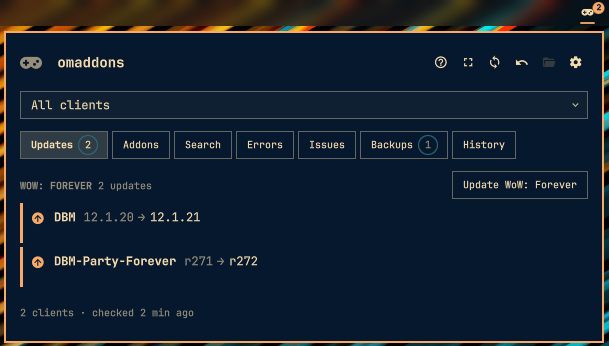
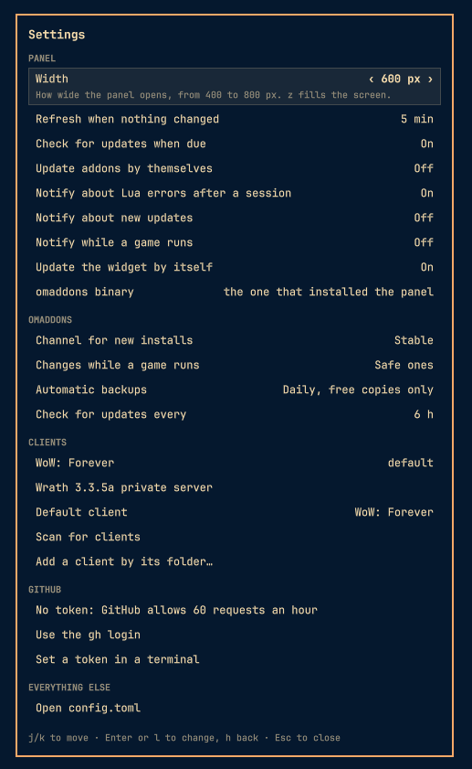
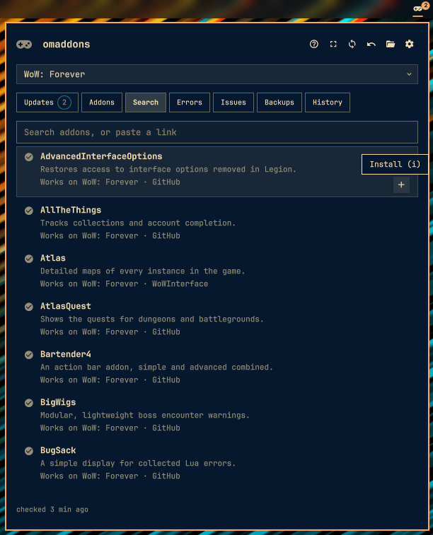
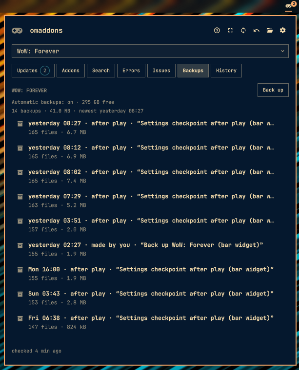

# omaddons

<div align="center">

**One binary that finds every World of Warcraft client on a Linux machine, installs only the addons each client will actually load, and can undo every change it makes.**


</div>

<table>
<tr>
<td valign="top" width="50%">


</td>
<td valign="top" width="50%">


</td>
</tr>
</table>

<sub>The [Omarchy bar widget](#omarchy): updates, search, backups and settings.</sub>

```text
$ omaddons status
Nothing needs doing
anniversary  tbc                                           2.5.6.70006   live  anniversary (battlenet)  0 addons · 0 unmanaged · 0 protected folders
classic      mists                                         5.5.4.70268   live  classic (battlenet)      0 addons · 0 unmanaged · 0 protected folders
era          Classic Era · Hardcore · Season of Discovery  1.15.9.70003  live  era (battlenet)          0 addons · 0 unmanaged · 0 protected folders
forever      forever                                       1.60.1.70245  live  forever (battlenet)      0 addons · 3 unmanaged · 0 protected folders · 3 adoptable
retail       mainline                                      12.1.5.70391  live  retail (battlenet)       2 addons in 2 folders · 0 unmanaged · 0 protected folders
wotlk        wrath-legacy                                  3.3.5.12340   live  localhost                0 addons · 0 unmanaged · 23 protected folders
Next: omaddons adopt -t forever
```

<sub>A test home laid out like the development machine, with five Battle.net clients in one Proton prefix and a 3.3.5a private-server client in another, found with no configuration. The output is trimmed, since `status` also prints a `backups:` line under each client and may recommend more than one next step.</sub>

<div align="center">
<h3>Install</h3>

```bash
mise use -g github:a44-io/omaddons     # prebuilt Linux x86_64 (on Omarchy: omarchy-mise-install github:a44-io/omaddons omaddons)

git clone https://github.com/a44-io/omaddons.git && cd omaddons
cargo install --locked --path .        # or from source
```

</div>

> [!NOTE]
> **Alpha.** Milestones 1 to 4 are done. The JSON contract froze at 1.0 with the first tag, `v0.1.0` (2026-11-08). The current release is `v0.2.1` (contract 1.1), and `main` is at contract 1.2 with the regression guard, to be released as 0.3.0. omaddons runs daily on the development machine, where every client it has managed has been seen in game loading the addons it installed. See [What works today](#what-works-today), [Limitations and known issues](#limitations-and-known-issues) and the [Roadmap](#roadmap).

---

## Contents

- [TL;DR](#tldr) · [What works today](#what-works-today) · [Design philosophy](#design-philosophy) · [How omaddons compares](#how-omaddons-compares)
- [Installation](#installation) · [Quick start](#quick-start)
- [Concepts: targets, families and load rules](#concepts-targets-families-and-load-rules) · [Sources and refs](#sources-and-refs) · [The built-in catalog](#the-built-in-catalog)
- [Command reference](#command-reference)
- [The JSON contract](#the-json-contract)
- [Safety model](#safety-model) · [Network and privacy](#network-and-privacy)
- [Configuration](#configuration) · [Files and state](#files-and-state)
- [Architecture](#architecture) · [Development](#development)
- [Troubleshooting](#troubleshooting) · [Limitations and known issues](#limitations-and-known-issues) · [Roadmap](#roadmap) · [FAQ](#faq)
- [For coding agents](#for-coding-agents) · [License](#license)

**Where the exhaustive detail lives.** This README explains what omaddons does and why, and states its guarantees. The field-by-field reference is generated from the code and printed by the binary, so it cannot drift: `omaddons help <command>` (every flag), `omaddons robot-docs schema <command>` (the JSON Schema of every command's `data`, every event and every file), `omaddons robot-docs errors` (every error and warning code with its `details`), `omaddons capabilities --json` (commands, limits, sources, rules rows) and `omaddons doctor explain <id>` (one failure mode in full).

---

## TL;DR

**The problem.** On Linux, World of Warcraft lives inside Wine prefixes: Battle.net under Proton or umu, Steam, Lutris, Heroic and Bottles each in their own, and a private-server client wherever it was unzipped. One machine can hold six clients, each with its own `Interface/AddOns`. Addon managers built for Windows want to be pointed at each folder and lean on CurseForge. Unzipping by hand installs builds the client never loads, half-replaces folders on failure, and cannot be undone. Coding agents get nothing they can parse.

**The solution.** omaddons finds every client with no configuration and reads its real version. It installs only what that client will load, because the client's own TOC rules are applied to the files inside the archive before anything is written. Every change is a journaled transaction, staged, swapped in atomically and recorded with its actor, argv and reason, and `omaddons undo` reverts it, SavedVariables included. Every command can answer with one JSON envelope, and every error in it names a fix, as a runnable argv whenever the fix is a command.

### Why use omaddons?

| Feature | What it does |
|---|---|
| **Zero-config discovery** | Reads Battle.net's `product.db`, `.build.info` and `.flavor.info`, the Lutris, Heroic, Steam and Bottles configs, and scans `~/Games` and `~/.wine`. Knows all 12 Battle.net WoW products and identifies private-server clients 1.12.1 to 5.4.8 from their executable. |
| **The game's rules decide** | TOC suffix precedence, `## Interface:` lists, `AllowLoadGameType`, family interface ranges, retail 12's floor and the legacy single-TOC rules, applied to what is inside the archive. A build the client never loads is never installed. |
| **Multi-flavor archives** | DBM and BigWigs ship retail-only modules beside their Classic ones. Folders the client would not load are skipped (`folders.skipped`), and a file labeled for other clients only is refused. |
| **Atomic, journaled changes** | Folders are staged on the same filesystem, then swapped in with `renameat2(RENAME_EXCHANGE)` under a journal. A crash leaves each folder wholly old or wholly new, and the next change finishes or rolls it back. |
| **Undo any change** | Each change snapshots what it replaces, so `undo` restores folders exactly and SavedVariables only where they changed. An undo is itself undoable, and `undo --last-by agent` reverts the last thing an agent did. |
| **Keyless** | Stable GitHub releases come from `release.json` without the REST API, git branches through GitHub's commits feed and codeload. WoWInterface, Tukui and WowAce need no key either. No account or token is needed for anything that works today. |
| **Safe around a running game** | Updates that keep the loaded TOC land while you play (`/reload`), a new addon asks for a restart, removing a loaded addon waits for the client to exit, and SavedVariables are never written while it runs. |
| **Verifiable privacy** | A hard host allowlist on every redirect hop, every request and git run logged locally (`omaddons net-log`), `--offline` refusing all network access, and no telemetry. |
| **Built for agents** | One `--json` envelope for success or failure, typed errors with fixes as argv arrays, documented exit codes, and actor and argv recorded on every change. `capabilities --json` and `robot-docs` describe the build offline, and a `--dry-run` stores a plan that `apply` runs exactly. |
| **A doctor that repairs** | `omaddons doctor` checks 32 failure modes with evidence and a fix for each finding. `doctor fix` repairs what its 11 fixers cover as one undoable transaction (a retention prune excepted, and forced repairs only with `--force --yes`). |
| **Settings backups** | Each client's `WTF/` is backed up before the day's first change and after play, cloned on btrfs and xfs so it takes no space at first. `backup restore` puts back all of it or one addon's settings, undoably. |
| **Lua errors, attributed** | `omaddons errors` reads BugGrabber on every client, names the likely source and how sure it is, marks new errors, and says whether an update may fix them. |
| **Regression guard** | A Lua error omaddons watched appear is tied to the change before it, with the way back (`skip --back`). A release you went back from stays skipped until you offer it again, and automatic updates (`update --auto`) wait for a release to settle. |
| **A bar widget** | On [Omarchy](https://omarchy.org), `omaddons omarchy install` puts a button on the bar that says what needs you, with a panel for everything above, by keys or mouse. Every action runs an omaddons command, so History and undo cover it. |

### Quick example

```bash
# Every client on the machine, no setup
omaddons status

# Preview, then install exactly what the preview showed (its plan id)
omaddons install dbm bigwigs -t retail --dry-run    # Plan 01M8Q2VA… stored for 24 hours
omaddons apply 01M8Q2VA

# Season of Discovery runs in the Classic Era client: -t sod selects it
omaddons install questie -t sod

# A 3.3.5a private server: a git branch, fetched without the git binary
omaddons install gbb -t wotlk

# Anything on GitHub: a pasted link works
omaddons install https://github.com/tullamods/OmniCC -t retail

# What changed, by whom, and take it back
omaddons history
omaddons undo

# Something wrong? The evidence and the fix, then the repair, previewed first
omaddons doctor
omaddons doctor fix --dry-run

# The same thing, for an agent
omaddons install plater -t forever --json --actor agent --reason "user asked for nameplates"
```

---

## What works today

Everything in this README describes code that exists and is tested, unless it is marked as planned. Where the code at HEAD is known to differ from it, [Known issues](#known-issues) says so.

| Area | State |
|---|---|
| Discovery (Battle.net, Steam, Lutris, Heroic, Bottles, custom clients) and the TOC load-rule engine for all 12 Battle.net products and five legacy versions | ✅ M1 |
| The transaction engine: plan, stage, journal, atomic swap, crash recovery, undo, retention | ✅ M1 |
| Keyless sources: GitHub releases, git, direct URLs, local zips and folders (M1), WoWInterface and Tukui (M2), and WowAce (M3) | ✅ |
| A catalog of 63 verified addons in 66 entries | ✅ M1 to M3 |
| `outdated`, `update`, `pin`, `adopt`, drift, dependencies, `sync`, `export`, `copy`, `search`, changelogs, `auth github` | ✅ M2 |
| `backup` of `WTF/` with automatic checkpoints, `errors` (BugGrabber), `status` as triage, the Omarchy bar widget | ✅ M3 |
| Stored plans, `apply`, `plans show` and `--if-match`, `capabilities`, `robot-docs` and completions, intent inference, the doctor, and the frozen contract with its golden and released baseline | ✅ M4 (`v0.1.0`, 2026-11-08) |
| The widget rebuilt user-first, its accessibility pass, opt-in automatic updates, sharing an addon set by clipboard | ✅ after `v0.1.0` |
| The widget as an ordinary Omarchy plugin in its own repository, added by `omarchy install` and no longer rendered by omaddons | 🚧 implemented on `main`, published to its repository with 0.3.0 |
| In-game load checks, in which retail, Mists Classic, Classic Era, Anniversary, WoW: Forever and 3.3.5a each wrote the SavedVariables of the addons omaddons installed | ✅ observed 2026-10-20 and 21 |
| Regression guard: `skip` and `unskip`, the errors ledger and the link from a new error to the change before it, `update --auto` (contract 1.2) | 🚧 implemented on `main`, and release 0.3.0 waits on its real-machine checkpoint |
| Optional CurseForge and Wago (bring your own key), an AUR package, a man page | 🗓️ M5 |

---

## Design philosophy

**1. The game's rules decide.** A host's flavor tags, a `release.json` and a file name order the candidates, but they never make a folder install that the client would not load. Each folder in the archive is judged by the TOC the client would load from it, under that client's rules row (suffixes, interface range, game types).

**2. Every change is a transaction.** There is one engine and one filesystem writer (`src/fsx/`). Every change stages its folders on the client's own filesystem, swaps them in under a journal and a lock held only for the commit window, and records the actor, the argv and the reason. A gate test fails if any `std::fs` write call appears outside `src/fsx/`.

**3. Keyless and private by default.** Everything that works today needs no account. The network is a closed allowlist of hosts, every request is logged locally, and `--offline` refuses all network access. CurseForge and Wago will be opt-in, bring your own credential, and their data will never be cached.

**4. The CLI is the product.** Humans read the terminal output, agents read the JSON envelope, and the Omarchy widget renders the same envelope without logic of its own. Commands never print. They return typed outcomes that one output layer renders, and clippy denies `print!`. Every error names its fix, either an argv an agent can run or a sentence when no command would help.

**5. Detection is data.** Products, the version-to-family table, interface ranges and client-rules rows are tables in `src/rules.rs`. Each can be patched from `config.toml`, so a new product code, a changed version range or load rule for a known family, or a misdetected private server needs no new release. A new family (an expansion line with its own `release.json` flavor) still does, because families are a closed set in code.

---

## How omaddons compares

| | **omaddons** | WowUp | CurseForge app | instawow | Unzip by hand |
|---|---|---|---|---|---|
| Interface | CLI + JSON | GUI (Electron) | GUI | CLI, optional GUI | File manager |
| Native on Linux | ✅ Linux only | ✅ | ✅ AppImage, .deb | ✅ | ✅ |
| Finds clients inside Wine/Proton, Steam, Lutris, Heroic and Bottles prefixes with no setup | ✅ | ⚠️ ¹ | ⚠️ ¹ | ⚠️ ¹ | ❌ |
| Supports private-server clients 1.12.1 to 5.4.8 | ✅ | ❌ | ❌ | ❌ | ⚠️ by hand |
| Checks the archive's TOCs against the client's load rules before writing | ✅ | ⚠️ host metadata | ⚠️ host metadata | ⚠️ host metadata | ❌ |
| Undo installs and removals byte for byte, SavedVariables included | ✅ | ❌ | ❌ | ⚠️ `rollback` of updates | ❌ |
| Settings (`WTF/`) backups and restore | ✅ automatic, whole or one addon's, undoable | ✅ by hand, whole | ❌ ² | ❌ | ⚠️ copy `WTF/` |
| Lua error triage: which addon, how often, whether an update may fix it | ✅ `errors`, every client | ❌ | ❌ | ❌ | ⚠️ BugSack in game |
| Update everything in one command | ✅ `update`, every client in one run | ✅ | ✅ | ✅ | ❌ |
| GitHub releases | ✅ keyless | ✅ | ❌ | ✅ | ⚠️ |
| WoWInterface, Tukui | ✅ keyless | ✅ | ❌ | ✅ | ⚠️ |
| CurseForge | 🗓️ M5, opt-in | ✅ WowUp-CF build | ✅ | ✅ | ⚠️ |
| Wago Addons | 🗓️ M5, opt-in | ✅ | ❌ | ✅ | ⚠️ |
| Documented machine contract for agents | ✅ | ❌ | ❌ | ❌ | ❌ |
| Ties new Lua errors to the update before them, with a way back | ✅ | ❌ | ❌ | ❌ | ❌ |

¹ They detect standard install locations, and other clients are added by pointing the app at their folder. ² The CurseForge app documents no settings backup. Compared from each project's own documentation as of October 2026. Corrections are welcome.

**Use omaddons when** you run several WoW clients on Linux (especially across prefixes, launchers or private servers), want every change reversible with SavedVariables included, drive addons from a coding agent or script, or want to know and limit which hosts are contacted.

**Use something else when** you depend on CurseForge-only or Wago-only addons today (the CurseForge app, WowUp), want a graphical app (WowUp, the CurseForge app, [strongbox](https://github.com/ogri-la/strongbox)), or play on Windows or macOS (omaddons is Linux only, by design).

---

## Installation

### Prebuilt (Linux x86_64)

Each [release](https://github.com/a44-io/omaddons/releases) has a stripped x86_64 binary (glibc 2.39+, as on Arch and Omarchy) and a `checksums.txt`. On Omarchy, install it as Omarchy installs CLI tools. The wrapper it writes in `~/.local/bin` installs the newest release and checks for newer ones.

```bash
omarchy-mise-install github:a44-io/omaddons omaddons   # or: mise use -g github:a44-io/omaddons
omaddons --version
```

Or download `omaddons-<version>-x86_64-unknown-linux-gnu.tar.gz`, check it with `sha256sum -c checksums.txt --ignore-missing`, and put `omaddons` on your `PATH`. There is no AUR package yet (M5).

### From source

It needs Linux (developed and tested on x86_64, and the dependency policy also covers aarch64) and [rustup](https://rustup.rs), which installs the pinned toolchain (Rust 1.97.1, `rust-toolchain.toml`) on the first build. `git` 2.32+ is optional, only for `git:` refs on hosts other than github.com (see [`git_hosts`](#configuration)).

```bash
git clone https://github.com/a44-io/omaddons.git && cd omaddons
cargo install --locked --path .          # into ~/.cargo/bin
omaddons --version                       # omaddons 0.2.1

cargo build --locked --release           # or build without installing
./target/release/omaddons status
```

The release profile is built for size (`opt-level = "s"`, fat LTO, one codegen unit, stripped), and the binary is about 15.8 MB with the catalog, the agent guide and every published JSON Schema embedded. A release rebuild takes about two and a half minutes.

For Claude Code, `omaddons robot-docs install-skill` installs the agent guide as a skill (see [`robot-docs`](#robot-docs)).

### Shell completions

`omaddons completions <SHELL>` prints a script for bash, zsh, fish, elvish or PowerShell, generated from this build's command tree. For bash, zsh and fish, `omaddons install-completions <SHELL>` writes it where that shell looks for your own completions (run it again after upgrading, and `--dry-run` says where first). To place a script yourself:

- **bash.** `omaddons completions bash > "${XDG_DATA_HOME:-$HOME/.local/share}/bash-completion/completions/omaddons"`, or without bash-completion, `source <(omaddons completions bash)` in `.bashrc`.
- **zsh.** `omaddons completions zsh > "$HOME/.zfunc/_omaddons"`, with `fpath=("$HOME/.zfunc" $fpath)` in `.zshrc` before `compinit`. Delete `~/.zcompdump` if a new script is not picked up.
- **fish.** `omaddons completions fish > "${XDG_CONFIG_HOME:-$HOME/.config}/fish/completions/omaddons.fish"`.
- **elvish.** `eval (omaddons completions elvish | slurp)` in `rc.elv`. **PowerShell.** `omaddons completions powershell | Out-String | Invoke-Expression` in `$PROFILE`.

Every shell completes commands, subcommands, aliases, flags and fixed values. In bash, zsh and fish, values from omaddons' own files complete too: client ids (`-t`, `copy --from`/`--to`, `targets`), managed addon names, stored plan ids, backup ids, transactions and run ids, doctor run ids and failure-mode ids. At each Tab the script runs `omaddons __complete`, a hidden reader of the registry, the discovery cache, the records, the plan store, the backup inventory and the history projection. It never scans, locks, writes or makes a request, so on a fresh install `-t` completes clients only once a plain `status` has found them.

### Uninstall

```bash
omaddons omarchy remove                # if you installed the bar widget
cargo uninstall omaddons
rm -rf ~/.config/omaddons ~/.local/state/omaddons ~/.cache/omaddons
rm -rf ~/.claude/skills/omaddons       # if you installed the agent skill (or the --dir folder)
rm -f ~/.local/share/bash-completion/completions/omaddons ~/.zfunc/_omaddons \
  ~/.config/fish/completions/omaddons.fish   # the scripts install-completions wrote, if any
```

Deleting the state directory loses the history and every undo snapshot. Each managed client also has an `Interface/.omaddons/` folder holding its identity marker, staging area, folder snapshots and `WTF/` backups. Deleting it loses them. The addons themselves stay where they are.

---

## Quick start

```bash
omaddons status                                        # 1. every client, its addons, running state, what needs attention
omaddons targets add /mnt/games/turtle --name turtle   # 2. add a client discovery missed (or: config set extra_roots '["/mnt/games"]')
omaddons targets default retail                        # 3. a default target, so install needs no -t
omaddons install dbm bigwigs --dry-run                 # 4. preview, then install
omaddons install dbm bigwigs
omaddons list -t retail                                # 5. check and, if needed, undo
omaddons history
omaddons undo
omaddons errors                                        # 6. optional: last session's Lua errors (omaddons install buggrabber captures them)
omaddons backup create -t retail                       #    back up a client's settings by hand
omaddons omarchy install                               #    on Omarchy, put the widget on your bar
```

### A whole session

Real output from a test home with a retail and a Classic Era client and two local addons (paths shortened to `~`). The installs come from a folder and a zip, so the session works offline.

```text
$ omaddons install ./HelloWorld ./Bar-2.1.0.zip -t retail --dry-run
retail: would install HelloWorld 1.0.0 (1 folder)
retail: would install Bar 2.1.0 (1 folder)

$ omaddons install ./HelloWorld ./Bar-2.1.0.zip -t retail --reason "set up retail UI"
retail: installed HelloWorld 1.0.0 (1 folder)
retail: installed Bar 2.1.0 (1 folder)
tx 01M59Z5RTVMBBHR4FKNZ3FN39K · undo: omaddons undo 01M59Z5RTVMBBHR4FKNZ3FN39K

$ omaddons list -t retail
retail (12.1.5.70391, mainline)
  Bar         2.1.0    file:~/Downloads/Bar-2.1.0.zip  stable
  HelloWorld  1.0.0    file:~/Downloads/HelloWorld     stable
  2 addons in 2 folders · 1 unmanaged · 1 protected · 0 linked folders

$ omaddons remove Bar -t retail --actor agent --reason "Bar conflicts with ElvUI"
warning: On retail, 01M59Z5RWG5MH458YF524HJPG5's snapshot holds the only copy of Bar: `omaddons undo 01M59Z5RWG5MH458YF524HJPG5` brings them back until retention prunes it (kept at least 24 hours; then pruned once 10 newer transactions on this client exist, after 7 days, or past the 2 GiB snapshot cap)
  fix: omaddons undo 01M59Z5RWG5MH458YF524HJPG5
retail: removed Bar 2.1.0 (1 folder)
tx 01M59Z5RWG5MH458YF524HJPG5 · undo: omaddons undo 01M59Z5RWG5MH458YF524HJPG5

$ omaddons undo --last-by agent --actor agent --reason "the user wants Bar back"
reverted 01M59Z5RWG5MH458… (remove by agent, 2026-10-19 06:36) on retail
restored 1 folder, removed 0 · SavedVariables: 0 restored, 0 unchanged
tx 01M59Z5RX2ECD3E5ZVXFYZPVH0 · undo this: omaddons undo 01M59Z5RX2ECD3E5ZVXFYZPVH0

$ omaddons history
01M59Z5RX2ECD3E5…  2026-10-19 06:36  agent  undo     retail  +1 ~0 -0  "the user wants Bar back"
01M59Z5RWG5MH458…  2026-10-19 06:36  agent  remove   retail  +0 ~0 -1  "Bar conflicts with ElvUI"
01M59Z5RTVMBBHR4…  2026-10-19 06:36  human  install  retail  +2 ~0 -0  "set up retail UI"
```

And here is what a refusal looks like.

```text
$ omaddons install ./EraOnly.zip -t retail
error[wrong_flavor]: file:~/Downloads/EraOnly.zip does not load on retail (Mainline)
fix: use an archive built for this client

$ omaddons install gh:o/oldthing -t retail
error[unmanaged_folder]: OldThing is not managed by omaddons
fix: omaddons adopt OldThing --ref gh:o/oldthing -t retail
  or: omaddons install gh:o/oldthing -t retail --force

$ omaddons install ./Bar-2.1.0.zip
error[target_ambiguous]: ./Bar-2.1.0.zip is compatible with 2 targets: era, retail
fix: omaddons install ./Bar-2.1.0.zip -t era
  or: omaddons install ./Bar-2.1.0.zip -t retail
```

---

## Concepts: targets, families and load rules

### Targets

A **target** is one WoW client, one flavor folder such as `_retail_`, with its own `Interface/AddOns` and `WTF/`. Each target has:

- an **id** you type with `-t`: `retail`, `era`, `forever`, `wotlk`.
- a **key**, a ULID assigned on registration that never changes.
- a **family** derived from the client's version, which picks its load rules.
- zero or more **game modes**. Classic Era, Hardcore and Season of Discovery all run in the Classic Era client and share its addons.

A target is **registered** on its first change (or with `targets add`, `rename` or `default`), which writes `<client>/Interface/.omaddons/target.json`, so a moved or renamed install keeps its identity. A copied install carries the same marker. The client at the registered directory keeps the key, and the other is reported as a copy (`target_key_duplicate`) and gets a new key on its first change. A second install of the same flavor gets a qualified id (`retail@steam`, `retail@lutris`, `retail@wine`, then `retail@steam-2`…). The first registered keeps the bare id.

### Where discovery looks

Discovery runs whenever a command needs the clients (not for `auth`, `config`, `net-log`, `help`, `completions`, `install-completions`, `robot-docs`, `capabilities`, `plans show` or a plain `targets rm`). Each walk goes at most 4 levels deep, and all the walks in one run share a budget of 50,000 directories (`discovery_truncated` when it runs out).

It first collects the Wine prefixes (directories containing `drive_c/`):

- those **launcher configs** name: Lutris (`games/*.yml`), Heroic (`GamesConfig/*.json`, its shared and per-game prefixes, sideloaded apps), Steam (the `compatdata/*/pfx` of every library in `libraryfolders.vdf`) and Bottles (every bottle, custom paths included), native and Flatpak (Steam also Snap).
- those of **running WoW and Battle.net processes** (their `WINEPREFIX`, your own processes only), when the prefix is under your home. A client in a nested prefix such as `~/Games/umu/umu-default` is found while it or the Battle.net app runs, and remembered after they exit.
- the **direct children of `~/Games`** that are prefixes, and **`~/.wine`**.

Then it looks for clients in this order. The first route that finds a client decides how it was found (`found_by`) and its qualifier:

1. **Battle.net's `product.db`** in every prefix (`drive_c/ProgramData/Battle.net/Agent/product.db`). Drive letters are mapped through `dosdevices/`, so a game on `D:` outside the prefix is found.
2. **Executables named by launcher configs**: Lutris's `exe:` lines, Heroic's sideloaded apps, Steam's non-Steam shortcuts (`shortcuts.vdf`).
3. **A walk of the `drive_c`** of each launcher-named and running-process prefix, skipping `windows`, `users` and `ProgramData`.
4. **`extra_roots`** from `config.toml`, and the roots of manually added targets.
5. **A walk of the `drive_c`** of each `~/Games` prefix and of `~/.wine`.
6. **A plain walk of `~/Games`** for clients outside any prefix.
7. **The roots of registered targets** no route above reached, while they are still WoW roots.
8. **Roots remembered** from a time a client or the Battle.net app ran, kept in `~/.cache/omaddons/discovery.json`.

A directory with `.build.info` is a **Battle.net root**. Each `_<flavor>_` folder in it becomes a target, identified by its `.flavor.info`, `product.db` or the folder table. A folder of another Blizzard game (Warcraft III's `_retail_` is product `w3`) is skipped. An unknown flavor folder `_xyz_` gets the id `xyz`, and counts as a test client when its folder or product name contains `ptr` or `beta`.

**An uninstalled client is no target.** Battle.net uninstalls a client by dropping its row from `.build.info` and deleting its files except `Interface/`, so the folder stays, holding `Interface/.omaddons/` and the AddOns. Such a folder is skipped only when it has no `.flavor.info`, no `.build.info` row names its product, it holds no `wow*.exe`, and `product.db` names neither it nor its product. Anything less certain stays a target. A registered client that was uninstalled, or whose directory is gone, is `missing` (attention `target_missing`, `fm-userland_state-target-vanished`), so `-t` naming it is `target_not_found` and nothing writes to it, except that `backup list` and `backup export` still reach its backups. Reinstalling it brings it back under its old id and key. `targets rm <id>` forgets it, and `--purge` also deletes what omaddons kept there.

A directory with `Interface/` and a `wow*.exe` is a **custom client**. Its version comes from the executable's PE version resource, and its label from `Data/<locale>/realmlist.wtf`, the root's `realmlist.wtf`, `realmList` in `WTF/Config.wtf`, then the directory name.

Parsed results are cached in `~/.cache/omaddons/discovery.json` and reused while a root's listing, route and stamped files, the rules and the omaddons version are unchanged. `targets --rescan` re-parses every root, and `status --cached` skips the scan entirely.

### Battle.net products

| Product code | Folder | Exe | Kind | Target id | Family (current version) | Game modes |
|---|---|---|---|---|---|---|
| `wow` | `_retail_` | WoW.exe | live | `retail` | mainline (12.x) | Retail |
| `wowt` | `_ptr_` | WoWT.exe | test | `ptr` | mainline | |
| `wowxptr` | `_xptr_` | WoWT.exe | test | `xptr` | mainline | |
| `wow_beta` | `_beta_` | WoWB.exe | test | `beta` | mainline | |
| `wow_classic` | `_classic_` | WoWClassic.exe | live | `classic` | mists (5.5.x) | Mists of Pandaria Classic (`mists-classic`, `mop`, `mop-classic`) |
| `wow_classic_ptr` | `_classic_ptr_` | WoWClassicT.exe | test | `classic-ptr` | mists | |
| `wow_classic_beta` | `_classic_beta_` | WowB.exe | test | `classic-beta` | forever (1.60.x) | |
| `wow_classic_era` | `_classic_era_` | WoWClassic.exe | live | `era` | vanilla (1.15.x) | Classic Era (`classic-era`), Hardcore (`hardcore`, `hc`), Season of Discovery (`sod`, `season-of-discovery`) |
| `wow_classic_era_ptr` | `_classic_era_ptr_` | WowClassicT.exe | test | `era-ptr` | tbc (2.5.x) | |
| `wow_anniversary` | `_anniversary_` | WoWClassic.exe | live | `anniversary` | tbc (2.5.x) | Burning Crusade Anniversary (`tbc-anniversary`, `bc-anniversary`) |
| `wow_classic_titan` | `_classic_titan_` | WoWClassic.exe | live | `titan` | titan (3.80.x, China) | |
| `wowf` | `_forever_` | Wow.exe | live | `forever` | forever (1.60.x) | WoW: Forever |

The product code does not decide the family, the version does (`wow_classic_era_ptr` runs TBC 2.5.x, `wow_classic_beta` runs Forever 1.60.x). An unknown flavor folder whose version cannot be read can receive installs only after you set its family (see [Per-target overrides](#per-target-overrides)).

### Private-server (legacy) clients

| Client version | Family | Default id | Load rules |
|---|---|---|---|
| 1.12.1 (Vanilla) | `vanilla-legacy` | `vanilla` | plain `<Folder>.toc` only, single interface number |
| 2.4.3 (TBC) | `tbc-legacy` | `tbc` | same |
| 3.3.5a (WotLK) | `wrath-legacy` | `wotlk` | same |
| 4.3.4 (Cataclysm) | `cata-legacy` | `cata` | same |
| 5.4.8 (MoP) | `mists-legacy` | `mists` | same |
| 1.16–1.49 (builds of the 1.12 client that stamp their own version, such as Turtle WoW 1.17 and 1.18) | `vanilla-legacy` | `vanilla` | same, interface 11200 |

Legacy clients are found by their executable (`wow.exe`, then `wow-64.exe`, then any `wow*.exe`) next to an `Interface/` folder. Other custom versions follow the modern rows (1.13–1.15 is `vanilla`, 1.50 and up `forever`, 3.4 `wrath`). A custom client with no readable version, or one no family covers (2.6, say), gets family `unknown` and the `fallback-custom` rules (the plain TOC only), and takes a slug of its directory name as its id.

### Families and interface ranges

| Family | Interface range | Clients |
|---|---|---|
| `mainline` | 60000 and up (120000 and up on 12.x clients, the [floor](#how-omaddons-decides-what-loads)) | retail, PTR, XPTR, beta |
| `vanilla` | 11300–14999 | Classic Era (with Hardcore and Season of Discovery) |
| `forever` | 15000–19999 | WoW: Forever and its beta |
| `tbc` | 20500–20599 | Anniversary, the Classic Era PTR |
| `wrath` | 30400–30499 | Wrath Classic (3.4.x, no live product today) |
| `titan` | 38000–38099 | Titan (China) |
| `cata` | 40400–40499 | Cataclysm Classic (4.4.x, no live product today) |
| `mists` | 50500–50599 | Mists Classic |
| `vanilla-legacy` | 11200–11299 | 1.12.1 private servers |
| `tbc-legacy` | 20400–20499 | 2.4.3 private servers |
| `wrath-legacy` | 30300–30399 | 3.3.5a private servers |
| `cata-legacy` | 40300–40399 | 4.3.4 private servers |
| `mists-legacy` | 50400–50499 | 5.4.8 private servers |
| `unknown` | the client's own major.minor | anything else |

A client's interface number is `major×10000 + minor×100 (+ patch on modern clients)`, so 12.1.5 is 120105 and 3.3.5a is 30300. A version rule can pin it instead (a custom 1.16–1.49 client is 11200), and on legacy clients `lastAddonVersion` in `WTF/Config.wtf` overrides either.

### Choosing a target with `-t`

`-t` (alias `--flavor`) accepts any of these. The first kind that matches wins:

1. a target **key** (ULID).
2. a target **id**: `retail`, `era`, `retail@steam`, `turtle`.
3. a **product code** such as `wow_classic_era`.
4. a **flavor folder** such as `_classic_era_`.
5. a **game mode** or alias: `sod`, `hardcore`, `mop`.
6. a **family**: `mainline`, `vanilla`, `wrath-legacy`.
7. a **path**: the install root, the client directory or its AddOns folder.

- **Several matches.** Every target the first matching kind matches is selected, so `-t mainline` reads every retail, PTR, XPTR and beta client in commands that cover several. A command that must land on one client (`install`, `remove`, each side of `copy`, `adopt --ref`, `history`, `undo`) refuses a selector that matches two with `target_ambiguous` (exit 3). The first candidate is the `fix`, each other an `alternatives` entry.
- **`-t all`** selects every client, test clients included, but on a command that lands on one client it is `target_ambiguous` unless there is only one. A target actually named `all` wins over the keyword, with `target_id_reserved`.
- **An id beats a family.** The legacy default ids `vanilla`, `tbc`, `cata` and `mists` are also family names, so with a 1.12.1 server present, `-t vanilla` selects it, not Classic Era. Use `-t era` and `-t classic` for the Battle.net clients, or rename the server's target.
- **No `-t`.** Only `install` picks a target on its own: config `default_target`, then the registry default (`targets default`), then the only live client. With several live clients and no default it dry-runs the refs against each and installs only if exactly one loads every ref that loads anywhere. Bare `undo` reverts the most recent run on every target. `remove` finds the target that manages the named addons.
- **A mistyped selector** is `target_not_found` (exit 3). When a client id, game mode or family here is within two edits (`retial`, `wtolk`), the fix is your own command with that word corrected. Nothing is corrected on its own, and product codes, folders, keys and paths are never guessed.
- **A client in the wrong place** (`omaddons retail update`, `omaddons remove dbm retail`) is a usage error whose fix moves it into `-t` and keeps your command. `install`, `update` and `remove` check their names before anything else, so nothing happens on another client first. A name that is an installed addon, a catalog name, a ref or a path is never moved.

### How omaddons decides what loads

For each top-level folder in the archive:

1. **Pick the TOC the client would load.** Candidates are `<Folder>.toc` and, on clients that support several TOCs, `<Folder>_<Suffix>.toc` or `<Folder>-<Suffix>.toc` (case-insensitive). Precedence follows the client's row (table below): its game suffixes in order, then its family suffix, then the plain TOC. A suffix the row does not list never loads. Legacy clients read the plain TOC only.
2. **Read its lines as the client does.** On current clients a `##` line may carry inline directives such as `[AllowLoadGameType classic]` and applies only on the clients they admit (the row field `directive_conditionals`). A directive that cannot be known offline (a text locale) counts for nothing. At most the first 128 MiB of a TOC is read (`TOC_MAX_BYTES`).
3. **Game types.** An `AllowLoadGameType` that excludes this client, or an `ExcludeLoadGameType` that names it, means the folder does not load. A game type names the client by one of its row's game types or its family suffix, lowercased (`classic` admits every Classic client, `mainline` retail and Forever). Legacy clients ignore game types.
4. **Interface.** Comma-separated `## Interface:` lists are read where the client supports them. Otherwise only the leading number counts. The folder loads if a value falls inside the client's family range, and an older one than the client's gets an `out_of_date` warning (it loads only with "Load out of date AddOns" enabled). A folder with no value in range is another client's, unless its `AllowLoadGameType` names one of the client's own row game types, which makes it `out_of_date` too. Whether a folder whose in-range values are all *newer* than the client's is out of date is unverified, and omaddons reports it current.
5. **The floor.** Retail 12.0 and later load no Mainline TOC below interface 120000, with no player override. On such a client a folder whose in-family values are all below 120000 is `wrong_flavor` (reason `below_client_floor`), never `out_of_date`. It is the row field `interface_floor`.

The rows, as built in (`[client_rules]` can patch them, see [Rules overrides](#rules-overrides-advanced)):

| Row | Clients | Versions | Game suffixes, in order | Family suffix | Game types |
|---|---|---|---|---|---|
| `mainline` | retail, PTR, XPTR, beta | 12.1.5 and up | `_Standard` | `_Mainline` | `standard` |
| `mainline-12.0.7`, `mainline-10.2.7`, `mainline-9.1` | older retail builds | 9.1.0–12.1.4 | | `_Mainline` | `standard` |
| `forever` | WoW: Forever and its beta | 1.50 and up | `_Forever`, `_Camelot` | `_Mainline` | `forever`, `camelot` |
| `vanilla` | Classic Era (Hardcore, Season of Discovery) | 1.13 and up | `_Vanilla` | `_Classic` | `vanilla` |
| `tbc` | Anniversary, the Classic Era PTR | 2.5 and up | `_TBC` | `_Classic` | `tbc` |
| `wrath` | Wrath Classic | 3.4 and up | `_Wrath` | `_Classic` | `wrath` |
| `titan` | Titan (China) | 3.80 and up | `_Wrath` | `_Classic` | `titan`, `wrath` |
| `cata` | Cataclysm Classic | 4.4 and up | `_Cata` | `_Classic` | `cata` |
| `mists` | Mists Classic | 5.5 and up | `_Mists` | `_Classic` | `mists` |
| the five `*-legacy` rows | 1.12.1, 2.4.3, 3.3.5a, 4.3.4 and 5.4.8 servers | | plain TOC only | | |
| `fallback-battlenet` | a Battle.net client no other row covers (usually family `unknown`) | | | `_Mainline`, `_Classic` | |
| `fallback-custom` | a custom client no other row covers (family `unknown`, or below its family's rows) | | plain TOC only | | |

omaddons installs what the author built for this client, and grades each download as a whole:

- **Clean.** The publisher's `release.json` declares this client for this very file, and folders the client would not load are skipped and listed in `folders.skipped` (how DBM's retail-only modules stay out of a Classic install). Or the addon's own folder loads and every skipped folder rules itself out.
- **Leaves folders out.** The addon's own folder loads, and the other skipped folders are built for other clients only. They are left out, each with a `folder_left_out` warning.
- **Refused** otherwise, when nothing loads or the addon's own folder does not.
- **The publisher's word against it.** A file whose `release.json` entries, or whose file name (`Foo-1.0-retail.zip`), name other clients only is refused even when its TOCs load, unless the addon's own folder carries a TOC named for this client at an interface in range (Raider.IO's `release.json` names mainline only, but `RaiderIO_Classic.toc` installs it on Mists Classic). Tukui's patch list and WoWInterface's tags are never evidence. [`--any-flavor`](#install-ref) overrides the publisher's word on one client.

Release metadata orders the candidates: assets whose metadata names this flavor, then a file-name hint for it, then unannotated assets, then hints for other flavors. Full builds come before `-nolib` builds. They are downloaded and verified in that order. The first clean one installs, else the first that leaves folders out, else the ref is refused with `no_compatible_release` and every asset tried in `error.details.tried` (`{asset, code, message}`). A `url:`, `file:` or `--file` archive is refused as `wrong_flavor`.

#### A release per client (GitHub look-back)

Some authors publish one GitHub release per client (VuhDo tags `v3.218-titan`, then `v3.217-mists`, then `v3.216-bcc`). When no candidate of a `gh:` addon's newest release installs on a client, and its `release.json` declares no build for it, omaddons looks back. It reads `releases.atom` (the 10 newest releases) and each older release's `release.json`, newest first, stopping at the first that declares the client, or after three in a row that declare the same other clients. The release found installs with an `older_release_for_client` warning, after one API request confirms it is no prerelease.

- **Remembered against the newest tag**, per client family, so `outdated`, `update`, `status` and `list` reuse it without a request until a new newest release.
- **Never a downgrade**, and never for a named release. `--version`, a pasted asset link and `--file` never look back.
- **An alpha series.** When every older release in the feed is prerelease-named, it probes the newest stable tag's siblings, which are its version with each suffix the feed uses.
- When the feed or API cannot be asked, the look-back stops and the refusal's `tried[]` says why, remembering nothing.

---

## Sources and refs

A **ref** names where an addon comes from. Everything that works today is keyless.

| You type | Source | Where the release comes from |
|---|---|---|
| `weakauras`, `dbm`, `bw` | catalog | [The built-in catalog](#the-built-in-catalog), by name or alias (case-insensitive), or an installed addon's name. Any other name is `not_found`, with `omaddons search <name>` as the fix |
| `gh:Owner/Repo`, `Owner/Repo`, `https://github.com/o/r` | GitHub | The stable path reads `releases/latest` and its `release.json` from github.com, with **no REST API calls**. The REST API (60 requests an hour without a token) is used only for `--channel beta`/`alpha`, releases without a usable `release.json`, a look-back's one confirmation, and `info`. A `/releases/tag/T` link pins tag `T`, `/releases/download/T/F` installs exactly asset `F`, `/tree/branch` becomes a `git:` ref |
| `git:https://github.com/o/r#branch` | git on GitHub | The commits Atom feed resolves the branch or tag to a commit, and codeload serves a zip of that exact commit. **No git binary.** No `#rev` means the default branch |
| `git:https://codeberg.org/o/r#tag` | git elsewhere | The `git` binary (2.32+), only for hosts listed in `git_hosts`: argv only, a cleared environment, an empty home, https only, no redirects and no credentials |
| `url:https://…/addon.zip` | direct download | Only from the always-allowed hosts (see [Network and privacy](#network-and-privacy)). Any other host is `host_blocked`. Its release is its URL, so it is never re-checked |
| `./addon.zip`, `./AddonFolder`, `file:path` | local | A zip (magic bytes checked) or a folder, read in place |
| `wowi:<id>`, WoWInterface links | WoWInterface | One `filedetails` request to `api.mmoui.com` per 50 addons, then the file from `cdn.wowinterface.com`, checked against the published MD5 (`download_unverified` without one). Only a project's current file is served |
| `tukui:<slug>`, Tukui links | Tukui | One list request to `api.tukui.org` per command, and a fresh download link that is never stored or logged. Checked against its `ETag` MD5 |
| `wowace:<slug>`, `#<tag>`, `#r<rev>`, `#r<rev>:<directory>`, WowAce links | WowAce | Its public Subversion repository at `repos.wowace.com`. One `PROPFIND` of `tags/` gives every tag's revision, the newest stable tag installs, and everything is fetched at one pinned revision. The tree is built as the WowAce packager would build a project needing only `package-as` and `@project-version@`. Anything more (`externals`, `ignore`, build keywords) is refused with `packaging_unsupported` |
| `cf:<id>`, `wago:<id>`, CurseForge and Wago links | | Refused with `source_disabled` (M5), unless `--file` supplies the archive for a `cf:` or `wago:` ref |
| another `https://` link | `git:` or `url:` | A link to a `git_hosts` host, or ending in `.git`, is a `git:` ref, and any other must be on an always-allowed host. `http://` is refused (`ref_invalid`) |

- **Channels.** `--channel stable|beta|alpha`. The default is the addon's recorded channel, then `default_channel`, then `stable`. On GitHub, `beta` and `alpha` both mean the newest non-draft release among the 20 most recent (through the REST API). Other sources publish one stream, so there the channel is only recorded.
- **Pinning.** `--version V` installs exactly that release and pins it: a tag for `gh:`, a rev for `git:`, a tag or `r<rev>` for `wowace:`. It is refused for `url:` and `file:` refs. A pasted release link pins its tag the same way. Installing a pinned addon again without `--version` changes nothing and warns `addon_pinned`.
- **A browser download.** `--file ZIP` (or an unpacked folder) installs an archive you downloaded as the release of one ref. `update` and `outdated` never replace it from upstream (`static`).
- **Same name, another ref.** An addon is installed from one ref at a time. Another ref over an installed addon is a takeover, refused with `ownership_conflict`, and the fix adds `--force` (undoable, with `ownership_transferred`). `gh:` and `git:` refs of one repository are different refs. `omaddons adopt <folder> --ref <ref>` re-points an addon in place.
- **Ambiguity.** `owner/repo` that also exists as a local path, or a bare name that names more than one ref, gives `ref_ambiguous` with every candidate as a runnable `omaddons install …` command.

---

## The built-in catalog

66 entries are embedded in the binary from [`catalog/catalog.toml`](catalog/catalog.toml). They are 62 addons with one entry each and BugGrabber's four builds, each checked against its publisher (its release, `release.json` or API, and the folders and TOCs of the file it hands out). `omaddons search --catalog` lists them offline, and `omaddons info <name>` shows one.

Each entry declares the **families** its publisher builds for. That list gives `search`'s `yes` or `no` and orders lookups (a dependency or adopted folder matches entries declaring the client's family first), but for a name without variants it never refuses an install. TOC verification decides.

**Variants.** One name can have a build per set of client families, so `omaddons install buggrabber` installs the newest WowAce tag on modern clients, trunk r152 on 3.3.5a, r130 on 2.4.3 and the 1.12-era tree at r43 on 1.12.1. A client no variant covers gets `not_found`, never another family's build.

**Your own entries.** Files in `~/.config/omaddons/catalog.d/*.toml` are applied in file-name order, in the same format. They can add an entry, replace one (whole, fields are not merged) or drop one with `remove = true`. An entry's keys are `name`, `variant`, `aliases`, `summary`, `ref`, `families`, `folders` and `notes`. Only `folders` makes an entry findable as a dependency or claimable by `adopt`. A file that does not parse or holds an invalid entry is skipped whole, with `catalog_override_invalid`.

```toml
# ~/.config/omaddons/catalog.d/mine.toml
schema_version = "1.0"

[[addon]]
name = "MyBars"
aliases = ["mb"]
summary = "My action bars, as I like them."
ref = "gh:example/MyBars"
families = ["mainline"]
folders = ["MyBars", "MyBars_Config"]

[[addon]]
name = "Dominos"
remove = true
```

---

## Command reference

61 command paths in three groups: **Look** (changes no addon), **Change** (preview any with `--dry-run`) and **Setup**. This section says what each does and the rules it keeps. `omaddons help <command>` has every flag in full and `omaddons robot-docs schema <command>` every field of its JSON.

Help comes at two depths. Bare `omaddons` (or `-h`) is one screen: the commands by group, where to start and the exit codes. `omaddons --help` (or `omaddons help`) adds every command's aliases and summary, every global option and the environment variables. Likewise `omaddons <command> -h` is the compact page and `--help` (or `omaddons help <command>`, `omaddons help targets add` for a subcommand) the whole one.

A mistyped command, flag or value is a usage error. Its fix is the corrected command when that command only reads, and `omaddons help <command>` when the closest command changes something, so a typo never hands you a different command that changes addons. A mistyped flag, or a value of a flag with fixed choices, is corrected in place (`--channel betaa` → `--channel beta`). Every suggested command parses.

### Global options

Every global option works before or after the command, except `-V`/`--version`, which works only before it.

| Option | Meaning |
|---|---|
| `--json`, `--robot` | One JSON envelope on stdout (see [The JSON contract](#the-json-contract)) |
| `--format json\|human` | Overrides `--json`. Default `human`, or `OMADDONS_FORMAT=json` |
| `-t, --target <TARGET>` (alias `--flavor`) | The client to act on, either [any selector](#choosing-a-target-with--t) or `all` |
| `--dry-run` | Show the plan without changing addons or settings. Every command accepts it, and one that changes nothing ignores it. On the storable commands it also stores the preview for 24 hours (see [Stored plans](#stored-plans)) |
| `--actor human\|agent\|widget` | Who is acting, recorded in history by every command that changes something. Default `OMADDONS_ACTOR`, else `human` when stdin is a terminal, else `agent`. In `history` it filters |
| `--reason <TEXT>` | Why, recorded verbatim in history (at most 200 characters) |
| `--offline` | Fail any network access (`OMADDONS_OFFLINE=1`) |
| `--while-running` | Allow folder changes while the client runs (never SavedVariables) |
| `--if-match <TOKEN>` | Change nothing unless the plan is still the one the `--dry-run` that returned this token showed. Only the binding commands take it (see [Previews, plans and `--if-match`](#previews-plans-and---if-match)) |
| `--no-color` | No ANSI color (also `NO_COLOR`). Color is also off with `--json`, in CI, with `TERM=dumb` and when stderr is not a terminal |
| `--quiet` | Only errors on stderr |
| `-v, --verbose` | `-v` adds detail fields to the output (paths, evidence, every list item) and `debug` events on stderr. `-vv` also adds `trace` events on stderr and never changes stdout. One before the command and one after count as `-v`, and more than two act as `-vv` |
| `--progress json\|human\|none`, `--no-progress` | Progress of long commands on stderr. Off with `--json`, in CI or when stderr is not a terminal, unless `--progress` names a mode |
| `-h, --help`, `-V, --version` | Help (`-h` compact, `--help` whole) and version |

### `status`

Triage. It shows every client with its addon and folder counts, what needs attention, and its issues, which are the doctor's cheap checks (every `cached` check of its [registry](#doctor) with `--cached`, and every `cached` and `quick` check without).

```bash
omaddons status               # scan, then report (managed files checked stat-first)
omaddons status --cached      # no scan: the cached clients, re-checked on disk (fast; the widget's view)
omaddons status --deep        # re-hash every managed file, not only those whose size or time changed
omaddons status --check       # exit 6 when anything needs attention, or a P0 or P1 issue exists
omaddons status -v --json     # adds client_dir, install_root and exe_name, and changed paths
```

Plain `status` writes one file, the discovery cache, when its scan finds a client changed, and `--cached` writes nothing. It never asks a source and never prunes. Each client shows:

- **`display_name`**, **`running`** (from `/proc`, and `null` with `running_unknown` when unreadable).
- **`updates`**, with pending counts (`available`, `pinned`, `skipped`, `blocked`, `failed`, `unchecked`, `too_new`) remembered from earlier `outdated`, `update` and `install` runs, and `stale` when the oldest check is older than `check_interval_hours`.
- **`drift`**, each managed addon whose files changed on disk (`modified`), whose folder is gone (`missing`) or that has no file index. Drift is never stored.
- **`adoptable`**, **`orphans`** and **`any_flavor_addons`** are unmanaged folders `adopt --apply` would take over, dependencies nothing requires any more, and addons installed under `--any-flavor`.
- **`errors`**, its Lua errors in [`errors`](#errors)' units, with `top_addons` and each one's `after_change` link. `--cached` opens no BugGrabber file and recounts the last `errors` run (`stale` or `unchecked` when it cannot).
- **`backups`** and **`undo_snapshots`**, its `WTF/` protection from the backup inventory, and what [retention](#retention) counts for it.

The JSON adds five keys to `data`:

- **`summary`**: `targets`, `running`, `updates` (with `auto_ready`, how many updates `update --auto` is expected to take now), `issues` (counts `p0` to `p3`), `check_due`, `errors`, `widget_outdated`, and `state`, the most pressing of `attention`, `errors`, `updates` and `idle`.
- **`issues`**, on each client and for the machine, are the doctor's findings as `omaddons doctor` gives them (`id`, `severity`, `title`, `remediation`, `auto_fixable`) plus `explain`. A check whose input could not be read is never reported clean.
- **`widget`** is the bar widget, read from its files with no subprocess (`installed`, `enabled`, `version`, `outdated`, `binary`, `doorbell_dir`).
- **`github`** says whether a token is configured and from where, but never gives the token.
- **`last_change`** and **`last_change_state`** say what bare `omaddons undo` would revert now, with its `undo` command.

Pending updates are never attention (`outdated --check` is the update check). A P0 or P1 issue fails `status --check` as attention does, but P2 and P3 never do. `commands` recommends the next steps: `install <addon> --reinstall` for modified or missing addons, `update`, `adopt -t <id>`, `outdated` when a check is stale, `errors`, `backup list` or `backup create`, `omarchy install` for an outdated widget, and `remove <orphans…>`.

### `install <REF>...`

Install or update addons in one target (`add` is an alias). Each ref is fetched once and verified against the target's TOC rules before anything is written, and all addons for a target go into one transaction. Re-running `install` on an installed addon updates it to the newest release its channel allows.

| Flag | Meaning |
|---|---|
| `--channel stable\|beta\|alpha` | Release channel (by default the recorded one, then `default_channel`, then stable) |
| `--version <V>` | Exactly this release, pinned, given as a tag for `gh:` or a rev for `git:` |
| `--file <ZIP>` | Use this downloaded archive as the release of the one given ref |
| `--reinstall` | Install the recorded release again, replacing its folders, which repairs modified or missing files (undoable) |
| `--force` | Take over another addon's folder or an addon of the same name from another ref, or replace an unmanaged folder (undoable until retention prunes the snapshot, and it warns `snapshot_only_copy`) |
| `--strict` | Exit 6 when only some of the addons install |
| `--refresh` | Fetch every release from its source, never from remembered metadata |
| `--no-deps` | Install only the named addons, not the ones their TOCs require |
| `--any-flavor`, `--no-any-flavor` | On this client, install builds the publisher did not make for it and keep doing so, or clear that |

```bash
omaddons install dbm bigwigs littlewigs -t retail
omaddons install questie -t hardcore
omaddons install gh:WeakAuras/WeakAuras2 --channel beta -t era
omaddons install gh:tullamods/Dominos --version 11.4.5 -t retail
omaddons install gh:someone/addon --file ~/Downloads/addon-1.2.zip -t retail
omaddons install Plater -t retail --reinstall   # put back modified or deleted files
```

- **Items.** Each item's `status` is `installed`, `updated`, `unchanged`, `skipped` (the same addon requested twice) or `failed`, or, when only its record changed, `pinned`, `unpinned` or `edited`. A partial result is still exit 0, with `partial: true` and each failure in `data.items[].error`, but with `--strict` it is exit 6. When every addon fails, the command fails with the first item's error and `error.details.items` lists them all.
- **Left alone.** `url:` refs are never re-checked, pinned addons stay where they are (`addon_pinned`), and a release [skipped](#skip-addon-and-unskip-addon) on that client is never installed without `--version` (`release_skipped`).
- **Reinstalling.** `--reinstall` installs the recorded release again, from the download cache when it is there (offline too), else that exact release fetched again, never a newer one. Pins and dependency reasons are kept.
- **Dependencies.** What an addon's TOC requires (`## Dependencies`, `## RequiredDeps`) installs in the same transaction when a keyless source ships it. The folder is looked up locally, never sent to a service: the catalog, the Tukui list, then the WoWInterface index. A dependency is recorded as `reason: dependency` with `required_by`, and `undo` removes it with its requester. `Blizzard_*` folders, folders of the same archive and folders already present install nothing, and `## OptionalDeps` never installs anything. A required folder that cannot be resolved warns `missing_dependency` and the run stays a success. The limits are 4 rounds and 32 dependencies per client.
- **Bound to a preview.** `--dry-run` returns `data.precondition` and stores a plan, and `--if-match <token>` (or `apply <plan_id>`) installs exactly what that preview showed, or nothing (`plan_stale`).

#### A build not made for this client: `--any-flavor`

Some addons the rules refuse still work (many small addons run unchanged everywhere while their TOC lists only retail). `omaddons install <ref> -t <id> --any-flavor` installs such a build on that one client and records the choice, kept by every later `update`, `sync` and reinstall until `--no-any-flavor` clears it. Under it the publisher's word against the file is ignored, and a folder whose TOC the client reads but whose interfaces are off its range installs as out of date. Still refused: a game-type gate (the author excluded this client), TOCs the client never reads, and retail 12's interface floor. Each install that needed it warns `any_flavor`. A refusal it would lift offers it among its `alternatives`, never as its fix. Agents use it only when the user asks for that addon on that client.

### `update [ADDON]...`

Every managed addon on every client, or only the named ones, to its newest compatible release. `upgrade` is an alias, and bare `update` is the same as `update --all`.

```text
$ omaddons update
classic: updated 1 addon (tx 01M5Q2VA0JX3N8K2…) — /reload in game
  DBM  12.1.14 → 12.1.15
era: nothing to update (Questie is pinned)
  Questie  skipped: is pinned
retail: updated 2 addons (tx 01M5Q2VA1KR4P9D6…)
  DBM     12.1.14 → 12.1.15
  Plater  Plater-v661 → Plater-v662
Undo all of it with: omaddons undo
```

```bash
omaddons update                     # everything, everywhere
omaddons update dbm plater -t retail
omaddons update dbm --channel beta  # switch to beta and install its newest release
omaddons update --dry-run           # what would change, per client
omaddons update --strict            # exit 6 when only some addons update
omaddons update --no-deps           # not what the new releases' TOCs start requiring
omaddons update --auto              # unattended: only releases this machine saw 6 hours ago or more
```

- **One run, one transaction per client.** `omaddons undo` reverts every client and `omaddons undo <tx>` one of them, and a failure on one client does not roll back another.
- **What to update** comes from the same statuses `outdated` shows, fetched once per ref (free inside 15 minutes, and `--refresh` asks again). A fetch that fails fails its addons (`update` never installs from stale metadata) and makes the run `partial`.
- **Left alone, saying why** (`skipped`, with `skip_reason`): `pinned`, `skipped_release`, `ahead`, `static` (a local file, a URL or `--file`), `unchecked`, `blocked` (a newer release that does not load on the client), and with `--auto` `too_new` and `dependency_held`.
- **New dependencies** a release starts requiring install in the same transaction, as `install` does.
- **Your edits** in an addon's folders do not stop `update`, `install` or `sync`. They are replaced, and a `local_changes_replaced` warning names them, with `omaddons undo <tx>` as its fix.
- There is no `--version` and no `--force`. A given version is an install (`install <addon> --version V` or `pin <addon> --version V`), and a takeover is `install <addon> --force`.

**`--auto`, an unattended update.** Every release the update would take must have been first seen by this machine at least `update_min_age_hours` ago (default 6, and 0 turns the wait off), so a broken release has time to be pulled before it reaches you. The wait counts from the [release memo](#files-and-state)'s first sight, never a source's publication date, and it applies to the release finally chosen, including one a look-back picked and each dependency a new release starts requiring. A held addon is `skipped`, either `too_new` with `auto_eligible_at` (`BigWigs  left at v412 · v413 is too new for an automatic update (after 00:52)`), or `dependency_held` when its new release needs one that is. The rest of the client updates, and a run where everything waits exits 0 and commits nothing. Nothing else waives the wait.

### `pin <ADDON>` and `unpin <ADDON>`

Hold an addon at its release through `update`, and let it go again.

```bash
omaddons pin dbm                     # every client that has DBM
omaddons pin dbm --version 12.1.14   # install that release where DBM is installed, then pin it
omaddons unpin dbm
```

A pin without `--version` changes only the record, never a game file, so it works while the game runs. It is a transaction (kind `pin`), one per client under one run, so `omaddons undo` reverts it. `pin --version` installs that release first, as `install --version` does. An addon installed nowhere is `not_managed`. After `unpin`, the last line says what `update` would install, from remembered metadata.

### `skip <ADDON>...` and `unskip <ADDON>...`

Pass over one release, and offer it again. A mark is a decision about one addon on one client, so `update` passes over the release it holds and installs the next one as usual.

```text
$ omaddons skip plater -t retail
retail: Plater Plater-v662 is skipped (installed: Plater-v661): update resumes at the next release (tx 01M9A2…)
undo: omaddons undo 01M9A2B3C4D5E6F7G8H9J0K1MN
$ omaddons unskip plater -t retail
retail: Plater Plater-v662 is offered again (tx 01M9A2…)
undo: omaddons undo 01M9A2C3D4E5F6G7H8J9K0M1NP
retail: `omaddons update Plater -t retail` installs Plater-v662
```

```bash
omaddons skip plater -t retail                      # the release waiting now
omaddons skip plater --release gh:Tercioo/Plater-Nameplates@Plater-v662 -t retail
omaddons skip dbm --version 12.2.0 -t retail        # every release labelled 12.2.0
omaddons unskip plater -t retail                    # every mark of Plater
omaddons unskip --tx 01M9A2B3C4D5E6F7G8H9J0K1MN     # exactly the marks one transaction made
omaddons skip dbm --back -t retail                  # back to the files installed before
omaddons skip dbm --back --tx 01M8Q2VA… -t retail   # back from exactly that transaction
omaddons skip dbm --back --to 12.1.20 -t retail     # back to a label, as the source serves it now
```

```text
$ omaddons skip dbm --back -t retail
DBM 12.1.22 → 12.1.21 on retail · the files installed before, from the local cache
12.1.22 is skipped: update passes over it and resumes at the next release
undo: omaddons undo 01M9B4C5D6E7F8G9H0J1K2M3NP
offer 12.1.22 again: omaddons unskip --tx 01M9B4C5D6E7F8G9H0J1K2M3NP -t retail
```

- **Plain `skip`** marks the release `outdated` remembers as waiting, by its exact key (its revision included where the source numbers revisions). It makes no request. With nothing waiting the addon is `unchanged`, and the output says why.
- **`--release ID`** (one addon) marks exactly that release, by its id as `outdated` and `list -v` print it (`gh:Owner/Repo@v6.2.5`), with `--revision N` where the source numbers revisions. **`--version V`** makes a label mark on every release whose version reads V.
- **`unskip`** clears every mark of the addons. With `--release`, `--version` or `--tx`, it clears only the marks that names. Its last line says what `update` would install now.
- **`--back`** (one addon on one client) goes back to the release before the installed one and marks the one it leaves, in one `update` transaction that keeps the pin and never touches SavedVariables. It installs **the very files** installed then, taking their archive from the local cache while it still hashes to the record, else from a source that can serve that release again and is held to its witness (GitHub by the archive's hash, WowAce by its revision, git by its commit, but WoWInterface and Tukui serve only their current file). It never falls back to a label. When those files cannot be had it changes nothing (`not_found` or `hash_mismatch`), and it is `plan_stale` when the addon has moved on. `--tx T` (what `errors` suggests) goes back along T's recorded change. **`--to V`** is the label form, for going further back, and goes to the release the source serves as V *now*.
- **Records only** (all but `--back`): a transaction of kind `skip`, no folder moves and no request, so it runs while the game runs, and `omaddons undo` reverts it. An addon keeps at most 256 marks, and no mark is ever dropped to make room.
- **What a mark does.** `outdated` shows the release as `skipped_release`, `update` leaves the addon where it is (`skip_reason: "skipped_release"`), `install` without `--version` is `unchanged` with `release_skipped`, and `status` counts it in `updates.skipped`. A newer release is an ordinary update. A mark is not copied to another client and not exported.
- **What else clears a mark.** An install that names that version (warning `skip_lifted`), re-pointing the addon (`adopt --ref`), the `skip`'s own undo, and the redo of an [`undo`](#undo-tx) that made the mark.
- **The result.** Items are `skip_marked` or `skip_cleared`, each client lists `skips_marked` or `skips_cleared`, and `commands` offers `unskip --tx <tx>`. A preview binds to the release it marks.

### `sync [FILE]`

Make every client match a desired-state file: `~/.config/omaddons/addons.toml`, or the file named, or, with `-`, the list on standard input.

```toml
schema_version = "1.0"

[family.mainline]                  # every live mainline client
addons = ["WeakAuras", "DBM", "gh:BigWigsMods/BigWigs"]

[[family.mainline.addon]]          # the table form, when an entry needs options
name = "Plater"
version = "Plater-v661"
pinned = true

[target."ptr"]                     # one client by id: the only way to reach a test client
addons = ["DBM"]
```

| Flag | Meaning |
|---|---|
| `--strict` | Exit 6 when only some of the addons sync |
| `--no-deps` | Install only the listed addons, not the ones their TOCs require |
| `--locked` | Install the version each entry records, from the download cache when it is still there |
| `--prune` | Also remove managed addons the file does not list |

- **The file.** A family section applies to every live client of that family, never to a test client. A `[target."<id>"]` section applies to that one client and its entries replace family entries for the same addon. An entry is a name or a ref, read as `install` reads its arguments. Table-form keys: `name`, `ref`, `channel`, `version`, `sha256`, `revision`, `pinned`, `dependency`, `any_flavor`. Unknown keys and sections naming no known client warn (`desired_unknown_key`, `desired_unknown_target`). A file that does not parse changes nothing (`desired_state_invalid`, exit 2, with the line).
- **What sync does.** It installs what is missing, installs a pinned entry's version, switches channels, and sets or clears pins to match. It never moves an installed addon to a newer release (that is `update`'s job), so a second `sync` changes nothing and sends no request. Each client with changes gets one `sync` transaction under one run.
- **`sync -`** reads the list from standard input, up to 64 KiB, and refuses a terminal. A dry run's stored plan keeps the text, so `apply` syncs exactly that list.
- **`--locked`** reproduces versions, not only refs. Run `omaddons export` on one machine, then `omaddons sync <file> --locked` on another. Every entry with a `version` installs that version. An entry's `sha256` pins the bytes, so only the archive with exactly those bytes installs, else the entry fails with `hash_mismatch` (`details.reason: "lock_mismatch"`). Entries with neither install the newest release, with one `not_locked` warning per client.
- **`--prune`** removes managed addons the file does not list, in the same transaction, keeping every addon an entry names or may name and everything a kept one requires. It touches only clients the file has a section for, and refuses a file with a section naming no known client (it could be a typo that empties one). An empty section removes every managed addon there, so try `--dry-run` first.
- **Bound to a preview.** The token covers the file's exact bytes, so editing even a comment makes the bound run stale.

### `export`

Write every client's addon set as one `addons.toml`, the file `sync` reads. It goes to stdout by default, or with `--write` to the config directory.

```bash
omaddons export > dotfiles/wow/addons.toml   # then, on another machine: omaddons sync dotfiles/wow/addons.toml
omaddons export -t vanilla                   # only these clients
omaddons export --write                      # ~/.config/omaddons/addons.toml, the previous file kept as addons.toml.bak
```

It reads only omaddons' records and makes no request. A family section holds what every live client of that family has alike, and the rest goes in each client's own section. Entries are tables sorted by name, with `version` (and `revision`, `sha256` while the archive is cached) so `sync --locked` can reproduce them. An addon installed from a local file or folder is left out (`export_local_source`). `--write` refuses a file changed since omaddons last wrote it unless `--overwrite`, and never writes an empty export.

### `copy`

Install one client's addons on another, where builds exist. Every addon installed explicitly on `--from`, or the ones named, goes to `--to` in one transaction.

```bash
omaddons copy --from era --to anniversary            # everything explicit
omaddons copy --from era --to anniversary Questie    # only the addons named
omaddons copy --from era --to anniversary --dry-run  # what would install, and what would be skipped
omaddons copy --from era --to anniversary --strict   # exit 6 when an addon fails (skips never count)
omaddons copy --from era --to anniversary --no-deps  # only the addons copied, not what their TOCs require there
```

Each side is exactly one client, and `-t` is a usage error. Each addon installs from its ref on its recorded channel as `install` would, taking the newest release that loads on `--to`, unpinned, since versions differ between flavors. Dependency records, skip marks and `--any-flavor` are not copied. Three kinds are skipped, never failed: one already on `--to` (`already_installed`), one from a local file or folder (`local_source`) and one with no build that loads there (`no_build_for_target`). A bound run's token covers the source client too.

### `remove <ADDON>...`

Remove managed addons from one target, as a transaction undoable until retention prunes its snapshot (`uninstall`, `rm` and `delete` are aliases). An addon is named by its name, its ref or a folder it owns.

```bash
omaddons remove DBM -t retail
omaddons remove gh:BigWigsMods/BigWigs -t era
```

- Unmanaged, linked and `Blizzard_*` folders, and names no managed addon answers to, are refused with `not_managed`. Without `-t`, the client is the one that manages the named addons.
- Removing what no source gives again (an addon adopted as it was, or installed from a local archive) warns `snapshot_only_copy`.
- An addon whose folders were all deleted by hand is forgotten, and its record goes, in a transaction that changes no folder.
- **Dependencies.** Removing an addon others still require goes ahead, with `still_required` naming them. A dependency nothing requires any more is an orphan, and `orphaned_dependency` names them all with one `omaddons remove <names…> -t <id>` as its fix. Orphans are never removed by themselves.

### `undo [TX]`

Revert what a command did, as new transactions, SavedVariables included (`revert` and `rollback` are aliases). A command that changes several clients commits one transaction per client under one run id. Bare `undo` reverts the most recent run, as a run of its own that a second `undo` reverts again.

| Flag / argument | Meaning |
|---|---|
| `TX` | One transaction, given as an id or a unique prefix of 8+ characters |
| `--run RUN` | Every transaction of one run, or with `-t`, only its transaction on that client |
| `-t TARGET` | The most recent transaction on that client only |
| `--last-by human\|agent\|widget` | This actor's most recent run (an undo counts too) |
| `--saved-variables auto\|restore\|keep` | `auto` (default) restores what changed, deferred while the game runs. `restore` refuses while it runs. `keep` never touches SavedVariables |

- **Conflicts.** Undoing the newest change never conflicts. An older one is `undo_conflict` when a later transaction touched the same folders (the fix names the newer one to undo first), when it was already undone, or when a folder it removed was put back by hand. A later transaction itself undone no longer counts.
- **An undone release stays away.** An undo that moves an addon back from one release to another marks the release it leaves [skipped](#skip-addon-and-unskip-addon) on that client (`origin: undo`), so `update` and the widget's automatic update pass over it until a newer release comes out. The redo (`undo` of the undo) puts the release back and clears the mark, and `commands` offers `unskip --tx <undo>` to clear it without redoing.
- **Not undone.** Settings changes and `backup` lines in [`history`](#history) are stepped over, and `undo <tx>` of one is `not_found`. Registry changes and `target.json` are not reverted.
- **A `WTF/` restore** is undone by one exchange that puts the previous tree back, never while the game runs, and it reverts all play since the restore (`data.changed_since`). Settings a restore put back are never overwritten in silence, so an older undo that would is `undo_conflict` (or pass `--saved-variables keep`).
- **A repair.** A `doctor fix` repair (`kind: repair`) is undone like any change, or by [`doctor undo <run>`](#doctor-diff-doctor-undo-and-doctor-gc). It is strict. A path not exactly as the repair left it is `undo_conflict` (`details.reason: "changed_since_repair"`) before anything moves, and a set-aside journal comes back only while nothing it depends on has changed (`changed_since_suspension`).
- **Unreadable history.** A newer history line this omaddons cannot read counts as touching whatever it may have, so undoing that is `undo_conflict` (`details.reason: "history_unreadable"`).
- **Bound to a preview.** `--dry-run` stores a plan naming the full transaction or run it resolved, even for bare `undo` or `--last-by`.

More in [Undo](#undo) under the safety model.

### `apply <PLAN_ID>`

Run exactly what a `--dry-run` stored, the plan its `data.plan_id` names. `apply` executes the plan's typed intent through its command's own code, bound to the plan's token, one transaction per client, as the preview showed or not at all.

```bash
omaddons install weakauras -t era --dry-run    # Plan 01M8Q2VA… stored for 24 hours
omaddons apply 01M8Q2VA                        # exactly that install, or plan_stale
omaddons apply 01M8Q2VA --dry-run              # check it against the world now; changes nothing
```

- **Which plan.** The full id or a unique prefix of 8+ characters. An unknown or unreadable one is `plan_not_found`, and a shared prefix is `ref_ambiguous`.
- **Refusals**, each a non-retryable `plan_stale` whose fix is the plan's command with `--dry-run`: `already_applied` (`details.txs`), `expired`, `binary_changed`, `input_missing`, or anything changed since the preview (`details.changed`).
- **Every source again.** `apply` checks every source the plan installs from, whatever the 15-minute window, so a release published since makes it `plan_stale`, never a different install.
- **One applier per plan.** A real `apply` holds the plan's lease. A second waits up to 30 seconds, then fails `locked`, or finds `already_applied`.
- **Per client.** `data.outcomes[]` reports each client: `committed` (with its `tx`), `unchanged`, `stale` or `failed`. A run over several clients is never called atomic.
- **History.** Each transaction records the plan's command line as its argv and the plan's id as `plan`. `--if-match`, `-t` and `--while-running` are usage errors. The plan carries its token, clients and policy.

### `backup`

Copies of each client's `WTF/`, which holds its settings, the data players actually lose. Bare `backup` is `backup list`. A backup is `<client>/Interface/.omaddons/backups/<id>/`: `backup.json` (what it is and proves), `manifest.json` (entry stats, and it stays on this machine), `addons.json` (each managed addon's name, folders, version and source) and the `WTF/` copy. Ids, in every `backup` command, are prefixes of 8+ characters.

```bash
omaddons backup create -t retail --reason "before the raid"
omaddons backup list
omaddons backup restore 01M6K2VA -t retail                    # the whole WTF/, undoable
omaddons backup restore 01M6K2VA -t retail --addon WeakAuras  # one addon's settings
omaddons backup prune --dry-run
omaddons backup export 01M6Q8PN /run/media/me/usb/retail-wtf.tar.zst
omaddons backup import /run/media/me/usb/retail-wtf.tar.zst -t retail
omaddons backup verify 01M6Q8PN -t retail
```

#### `backup create`

Backs up each selected client's `WTF/`, or without `-t`, every live client with one.

- **No lock while copying**, and a running client is backed up too (`client_running: true`).
- **Copy-on-write** on btrfs and xfs, taking no space at first, but elsewhere byte-copied (`backup_copied`).
- Each file is stamped before and after its copy and recopied if changed. `stable` means observed unchanged while copied, not a snapshot, and a second change leaves it `best_effort` (`backup_unsettled`).
- **Hashed only with `--verify`** (`integrity: verified`, `baseline: capture`). Otherwise the manifest holds each entry's path, kind, size, mode and mtime (`integrity: metadata_only`).
- **Owner only.** `backups/` and each backup `0700`, metadata `0600`.
- **`--auto`** makes the after-play checkpoint of [Automatic backups](#automatic-backups) instead, when due. A skip is a success with `skipped: {reason}`.

#### `backup list`

Newest capture first (`--limit N` keeps N per client), never walking or hashing a tree. Each backup says what it is and proves:

- `kind` is one of these: `manual`, `auto` (`trigger` `pre_change` or `post_session`), `before_restore`, `imported` or `recovered`.
- `consistency` is `stable` or `best_effort`, and `reflinked` is one of these: `all`, `some` or `none`.
- `integrity` is one of these: `metadata_only`, `verified` (with its `baseline` of `capture`, `import` or `later`) or `damaged`, never "verified" alone.
- `restorable`, `busy`, and `qualifying`. A qualifying backup is a whole, stable capture made here, counting as a checkpoint.

#### `backup restore`

Puts a client's whole `WTF/` back as a backup holds it (files and modes exactly) in one atomic exchange under the lock, undone by `omaddons undo <tx>`.

- **Refused before anything is copied.** A client running or maybe running (`game_running`, whatever `running_policy` or `--while-running` say), a backup not restorable or whose tree differs from its manifest (`state_corrupt`), and no atomic exchange of `WTF/` on its mount (`filesystem_unsupported`, no fallback).
- The current `WTF/` becomes a `before_restore` backup where the filesystem clones, else `before_restore_skipped` (the undo snapshot keeps the replaced tree).
- The staged copy is checked against the manifest, content too when the backup holds hashes. A mismatch is `hash_mismatch`, changes nothing, and records the backup `damaged`.
- **`--addon <name>`** (repeatable) puts back only that addon's SavedVariables (`<Folder>.lua` and `.lua.bak`, account-wide and per character) for the folders it had when the backup was taken, each file exchanged in place. `folder:<F>` names one folder alone.
- `--dry-run` stores a plan, and a play session before the bound run makes it `plan_stale`.

#### `backup prune`

Deletes old backups and cannot be undone. Without ids it runs the [retention](#retention) pass. `--keep N` also deletes beyond the newest N of each kind, `--older-than D` also manual, imported and recovered ones captured before then. Neither deletes one younger than a day, nor the client's newest checkpoint. Ids delete exactly those, but the newest checkpoint is refused. A backup being read is skipped into `busy_backups`. `--dry-run` stores a plan with the exact ids.

#### `backup export` and `backup import`

`omaddons backup export <ID> <FILE>` writes one backup as a `tar` compressed with zstd, mode 0600, with every file's SHA-256 in its manifest. One backup always exports to the same bytes. It is checked as it streams, never replaces an existing file (`file_exists`), and never writes inside a game client, a Wine prefix or omaddons' own folders (`scope_denied`). A client no longer installed is reached too, to keep a backup before [`targets rm --purge`](#targets-1).

`omaddons backup import <FILE> -t <id>` makes an export a new backup of kind `imported` (`integrity: verified`, `baseline: import`). It accepts **only an unmodified `backup export` file**. The archive is checked whole before a byte is written, and anything else is refused as `unsafe_archive`, `archive_too_large` or `bad_archive` with `details.reason`. Another family is `wrong_flavor` (alternative `--force`). With `omaddons export` and `sync --locked` for the addons, that moves or rebuilds a whole machine.

#### `backup verify`

Proves a backup's content, or records a baseline. Structure is checked first. A backup with hashes has every file hashed and compared, and one differing makes it `damaged`. One without hashes (automatic and plain `backup create` backups) gets them recorded now as a `later` baseline, which cannot prove the capture was intact, only that nothing changed after it.

### `history`

What changed, when, by whom and why, newest first (`log` is an alias).

```bash
omaddons history
omaddons history --limit 50 --since 2w
omaddons history --by agent --since 12h
omaddons history --run 01M51F4R2ZQX        # one run's transactions (a prefix of 8+ characters works)
omaddons history -t retail -v --json       # each folder operation (ops) instead of counts, and each addon's change (items)
```

- `--limit` defaults to 20, and `--since` takes `30m`, `12h`, `1d`, `2w` or an RFC 3339 time. An explicit `--actor` filters too (`OMADDONS_ACTOR` never does).
- Each line counts the folders added (`+`), replaced (`~`) and removed (`-`), and `=N` for folders recorded without moving. In JSON every line has its `run`, its `plan` (the [stored plan](#stored-plans) it was committed from, else `null`) and, for an undo, `reverts`.
- **Kinds.** Transactions are `install`, `update`, `remove`, `undo`, `pin`, `skip`, `adopt`, `sync`, `restore` and `repair`. Settings changes record a line too, with zero folder counts: `config`, `target`, `auth`, `export`, `dismiss` (`errors dismiss`), `widget` (`omarchy install` and `remove`), `skill` (`robot-docs install-skill`) and `backup`. `undo` steps over the settings lines. A dry run, or a change to nothing, records none.
- **`-v`** adds `items`, each line's ops grouped by addon, `{addon, change, folders, from_version, to_version, skips_marked, skips_cleared}`, where `change` is `installed`, `updated`, `reinstalled`, `removed`, `adopted`, `pinned`, `unpinned`, `skip_marked`, `skip_cleared`, `skip_changed`, `edited`, `settings_restored` or `reverted`. The versions come from the line itself (`transitions` in `history.jsonl`), so they outlive its undo snapshot.
- A line that cannot be written after the change warns `history_not_recorded`, and unreadable lines are skipped with `history_lines_skipped`.

### `plans show <PLAN_ID>`

What a stored plan approved, and whether history records it as applied. It is the answer for an `apply` whose output was lost (a broken pipe, a crashed agent). It reads the plan and a bounded tail of `history.jsonl` and never re-plans: no lock, request or write, so it is safe while anything runs.

```text
$ omaddons plans show 01M8Q2VA
plan 01M8Q2VA7K3N5P8R1T4W6X9Y0Z (update): partial, 1 of 2 clients committed
approved: omaddons update
  classic: would update DBM 12.1.14 → 12.1.15
  retail: would update DBM 12.1.14 → 12.1.15
committed:
  classic: tx 01M8T4XQ0000000… at 2026-10-30 18:05 · undo: omaddons undo 01M8T4XQ00000000000000000A
not recorded: retail
apply never resumes a partial plan; preview again for the rest: omaddons update --dry-run
```

`state` is `pending` (stored, unexpired, nothing committed), `completed` (committed on every approved client), `partial` (`apply` never resumes it, so preview again for the rest), `expired` or `unknown` (the file is gone or unreadable, history was cut by its bound, or an interrupted transaction may hold its commit). Only history lines carrying the plan's id count as applied. A plan whose file is gone is still found through history when it committed something. A `backup prune` plan is always `unknown`, since a prune writes no history line.

### `list`

The addons in each target's AddOns folder (`ls` is an alias).

```bash
omaddons list                              # every target: managed addons with version, ref, channel
omaddons list -t forever --unmanaged       # also unmanaged, shared, linked and invalid folders, with title, version and load verdict
omaddons list -t wotlk --protected         # also Blizzard_* folders
omaddons list -v                           # also each addon's drift (files changed on disk), with paths
omaddons list --deep                       # drift by content: every managed file re-hashed
```

`list` never asks a source. Each addon carries `latest`, the newest release remembered from earlier checks with its status as `outdated` would judge it (the column shows `→ <version>`, `(blocked)`, `(skipped)` or `check failed`), plus `reason` (`explicit` or `dependency`), `required_by`, `orphan`, `any_flavor` and `installed_at`. `-v` adds each addon's `skipped_releases`, folder names and `drift`. Under `--unmanaged`, each folder's load verdict is `compatible`, `out_of_date`, `wrong_flavor` or `no_toc`.

On a client whose AddOns directory another client shares (a symlink), a folder only the other client records is class `shared`. It is not this client's to adopt, install over or remove.

### `outdated`

Which managed addons have updates, on every client (or the clients `-t` names), without changing anything. `check` is an alias.

```text
$ omaddons outdated
classic (5.5.4, mists)
  Bar  v1  → v2  gh:o/bar
  Foo  v1  → v2  gh:o/foo
retail (12.1.5, mainline)
  Bar  v1  → v2
  Foo  v1  → v2
  Pin  v1  pinned (latest v2)
4 updates on 2 clients · 1 pinned · checked just now (3 requests, 0 reused)
Run `omaddons update` to install them.
```

```bash
omaddons outdated -v              # every addon, current, static and unchecked ones included
omaddons outdated --check         # exit 6 (check_failed) when any update is available
omaddons outdated --refresh       # ask every source now, even inside the 15-minute window
omaddons outdated --verify        # download and verify each update not yet known to load
omaddons outdated --changelog     # each update's release notes since the installed release
```

Each distinct ref and channel is fetched at most once, through the [release memo](#files-and-state). A check from the last 15 minutes is reused without a request. After that, a stable GitHub release is first probed with one `releases/latest` request (no API), and an unmoved tag keeps the remembered release. `--offline` answers from the memo whatever its age, with a `stale_check` warning. `outdated` writes only the release memo, the download cache and `net.log`.

| Status | Meaning |
|---|---|
| `update_available` | A newer release exists, and `confidence` is `verified` (a download proved it loads), `declared` (the publisher's metadata names this client), `likely` or `unlikely` |
| `pinned` | Pinned, and a newer release exists |
| `skipped_release` | The release `update` would install is [skipped](#skip-addon-and-unskip-addon) on this client. Decided after `pinned` and before `blocked`, and `--check` never counts it |
| `blocked` | The newest release is known not to load on this client (`verified_not_loading`), or targets an older interface than the adopted build installed (`older_than_installed`) |
| `ahead` | The installed release is newer than the newest one on its channel |
| `failed` | The source cannot answer for it, because of a fetch error or a deleted repository |
| `current`, `static`, `unchecked` | Shown with `-v` only |

When a fetch fails, a remembered answer is used and the warning says so (`data.stale_answers`). With nothing remembered, the item is `failed`. Either way the run is `partial`. Each item's `latest` carries `first_seen_at`, when this machine first saw that release, and each `update_available` item `auto_eligible_at`, when [`update --auto`](#update-addon) would take it (`BigWigs  v412  → v413  gh:BigWigsMods/BigWigs · first seen 18:52 · automatic updates take it after 00:52`).

`--changelog` puts the release notes under each update. They are the releases newer than the installed one, at most 10, each as plain text of at most 4,000 characters. GitHub's come from `releases.atom` (never the API), a `git:` ref's from commit titles, WoWInterface's from the release itself, Tukui's from its changelog page. WowAce, `url:` and `file:` have none.

### `adopt`

Bring folders installed by hand or by another manager under management, exactly as they are. Only records change, never a folder. Alone, `adopt` reports where each unmanaged folder comes from and whether it is exactly a release, and changes nothing.

```bash
omaddons adopt                    # every client: identify, then check against the newest releases
omaddons adopt -t retail --no-verify   # identify only: no download
omaddons adopt --refresh          # ask every source (and the WoWInterface index) now
omaddons adopt --apply            # adopt every exact and identified addon (never a guess)
omaddons adopt Bagnon -t retail   # adopt the addon this folder belongs to, a guess included
omaddons adopt Bagnon --ref wowi:25068   # say where it comes from (anything install accepts)
```

Each client's unmanaged folders are grouped into addons. The evidence, strongest first, is a [catalog](#the-built-in-catalog) entry that ships the folder for the client's family, then the TOC's `X-Tukui-ProjectID`, then `X-Website` (a GitHub repository, a WoWInterface page or a Tukui addon), then `X-WoWI-ID`, then a WoWInterface project listing the folder, when its name or author matches the TOC's, and last a name alone. Each group gets a tier:

| Tier | Meaning |
|---|---|
| `exact` | The folders are, file for file, what the newest release installs here |
| `identified` | Confident identification, not (or not yet) exact, and `reason` says why |
| `guess` | A name-only, contested or borrowed match, and other candidates are in `alternatives` |
| `cf_only` | Only a CurseForge or Wago id (those sources arrive in M5) |
| `unknown` | No evidence |

- **Adopting.** `--apply` adopts every `exact` and `identified` group. Folder names adopt the groups holding them, from `guess` up. `--ref R` (one folder on one client) decides where it comes from, or re-points an already managed addon to `R`. Each client gets one `adopt` transaction, allowed while the client runs. Undo forgets the records and leaves every folder.
- **Versions.** An `exact` group is recorded with its release, any other with its TOC's version, and `update` never replaces it with a release built for an older interface (`blocked`, `older_than_installed`).
- **Refusals** per folder: `not_found` (identified by nothing, so pass `--ref`), `source_disabled` (CurseForge or Wago only), `ref_ambiguous` (a guess with rivals), `ownership_conflict` (a managed addon's leftover, or `shared` with another client), `protected_folder` (`Blizzard_*`), `unmanaged_folder` (a symlink or not an addon folder).
- **Bound to a preview.** Folders are hashed before the lock and checked again under it. One whose content changed is `plan_stale`.

### `targets`

List the clients, or add, remove, rename and choose them.

```bash
omaddons targets                           # id, key, family or modes, version, kind, label, path
omaddons targets --rescan                  # ignore the discovery cache
omaddons targets add /mnt/games/turtle --name turtle   # a root, flavor folder, client dir, Interface or AddOns path
omaddons targets rename wotlk warmane
omaddons targets default retail            # install's default when -t is absent; config default_target still wins
omaddons targets rm warmane                # unregister; nothing in the client directory is touched
omaddons targets rm classic --purge --dry-run   # an uninstalled client: what a purge deletes
omaddons targets rm classic --purge --yes --if-match <token>   # delete exactly that preview
```

Each client carries `found_by`, the discovery route that reached it first: `product_db`, `launcher:<name>`, `process`, `extra_root`, `scan`, `manual`, `registered`, `remembered`, or `registry` for a registered client that is gone. An id you choose must match `^[a-z0-9][a-z0-9._-]*$`, be at most 32 characters, and not be a key, family name, product code or `all`.

**Purging an uninstalled client.** `targets rm <id> --purge` also deletes what omaddons kept for a client that is no longer installed: everything of its `Interface/.omaddons/` (backups, undo snapshots, the marker), the state halves of transactions that touched it alone, and its record. It never touches `Interface/AddOns/`, `history.jsonl` or another client's data. It works only for a client discovery no longer finds, previews first (`--dry-run` lists every deletion, each backup and the undos lost), needs `--yes` on a real run, and cannot be undone.

### `search <QUERY>...`

Find an addon by name, folder, author or description, across the catalog, the WoWInterface index, the Tukui list and GitHub's repository search, at once. `find` is an alias.

```text
$ omaddons search damage meter -t retail
  Recount Damage Meter   wowi:7000                    WoWInterface · 2.1M downloads · updated 2026 · retail: likely
  Details! Damage Meter  wowi:23056                   WoWInterface · 515k downloads · updated 2020 · retail: abandoned
  Skada                  gh:Skada-Damage-Meter/Skada  GitHub · ★412 · updated 2026 · retail: unknown
Install: omaddons install wowi:7000 -t retail        (a hint: install verifies each addon's TOC)
```

| Flag | Meaning |
|---|---|
| `--catalog` | Browse the [built-in catalog](#the-built-in-catalog) alone, offline, and the words become optional |
| `--source S` | Only this source (repeatable): `catalog`, `wowi`, `tukui` or `github` |
| `--limit N` | Most results (default 20, at most 50) |
| `--refresh` | Fetch the WoWInterface index and the Tukui list now, even inside their windows |

- **Ranking.** Exact names first, then names starting with the query, then every word in the name or folders, then every word anywhere. Within a rank, the catalog, then popularity, then the newest.
- **A hint per client.** Each result says whether it is likely to load on every selected client: `yes` or `no` from the catalog's families, `likely` or `unlikely` from Tukui's patches or the release memo, `likely` or `unknown` from WoWInterface's declared versions, `abandoned` for a WoWInterface project not updated in two years, `unknown` for GitHub. It is a hint, and `install` verifies every TOC.
- **Privacy.** Only GitHub receives what you search for, and the other lists are searched on this machine.
- A source not consulted is listed in `sources_skipped` (`offline`, `rate_limited`, `disabled`, `no_index`). `--offline` searches the catalog, the stored index and the remembered Tukui list.

### `errors`

Which addon most likely throws Lua errors, how often, since when, and whether an update may fix it, read from [BugGrabber](https://www.wowace.com/projects/bug-grabber)'s SavedVariables on every client, 3.3.5a included. It writes nothing but its memo and ledger in the cache.

```text
$ omaddons errors
retail (12.1.5.70391, mainline) · BugGrabber · 3 errors from 3 addons · 2 new
  DBM        7×  1 new  last 2026-11-13 20:14  likely source  current
    DBM-Core/DBM-Core.lua:4411: attempt to call a nil value
      appeared between 2026-11-13 15:40 and 2026-11-13 20:14, in the first session after update 01M8Q2VA3H7KQ2D9W4XB6FJNRT (2026-11-13 16:02)
      that update replaced DBM 12.1.21 → 12.1.22 · likely
      DBM-Core/DBM-Core.lua:4411: in function 'StartTimer'
  Foo        3×  1 new  last 2026-11-13 18:30  likely source  1.2 → 1.3 available (may fix it)
    Foo/core.lua:12: attempt to index a nil value (field 'db')
      already there when omaddons first read this file (2026-11-02 21:12): its age is unknown
      Foo/core.lua:12: in function 'Refresh'
  WeakAuras  57×  last 2026-10-15 17:30  likely source (custom code)
    [custom code]:4: attempt to perform arithmetic on a nil value
      [custom code]
      … (1 C frame)
      WeakAuras/WeakAuras.lua:4512: in function 'RunTrigger'
era (1.15.8.64907, vanilla) · no Lua errors are captured: BugGrabber is not installed
Update them: omaddons update Foo -t retail
Next: omaddons skip DBM --back --tx 01M8Q2VA3H7KQ2D9W4XB6FJNRT -t retail    # go back to 12.1.21, and pass over 12.1.22
Next: omaddons errors dismiss -t retail
Capture Lua errors: omaddons install buggrabber -t era
```

Under each new error, a line says when it began. DBM's appeared after omaddons last saw the file without it, in the first session after its update, so that update is named, graded, and offered with its way back. Foo's was already there when omaddons first read the file, so its age is unknown and no change is named for it.

| Flag | Meaning |
|---|---|
| `--since D` | Only errors seen since then: `30m`, `12h`, `1d`, `2w`, or an RFC 3339 time |
| `--addon A` | Only one addon's errors, by addon or folder name |
| `--limit N` | Addons shown per client (default 10) |
| `--received` | Also list the errors other players sent through BugSack, apart |
| `--raw-details` | Also show messages, locals and code as written (see Privacy below) |
| `--check` | Exit 6 when a client has new errors, or could not be read completely |

- **What it reads.** Each account's `!BugGrabber.lua`, and the file of every installed addon whose loaded TOC lists `BugGrabberDB` under `## SavedVariables`, within 32 account folders and 64 files per client, 256 MiB per run and 64 MiB per file. A file it could read only in part is reported with `errors_partial`. While a client runs, its errors since the last `/reload` are not on disk yet.
- **Attribution.** A stack shows where an error surfaced, not its cause, so the output says "likely source", never "caused by". An addon's own first frame wins over a library it embeds, a blocked call names the addon that made it, the client's taint report names the addon whose taint reached it, and WeakAuras custom code is "custom code". Each error carries `attribution.method` (`protected_call`, `taint`, `first_addon_frame`, `library_frame`, `blizzard_only` or `none`) and `attribution.confidence` (`high`, `medium`, `low`).
- **New errors.** "New" is decided per database (one file of one account). The first read marks the latest session's errors new. After that, errors from every later session stay new until `errors dismiss`. A file last written more than 7 days ago has no new errors.
- **When each began (`first_seen`).** Every run records what it read whole in the errors ledger. An error is `observed` when a complete read without it was followed by one with it ("appeared between … and …"). It is `baseline` when it was there at the first complete read, after the file was reset or put back, or while a file could not be read whole (its age unknown). It is `related` when an error of its shape was observed first, and `unknown` when no complete read vouched for its absence.
- **The change before it (`after_change`).** Each error omaddons watched appear is judged once, from history and BugGrabber's session numbers, for the change most plausibly before it, as evidence of order, never of cause. `relation` is `own` (it replaced the erroring addon), `in_stack`, `dependency` or `none`. `confidence` is `high` ("likely": its own change, the first session after, all known), `medium` ("possible") or `low` ("weak"). A missing fact only ever lowers a grade (`evidence.unknowns` names each), and a judgment is kept as made. A link acts on nothing.
- **What to do about it.** A `high` or `medium` link on a new error, whose addon is still at the release that change installed, carries its ways back in `after_change.commands`, best first: `omaddons update <addon>` when a newer release is out (the author's fix first), then `omaddons skip <addon> --back --tx <tx>` (action `rollback`) when the earlier files can be had again exactly, else `omaddons undo <tx>`. A `low` link never gets one.
- **Privacy.** An error's text shows only when it is one of Lua's or the client's own messages. Any other message, written by an addon, may hold a party member's name, so only its length shows (`message_kind: custom`). Code chunks show as `[custom code]`, paths relative to `AddOns/`, accounts as `account N`. `--raw-details` adds messages, stacks and locals with the names it recognizes replaced, warning that other names may remain. Errors other players sent are counted apart (`received`), and the sender's name is never kept.
- **Counts and filters.** Counts, `new`, the memo and `--check` come from every error read, but `--since`, `--addon` and `--limit` only shape what is listed, so a narrow read never makes a client look clean.

**`errors dismiss`** marks the errors read as seen, on every client or those `-t` selects. They stay listed but stop being new. Errors from a later session are new again. A database read only in part is never acknowledged. Dismissals live in the state directory (`errors_ack.json`), each is a history line of kind `dismiss`, and it cannot be undone. `--if-match <token>` takes an `errors` read's `dismiss.precondition`, so a dismissal acknowledges exactly what that read showed.

### `info <REF>`

What an addon is: what its source says of it and its project page, installed records on every target with the TOC each loads, the catalog entry, and the newest release (`show` is an alias).

```text
$ omaddons info weakauras
WeakAuras  gh:WeakAuras/WeakAuras2
  World of Warcraft addon that displays auras
  by WeakAuras · ★1k · updated 2026-10-28 · https://github.com/WeakAuras/WeakAuras2
  catalog: folders WeakAuras, WeakAurasArchive, WeakAurasModelPaths, WeakAurasOptions, WeakAurasTemplates · families vanilla, tbc, cata, mists, titan
  latest: 5.19.2 · likely to load on classic, era · not on retail
```

- **`about`** is `{summary, author, homepage, updated_at, popularity}` as the source describes the project (GitHub's repository description costs one REST request, remembered for a day). `homepage` is built from the ref alone, never from a TOC.
- **`latest.compat`** says, for each selected client, `verified`, `blocked`, `declared`, `likely` or `unlikely`. It is a hint, and `install` verifies every TOC.
- **Each installed record** carries `drift`, `reason`, `required_by`, `orphan`, `any_flavor`, `skipped_releases`, `left_out` (folders of the release this client does not load) and `toc`, the TOC its own folder loads on that client.
- **The newest release** comes through the release memo (15 minutes, `--refresh` checks again, and `--offline` answers from it whatever its age).
- **`--changelog`** adds the release notes of every release newer than the oldest one installed, as in `outdated --changelog`.
- **`--releases`** adds the source's recent releases, newest first (`--limit N`, 10 by default, at most 20), and `omaddons install <ref> --version <version>` installs any of them, pinned. It costs one request, made only when asked. WoWInterface, Tukui, `url:`, `git:` and local refs list only their latest.

### `doctor`

Every check of the failure-mode registry, reporting what is broken in what omaddons manages, with evidence and the exact remediation. Bare `doctor` is `doctor diagnose`. It changes nothing outside its run record in `~/.local/state/omaddons/doctor/`, takes no lock, and makes no request without `--online`.

| Flag | Meaning |
|---|---|
| `--only IDS`, `--skip IDS` | Only, or not, these checks, given as failure-mode ids or subsystem names, comma-separated (`--skip` wins) |
| `--severity P0`…`P3` | Only findings of that severity or more severe, and any check that could not finish |
| `--quick`, `--include-deep` | The cached and quick tiers only, or every tier (by default, every tier but `deep`) |
| `--online` | Also the network checks, else listed in `skipped` (`online_required`) |
| `--budget 500ms`, `2s` | The run's whole time, and a selection declared to cost more is refused before anything runs |
| `--since RUN` | Compare by instance key with an earlier run (its id, or `latest`): `new_instances`, `resolved_instances`, `unchanged` |

```text
$ omaddons doctor
omaddons doctor · 15 checks · 1 finding (1 P1) (7 checks skipped, 3 online checks skipped)
  P1 fm-configs-config-parse-error  machine · ~/.config/omaddons/config.toml
     config.toml does not parse (line 1, column 19)
     → fix line 1, column 19 of ~/.config/omaddons/config.toml; …
run 2026-10-30T20-45-20Z__01M678YN…
```

- **A finding** has its failure mode (`id`), `instance` (failure mode, client key or `machine`, and resource, stable across renames), `severity`, `subsystem`, `title`, `confidence`, `target`, `addon`, `evidence` (paths, digests, modes, counts, but never a file's content, nor a path below `WTF/`) and `remediation`: `command` and `argv` (`null` for advice), `explain_command`, `auto_fixable`, `needs_force` and `destructive`.
- **Never clean by default.** A check whose input could not be read is in `skipped` with its reason, and the unreadable file is a finding of its own. A check a limit stops, or that panics, is a `runtime` finding, and the run goes on.
- **Budgets.** Each check runs isolated, within 5 ms in the cached and quick tiers, 2 s in the others, and 20,000 entries for any walk.
- **Online checks** each send one logged request (purpose `doctor-probe`) with no retry or redirect. An answer the check cannot judge is never a pass.
- **The run directory**, `~/.local/state/omaddons/doctor/runs/<UTC time>__<ULID>/`, holds `report.json` and `runtime.jsonl`, read-only once the run ends, and `doctor/latest` links to the newest finished run. Apart from run ids and times, two runs over one state print the same.

**The failure modes.** The catalog is code (`src/doctor/registry.rs`) and holds 32 failure modes, 11 with a fixer. The `status` column says which [`status`](#status) reports as issues: `C` with or without `--cached`, `Q` only without, `never` for neither. `runtime` rows are raised by the run itself and cannot be selected. `omaddons doctor explain <id>` describes one in full.

| Id | Sev | Tier | `status` | What | Repair |
|---|---|---|---|---|---|
| `fm-concurrency_primitives-journal-pending` | P0 | cached | C | An interrupted change or repair that recovery can settle | delegates to omaddons' own recovery |
| `fm-concurrency_primitives-journal-too-new` | P0 | cached | C | An interrupted change a newer omaddons started | forced set-aside |
| `fm-concurrency_primitives-journal-unreadable` | P0 | cached | C | An interrupted change's journal cannot be read | forced set-aside |
| `fm-concurrency_primitives-journal-unexpected-state` | P0 | cached | C | An interrupted change to `WTF/` stopped at a state it cannot place | forced set-aside |
| `fm-concurrency_primitives-journal-step-unrecognized` | P0 | cached | C | An interrupted change stopped at a step in neither its before nor its after state | forced set-aside |
| `fm-concurrency_primitives-journal-marker-mismatch` | P0 | cached | C | An interrupted change names a client directory that is no longer its client's | forced set-aside |
| `fm-concurrency_primitives-journal-unattributed` | P0 | cached | C | An interrupted change cannot be attributed to any client, so every change is refused | forced set-aside |
| `fm-schemas-state-corrupt` | P0 | default | when its checks read the file | A state file cannot be read | restore or repair the file by hand |
| `fm-schemas-state-version-newer` | P0 | cached | C | State was written by a newer omaddons | upgrade omaddons |
| `fm-configs-config-parse-error` | P1 | cached | `status` itself fails | `config.toml` cannot be read | edit the file where the finding points |
| `fm-concurrency_primitives-journal-preservation-incomplete` | P1 | cached | C | An interrupted restore has not finished keeping the settings it displaced | delegates to recovery |
| `fm-state_files-record-folder-missing` | P1 | cached | C | A managed addon's folder is gone | `install --reinstall`, or `remove` |
| `fm-external_artifacts-ownership-conflict` | P1 | default | never | Several addons of one client's record claim one AddOns folder | `install --force` on the addon that should own it |
| `fm-network-credential-rejected` | P1 | default, online | never | GitHub answers 401 to the configured token, or the credential cannot be read | replace or clear the token at its source |
| `fm-state_files-detector-crashed` | P1 | runtime | C | A check stopped with an internal error | none |
| `fm-external_artifacts-managed-files-modified` | P2 | quick | Q | A managed addon's files changed on disk | `install --reinstall` |
| `fm-external_artifacts-ownership-transferred` | P2 | cached | C | Addons lost a folder to another addon | `list -v`, then reinstall or remove them |
| `fm-external_artifacts-case-collision` | P2 | default | never | AddOns entries' names differ only in case | advice |
| `fm-external_artifacts-wrong-flavor` | P2 | default | never | A managed addon's folder no longer loads on its client | `update` |
| `fm-userland_state-target-vanished` | P2 | cached | C | A registered client is gone or uninstalled | `targets rm` |
| `fm-concurrency_primitives-journal-waits-for-game` | P2 | cached | C | An interrupted change to `WTF/` waits for the game to exit | quit the game |
| `fm-concurrency_primitives-lock-held-long` | P2 | cached | C | A process has held the global lock over 10 minutes | advice |
| `fm-caches-blob-hash-mismatch` | P2 | deep | never | A cached download no longer hashes to its name | quarantines it |
| `fm-network-github-rate-limited` | P2 | default, online | never | 5 or fewer GitHub REST requests remain this hour | advice |
| `fm-network-source-unreachable` | P2 | default, online | never | An enabled source of an installed addon does not answer | advice |
| `fm-plugins-widget-invalid` | P2 | quick | Q | The installed bar widget fails Omarchy's plugin validation | Omarchy's plugin update, or `omarchy install` |
| `fm-secrets-credential-file-mode` | P2 | cached | C | A credential file other users can read | chmod 0600 |
| `fm-external_artifacts-out-of-date-toc` | P3 | default | never | A managed addon loads only as out of date | `update` |
| `fm-plugins-skill-version-drift` | P3 | cached | C | An installed agent skill holds another guide than this build's | `robot-docs install-skill` |
| `fm-plugins-widget-version-drift` | P3 | cached | C | The bar widget cannot serve this omaddons build | update the widget or omaddons |
| `fm-state_files-check-incomplete` | P3 | runtime | C | A check stopped at a limit or could not read an input | none |
| `fm-state_files-snapshots-past-retention` | P3 | quick | Q | A client keeps undo snapshots retention would prune now | delegates to retention (not undoable) |

The six stuck-journal rows (`journal-too-new` to `journal-unattributed`) are repaired only by a **forced set-aside** into quarantine that deletes nothing. The command is `doctor fix --only <id> [-t <id>] --force --yes`. Undo reactivates the journal only while nothing it depends on changed. The journal rows come from one read-only simulation of what recovery will do with each journal.

#### `doctor explain`

One failure mode in full, and its instances now. It changes nothing: no run directory, no lock, no request. The id is a failure-mode id or one instance's key as a report gives it (`<fm-id>@<target key or machine>[:<kind>=<value>]`).

```text
$ omaddons doctor explain fm-configs-config-parse-error
fm-configs-config-parse-error · P1 · configs · cached
config.toml cannot be read
  what: config.toml does not parse, holds a value out of range, is not UTF-8, is too large, or cannot be read.
  why:  Every change command fails closed with state_corrupt until it is fixed, and the doctor skips every check that depends on the configuration.
  repair: no automatic repair; edit config.toml where the finding points …
1 instance:
  machine · ~/.config/omaddons/config.toml
    → fix line 1, column 19 of ~/.config/omaddons/config.toml; omaddons never rewrites a config.toml that does not parse
```

#### `doctor fix`

Repair what a fixer can repair, as one transaction, after the same checks `doctor` makes. It takes `doctor`'s selection flags (not `--since`) and `-t`.

```bash
omaddons doctor fix --dry-run                       # what it would change, and its token
omaddons doctor fix --if-match pc1:…                # exactly that, or plan_stale
omaddons doctor fix --only fm-…                     # one failure mode's repair, even a disabled one
omaddons doctor fix --only fm-… --force --yes       # a forced repair: named, and consented to
```

- **Each finding falls in one group.** The groups are *planned* (an enabled fixer, or `--only` names it), *needs `--force --yes`* (a forced repair runs only with `--only <id> --force --yes`, never by default or from the bar widget), *disabled* (`--only <id>` runs it) and *manual* (`doctor explain <id>` says what to do).
- **Today's repairs.** They cover delegating interrupted changes to recovery and past-retention snapshots to retention, the forced set-aside of stuck journals, the quarantine of damaged cached archives, and the chmod of exposed credential files to 0600.
- **Preview, then bind.** `--dry-run` plans without the lock and lists every filesystem operation (`actions_planned`), every recovery it would finish (`delegated_planned`) and every prune (`prunes_planned`), with a `precondition`. `doctor fix --if-match <token>` plans again under the lock and compares before its first operation. `doctor fix` stores no plan.
- **The run.** Under the global lock: plan again, finish the disclosed recoveries, prune the listed snapshots, then repair as one journaled transaction. A failed operation rolls back every one before it. Its own operations never delete. What it sets aside goes to the run's `quarantine/`, and what it overwrites goes to `backups/`. It never writes below `WTF/`, `config.toml`, `addons.toml` or a SavedVariables file. A repair is a line of kind `repair` in `history`.
- **Refusals** before anything changes are `doctor_refused` (exit 4) with `details.reason`: `force_required`, `client_running`, `filesystem_mismatch`, `too_many_actions` (over 1,000), `fixer_conflict`. `--force` without `--yes` or without `--only` is a usage error. A fix never supplies consent.

#### `doctor diff`, `doctor undo` and `doctor gc`

```bash
omaddons doctor diff                # the plan of a default doctor fix --dry-run, and its token
omaddons doctor diff latest         # findings new, resolved and unchanged since the last run
omaddons doctor undo                # undo the newest repair still in effect (or: doctor undo <run>)
omaddons doctor gc --before 30d --dry-run                  # what would go, what stays and why
omaddons doctor gc --before 30d --yes --if-match pc1:…     # delete exactly what that preview listed
```

- **`doctor diff`** changes nothing.
- **`doctor undo`** is the same undo as [`omaddons undo <tx>`](#undo-tx), named by the doctor run that made the repair, with the same strict checks. It is idempotent, so a repair already undone is exit 0.
- **`doctor gc`** is the only command that deletes old doctor runs, the `.repair` client halves of repair transactions and the cache quarantines. It never deletes what an unfinished change still needs. Its plan keeps, in `exclusions`, anything pinned by an `unfinished_journal`, an `active_undo`, a `recovery_dependency` or an `active_run`, and lists the undos the deletion takes away (`lost_undos`). A real run needs `--yes`. The bar widget never runs it.

### `config`

Show or change `config.toml`. `set` edits the one value in place with `toml_edit`, keeping the file's comments and order, and validates the whole file before writing it.

```bash
omaddons config                                  # every key, its value, and "# default" where unset
omaddons config get running_policy
omaddons config set default_channel beta
omaddons config set git_hosts '["codeberg.org"]' # arrays and tables take TOML syntax
omaddons config set limits.snapshot_max_bytes 4GiB
omaddons config set 'client_rules."mainline-12.0.7".interface_floor' 120100 # quote a name with a dot, as TOML does
omaddons config path
```

A mistyped key is a usage error whose fix is the closest real key. See [Configuration](#configuration).

### `auth github`

The opt-in GitHub token. The main GitHub path (`releases/latest`, `release.json`, the feeds) needs none. A token raises GitHub's REST budget from 60 to 5,000 requests an hour (and search from 10 to 30 a minute) for the beta and alpha channels, repositories without a `release.json`, and `search`.

```bash
omaddons auth github                          # which token is used; online, the hour's REST budget left
echo "$TOKEN" | omaddons auth github set      # store a token: standard input only, never argv
omaddons auth github --from-gh                # store what `gh auth token` prints
omaddons auth github clear                    # forget the stored token
```

`set` writes `~/.config/omaddons/credentials/github` with mode 0600, in a 0700 directory. The token is never shown, logged or sent anywhere but `api.github.com`. A rejected token is `auth_rejected`, whose fix undoes the token's source. See **Tokens** under [Network and privacy](#network-and-privacy).

### `net-log`

Every network request and git subprocess omaddons made, with a summary by host and by `via` (`http` or `git`). A request whose line cannot be written fails, so nothing is contacted unlogged. It shows the 50 most recent (`--limit N`, `--since`), from `net.log` and its one rotated predecessor.

### `omarchy`

The bar widget for [Omarchy](https://omarchy.org)'s desktop. A gamepad button on every monitor's bar says what needs you, and its panel, by keys or mouse, updates, installs, repairs, backs up, restores and undoes. Everything it does is an omaddons command line, recorded with `--actor widget`, so its changes can be undone. The [screenshots at the top](#omaddons) show it.

The widget is its own repository, [a44-io/omaddons-omarchy](https://github.com/a44-io/omaddons-omarchy), and an ordinary Omarchy plugin (id `a44.omaddons`). Its source lives in this repository under `omarchy/` and is published to that repository with release 0.3.0. Until then, a development build installs it from a local export named by `OMADDONS_WIDGET_REPO`.

```bash
omaddons omarchy install                       # right section; then says how to move it and bind a key
omaddons omarchy install --section left        # a widget not yet on the bar goes left
omaddons omarchy install --no-enable           # add it, leave the bar as it is
omaddons omarchy                               # status
omaddons omarchy remove
omarchy plugin update a44.omaddons             # update the widget (Omarchy's own command)
mise upgrade github:a44-io/omaddons            # upgrade omaddons; the widget keeps working
```

- **`omarchy install`** adds the widget's repository through Omarchy (`omarchy-plugin-add https://github.com/a44-io/omaddons-omarchy.git --yes`, and `OMADDONS_WIDGET_REPO` names another URL or a local path), which clones and validates it into `~/.config/omarchy/plugins/a44.omaddons/`, then puts it on the bar (`omarchy-bar put`) unless `--no-enable`. omaddons never writes the widget's code. An existing checkout is left alone (`unchanged`), a widget an older omaddons rendered is moved out first (`replaced`), and files copied there by hand are refused (`file_exists`). `--offline` refuses an install that would clone. Run it from the desktop session.
- **`omarchy status`** says whether Omarchy is here and its shell runs, and describes the widget: `installed`, `enabled`, `section`, `version`, `checkout`, `commit`, `outdated`, `context_matches` and the plugin validator's verdict (`validation`). It writes nothing and makes no request.
- **`omarchy remove`** takes the widget off the bar (Omarchy then drops its bar settings), moves its folder out under the global lock and deletes it. `omarchy plugin remove a44.omaddons` removes it too, without a history line.
- **Versions.** The widget never reinstalls or replaces itself. It reads any omaddons whose contract is 1.x from the minimum its manifest names (`omaddons.contract_min`, 1.2), so upgrading omaddons needs nothing else. An omaddons older than that, or a later major, shows a read-only card with the command that fixes it, copied, never run.
- **A key.** Add `o.bind("SUPER + ALT + W", "WoW addons", { panel = "a44.omaddons" })` to `~/.config/hypr/bindings.lua`.

#### How the widget works

- **Seven views.** They are Updates, Addons, Search, Errors, Issues, Backups and History, each scoped to one client or All, with a page per addon, error, problem, backup and change.
- **The plan sheet.** Every update, install, reinstall, pasted addon list and destructive action first runs its command's dry run, storing a plan. Anything that is not a routine update exactly as its row showed opens a plan sheet listing every item and each effect the CLI's [approval summary](#the-approval-summary) names. Only a fresh key press confirms, running `omaddons apply <plan_id>` of exactly that plan. A stale plan runs nothing and the sheet returns with a new preview.
- **Refreshes.** It watches the [doorbell](#architecture) instead of polling, and reads `status --cached` when it rings. Hyprland's window events show a game's start and exit within a second. Opening the panel makes no network request.
- **After play**, a stopped client gets its post-session checkpoint (`backup create --auto`) and its Lua errors read.
- **Automatic updates** (`autoUpdate`, off by default). After a background check finds updates, while no client runs and no plan sheet is open, the widget previews [`update --auto`](#update-addon) and runs the plan only when it is exactly the Updates rows that have settled and needs nothing of you. A failure says so once and turns `autoUpdate` off.
- **Notifications** of new Lua errors and updates wait while a client runs and carry names and counts only.
- **Settings** (`,`). The panel's own (`panelWidth`, `refreshIntervalSec`, `autoCheck`, `autoUpdate`, `notifyErrors`, `notifyUpdates`, `notifyWhilePlaying`, `binary`, `keyHint`) live in Omarchy's `shell.json`, and omaddons' (`default_channel`, `running_policy`, `auto_backup`, `check_interval_hours`, `update_min_age_hours`, client names and families, the GitHub token's source) are read and set through `omaddons config`, `targets` and `auth github`.
- **IPC.** `omarchy-shell a44.omaddons state` prints the widget's state as one JSON object, and `refresh`, `check` and `show <view>` ask for a refresh, an update check, or the panel at a view.
- **Accessibility.** Every control has an accessible name and role, color never carries a state alone, text reaches 4.5:1 contrast on the supported themes, Esc leaves every layer, and with animations off, spinners stand still.

#### Keys and the mouse

The mouse does what the keys do. A click on a row acts as Enter, and nothing needs a double click. The keys, as the widget's own key map holds them (`omarchy/View.js`, `KEYMAP`, which also draws the key reference and every button's key hint, and a test keeps this table equal to it):

<!-- BEGIN KEYMAP: omarchy/View.js KEYMAP, row for row (tests/omarchy_widget.rs readme_key_table_is_the_keymap) -->
| Keys | Where | Does |
|---|---|---|
| `h` `l` `Left` `Right` | Anywhere | previous or next view (on a page, h goes back) |
| `1` `2` `3` `4` `5` `6` `7` | Anywhere | view 1 to 7: Updates, Addons, Search, Errors, Issues, Backups, History |
| `?` | Anywhere | this key reference |
| `,` | Anywhere | settings: the panel's, omaddons' and the clients' |
| `z` | Anywhere | fill the screen, and back |
| `Ctrl+=` `Ctrl+-` `Ctrl+0` | Anywhere | bigger or smaller text, and back to normal (or Ctrl+wheel) |
| `Esc` | Anywhere | back out one layer: a page, then a filter or a search, then the panel closes |
| `Tab` `Shift+Tab` | Anywhere | the bar's next or previous panel |
| `j` `k` `Down` `Up` | Every view | move the cursor |
| `g` `G` | Every view | first or last row |
| `PgUp` `PgDn` | Every view | a page up or down |
| `t` `T` | Every view | next or previous client (All, then each client on this computer) |
| `s` | Every view | Search, its box ready to type in |
| `c` | Every view | check for updates now |
| `U` | Every view | update everything on the chosen client, or on every client |
| `Ctrl+Z` | Every view | undo the last change, after a confirmation (in History and on a change's page, that change) |
| `o` | Every view | open the chosen client's AddOns folder (under All, the row's client) |
| `b` | Every view | back up the chosen client's settings now, or every client's |
| `d` | Every view | mark the new Lua errors shown as seen |
| `Enter` `Space` | Updates | open the addon's page |
| `u` | Updates | update this addon |
| `p` | Updates | pin or unpin it |
| `e` | Updates | show or hide the release notes since its version |
| `S` | Updates | skip the release waiting, or offer a skipped one again |
| `/` | Updates | filter the updates by name, source or state |
| `Enter` `Space` | Addons | open the addon's page |
| `u` | Addons | update this addon |
| `p` | Addons | pin or unpin it |
| `x` | Addons | remove it, after a confirmation |
| `r` | Addons | restore its settings from a backup |
| `/` | Addons | filter the list by name, source or state |
| `S` | Addons | sort by name, by recently updated, or by source |
| `y` | Addons | copy the chosen client's addon list (or every client's), to share it |
| `Ctrl+V` | Addons | paste an addon list someone shared: see what it would change, then apply it |
| `Enter` `Space` | Errors | show the addon's errors and their stacks |
| `u` | Errors | update the addon the errors come from, when one is waiting |
| `r` | Errors | restore the addon's settings from a backup |
| `y` | Errors | copy a report of its errors, to send its author |
| `Enter` `Space` | Issues | run the row's fix (a repair previews first), or read why |
| `e` | Issues | read why: the problem's page, with the doctor's explanation |
| `y` | Issues | copy the command a row shows, to run in a terminal |
| `Enter` `Space` | Backups | open this backup's page: the addon settings it holds, restore, delete |
| `r` | Backups | restore from this backup: choose what |
| `x` | Backups | delete this backup, after a confirmation |
| `Enter` `Space` | History | open the change's page: what it did on each client, and its undo |
| `/` | History | filter the changes by addon, client, who or reason |
| `Enter` `Space` | A page | run the page's main action: a problem's fix, on an addon page the client line's repair, update or install (on a release note, show all of it or fold it), on a change's page the cursored addon's page, on an error page the first way back from the change before it (Go back), or on a backup's page the cursored addon's settings back |
| `u` | A page | update the addon, when one is waiting (on an addon page, on the client line) |
| `i` | A page | an addon page: install it on the client line's client |
| `x` | A page | remove the addon from the client line's client, or delete a backup's page's backup, after a confirmation |
| `p` | A page | an addon page: pin or unpin it on the client line's client |
| `r` | A page | restore the addon's settings from a backup, or choose what to restore from a backup's page's backup |
| `w` | A page | an addon page: open its web page |
| `v` | A page | an addon page: its versions and channels on the client line's client (again: close them) |
| `y` | A page | copy an error page's report, a problem page's command, or an addon page's source |
| `Enter` `Space` | Search | open the result's page (a pasted link's: where it works, and Install) |
| `i` | Search | install the result where it works (under All, choose the client) |
| `Enter` | Search box | search now, and go to the results |
| `Down` `Up` | Search box | move the cursor in the results (the box keeps the keys) |
| `Esc` | Search box | leave the box (its text stays: Esc again clears the search) |
| `Down` `Up` | Filter box | move the cursor in the list (the box keeps the keys) |
| `Enter` | Filter box | go to the first match, and leave the box |
| `Esc` | Filter box | leave the box (the filter stays: Esc again clears it) |
| `Enter` | Path box | add the client in this folder |
| `Esc` | Path box | leave the box (its text stays: Esc again goes back) |
| `j` `k` `Down` `Up` | Problem card | move between the card's buttons |
| `Enter` `Space` | Problem card | press the button |
| `Esc` `n` `N` | Dialog | cancel, or go back a step |
| `j` `k` `Down` `Up` | Dialog | scroll a plan sheet, or move between a chooser's choices |
| `h` `l` `Left` `Right` `Tab` `Shift+Tab` | Dialog | move between Cancel and the confirm button, or change the setting under the cursor |
| `y` `Y` | Dialog | confirm a plan sheet |
| `Enter` `Space` | Dialog | the button, choice or setting under the cursor (a plan sheet starts on Cancel) |
| `?` `Esc` | Key reference | close the reference |
| `j` `k` `Down` `Up` | Key reference | scroll |
<!-- END KEYMAP -->

#### Safety rules

Every gate checks these (`omarchy/tests/security.test.js` scans the widget's source for code that goes around them, and each scan must catch a violation planted in a copy of the source):

- omaddons runs only with an argv from the widget's command table, or one the CLI printed that its classifier accepted, never through a shell or as a string.
- It runs `omaddons apply` only for the plan it just previewed, never from a fix or a recommendation.
- Besides omaddons it runs seven desktop tools, each with a fixed argv: `inotifywait`, `omarchy-notification-send`, `xdg-open`, `omarchy-launch-browser` (only an `https:` link to GitHub, WoWInterface, Tukui or WowAce), `wl-copy` (text on its standard input, never an argument), `wl-paste` (only to read a pasted addon list) and `omarchy-launch-config-editor`.
- Only a checked pasted addon list (plain text, at most 64 KB) goes to an omaddons child's standard input, to the preview of `sync -`. Nothing pasted runs before the plan sheet's Yes.
- It never gives consent: never `doctor gc`, `doctor undo`, or a command line holding `--force`, `--yes` or `--purge`. Its own repairs run bound to their preview (`doctor fix --only <id> --if-match <token>`).
- It sets no variable of a child's environment and writes no file, and `keyHint`, the one setting it changes itself, is saved through Omarchy's shell.
- While `status` reports an interrupted change, it runs none of its silent changes (the after-play checkpoint, an automatic update).
- It changes addons with no key pressed only for an automatic update.
- It shows the CLI's strings as plain text and decides nothing from a warning's text or an issue's id.

### `completions <SHELL>` and `install-completions <SHELL>`

`completions` prints a completion script for `bash`, `zsh`, `fish`, `elvish` or `powershell` on stdout and nothing else, the same bytes on every run. It reads no state and writes nothing. See [Shell completions](#shell-completions) for where each shell looks.

`install-completions` writes that script where bash, zsh or fish looks for your own completions:

| Shell | File |
|---|---|
| bash | `${XDG_DATA_HOME:-$HOME/.local/share}/bash-completion/completions/omaddons` |
| zsh | `$HOME/.zfunc/_omaddons` (add `fpath+=("$HOME/.zfunc")` to `.zshrc` before `compinit`) |
| fish | `${XDG_CONFIG_HOME:-$HOME/.config}/fish/completions/omaddons.fish` |

It writes one marker line first, and replaces only a file carrying that marker. A file it did not write is refused with `file_exists` unless `--force`, and a symlink is never written through (`scope_denied`). elvish and PowerShell load completions from `rc.elv` and `$PROFILE`, which omaddons never edits (`usage`). It records nothing: no history line, no lock, no request.

### `robot-docs`

Documentation for programs and agents, generated from the code, so it cannot drift from what the binary does. `guide`, `schema` and `errors` read no file or setting, need no `HOME`, send no request and change nothing.

```bash
omaddons robot-docs                           # the agent guide, as Markdown (same as robot-docs guide)
omaddons robot-docs schema --json             # every schema: envelope, events, commands, files
omaddons robot-docs schema backup restore     # one command's data, by its path
omaddons robot-docs errors --json             # every error and warning code
omaddons robot-docs install-skill             # the guide as a Claude Code skill
```

- **`guide`** is the agent guide, Markdown with YAML frontmatter, the same bytes as `skills/omaddons/SKILL.md` in this repository (a test holds them equal), under 500 lines and 32 KiB. The line after the frontmatter is the stamp `<!-- omaddons guide sha256:<hex> -->`.
- **`schema [COMMAND]`** gives the JSON Schema (draft 2020-12) of every command's `data`, the envelope, every stderr event and every file omaddons writes. The published schemas are open, so a validator built from them must accept keys a newer release adds. The binary prints schemas embedded at build time (see [The embedded schemas](#the-embedded-schemas)).
- **`errors`** lists every registered error code as `{code, exit, doctor_exit, retryable, meaning, details_schema, fix_pattern}` and every warning code as `{code, meaning, fix_pattern}`. `retryable` is `true`, `false` or `"conditional"` (each error's own `retryable` then says).
- **`install-skill`** writes the guide as `SKILL.md` into `$HOME/.claude/skills/omaddons/` (or `--dir`, any agent's skill folder). A hand-edited `SKILL.md` is kept beside it as `SKILL.md.bak` first, a symlinked one is never written through, and a folder inside a game client, a Wine prefix or omaddons' own folders is `scope_denied`. A run that writes records a settings line of kind `skill`. `omaddons doctor` reports a skill holding another guide (`fm-plugins-skill-version-drift`) and never rewrites it.

### `capabilities`

What this build can do, answered offline in a few milliseconds, and the first call an agent should make. Everything in it is generated from the code (the live command tree and the registries), with the values `config.toml` changes as they are in effect. It runs no discovery, request or credential command and writes nothing, and two runs over one config print the same bytes.

`data` holds `version`, `contract_version`, `build_id`, `guide_digest`, `features`, `commands` (every path with its group, `mutates`, `stores_plan`, `binds`, `network`, aliases, args, flags and the command that prints its schema), `exit_codes` (`general` and `doctor`), `env_vars`, `limits` (every limit and politeness constant, with the `config.toml` key that changes it), `sources`, `families`, `client_rules`, `target_id_forms`, `error_codes`, `warning_codes`, `actions`, `failure_modes` and `config_error`. Each value `config.toml` can change carries `source` (`config` or `builtin`). A broken `config.toml` does not fail the command. It exits 0 with the built-in values and `config_error`.

```text
$ omaddons capabilities
omaddons 0.2.1 · contract 1.2 · build e49d5dfe18e17d93
61 commands: look 18 · change 20 · setup 23 (omaddons help <command> for one)
…
43 error codes · 57 warning codes · 29 actions · 32 failure modes
--json for the full description
```

### `help [COMMAND]`

Bare help never runs an action, opens a pager or prompts. Its `Agents:` line is the discovery trio, each a command that changes nothing: `omaddons capabilities --json`, `omaddons robot-docs guide` and `omaddons doctor --json`. With `--json`, bare help's `data` is `{name, version, usage, commands, global_flags, exit_codes, discovery}` and `help <command>`'s is `{command, about, usage, args, flags}`, `command` being the canonical path (`install` for `help add`).

---

## The JSON contract

`--json` (or `--robot`, `--format json`, `OMADDONS_FORMAT=json`) makes every command print **exactly one JSON object on one line on stdout**, on success and on failure, including usage errors and panics. Keys always come in the same order.

### Success

```json
{"ok":true,"schema_version":"1.2","tool_version":"0.2.1","command":"install","exit_code":0,"partial":false,
 "data":{"dry_run":false,"target":{"id":"retail","key":"01M51EX04HHWM46XE9F2B9JXED"},"tx":"01M51EX645RCVFN6Z4ZV5GRWVS","kind":"install",
   "items":[{"request":"./Bar-2.1.0.zip","ref":"file:/home/me/src/Bar-2.1.0.zip","name":"Bar","status":"installed",
     "from_version":null,"to_version":"2.1.0","version_confidence":"toc","channel":"stable",
     "folders":{"added":["Bar"],"replaced":[],"removed":[],"skipped":[],"recorded":[]},"error":null,
     "reason":"explicit","required_by":[],"bridge_dependencies":[],"unresolved":[]}],
   "reload_required":"none","atomic_swap":true,"creates_addons_dir":false},
 "warnings":[],
 "commands":[{"action":"undo","command":"omaddons undo 01M51EX645RCVFN6Z4ZV5GRWVS","argv":["omaddons","undo","01M51EX645RCVFN6Z4ZV5GRWVS"],"destructive":true}],
 "meta":{"elapsed_ms":3,"offline":true}}
```

<sub>Wrapped for reading, but the real output is one line.</sub>

### Failure

```json
{"ok":false,"schema_version":"1.2","tool_version":"0.2.1","command":"install","exit_code":3,
 "error":{"code":"target_ambiguous","message":"./Bar-2.1.0.zip is compatible with 2 targets: era, retail",
   "fix":"omaddons install ./Bar-2.1.0.zip -t era","fix_argv":["omaddons","install","./Bar-2.1.0.zip","-t","era"],
   "alternatives":[{"display":"omaddons install ./Bar-2.1.0.zip -t retail","argv":["omaddons","install","./Bar-2.1.0.zip","-t","retail"]}],
   "retryable":false,"details":{"candidates":["era","retail"]}},
 "warnings":[],"commands":[],"meta":{"elapsed_ms":1,"offline":true}}
```

### Fields

| Field | Type | Meaning |
|---|---|---|
| `ok` | bool | `true` exactly when `exit_code` is 0 |
| `schema_version` | string | The contract's version, `"1.2"` (see [Stability](#stability)) |
| `tool_version` | string | The binary's version |
| `command` | string | The command's canonical path: `install`, `targets add`, `auth github`. A bare command that runs its default action names that action (`backup` is `backup list`). It is `help` for help, `version` for `--version`, and `omaddons` when no command could be read |
| `exit_code` | int | The process exit code |
| `partial` | bool | Success with some failed items (present on success and on `check_failed`) |
| `data` | object | The command's result (success, and `check_failed`) |
| `error` | object | `code`, `message`, `fix` (display string), `fix_argv` (argv array, or `null` when the fix is prose or needs a value only you can supply, shown as a `<placeholder>`), `alternatives` (`[{display, argv}]`), `retryable`, `details` (always an object) |
| `warnings` | array | `{code, message, fix, fix_argv, targets}`, and `targets` lists the ids of the clients a warning is about. On a partial run, each failed item is mirrored here |
| `commands` | array | Suggested next steps, `{action, command, argv, destructive}`. Confirm before running one that is `destructive`. The actions: `undo`, `undo_run`, `update`, `check_updates`, `adopt`, `adopt_folder`, `adopt_with_ref`, `install`, `search`, `info`, `reinstall`, `inspect`, `status`, `remove_orphans`, `list_unmanaged`, `forget_target`, `backup_create`, `refresh_backups`, `check_errors`, `dismiss_errors`, `install_buggrabber`, `reinstall_widget`, `enable_widget`, `apply` (first in every dry run that stored a plan), `doctor_explain`, `doctor_fix`, `install_skill`, `unskip` and `rollback` |
| `meta` | object | `elapsed_ms`, `offline` |

`check_failed` (exit 6) is the one failure that also carries `data` and `partial`, so `status --check --json` still returns the full status. On every other failure `commands` is empty, except a panic's, which can offer `undo`.

### Exit codes

| Exit | Name | Meaning |
|---|---|---|
| 0 | `ok` | Success, including partial success (`partial: true`, each failed item in `data`) |
| 1 | `failed` | Runtime failure: network, source, archive integrity, I/O, state, internal. `error.retryable` says whether to retry |
| 2 | `usage` | Unknown command or flag, bad argument, bad ref syntax, an unreadable `addons.toml` (`desired_state_invalid`) |
| 3 | `not_found` | Target, ref, addon, backup, run, plan or transaction not found, or ambiguous |
| 4 | `refused` | Safety refusal: running client, protected folder, ownership or case conflict, unsafe archive, wrong flavor, undo conflict, blocked host |
| 5 | `locked` | Another omaddons process held the lock past the 5-second timeout, and it is retryable |
| 6 | `check_failed` | An opt-in assertion failed: `status --check` (attention, or a P0 or P1 issue), `outdated --check` (an update is available), or `--strict` on `install`, `update`, `sync` and `copy` (a partial success). `data` is kept |

A panic still produces one `internal` envelope and exit 1, never Rust's 101 (exit 74 in the `doctor` tree). Its fix is `omaddons doctor`, and its `commands` offer `omaddons undo <tx>` for a transaction that committed before it.

### The doctor envelope and its exit codes

Every `doctor` command prints the same envelope keys in the same order, with two differences. There is **no `data` and no `partial`**. The report's own keys (`view`, `run_id`, `state`, `summary`, `findings` and the rest) sit at the top level, after `exit_code`. And **findings are not a failure**. `ok` is `true` only for exit 0, and `error` is there only when the run failed.

Every `doctor` command, usage errors included, exits by its own dictionary, in the BSD `sysexits` range for what is not a diagnosis:

| Exit | Name | Meaning |
|---|---|---|
| 0 | `healthy` | Every selected check completed and found nothing |
| 1 | `findings_present` | Completed with findings, a check that could not finish among them |
| 2 | `fix_partial` | `doctor fix` ran, but a failure mode it repaired is still found |
| 3 | `fix_failed_rolled_back` | `doctor fix` failed and was rolled back, so nothing changed |
| 4 | `refused_unsafe` | Refused before any change: safety precondition, missing `--force`, conflict, stale preview or over-budget selection |
| 5 | `concurrency_lost` | Another omaddons process held the lock past the acquire timeout |
| 6 | `online_required` | The selection needs the network, so add `--online` |
| 64 | `usage_error` | Unknown command or flag, or bad argument |
| 66 | `no_input` | Target, run, failure mode or other input not found, or ambiguous |
| 73 | `cannot_create` | Run directory could not be created |
| 74 | `io_error` | Runtime failure: I/O, state, network or internal |

Every error code has its doctor exit, from its general exit: 2 → 64, 3 → 66, 4 → 4, 5 → 5, 1 → 74, except `plan_stale` (4), `check_failed` (1) and `online_required` (6).

### Error and warning codes

`omaddons robot-docs errors --json` is the authoritative list, with each code's meaning, `details` schema and fix pattern. The tables below are an index, and `conditional` means each error's own `retryable` says.

<details>
<summary><strong>Every error code (43)</strong></summary>

| Code | Exit | Retryable | When |
|---|---|---|---|
| `usage` | 2 | no | A bad flag, value, config key or id, a missing or relative `HOME`, or a client named where a command or argument belongs |
| `ref_invalid` | 2 | no | Malformed ref: `gh:owner`, `git:` without https, `http://` |
| `desired_state_invalid` | 2 | no | `sync`'s `addons.toml` unreadable or invalid, or `export --write` refusing an edited file or an empty export |
| `target_not_found` | 3 | no | No target matches, or no client at all (fix `omaddons targets add <path>`) |
| `target_ambiguous` | 3 | no | Several targets fit, with one alternative per candidate |
| `ref_ambiguous` | 3 | no | A name matching several addons or a local path, or an id prefix matching several |
| `not_found` | 3 | no | An unknown name, path, tag, asset, transaction, run or backup id, a pruned snapshot, or nothing to undo |
| `not_managed` | 3 | no | `remove` of an unmanaged, linked or `Blizzard_*` folder, or a name no managed addon answers to |
| `plan_not_found` | 3 | no | A stored plan `apply` cannot find or read |
| `no_compatible_release` | 3 | no | No candidate loads on the client (`details.tried`), or the ref has no release to choose |
| `game_running` | 4 | no | The running policy refuses, or a SavedVariables write while the client runs (`details.reason`) |
| `protected_folder` | 4 | no | A change touching a `Blizzard_*` folder |
| `ownership_conflict` | 4 | no | Another addon owns the folder, and its fix appends `--force`, never across clients sharing an AddOns directory |
| `unmanaged_folder` | 4 | no | An unmanaged folder exists, and its fix adopts it, with `--force` as the alternative |
| `case_collision` | 4 | no | A folder name differing only in case from an existing one |
| `wrong_flavor` | 4 | no | A `url:`, `file:` or `--file` archive not loading on the client |
| `unsafe_archive` | 4 | no | Traversal, absolute paths, symlinks, devices, duplicates, ratio limit (`details.reason`), or a `backup import` archive that is not exactly an export |
| `archive_too_large` | 4 | no | Over an entry, size or download limit (`details.limit`, with `details.config_key` if `config.toml` can raise it) |
| `undo_conflict` | 4 | no | A later transaction touched the same folders, the change is already undone, or the newer history is unreadable |
| `host_blocked` | 4 | no | A request or redirect to a host off the allowlist, or a `git:` ref to a host not in `git_hosts` |
| `scope_denied` | 4 | no | The filesystem writer refused a path outside its scope, or a fenced or mismatched journal |
| `state_too_new` | 4 | no | A state file or journal from a newer omaddons, refused before anything is staged |
| `filesystem_unsupported` | 4 | no | A `WTF/` restore cannot run atomically on this client (`details.reason`) |
| `file_exists` | 4 | no | A file omaddons would create exists, never replaced |
| `locked` | 5 | yes | The lock held past 5 s, or a plan's lease held past 30 s (`details.holder`) |
| `check_failed` | 6 | no | `--check` or `--strict` |
| `network` | 1 | conditional | Connection failure, too many redirects, an unreadable source response |
| `rate_limited` | 1 | yes | GitHub REST budget exhausted, or any host's rate-limit answer (`details.reset_at`) |
| `download_failed` | 1 | no | git could not clone or fetch a `git:` ref on another host |
| `http_status` | 1 | conditional (5xx only) | Unexpected status (`details.status`) |
| `hash_mismatch` | 1 | conditional | Downloaded bytes, a backup's file or a cached archive not matching its hash, or a `sync --locked` lock mismatch |
| `plan_stale` | 1 | conditional (no under `--if-match` and from `apply`) | The target changed between plan and commit, a bound run no longer matches its preview (`details.changed`), or `apply` refuses a plan (`details.reason`) |
| `offline` | 1 | no | `--offline` blocked a request |
| `bad_archive` | 1 | no | Malformed, encrypted, or not Stored/Deflate |
| `distribution_disabled` | 1 | no | Reserved for CurseForge (M5) |
| `source_disabled` | 1 | no | A source off in `config.toml`, CurseForge or Wago refs (M5), or a `git:` ref when `git` is missing or older than 2.32 |
| `auth_required` | 1 | no | A configured or stored GitHub token is unusable |
| `auth_rejected` | 1 | no | GitHub answered 401 to the token, or a credential command failed |
| `state_corrupt` | 1 | no | An unreadable state or config file (with line and column), or a journal with unreadable lines |
| `io` | 1 | conditional | Filesystem error (`details.path`) |
| `internal` | 1 | no | Bug or panic, and the fix is `omaddons doctor` |
| `online_required` | 1 | no | A `doctor` selection of only checks needing the network, without `--online` (doctor exit 6) |
| `doctor_refused` | 4 | no | A `doctor` command refused before any change (`details.reason`) |

</details>

<details>
<summary><strong>Every warning code (57)</strong></summary>

| Code | Meaning |
|---|---|
| `journal_recovered` | An interrupted transaction was finished or rolled back |
| `delegated_recovery` | `doctor fix` finished an interrupted transaction through omaddons' own recovery |
| `journal_pending` | An interrupted transaction waits for the next change command, or one this omaddons cannot recover was left as is |
| `tx_in_progress` | Another omaddons process is committing |
| `atomic_swap_unavailable` | No `renameat2` exchange on the AddOns filesystem, so two journaled renames were used |
| `reload_required` | The client runs, so `/reload` or a restart is needed, and the fix says which |
| `saved_variables_deferred` | The game runs, so SavedVariables were left. Restore them later with the given command |
| `saved_variables_out_of_scope` | SavedVariables reached through a symlink outside the client, never snapshotted or written |
| `running_unknown` | `/proc` unreadable, so every client counts as running |
| `snapshot_cap_exceeded` | Protected snapshots alone exceed the size cap |
| `retention_failed` | Pruning failed after a commit or backup, but the change stands |
| `out_of_date` | The TOC's interface is older than the client's, so it loads only with "Load out of date AddOns" |
| `folder_left_out` | An install left out a folder built only for other clients |
| `any_flavor` | An addon installed under `--any-flavor` against its publisher's labels |
| `older_release_for_client` | An older GitHub release declaring this client was installed ([look-back](#a-release-per-client-github-look-back)) |
| `missing_dependency` | A folder an installed addon's TOC requires was not installed |
| `toc_comma_on_legacy` | A comma interface list on a client that reads only the first number |
| `client_not_launched_since_patch` | `Config.wtf` predates the client's current version |
| `widget_outdated` | The bar widget serving this state cannot serve this build |
| `state_version_older` | State migrates forward on the next write |
| `state_version_newer` | Writes refused until omaddons is upgraded |
| `config_unknown_key` | An unknown key in `config.toml`, with the closest valid key |
| `unknown_flavor` | An unrecognized flavor folder or custom client became a target without a family override |
| `discovery_truncated` | Discovery hit its directory budget, so add the client with `targets add` |
| `target_key_duplicate` | Two clients carry the same marker (a copied install) |
| `catalog_override_invalid` | A `catalog.d` file was skipped |
| `ownership_transferred` | `--force` moved a folder from one addon to another, or `sync --prune` replaced an addon from another source |
| `credential_file_mode` | A credential file readable by other users, and the fix is `chmod 600 <file>` |
| `addon_pinned` | A pinned addon left at its release |
| `release_skipped` | A release skipped on its client was passed over, and the fix offers that one release again |
| `skip_lifted` | A skipped release installed because a request named its version, so its mark is gone |
| `stale_check` | An answer from stored data, not the source now, and it names how old |
| `desired_unknown_key` | An `addons.toml` key omaddons does not know, ignored |
| `desired_unknown_target` | An `addons.toml` section naming no known client, so its entries are skipped |
| `adopt_name_changed` | An adopted addon's name was taken, so it is recorded as `<name> (<primary folder>)` |
| `export_missing_target` | In `export`, a registered client whose directory is gone, exported from its records |
| `export_local_source` | In `export`, an addon installed from a local file or folder, left out |
| `local_changes_replaced` | An install or update replaced files changed on disk, and the fix is `omaddons undo <tx>` |
| `snapshot_only_copy` | A transaction's snapshot holds the only copy of folders, and undo restores them until retention prunes it |
| `not_locked` | In `sync --locked`, entries without a version installed their newest release |
| `still_required` | A removed addon is required by addons that stay |
| `orphaned_dependency` | A remove, update or undo left dependencies required by nothing |
| `bridge_dependency` | A new addon's bridge or plugin folder works with an addon not installed |
| `target_addons_shared` | Clients share one AddOns directory, so a folder one records is `shared` on the others |
| `history_lines_skipped` | Unreadable `history.jsonl` lines skipped, neither listed nor undoable |
| `download_unverified` | A WoWInterface or Tukui file with no usable published hash, installed unchecked |
| `history_not_recorded` | A settings change or backup was made, but its history line could not be written |
| `backup_copied` | In `backup create`, files that could not be cloned were byte-copied |
| `backup_unsettled` | In `backup create`, `WTF/` changed while copied, twice, so the backup is `best_effort` |
| `backup_space_low` | In `backup create`, less than `limits.backup_min_free_mb` was free |
| `errors_partial` | In `errors`, a BugGrabber file was read only in part |
| `restore_rolled_back` | An interrupted `WTF/` restore rolled back, and what it displaced is kept as a `recovered` backup |
| `before_restore_skipped` | `backup restore` kept no `before_restore` backup, but the undo snapshot keeps the replaced tree |
| `auto_backup_failed` | The automatic backup before a change failed, but the change went ahead |
| `omarchy_shell_unreachable` | Omarchy's shell was unreachable, so the files changed but not the bar |
| `target_id_reserved` | `-t all` selected the client whose id is `all` |
| `plan_not_stored` | A dry run could not store its preview, but the preview and its token remain valid |

</details>

### Previews, plans and `--if-match`

A confirm dialog, or an agent that previews before it acts, must not run something other than what it showed. A `--dry-run` of a command that changes addons, or of a destructive command, returns `data.precondition`, a token describing exactly what the run would do and what it saw, and the real run with `--if-match <token>` does that, client by client, or nothing.

```bash
omaddons remove Foo -t retail --dry-run --json     # data.precondition: "pc1:…"
omaddons remove Foo -t retail --if-match pc1:…     # exactly that removal, or plan_stale
```

- **Binding commands.** They are `install`, `update`, `pin`, `unpin`, `skip`, `unskip`, `adopt` (when it adopts), `sync`, `copy`, `remove`, `undo`, `backup restore`, `backup prune`, `errors dismiss`, `doctor fix`, `doctor gc` and `targets rm`. `--if-match` anywhere else is a usage error.
- **Checked twice.** The real run plans again and computes the token from its own plan before it stages anything, then checks again inside the commit window, under the global lock and before it moves anything. It re-reads every folder the run replaces, removes, copies from or adopts, checks that every name it creates is still free and the client's marker unchanged, and requires the re-judged operations to equal the approved ones.
- **The refusal.** A difference is `plan_stale`, not retryable, and nothing is changed. `fix_argv` is the same command with `--dry-run`. `details.changed` names what differs: `command`, `targets` (a client's records changed), `selection` (the run would now change something else, such as a newer release) or `observed` (what the run saw changed: a file in a folder it replaces, the marker, a local input, the rules, the build).
- **What a token covers,** per client: the record generation, the folder operations and each release (release id, address, expected hash and archive digest), the content of every folder replaced or removed, every name created, the marker, local inputs, dependency resolution, the rules and the build. No human-readable text enters a token.
- **Releases between preview and run.** `install` and `copy` always ask their sources again, so a release published since makes the bound run stale. `update` and `sync` answer from releases remembered in the last 15 minutes, so inside that window a bound run installs exactly the previewed version.
- **Per client, not atomic across clients.** On each client a bound run commits exactly the previewed operations or none. A client changed after the run's own check is refused while others commit, making the run `partial`.
- **The limit of the guarantee.** Other omaddons processes are serialized by the global lock. There is no compare-and-swap against another program writing into `AddOns` in the last instant before a rename (Linux offers none), but the snapshot keeps what the run changed for `omaddons undo <tx>`.
- The token is `pc1:` and 64 hex digits. Nothing is stored. It holds as long as what it describes is unchanged, and it is no credential.

### Stored plans

The dry runs of `install`, `update`, `pin`, `unpin`, `skip`, `unskip`, `adopt` (when adopting), `sync`, `copy`, `remove`, `undo`, `backup restore` and `backup prune` keep the preview in the cache when it would change something. `data.plan_id` names it, `data.plan_expires_at` gives its expiry, and `data.approval` describes what it covers. The human output ends with `Plan <id> stored for 24 hours. Run exactly this: omaddons apply <id>`, and `commands[]` starts with that `apply`, so an agent that takes `commands[0]` after a preview runs exactly that preview.

Each plan lasts 24 hours. The store holds at most 512 plans and 32 MiB, each plan at most 256 KiB. Admission clears expired plans, never evicts a live one, and declines a plan over a quota. `plan_id` then stays `null`, with one `plan_not_stored` warning, and the preview and its token stand. If an `apply`'s output is lost, [`plans show`](#plans-show-plan_id) says from history alone whether it committed.

### The approval summary

`data.approval` is a typed summary of a dry run, `{routine, reasons, selection, scope}`. `routine` is true exactly when `reasons` is empty. Each reason describes an effect that calls for review:

| Reason | Effect |
|---|---|
| `dependency_added` | Adds an addon because another addon requires it |
| `folders_removed` | Removes folders |
| `local_changes_replaced` | Replaces files changed by hand |
| `source_changed` | Takes an installed addon from another source |
| `channel_changed` | Changes an installed addon's release channel |
| `while_running` | Overrides the running-client policy |
| `reinstall` | Reinstalls the recorded release |
| `force` | Allows an ownership takeover or replacement of an unmanaged folder |
| `downgrade` | Installs an older version |
| `destructive` | Removes addons, undoes a change, restores settings or prunes backups |

`selection` lists each change (`target_id`, `addon`, `source`, `channel`, `release_id`, `asset`, `from_version`, `to_version`, `op`, …), where `op` is `install`, `update`, `remove`, `adopt`, `edit`, `undo`, `restore` or `prune`. `scope` describes effects beyond those items: `dependencies_added`, `folders_removed`, `local_changes_replaced`, `source_changed` and `while_running`. The bar widget's plan sheet is drawn from it.

### stderr events

When stderr is not a terminal, or `CI` is set, or `TERM=dumb`, stderr carries NDJSON events. Otherwise it carries human text.

```json
{"event":"error","code":"source_disabled","message":"cf:61284: CurseForge arrives in M5","fix":"omaddons help install","fix_argv":["omaddons","help","install"],"retryable":false,"exit_code":1}
{"event":"warning","code":"reload_required","message":"…","fix":"/reload in game","fix_argv":null,"targets":["retail"]}
{"event":"log","level":"debug","message":"discovery: scanned yes, roots reused 2, parsed 0, cache written no"}
{"event":"progress","phase":"download","message":"gh:o/foo@v1 on retail","current":1,"total":2,"target":"retail","ref":"gh:o/foo"}
```

Exactly one `error` event is emitted per failure, even with `--quiet`. `debug` log events need `-v`, `trace` events `-vv`. A log message's wording may change in any release, so match on `event` and `level`. `progress` events come from long commands, with phases `fetch`, `download`, `verify`, `stage`, `commit` and `copy`. Match on the typed `target` and `ref`, never on `message`.

### Naming rules

Six rules hold every key and value of the contract, checked by `tests/contract/rules.rs` in every gate:

1. **Timestamps.** Every instant is an RFC 3339 UTC string under a key ending in `_at` (or `at` itself). Every duration is an integer whose key names its unit (`_ms`, `_s`).
2. **Null versus omitted.** A key is always present, `null` when it has no value, unless a flag adds it (`-v`, `--raw-details`).
3. **Names.** Snake case. Arrays are plural. `id` is the identifier you type, `key` a ULID key only. Counts are bare nouns (`files`, `bytes`). Booleans are states (`restorable`, `busy`), never `is_…`.
4. **Enumerations.** Snake-case values from a closed set its schema lists. Free text is a string with a `maxLength`.
5. **Command names.** The envelope's `command` is the command's canonical path.
6. **`details`.** Every error's `details` matches its code's declared shape.

A few vocabularies keep their own spelling: the doctor's `state` values and severities `P0` to `P3`, POSIX permission modes, game families (`wrath-legacy`), `auto_backup`'s `daily-copy`, client-rules row names, and `net.log`'s `time`.

### Stability

The envelope's `schema_version` is the contract's version (`capabilities`' `contract_version`): 1.0 at `v0.1.0`, 1.1 at `v0.2.0`, and 1.2 on `main` (the regression guard: `skip`, `unskip`, `errors`' `first_seen` and `after_change`, `latest.first_seen_at`).

- **The golden.** The contract is pinned by a semantic manifest, `tests/contract/manifest.json`, generated from the code: every command path, flag and positional, every output field with its type, presence, nullability and enum values, every error code with its exit, retryability and typed `details`, and every warning code, action, failure-mode id, event, exit code, environment variable, config key and persisted file kind. `tests/contract/wire_names.txt` prints the same one name per line. Regenerate both with `OMADDONS_UPDATE_WIRE_NAMES=1 cargo test --test integration contract::wire_names`. The gate fails when they differ from the code.
- **The released baseline.** The gate also compares the contract with `tests/contract/released/<version>.json`, which only the release step writes. A change that only adds (an output field, enum value, flag or optional positional) needs a higher minor `schema_version`. A change that removes or loosens anything (a field removed or made nullable, a flag removed, a new requirement, a changed default) needs a higher major. A persisted file's schema change needs that file kind's own version bump. Regenerating the golden never satisfies the comparison, only the version bump does.
- **For consumers.** JSON member order is deterministic but not part of the contract. Ignore fields and enum values you do not know. The bar widget accepts any 1.x envelope from its minimum.
- **The contract suite** (`tests/contract/`) validates every envelope strictly against its JSON Schema, every `details` against its code's specification and every stderr event. It also checks that every suggested argv parses, that no prose fix names a runnable command, and that a mistyped command's fix never runs a different changing command. The intent corpus runs each common wrong invocation on a synthetic home and requires a failing one to change no byte and send no request.

---

## Safety model

### Transactions

```text
plan (no lock)            stage (no lock)
──────────────            ───────────────
fetch each ref once       extract to <client>/Interface/.omaddons/stage/<tx>/<Folder>/
download → blob cache     verify each file's size and SHA-256
inspect the archive       one syncfs per archive
judge every TOC against   wait (≤ 20 ms) for timestamps to settle
  the client's rules      digest folders the files index does not cover
ownership + running-      copy touched SavedVariables to .omaddons/snapshots/<tx>/WTF/, hashing each once
  policy checks

commit window (global flock, milliseconds)
──────────────────────────────────────────
recover leftover journals
register a new target
re-check the target's generation:
  changed and conflicting → plan_stale
  already done by another run → no-op
bound runs: check the approval again (witnessed folders, created names,
  marker, dependencies), then the re-judged operations
re-check the running state
journal: prepared
create Interface/AddOns if never launched
SavedVariables: keep each copy whose file's stat is unchanged, copy the rest
snapshot state files
swap each folder (journal step per rename):
  new      → RENAME_NOREPLACE
  replaced → RENAME_EXCHANGE
  old/removed → .omaddons/snapshots/<tx>/AddOns/
  each rename: the folder it moves is the one checked, its destination still free
journal: swapped
write record, files index, history line
journal: committed → release the lock
then: status.json, cleanup, doorbell, retention
```

- **Interrupted runs.** Every command that changes something first recovers all journals under the global lock. Dry runs and read commands never recover, they report `journal_pending`. A journal that reached `swapped` rolls forward, and anything earlier rolls back. Steps record both paths' inode, so rollback reverses only renames that happened. A journal is written back only into the client whose marker names its target.
- **Concurrency.** With no lock to plan and stage, a terminal, an agent and the widget work at once. The global lock (`~/.local/state/omaddons/lock`, an flock never renamed or deleted) is held for the commit window, briefly for retention, and for settings commands. The commit window stays under 50 ms in the time-budget tests (release build, tmpfs), but on btrfs on NVMe an install or restore held it 130 to 180 ms. A second run waits up to 5 seconds, then fails with `locked` (exit 5, retryable).
- **No atomic rename.** On filesystems without `renameat2` exchange (NTFS through ntfs-3g, some FUSE mounts), the transaction switches to plain journaled renames (two per replaced folder), with `atomic_swap: false` and an `atomic_swap_unavailable` warning. A cross-device rename is an error, never a fallback, so staging must share AddOns' filesystem.
- **Cached archives** are re-hashed against their names before use, and a mismatch is never staged but downloaded again.
- **Records-only changes.** `adopt`, `pin` without `--version`, `unpin`, `skip`, `unskip`, forgetting an addon whose folders are gone, and `required_by` bookkeeping touch no folder, commit while the client runs, and are undoable.
- **Whole-`WTF/` restores.** The backup's `WTF/` is staged and checked without the lock. Under the lock one `RENAME_EXCHANGE` swaps it with the live `WTF/`, so `WTF/` is wholly old or wholly the backup at every instant. There is no two-rename fallback (it would leave a moment with no `WTF/` for a launching game to fill with defaults), so without an atomic exchange the restore is `filesystem_unsupported`.
- **The launch race.** omaddons checks that the game is not running, but cannot stop it from starting. A client launched in the milliseconds before the exchange may write its old in-memory settings over the restored files at logout, and `omaddons undo <tx>` or restoring again with the game closed recovers.
- **Preservation after a crash.** Recovery of an interrupted restore never deletes a version of your settings before it has a durable home. Every version differing from every surviving copy becomes one `recovered` backup, and only then does recovery clean up (`restore_rolled_back`). Recovery that cannot finish stops with everything in place (`preservation_incomplete`, `unexpected_state`), and every later change on that client fails until resolved (see [`journal_pending` that does not clear](#journal_pending-that-does-not-clear)).
- **Journals and state this omaddons cannot read.** A journal from a newer major version (`journal_too_new`) or with an undecodable line (`journal_unreadable`) is never taken for "nothing ran". It stays with its lock, stage and snapshots, its client's changes fail, and other clients go on. A change is refused with `state_too_new` before anything is staged when a newer omaddons wrote its client's record, files index or the registry.
- **Repair journals.** The doctor's repair transactions (`<state>/journal/<tx>.repair.jsonl`) and their undos are recovered by the same commands. A stuck repair journal fences only writes overlapping what it protects, but an unreadable one refuses every change until set aside.
- **Crash testing** (`tests/engine_crash.rs`). A real `abort` at any of the 35 engine failpoints in every transaction shape, SavedVariables and restores included, must leave the state wholly old or wholly new, and recovery crashed in turn is finished by the next command.

### Automatic backups

With `auto_backup` on (`daily`, the default), each client gets two kinds of checkpoint.

- **Before the day's first change.** Before the first `install`, `update`, `remove`, `sync`, `copy` or `undo` of a local day that moves folders or restores SavedVariables, `WTF/` is backed up (kind `auto`, `trigger: pre_change`), before staging and outside the lock. Records-only changes, dry runs and no-op changes make none.
- **After a play session.** `omaddons backup create --auto` makes one (`trigger: post_session`) when settings changed since the last checkpoint, and the widget runs it when a client stops. None is made while the game runs or may be running.

Both are skipped, as a success with a reason: `unchanged` (`WTF/` is what the newest checkpoint holds), `no_reflink` (`daily` backs up only by cloning, so on ext4, tmpfs or NTFS it makes none, but `daily-copy` byte-copies too, within `limits.backup_copy_max_mb`), `space_low` (below `limits.backup_min_free_mb` free, even after pruning old automatic backups) or `in_progress`. `status` keeps recommending `backup create` while no checkpoint is recent, so a client is never silently unprotected.

An automatic backup that fails is only `auto_backup_failed`, and the change goes ahead.

### Undo

- An undo is its own transaction (kind `undo`, `reverts: <tx>`), so it can be undone too.
- Every history line carries the run (command invocation) it belongs to. Bare `undo` reverts a whole run, one undo transaction per client. A run groups transactions for attribution and is not atomic.
- Folders come back as they were from `<client>/Interface/.omaddons/snapshots/<tx>/AddOns/`: every file's bytes and mode, directory modes, symlinks and empty directories. Each addon's record and files index are restored, while other addons' later changes stand.
- **SavedVariables.** Only the touched addons' own files (`WTF/…/SavedVariables/<Folder>.lua` and `.lua.bak`, account-wide and per character) are snapshotted, with a SHA-256 manifest. On undo, a file unchanged since is left alone, a changed one is restored, and one the new version created is moved aside. With the game running, folders revert (if the running policy allows) and the SavedVariables restore is deferred (`saved_variables_deferred`, with the command to run later).
- An undo that moves an addon back from one release to another marks that release [skipped](#skip-addon-and-unskip-addon), so `update` does not bring it back. The redo clears the mark.
- A pruned snapshot gives `not_found`. For folders with no other copy, the commit said so with `snapshot_only_copy`.
- **Repairs.** The undo of a `doctor fix` repair is strict, with no flag that relaxes it. What a repair keeps is never deleted behind your back. Only [`doctor gc`](#doctor-diff-doctor-undo-and-doctor-gc) deletes a doctor run, a repair's client half or a cache quarantine, with `--yes`, bound to its preview.
- **Stuck journals are suspended, not deleted.** A set-aside moves the journal, its lock, state snapshot, stage and client snapshot into quarantine, records guards (each touched client's record generation and marker), and is reactivated only while every guard holds.

### Ownership and protected folders

| Folder | What happens |
|---|---|
| `Blizzard_*` (any case) | Never written, even with `--force`. Two independent layers, the planner and the filesystem writer's scope table, refuse it |
| A symlink (your development checkout) | Never touched, even with `--force` (class `linked`) |
| A file named like a folder the change creates | `unmanaged_folder` with reason `not_a_folder`, even with `--force` |
| A name that differs only in case from an existing folder | `case_collision`, even with `--force`. Wine folds case, so the game would see only one |
| A folder two addons of the same transaction both claim | `ownership_conflict`, even with `--force` |
| Another managed addon's folder | `ownership_conflict`, but `--force` transfers it and marks the old owner degraded |
| A folder another client's records own, in an AddOns directory the two share (class `shared`) | `ownership_conflict` naming that client, even with `--force` |
| An unmanaged folder | `unmanaged_folder`, whose fix adopts it under the ref being installed. `--force`, the alternative, replaces it, and the snapshot keeps the original for undo (`snapshot_only_copy`) |

Ownership comes only from omaddons' own records. Other managers' metadata is not read, but [`adopt`](#adopt) identifies their folders and records them as they are.

### Hostile archives

Refused as `unsafe_archive` before anything reaches the client: path traversal (`..`), absolute paths, drive letters, control characters, symlinks, devices, FIFOs and sockets, duplicate entries, entries colliding when case is ignored, names both a file and a directory, entries expanding past their declared size, and a compression ratio over 200:1 past 32 MiB. Over 20,000 entries or 1 GiB uncompressed, or a download over 512 MiB, is `archive_too_large`, and encryption or compression other than Stored or Deflate is `bad_archive`. A local folder or `git:` checkout follows the same rules. Staged files get fixed modes (0644 and 0755).

### Running clients

Running clients are detected live from `/proc` (your own processes only), with the executable name matched case-insensitively and the Wine path mapped through the prefix's drive letters. If `/proc` cannot be read, every client is treated as running (`running_unknown`). Detection sees only omaddons' own PID namespace, so a sandboxed omaddons cannot see a game outside it.

| `running_policy` | While the client runs |
|---|---|
| `safe` (default) | Replacements that keep the loaded TOC go through with `reload_required: "reload"` (`/reload` in game). A new folder goes through with `"restart"`. Removing a folder the client does not load goes through with `"none"`. Removing a folder it loads, or an update that deletes or renames the TOC it loads, is refused with `game_running`. On legacy and unrecognized custom clients every change is refused, except on 3.3.5a, where a replacement that keeps the loaded TOC goes through |
| `refuse` | Every change is refused |
| `allow` | Nothing is refused, and the result says whether `/reload` or a restart is needed |

`--while-running` lifts these folder rules for one command, even under `refuse`. **SavedVariables are never written while the client runs**, under any policy or flag, because the game rewrites them on logout. A whole `WTF/` restore is refused while its client runs or may run, whatever the policy or flag.

### Retention

Retention runs after every commit, for the target just changed, and at most once a day for every other registered client. `status` never prunes. On each client:

- Snapshots younger than 24 hours, the target's most recent transaction, and a snapshot a deferred SavedVariables restore still needs are protected.
- Beyond those, a snapshot is kept while within 7 days and fewer than 10 newer ones are kept. Everything else is pruned.
- If the kept set exceeds 2 GiB for the target, its oldest unprotected snapshots are pruned until it fits (`snapshot_cap_exceeded` when protected ones alone exceed it).
- A failed prune is only `retention_failed`, and history lines are never pruned. Undo of a pruned transaction fails `not_found`.
- The download cache is an LRU capped at 1 GiB. Archives of releases installed on any target, and those a stored plan would install, are pinned.
- Expired stored plans are swept after every commit. Orphaned stage directories and the snapshots of transactions that never committed are swept once an hour old, but a snapshot still holding an addon folder is never swept.
- A repair's client half and the cache quarantine are never pruned by retention. Only `doctor gc` deletes them.

**Backups** are thinned after every backup, after a restore and on `backup prune`:

- **Always kept.** Every backup younger than 24 hours, the client's newest checkpoint whatever its age, and a backup whose `backup.json` cannot be read.
- **Your backups** (`manual`, `imported` and `recovered`) are only deleted when you ask.
- **Automatic backups** are thinned by local day. For each of the newest `limits.backup_auto_keep_days` days (7) that hold any, the day's first `pre_change` backup, its last `post_session` backup and every `before_restore` backup stay.

The retention and archive limits live in `src/limits.rs`, and most can be changed in `[limits]`.

---

## Network and privacy

omaddons contacts **only** these hosts. The list is checked on every redirect hop and matched exactly (subdomains are never implied), and HTTP requests must be `https` on port 443.

| Host | Used for |
|---|---|
| `github.com` | `releases/latest`, `release.json`, release asset URLs (which redirect), `releases.atom`, commits feeds |
| `api.github.com` | REST fallback (beta and alpha channels, releases without `release.json`), `info`'s repository description and release listing, `search`, `/rate_limit` |
| `codeload.github.com` | Zips of exact commits for `git:` refs |
| `objects.githubusercontent.com`, `release-assets.githubusercontent.com` | Release asset downloads |
| `api.mmoui.com`, `cdn.wowinterface.com` | WoWInterface: the file list, project details, downloads |
| `api.tukui.org` | Tukui: the project list, download links, downloads, changelog pages |
| `repos.wowace.com` | WowAce's Subversion repository, `PROPFIND` and `GET` only |
| `api.curseforge.com`, `edge.forgecdn.net`, `mediafilez.forgecdn.net`, `addons.wago.io` | CurseForge and Wago, off until enabled (M5) |
| every host in `git_hosts` | `git:` refs through the git binary, never contacted over HTTP, only when you list them |

`url:` refs may download from any of the always-allowed hosts above (every row but CurseForge, Wago and `git_hosts`).

- **What a stable GitHub install costs.** Zero REST calls. omaddons reads `releases/latest` without following its redirect, then fetches `release.json` and the asset. That makes five `net.log` lines per repository, plus one download per candidate that does not load.
- **Politeness** (`src/politeness.rs`). At most 6 requests at a time overall and 3 per host. Retries cover 429, 5xx and network errors, up to 3 times with full-jitter backoff, honoring `Retry-After` up to 60 s. Timeouts are 10 s to connect, 30 s for an API call and 300 s for a download, and a request follows at most 5 redirects. Every request says `User-Agent: omaddons/<version>`.
- **Fetch once.** Within one command each ref is fetched once, however many targets need it. `install`, `copy` and `pin --version` always ask the source, but `outdated`, `update`, `sync`, `adopt`, `search` and `info` reuse an answer up to 15 minutes old (`SOURCE_RECHECK_MIN_INTERVAL`) unless `--refresh`.
- **Tokens.** A GitHub token is opt-in and sent only to `api.github.com`. It is, in order: `OMADDONS_GITHUB_TOKEN`, config.toml's `[sources.github] credential` (`{ env = "…" }`, `{ file = "…" }` or `{ command = [...] }`, a command run as argv only when a REST request first needs it, never under `--offline`), or the file `omaddons auth github set` writes. `GITHUB_TOKEN` and `gh`'s credentials are never read, except `gh auth token` once on `auth github --from-gh`, and `Authorization` is dropped on any redirect to another host. omaddons stops sending REST requests once 5 or fewer remain, reporting `rate_limited` with the reset time.
- **The git subprocess** runs with a cleared environment (only `PATH` kept), `HOME` at an empty directory omaddons owns, no system or user git config, no credential helper, https only and no redirects, arguments as argv, killed on timeout.
- **`net.log`.** Every request that reaches the network (each redirect hop and retry) and every git run is one JSON line in `~/.local/state/omaddons/net.log`, rotated once at 10 MiB, with its `purpose`. Query strings and headers never are.
- **Offline.** `--offline` or `OMADDONS_OFFLINE=1` refuses all network access, git included, and runs no credential command. Local installs, `remove`, `undo` and every read command work, answering from the release memo with `stale_check`.
- **Search.** Only GitHub receives what you search for. The WoWInterface index and the Tukui list are whole lists searched on this machine.
- **Account, realm and character names.** `WTF/` paths name them, so omaddons keeps them out of what it prints. A path below `WTF/` shows them as `account N`, `realm N` and `character N`, and a backup's `manifest.json` never leaves the machine. `src/privacy.rs` holds the one redactor.
- **Also.** TLS uses rustls with the bundled Mozilla root store, not the system store. HTTP proxies are not supported. There is no telemetry.

---

## Configuration

`~/.config/omaddons/config.toml` (respects `XDG_CONFIG_HOME`). Every key is optional. Edit it by hand or with `omaddons config set`, which keeps comments and order. A broken file fails commands with `state_corrupt` citing line and column, and unknown keys only warn.

```toml
# Clients discovery cannot find: extra roots scanned on every run.
# Use absolute paths: "~" is not expanded (and not rejected either).
extra_roots = ["/mnt/games/turtle"]

# The target for install without -t: an id, key or any other -t form.
default_target = "retail"

# Release channel for new installs: "stable", "beta" or "alpha".
default_channel = "stable"

# While a client runs: "safe", "refuse" or "allow" (see Safety model).
running_policy = "safe"

# Extra https git hosts for git: refs, as bare host names. Needs git 2.32+.
git_hosts = ["codeberg.org"]

auto_backup = "daily"        # "off", "daily" (copy-on-write only) or "daily-copy"
# How old an update check may be before status calls it stale (updates.stale):
# 1–48 hours; 0 keeps the default of 6.
check_interval_hours = 6
# How long an automatic update waits after this machine first saw a release:
# 0–48 hours; 0 turns the wait off.
update_min_age_hours = 6

[limits]                     # sizes are integers or "KiB" / "MiB" / "GiB" strings
archive_max_entries = 20000
archive_max_uncompressed = "1GiB"
archive_max_ratio = 200
download_max_bytes = "512MiB"    # the largest download accepted
tx_retention_count = 10
tx_retention_days = 7
snapshot_max_bytes = "2GiB"      # per target, beyond the 24-hour window
blob_cache_max_bytes = "1GiB"
backup_min_free_mb = 2048        # MiB free beside backups below which they warn; 0 turns it off
backup_copy_max_mb = 4096        # MiB of automatic byte copies per target (daily-copy); 0 turns it off
backup_auto_keep_days = 7        # local days of automatic backups kept per target

# Turn a source off: its refs fail with source_disabled and make no request.
[sources.wowi]
enabled = false

# Per-target overrides, keyed by id or key.
[targets.wotlk]
label = "my 3.3.5a server"
```

| Key | Default | Meaning |
|---|---|---|
| `extra_roots` | `[]` | Extra discovery roots |
| `default_target` | none | `install`'s target when `-t` is absent, and wins over `targets default` |
| `default_channel` | `stable` | Channel for new installs |
| `running_policy` | `safe` | `safe`, `refuse` or `allow` (see [Running clients](#running-clients)) |
| `git_hosts` | `[]` | Hosts allowed for `git:` refs through the git binary, never one of the HTTP hosts above |
| `auto_backup` | `daily` | Automatic `WTF/` checkpoints: `daily` only by cloning, `daily-copy` also byte-copies, `off` makes none |
| `check_interval_hours` | `6` | `status` reports `updates.stale` when the oldest check is older than this (1–48, and 0 keeps the default) |
| `update_min_age_hours` | `6` | Hours an automatic update waits after this machine first saw a release (0–48, and 0 turns the wait off) |
| `limits.archive_max_entries` | `20000` | Entries per archive |
| `limits.archive_max_uncompressed` | `1GiB` | Expanded size per archive |
| `limits.archive_max_ratio` | `200` | Compression ratio, checked past 32 MiB |
| `limits.download_max_bytes` | `512MiB` | Largest download, and git checkouts |
| `limits.tx_retention_count` | `10` | Snapshots kept per target within the window |
| `limits.tx_retention_days` | `7` | The retention window |
| `limits.snapshot_max_bytes` | `2GiB` | Snapshot total per target beyond 24 hours |
| `limits.blob_cache_max_bytes` | `1GiB` | Download cache (installed releases and unexpired stored plans are pinned) |
| `limits.backup_min_free_mb` | `2048` | MiB free below which `backup create` warns `backup_space_low`, and 0 turns it off |
| `limits.backup_copy_max_mb` | `4096` | MiB of a client's automatic byte-copy backups (`daily-copy` only), and 0 turns it off |
| `limits.backup_auto_keep_days` | `7` | Local days of automatic backups kept per target (1 to 100) |
| `sources.<id>.enabled` | `true` | `false` turns a source off (`github`, `git`, `url`, `local`, `wowi`, `tukui`, `wowace`), so its refs fail with `source_disabled` and make no request |
| `sources.github.credential` | none | Where the GitHub token comes from: `{ env = "…" }`, `{ file = "…" }` or `{ command = [...] }` |
| `targets.<id or key>.label`, `.family`, `.name` | none | [Per-target overrides](#per-target-overrides) |
| `client_rules.<row>.<field>`, `rules.*` | built in | [Rules overrides](#rules-overrides-advanced) |

### Per-target overrides

```toml
[targets.retail]
label = "main"               # shown in status and targets
name = "My main"             # display_name in status and targets (the widget shows it)

[targets.mystery]
family = "wrath-legacy"      # a misdetected or unreadable client: re-picks its load rules
```

A `family` override re-picks the client's load-rules row and interface, as detection would have for that family. A client whose version cannot be read gets the family's current row, and its interface from `WTF/Config.wtf`'s `lastAddonVersion` when that lies in the family's range.

### Rules overrides (advanced)

The detection tables can be patched without a new release.

- `[client_rules.<row>]` patches one load-rules row, and an unknown row name adds a new row. The fields are `family`, `install_kind`, `version_min`, `version_max`, `game_types`, `multi_toc`, `comma_interface`, `game_suffixes`, `family_suffixes`, `legacy_suffixes`, `directive_conditionals`, `interface_includes_patch`, `legacy`, `reload_rereads_toc` and `interface_floor`. Quote a row name with dots, as in `[client_rules."mainline-12.0.7"]`.
- `[rules]` can add or replace `products`, prepend `version_families` rules, and replace `family_ranges`.

```toml
[[rules.version_families]]          # a 1.12-based client that reports 1.70
install_kind = "custom"
major = { min = 1, max = 1 }
minor = { min = 70, max = 70 }
family = "vanilla-legacy"
interface = 11200
```

Every rules edit applies on the next command, and the discovery cache re-parses every client once when the rules change. `omaddons capabilities --json` prints every row as it is in effect.

### Environment variables

| Variable | Effect |
|---|---|
| `OMADDONS_ACTOR` | Default `--actor` |
| `OMADDONS_OFFLINE` | `1` (exactly) means `--offline` |
| `OMADDONS_FORMAT` | `json` means `--json` |
| `OMADDONS_GITHUB_TOKEN` | Bearer token for `api.github.com` only |
| `OMADDONS_WIDGET_REPO` | The git URL or local path `omarchy install` adds the bar widget from. A local export serves development builds and tests |
| `NO_COLOR`, `CI`, `TERM=dumb` | No color. `CI` and `TERM=dumb` also switch stderr to NDJSON |
| `HOME` | Required and absolute |
| `XDG_CONFIG_HOME`, `XDG_STATE_HOME`, `XDG_CACHE_HOME` | Move omaddons' config, state and cache (used only when absolute) |
| `XDG_DATA_HOME` | Moves the Lutris, Steam and Bottles data lookups, and where `install-completions bash` writes |
| `OMARCHY_PATH` | Where `omarchy install` also looks for Omarchy's shell |
| `PATH` | Where `gh`, `git` and `omarchy-shell` are found |

Debug builds also read `OMADDONS_FAILPOINTS`, `OMADDONS_FAILPOINT_DIR`, `OMADDONS_HTTP_FIXTURES`, `OMADDONS_RECORD`, `OMADDONS_PROC_ROOT`, `OMADDONS_NOW` (freezes the clock), `OMADDONS_FS_CLONE`, `OMADDONS_FS_FREE_MB`, `OMADDONS_WIDGET_ID` and `OMADDONS_TEST_FIXERS`. Release builds ignore them. `OMADDONS_ALLOW_SKIP`, `OMADDONS_REAL_MACHINE`, `OMADDONS_LIVE`, `OMADDONS_REAL_CUSTOM_ROOT`, `OMADDONS_WRITE_SEEDS`, `OMADDONS_WIDGET_OUT`, `OMADDONS_TEST_LOG`, `OMADDONS_UPDATE_SKILL`, `OMADDONS_UPDATE_WIRE_NAMES`, `OMADDONS_UPDATE_SCHEMAS`, `OMADDONS_ADVANCE_RELEASED_BASELINE`, `BENCH_HOME`, `LIVE_HOME` and `COVERAGE_HOME` are read only by the test harness, never by the binary.

A test fails when the binary reads a variable this section does not list, or this section lists one nothing reads.

---

## Files and state

Three roots, each honoring its XDG variable, plus one folder inside each client. State files carry a `schema_version`, and a file written by a newer omaddons is read, never overwritten (`state_too_new`).

| Path | What | Safe to delete? |
|---|---|---|
| `~/.config/omaddons/config.toml` | Settings | Yes (defaults apply) |
| `~/.config/omaddons/catalog.d/*.toml` | Your catalog overrides | Yes |
| `~/.config/omaddons/addons.toml`, `addons.toml.bak` | The desired state `sync` reads and `export --write` writes | Yes (yours) |
| `~/.config/omaddons/credentials/github` | The GitHub token `auth github set` stores (mode 0600) | Yes (forgets the token) |
| `~/.local/state/omaddons/registry.json` | Registered targets and the default | Loses ids and registrations |
| `~/.local/state/omaddons/targets/<key>.json`, `<key>.files.json` | Per-target addon records (with each addon's `skipped_releases`), and every managed file's size and hash | Loses management |
| `~/.local/state/omaddons/history.jsonl` | One line per committed transaction and per settings change, with the releases it moved each addon between (`transitions`). Never rewritten | Loses history |
| `~/.local/state/omaddons/snapshots/`, `journal/`, `inflight/`, `trash/` | Undo data for state files, journals, in-flight locks, staged deletions | No |
| `~/.local/state/omaddons/lock` | The global lock | No |
| `~/.local/state/omaddons/doctor/runs/<UTC time>__<ULID>/`, `doctor/latest` | One directory per `doctor` run: `report.json`, `runtime.jsonl`, and for a repair `actions.jsonl`, `backups/`, `quarantine/` and `undo.sh`. Deleted only by `doctor gc` | Yes, but a repair's backups are lost |
| `~/.local/state/omaddons/errors_ack.json` | Dismissed Lua errors, but no error text | Yes, but dismissed errors are new again |
| `~/.local/state/omaddons/status.json`, `retention_sweep.stamp` | A derived summary, and when retention last passed over every client | Yes |
| `~/.local/state/omaddons/net.log`, `net.log.1` | The request log | Yes |
| `~/.cache/omaddons/blobs/`, `http/`, `tmp/`, `inflight/`, `trash/`, `git-home/` | Downloads, HTTP validators, temporary files, planning locks, git's empty home | Yes when no command is running |
| `~/.cache/omaddons/discovery.json` | The discovery cache, and remembered roots | Yes |
| `~/.cache/omaddons/releases.json` | The release memo: the newest release each fetch saw (at most 4,096 entries), when this machine first saw each, and what downloads taught (each archive's hash, and whether it loads on a client) | Yes, but releases count as first seen then |
| `~/.cache/omaddons/plans/` | [Stored previews](#stored-plans) and `apply`'s leases | Yes when no command is running |
| `~/.cache/omaddons/quarantine/<run id>/` | What a doctor repair set aside from the cache | Yes, but its undo can no longer put it back |
| `~/.cache/omaddons/wowi/index.json`, `about.json`, `export.json` | The WoWInterface file list, `info`'s about memo, the hash of the last `export --write` | Yes |
| `~/.cache/omaddons/doorbell.json` | A signal for the bar widget, rewritten by every write that can alter what `status --cached` reports | Yes |
| `~/.cache/omaddons/errors.json`, `errors_ledger.json` | The errors memo (what `errors` last observed, for `status`) and the errors ledger (when each error first appeared). Keys, sessions and times only, no error text | Yes, but errors present then read as already there |
| `~/.cache/omaddons/history_tail.json`, `backups.json` | Projections for `status --cached` of the newest undoable runs and the backup inventory | Yes |
| `<client>/Interface/.omaddons/target.json` | The client's identity, so a moved install keeps its id | Loses identity |
| `<client>/Interface/.omaddons/snapshots/<tx>/` | `AddOns/` (replaced and removed folders), `WTF/` (SavedVariables copies) and, for a whole restore, `WTF.previous/`, which hold most of the undo data | Loses undo |
| `<client>/Interface/.omaddons/stage/`, `trash/` | Staging (same filesystem as AddOns) and staged deletions | No |
| `<client>/Interface/.omaddons/backups/<id>/` | One `WTF/` [backup](#backup), owner-only | Loses that backup |
| `~/.config/omarchy/plugins/a44.omaddons/` | The bar widget, a git checkout Omarchy's plugin commands manage | Use `omaddons omarchy remove` |
| `~/.claude/skills/omaddons/SKILL.md` | The agent guide `robot-docs install-skill` wrote | Yes |

**Format versions across builds.** A client's record is format 1.1 from the first change a contract-1.2 build makes to it (it may carry `skipped_releases`). The `v0.2.1` release and older builds still read such a client but refuse every change to it with `state_too_new`, so going back to an older build leaves that client read-only until you upgrade again.

---

## Architecture

```text
                              omaddons <command> [--json]
                                           │
                        ┌──────────────────▼──────────────────┐
                        │ cli.rs: clap definitions → Command  │
                        └──────────────────┬──────────────────┘
                                           │
                        ┌──────────────────▼──────────────────┐
                        │ app/: one module per command        │
                        │ returns a typed Outcome; never      │
                        │ prints                              │
                        └──┬───────────────┬───────────────┬──┘
                           │               │               │
        ┌──────────────────▼───┐ ┌─────────▼────────┐ ┌────▼──────────────────────┐
        │ discover/            │ │ sources/         │ │ engine/                   │
        │ product.db, BPSV,    │ │ refs, GitHub,    │ │ plan → stage → journal →  │
        │ launchers, scan, PE, │ │ REST, atom, git, │ │ swap → commit; inspect,   │
        │ realmlist, /proc,    │ │ WoWInterface,    │ │ ownership, running        │
        │ registry, cache      │ │ Tukui, url, local│ │ policy, undo, retention,  │
        │                      │ │ resolve/: select,│ │ blob cache                │
        │                      │ │ catalog, deps,   │ │                           │
        │                      │ │ adopt, search    │ │ backup/: WTF/ backups     │
        └──────────┬───────────┘ └─────────┬────────┘ └────┬──────────────────────┘
                   │      rules.rs + toc/: ClientRules     │
                   │      and load verdicts                │
                   │               │                       │
                   │     ┌─────────▼────────┐              │
                   │     │ net/: ureq +     │              │
                   │     │ rustls, allowlist│              │
                   │     │ guard, retry,    │              │
                   │     │ limits, net.log  │              │
                   │     └──────────────────┘              │
                   │                                       │
                   └──────────────────┬────────────────────┘
                                      │
                        ┌─────────────▼────────────────┐
                        │ fsx/: the single filesystem  │  write-scope table, flock and
                        │ writer                       │  directory locks, renameat2,
                        └─────────────┬────────────────┘  reflink clones, stamps, prune,
                                      │                   failpoints
                                      │
          ┌───────────────────────────┼──────────────────────────────┐
          ▼                           ▼                              ▼
 <client>/Interface/         ~/.local/state/omaddons/       ~/.cache/omaddons/
 AddOns/, .omaddons/         registry, records, history,    blobs, http validators,
 (stage, snapshots,          journals, snapshots, net.log   discovery cache, release
 backups)                                                   memo, WoWInterface index,
                                                            doorbell, backups.json
                                      │
                        ┌─────────────▼────────────────┐
                        │ output/: one JSON envelope   │ ← every Outcome and Error
                        │ or human text on stdout;     │
                        │ NDJSON or text on stderr     │
                        └──────────────────────────────┘
```

| Path | Role |
|---|---|
| `src/main.rs`, `src/lib.rs` | Entry point and module tree |
| `src/cli.rs` | clap definitions, global flags, argv for fixes |
| `src/app/` | One module per command, plus `world.rs` (discovery and registry for a run), `engine.rs` (wiring), `precondition.rs` (preview tokens), `issues.rs` (`status`'s findings) and `complete.rs` (`__complete`) |
| `src/output/` | The JSON envelope, human rendering, stderr events, terminal detection |
| `src/error.rs`, `src/error/` | The error and warning registries and the exit-code table, and each code's `details` shape and fix form |
| `src/contract/` | The contract's enumerable facts, shared by `capabilities`, `robot-docs` and the tests: commands, actions, environment variables, features, the embedded JSON Schemas, stderr events, the agent guide's source (`guide/`) and the semantic manifest |
| `src/model.rs`, `src/vocabulary.rs` | Domain types (refs, folder names, actors, channels, records), and the words a client can be called by, for intent inference without discovery |
| `src/discover/` | Client discovery, launcher readers, running detection, the target registry and cache |
| `src/rules.rs` | Products, the version-to-family table, family ranges, client-rules rows, game modes |
| `src/toc.rs`, `src/toc/loaded.rs` | TOC parser and the load verdict |
| `src/inventory.rs`, `src/drift.rs` | Folder classification (protected, managed, shared, linked, unmanaged, invalid), and managed files changed on disk since their commit |
| `src/sources/` | Ref grammar and every source (GitHub, git, WoWInterface, Tukui, WowAce, url, local) and changelogs |
| `src/resolve/` | Candidate selection, the catalog, dependencies, adoption evidence, search, update statuses, and `ReleaseCache`, the one way a command gets release metadata |
| `src/net/` | HTTP client, allowlist, guard, retries, concurrency limits, validators, `net.log`, record and replay |
| `src/engine/` | The transaction engine, with restores, doctor repairs (`repair/`, whose `lower.rs` refuses what a repair may never do, such as a write below `WTF/`) and `simulate.rs` (recovery's decisions on a simulated tree) |
| `src/fsx/` | The only code allowed to write to the filesystem: the write-scope table, the global flock and per-directory locks, `renameat2`, the reflink clone policy, pruning, failpoints |
| `src/state/` | Config, paths, registry, records and files index, history, the release memo, `addons.toml`, the memos, the doorbell, stored plans |
| `src/backup/` | `WTF/` backups: the on-disk model, the tree copy, the inventory, automatic backups, export, import and verify |
| `src/errors/`, `src/lua.rs` | Lua errors: BugGrabber's databases decoded into one model, attribution, the memo, the ledger and dismissals, and a read-only parser of the Lua literals the client writes |
| `src/doctor/` | The failure-mode registry (`registry.rs`, `detectors/`), findings, the tolerant view (an unreadable layer is a finding, never a default), run directories, `explain.rs`, `online.rs`, `fix.rs` with `fixers/`, and `gc.rs` |
| `src/omarchy/` | The bar widget's commands (`install`, `status`, `remove`), the port of Omarchy's plugin validator, and the calls to Omarchy's tools |
| `src/privacy.rs`, `src/text.rs`, `src/clock.rs` | The one redactor for account, realm and character names, source text made plain and terminal-safe, and the clock |
| `src/politeness.rs`, `src/limits.rs` | Every network-politeness constant and every safety limit, each in one place |
| `src/build_info/`, `src/binary.rs`, `build.rs` | The build id (which plans, tokens and `capabilities` name), the running binary's own path, the agent guide's digest and the catalog's folder index |
| `catalog/catalog.toml` | The built-in catalog, embedded with `include_str!` |
| `omarchy/` | The bar widget's QML and JavaScript. `Model.js` turns envelopes into views and builds every argv the widget may run, over `View.js`, `Shared.js` and `Words.js`. `Service.qml` is its one service, `views/` and `ui/` are the panel, tests are under `omarchy/tests/`, and the plugin repository's own README is under `omarchy/publish/` |
| `crates/` | The `schemars` facade (see [The embedded schemas](#the-embedded-schemas)) |
| `tests/`, `fuzz/` | Integration, contract, crash, concurrency and live tests, and cargo-fuzz targets |

**One doorbell.** Every write that can change what `status --cached` reports rings `~/.cache/omaddons/doorbell.json` once, after the write. `status` never rings it, so the bar widget watches the cache directory instead of polling, and reads `status --cached` again when it rings. It never takes state from the file.

**Invariants the build enforces:**

- Only `src/fsx/` writes to the filesystem (`tests/single_writer.rs` scans every production item). Only three modules start processes, each held to its reason by the same test: git checkouts (`src/sources/git_hosts.rs`), the credential command (`src/state/config.rs`) and Omarchy's own tools (`src/omarchy/shell.rs`).
- Commands never print. They return typed outcomes that `src/output/` renders, and `print!` and `eprint!` are denied by clippy.
- No `unwrap` or `expect` outside tests, and `unsafe` is forbidden.
- Nothing calls `std::process::exit`. Every exit goes through one table, and every error code used in `src/` must be registered (`tests/contract/exit_sites.rs`).
- tokio, reqwest, native-tls, OpenSSL and aws-lc are banned (`deny.toml`). Concurrency is scoped threads over ureq.
- No hash-ordered map in a serialized type (`tests/determinism.rs`), so repeated runs print identical bytes.

---

## Development

### The local gate

There is no CI (decision D16). Every commit that changes code (`*.rs`, `Cargo.*`, `rust-toolchain.toml`, `deny.toml`, lint config, the catalog, the bar widget under `omarchy/`, the agent guide, test fixtures and snapshots) passes the gate first.

```bash
argc gate               # TOML spacing, cargo fmt --check, clippy --all-targets -D warnings, clippy on the
                        # library and binary as release builds them, cargo test, the widget pipeline, ubs
                        # on changed files, cargo deny when Cargo.toml/Cargo.lock/deny.toml changed
argc gate --all         # also run cargo deny, and the widget's QML step, unconditionally
argc widget-test        # the widget pipeline alone, QML step included
argc widget-snapshots   # every widget state rendered offscreen into target/widget-snapshots/
argc fmt | lint | test [filter] | e2e [filter]
argc release <tag>      # build and publish a pushed tag from a clean clone
```

`argc gate` runs `scripts/gate.sh`. It needs `cargo`, `git`, [`ubs`](https://github.com/Dicklesworthstone/ultimate_bug_scanner), `cargo-deny` and [`bun`](https://bun.sh), and Qt 6's `qmltestrunner` when the QML step runs. When no changed file is in a language UBS scans, it exits 3, "nothing scanned", and the gate goes on.

The widget pipeline (`scripts/widget-test.sh`) runs four steps over a fresh temporary directory: the real binary writes the envelopes the widget reads, `bun` tests `omarchy/Model.js` over them, the binary's own parser checks every command line bun built, and, when anything under `omarchy/` changed, `qmltestrunner` runs the QML tests, which walk seven player journeys end to end by keys and by mouse. Nothing generated is committed.

### Generated files: the agent guide and the embedded schemas

Two committed files are generated, and the gate compares them byte for byte. Never edit either by hand. After a rebase, regenerate.

- **`skills/omaddons/SKILL.md`** is what `omaddons robot-docs guide` prints. Edit `src/contract/guide/guide.md` for its prose, or the registries for its tables, then run `OMADDONS_UPDATE_SKILL=1 cargo test --test integration skill::` and commit both.
- **`src/contract/schemas.json.zst`** is every JSON Schema `robot-docs schema` prints. A change to any type whose schema is published (even a doc comment that becomes a `description`) changes it, so run `OMADDONS_UPDATE_SCHEMAS=1 cargo test --test integration contract::embedded_schemas`, then the suite again.
- **The contract golden** (`tests/contract/manifest.json`, `wire_names.txt`) is regenerated with `OMADDONS_UPDATE_WIRE_NAMES=1 cargo test --test integration contract::wire_names`. A change it shows needs its `schema_version` bump (see [Stability](#stability)).

#### The embedded schemas

Generating schemas needs schemars, built only by the package's `schemas` feature, which every test build has and the release binary does not. The `schemars` dependency key names a facade (`crates/schema-facade`) that is schemars with the feature, and without it is a `JsonSchema` trait and a no-op derive (`crates/schema-stub-derive`), so derives and `#[schemars(…)]` attributes stay. The gate's second clippy step builds the library and binary without the feature.

### Tests

The gate runs about 4,500 Rust tests, unit tests in `src/` and integration tests in about 150 suites under `tests/`. Every suite is a module of one test binary, `integration` (`tests/main.rs`), with tests named `<suite>::…`, so `cargo test --test integration restore::` runs one suite. About 100 more are `#[ignore]`d and run only at checkpoints. The widget adds `bun` tests and QML tests under `omarchy/tests/`.

| Suite | What it covers |
|---|---|
| `tests/contract/` | The envelope matrix, strict schema validation, the intent corpus, the semantic manifest and golden, the embedded schemas |
| `tests/engine_crash.rs`, `tests/barrier_crash.rs` | All 35 engine failpoints, every journaled rename and recovery itself, crashed as real `abort`s in a child process, and set-asides and their undos killed at every boundary |
| `tests/engine_witness.rs`, `tests/preconditions*.rs`, `tests/fail_closed.rs` | `--if-match` and the approval under the commit lock, with every change between preview and run refused, and state a build cannot read refused, never acted on |
| `tests/engine_concurrency.rs` | Parallel runs, plan/commit races at named steps, no lock while planning and staging, measured lock holds |
| `tests/apply.rs`, `tests/apply_crash.rs`, `tests/plans_show*.rs` | Stored previews and `apply` end to end, the lease, crashes that leave a plan applied exactly once or not at all |
| `tests/discover_*.rs`, `tests/catalog.rs`, `tests/sources_*.rs` | Discovery, every catalog entry replayed offline from recorded fixtures with no REST calls, and each source |
| `tests/single_writer.rs`, `tests/determinism.rs`, `tests/fsx_lock.rs` | The one writer and the three process-starting modules, no hash-ordered map in a serialized type, and the locks |
| `tests/backup_*.rs`, `tests/restore*.rs`, `tests/doorbell.rs` | `WTF/` backups end to end, whole and `--addon` restores and their undos, the doorbell's ring sites |
| `tests/errors*.rs`, `tests/e2e_regression.rs`, `tests/skip.rs`, `tests/update_auto.rs` | Lua errors (both writer formats, attribution, privacy), the ledger and links, skip marks, automatic updates. The README's examples for these run on a synthetic home |
| `tests/doctor*.rs`, `tests/blobs.rs` | The doctor's runtime, view and detectors, and each production fixer round-tripped through `doctor undo` byte for byte |
| `tests/omarchy.rs`, `tests/omarchy_widget.rs`, `omarchy/tests/` | The widget's commands over stub Omarchy tools, and the widget pipeline: the model, the security scans, the size budgets, accessibility, and a check that the widget reads no envelope key the published schemas do not declare |
| `tests/capabilities.rs`, `tests/robot_docs.rs`, `tests/skill.rs`, `tests/help_pages.rs`, `tests/completions.rs` | Round trips against the binary's parser and registries, byte-identical output, every help page snapshotted, each completion script |
| `tests/readme.rs`, and unit tests in `src/error.rs`, `src/contract/actions.rs`, `src/contract/env.rs` | This README: under 500,000 bytes (GitHub's rendering cutoff), the warning-code count in its header, every action in the `commands` row, and the environment-variable section equal to the registry. `tests/omarchy_widget.rs` holds the key table equal to `KEYMAP` |
| `tests/perf.rs`, `tests/compat_*.rs` | Time budgets and request economy, and earlier builds (M2, M3, 0.2.1) against state this build wrote. Checkpoint only |

Recorded HTTP fixtures live in `tests/fixtures/http/<scenario>/`. Debug builds replay them with `OMADDONS_HTTP_FIXTURES=<dir>` and re-record them with `OMADDONS_RECORD=1`. Recording never stores request headers or secrets.

**Test logs.** A test that runs more than one command logs through `TestLog` (`tests/common/tlog.rs`, `let log = tlog!();`), writing `steps.jsonl` and a readable `transcript.md` under `target/tmp/test-logs/<suite>/<test>/`, and its suite carries a `//! e2e suite: <purpose>` line. A failing test prints its log's path and last 20 records. `argc e2e [filter]` runs those suites with `OMADDONS_TEST_LOG=verbose`. By convention, each phase is a `log.step`. State assertions go through `log.tree`, `log.assert_unchanged`, `log.diff` or `log.assert_eq`, and unit tests are table-driven with a name per case.

### Milestone checkpoints (not part of the gate)

```bash
argc fuzz-all --time 600                                   # every fuzz target (21), 10 minutes each
argc bench                                                 # hyperfine medians on a synthetic home
argc widget-bench --real                                   # the bar widget's costs
cargo test --release --test integration perf:: -- --ignored --skip bench_home --skip live_home --test-threads=1   # the time budgets
cargo test --test integration compat_v021:: -- --ignored --nocapture   # the 0.2.1 release on a client this build changed
OMADDONS_LIVE=1 cargo test --test integration live_probes:: -- --ignored   # the real endpoints
OMADDONS_REAL_MACHINE=1 OMADDONS_LIVE=1 cargo test --test integration real_machine:: -- --ignored --test-threads=1   # this machine's clients; every addon change is undone
OMADDONS_ADVANCE_RELEASED_BASELINE=<version> cargo test --test integration contract::wire_names   # the release step: writes tests/contract/released/<version>.json
```

A checkpoint test that cannot run prints `SKIP <test>: <reason>` and fails, so a skip never counts as a pass. `OMADDONS_ALLOW_SKIP=<test>[,<test>…]` accepts the named skips. Real-machine tests run against the real home and undo every addon change they make. A fuzz crash input becomes a regression unit test in the owning parser.

---

## Troubleshooting

Every error names its fix. With `--json`, `error.fix_argv` is runnable and `error.details` says more. These are the cases that need more than the fix line.

### A client is missing from `status`

```bash
omaddons targets --rescan                         # ignore the discovery cache
omaddons targets add ~/path/to/client --name mine # a root, client dir, Interface or AddOns path
omaddons config set extra_roots '["/mnt/games"]'  # scan this root every run
```

A nested prefix (`~/Games/umu/umu-default`) is found while its game or Battle.net runs, and remembered after. A custom client needs an `Interface/` folder next to its `wow*.exe`. See [Where discovery looks](#where-discovery-looks).

### `target_ambiguous`, several clients match

Add `-t`, or for `install` set a default once with `omaddons targets default retail`. The `fix` is the first candidate, and `error.alternatives` holds one runnable argv for each of the others.

### `no_compatible_release` or `wrong_flavor`

The addon has no build this client loads, or its publisher labels its files for other clients only. The message says what decided the best-ranked file, and `error.details.tried` lists each asset and why it was rejected. Check the catalog's families (`omaddons info <name>`), try `--channel beta`, or pin a release with `--version`.

### `game_running`

The client is running, and the change would remove a folder it loads or drop the TOC it loads, or it is a legacy client, or `running_policy` is `refuse`, or the command writes SavedVariables (`undo --saved-variables restore`, `backup restore`). Quit the game and run the command again. For folder changes you can also add `--while-running`.

### `unmanaged_folder` or `ownership_conflict`

A folder with that name exists and omaddons does not own it, or another managed addon does. Adopt a folder you put there yourself as it is (`omaddons adopt <folder> --ref <ref> -t retail`), or replace it with `omaddons install <ref> -t retail --force`, undoable until retention prunes the snapshot that then holds its only copy.

### `saved_variables_deferred` after an undo

The folders were reverted, but the game was running, so SavedVariables were left alone. After quitting, run `omaddons undo <tx> --saved-variables restore`.

### `undo_conflict`

Undo the newer transaction the fix names first. After a repair (`changed_since_repair`), something changed what the repair touched since it ran, so nothing moved, and the repair's backups stay in its doctor run directory. After a set-aside (`changed_since_suspension`), the client changed since (`details.changed_guards`). The set stays readable in quarantine until `doctor gc`, to copy back by hand.

### `update` says a release is skipped

A mark on that client holds the release, from `omaddons skip` or from undoing the update that installed it. `omaddons list -v` and `info` show the marks. `omaddons unskip <addon> --release <id> -t <target>` offers that one release again, and `unskip --tx <tx>` clears exactly what one transaction marked.

### `locked` (exit 5)

Another omaddons process held the lock for more than 5 seconds, and `error.details.holder` names its pid and command. It is retryable. A second `apply` of one plan waits 30 seconds for the first instead.

### `hash_mismatch` on a cached archive

An archive in the download cache no longer hashes to its name, and could not be downloaded again (offline, or no longer served). omaddons never installs it. Online, the same command downloads it again. `omaddons doctor --include-deep` finds every damaged archive, and `omaddons doctor fix --only fm-caches-blob-hash-mismatch` quarantines them.

### `plan_stale` after `apply`, or its output was lost

`apply` refuses a plan that can no longer apply, and `error.details.reason` says why (`already_applied`, `expired`, `binary_changed`, `input_missing`), or `details.changed` what changed since the preview. The fix previews the plan's command again. If an `apply`'s output was lost, run `omaddons plans show <plan_id>` before anything else.

### `rate_limited`, `host_blocked`, `source_disabled`

- **`rate_limited`** is usually the GitHub REST budget (60 an hour without a token). Wait for `details.reset_at`, or `echo "$TOKEN" | omaddons auth github set`.
- **`host_blocked`** for a git host is fixed by adding it to `git_hosts`. `config set` replaces the whole list, so include the hosts already in it.
- **`source_disabled`** means a source turned off in `config.toml` (the fix turns it back on), a CurseForge or Wago ref (M5, but many addons also publish GitHub releases), or `git` missing or older than 2.32.

### `filesystem_unsupported` on a restore

A restore replaces `WTF/` in one atomic exchange or not at all, and `details.reason` says why it cannot here (`wtf_is_mount_point`, `stage_cross_mount`, or `no_rename_exchange` on NTFS through ntfs-3g and some FUSE filesystems). Nothing was copied. With the game closed, copy what you need by hand from `details.backup_dir`.

### Lua errors: nothing captured, or no change named

- **Nothing captured.** `errors` reads what BugGrabber saved. For a client without it, it offers `omaddons install buggrabber -t <id>` (4.3.4 and 5.4.8 have no keyless build). Errors reach the disk only at `/reload` or logout.
- **"Already there … its age is unknown."** omaddons never saw that BugGrabber file without the error, so it cannot say when it began and ties it to no change, even one made a minute before. At the first complete read of a file, every error in it reads this way.
- **"Could not be read completely."** The read could not prove the error absent before (the game was writing the file, or a bound cut the read). Run `omaddons errors` again after the next `/reload` or logout.
- **The link names the wrong change.** A link says which change came before an error, never that it caused it. A change omaddons did not make (a file edited by hand, another manager) is not in history, so the nearest change it made may be named instead. A link acts on nothing. `omaddons errors dismiss` clears it, and deleting `~/.cache/omaddons/errors_ledger.json` forgets every link.

### The bar widget is dimmed, or says a version is too old

The widget's mark and tooltip say why, and its panel's card says what to do: no answer from omaddons for longer than the refresh interval (a clock mark), no omaddons on the desktop session's `PATH` (the card copies `mise use -g github:a44-io/omaddons`, and `omarchy bar set a44.omaddons binary <path>` points it elsewhere), or `status` failed (the panel shows its error and fix). "omaddons is older than this panel needs" means a contract below the widget's minimum, so run `mise upgrade github:a44-io/omaddons`. "This panel is older than omaddons" means a later major, so run `omarchy plugin update a44.omaddons`. Either way the widget stays read-only and runs neither command itself. `omaddons doctor` reports the same (`fm-plugins-widget-version-drift`, `fm-plugins-widget-invalid`).

### `journal_pending` that does not clear

Journals are recovered by the next command that changes something, or by `omaddons doctor fix`, which lists each recovery in its preview. Dry runs and read commands never recover. Recovery stops and leaves a journal whole (with its in-flight lock, stage and snapshots) when a step matches neither its before nor its after state (`step_unrecognized`), its client no longer carries its marker (`marker_mismatch`), a newer omaddons started it (`journal_too_new`, so finish it with that version) or it holds undecodable lines (`journal_unreadable`). Every later change on that client fails (`error.details.journal_pending`), but other clients go on.

`status` and `omaddons doctor` name the state by its failure-mode id, and `omaddons doctor explain <id> -t <client>`, which the failing command's fix names, shows the evidence: the set a set-aside would move, its folders, and whether one may be the only copy. Then the set-aside unblocks the client. Preview `omaddons doctor fix --only <id> -t <client> --force --yes --dry-run`, then run it without `--dry-run`. It moves the set into the doctor run's quarantine and deletes nothing, and `omaddons doctor undo <run>` puts it back only while nothing it depends on has changed.

A journal that does not say which client it is for fails every change on every client (`fm-concurrency_primitives-journal-unattributed`). An interrupted `WTF/` restore waits while its game runs (quit the game and run any change), resumes once a full disk or I/O error is gone (`preservation_incomplete`), or stops with everything left as found (`unexpected_state`).

---

## Limitations and known issues

### What omaddons does not do (yet)

| Capability | State | Planned |
|---|---|---|
| CurseForge, Wago | ❌ | M5, optional, bring your own key |
| An AUR package, man page, packaged completions | ❌ [prebuilt releases](#prebuilt-linux-x86_64) or source | M5 |
| Batched GitHub checks (one request for many repositories) | ❌ one `releases/latest` per repository instead | M5 |
| Private GitHub repositories, HTTP proxies | ❌ | Not scheduled |
| Windows, macOS | ❌ | Never (non-goal) |
| A GUI, TUI, daemon or MCP server | ❌ | Not in v1 (non-goal) |
| Editing WeakAuras strings, ElvUI profiles or SavedVariables | ❌ | Never (non-goal) |

### Known limitations

- **Discovery** scans only the direct children of `~/Games` as prefixes (a nested prefix is found through a launcher config or while its client runs). Drive-letter mapping applies only to clients `product.db` names, so a custom client on another drive letter needs `targets add` or `extra_roots`.
- **Custom clients between the five legacy versions** (2.0–2.3, 3.0–3.2, 4.0–4.2, 5.0–5.3) get family `unknown`, which matches only their exact major.minor.
- **Running clients.** The legacy running behavior was observed only on 3.3.5a, so the other legacy clients and unknown custom clients refuse every change while running. The running check cannot stop a game from starting just after it (the launch race).
- **Older builds.** Use an older omaddons only to read state a newer one has written (`status`, `list`, `history`). From M3 on, every build refuses what it cannot read. `tests/compat_m2.rs`, `compat_m3.rs` and `compat_v021.rs` observe the earlier builds against newer state.
- **The download cache** takes a release's assets to be immutable, so different bytes re-uploaded under the same tag and file name go unnoticed while the old blob is cached, unless the source declares another size or hash.
- **A `url:` ref's release is its URL**, so new content published at the same URL is never picked up.
- **A publisher's label wins over loadable TOCs.** A file whose `release.json` or name labels it for other clients only is refused even when its TOCs would load, unless the addon's own folder carries a TOC named for the client. `--any-flavor` installs it anyway.
- **The look-back** sees only the 10 newest releases `releases.atom` holds, and reaches per-client tags only when they are named `<version><suffix>`.
- **WowAce** projects that need packaging steps (externals, ignored or moved folders, build keywords, nolib builds) are refused with `packaging_unsupported`, never installed half-built.
- **Restores need atomic renames.** Without `RENAME_EXCHANGE` (NTFS through ntfs-3g, many FUSE and network filesystems), or with SavedVariables on another mount than `Interface/.omaddons/`, restores are refused. Copy by hand from `Interface/.omaddons/backups/<id>/WTF/` with the game closed.
- **Two clients sharing one AddOns directory** keep separate records. A folder one records is `shared` on the other, so manage those addons from one client.
- **Lua errors** are only as fresh as BugGrabber's last save, at `/reload` or logout. `errors` was validated on fixtures that follow BugGrabber's published structure in both writer formats, but it has not yet been run against a capture from a real play session.
- **Links depend on what omaddons saw.** The first complete read of a BugGrabber file baselines every error in it (age unknown, no link), so a breakage from before it is never tied to a change. An error of the same shape as one already known is `related` and gets no link, even when it is a different bug. A link is judged once and kept. A `WTF/` copied from another machine can make its errors read as newly appeared.
- **The exact way back** (`skip --back`) needs the earlier archive in the cache, or a source that can serve that release again held to its hash, revision or commit (not WoWInterface or Tukui). Otherwise `errors` offers the transaction's `undo`.
- **Shell completion of values** works in bash, zsh and fish only, and offers only what omaddons' files hold, never running discovery.
- **`backup export`, `import` and `verify`** are CLI only, and the bar widget backs up, restores and prunes.
- **Unverified.** Whether a folder whose interfaces are all newer than the client's counts as out of date, where a modern client stores "Load out of date AddOns", and a `_Forever`-suffixed TOC alone on the Forever client (`_Camelot` was observed loading).

### Known issues

The README describes the intended behavior. A place where the code at HEAD does not match it yet is listed here.

None at HEAD.

---

## Roadmap

| Milestone | Scope | State |
|---|---|---|
| **M1, working slice** | Discovery, the TOC engine, the transaction engine with undo, keyless sources, the core CLI contract | ✅ 2026-10-15 |
| **M2, updates and adoption** | Updates, pins, WoWInterface and Tukui, changelogs, dependencies, drift, `adopt`, `addons.toml` with `export`, `sync` and `copy`, `search`, `auth github` | ✅ 2026-10-16 |
| **M3, the widget** | The Omarchy bar widget, `errors` (BugGrabber, from a new `wowace:` source), `backup` of `WTF/` | ✅ 2026-10-23 |
| **M4, the agent surface** | `capabilities`, `robot-docs`, `completions`, intent inference, stored plans and `apply`, the doctor, the contract's golden, and the first tag, `v0.1.0`, which froze the contract at 1.0 | ✅ 2026-11-08 |
| After `v0.1.0` | The widget rebuilt user-first, launch-week fixes, a `--help` overhaul, `install-completions`, and the first prebuilt release (`v0.2.0`, 2026-11-12) | ✅ |
| **The widget as a plugin** | The bar widget becomes an ordinary Omarchy plugin in its own repository, with omaddons a prerequisite. `omarchy install` adds it through Omarchy and no longer renders it | 🚧 implemented, published to its repository with 0.3.0 |
| **Regression guard** | `skip` and `unskip`, `undo` marking the release it leaves, the errors ledger, the link from an error to the change before it with a way back, `update --auto`. Contract 1.2, to be released as 0.3.0 | 🚧 implemented, real-machine checkpoint and release pending |
| **M5, accounts and release** | Optional CurseForge and Wago (bring your own credential, never cached), fingerprint adoption, a PKGBUILD, packaged completions, a man page | 🗓️ Planned |

---

## FAQ

### Why "omaddons"?

It is built alongside [Omarchy](https://omarchy.org), the Arch-based desktop that installs Battle.net through umu and Proton into `~/Games/battlenet`. The CLI does not depend on Omarchy and works on any Linux desktop.

### Will it touch the addons I already have?

No. Folders it did not install are reported as unmanaged and left alone. Replacing one requires `--force`, and even that is undoable for as long as the snapshot is kept (at least 24 hours). `adopt` brings existing addons under management as they are, without touching their files.

### Is it safe to use while WoW is running?

Yes, by default. Updates that keep the loaded TOC land and tell you to `/reload`, a new addon lands and asks for a restart, and removing a loaded addon is refused until the game exits. SavedVariables are never written while the game runs. See [Running clients](#running-clients).

### Does it work with Turtle WoW, Warmane or other private servers?

Yes. Any 1.12.1, 2.4.3, 3.3.5a, 4.3.4 or 5.4.8 client with an `Interface/` folder is a target, identified by its executable and labeled from `realmlist.wtf`. Turtle WoW is a `vanilla-legacy` client, whatever 1.12 or 1.16–1.49 version its executable reports.

### Can I use CurseForge addons?

Not through CurseForge yet. Optional support with your own key is planned for M5 (its terms forbid bundling a key or caching). Many CurseForge addons also publish on GitHub (`gh:Owner/Repo`), or install a zip you downloaded as a local path.

### Does it phone home?

No. There is no telemetry, only allowlisted hosts are contacted, every request is in `omaddons net-log`, and `--offline` makes network access impossible.

### Does omaddons read my SavedVariables?

Only BugGrabber's, read-only, for `omaddons errors`. Everything else it copies as files without reading them, into undo snapshots and backups, and writes them only when you undo or restore, never while the game runs.

### Will automatic backups fill my disk?

No. By default they are made only by cloning, so on btrfs and xfs a fresh backup shares every byte with `WTF/`, and elsewhere none is made. Each keeps `limits.backup_min_free_mb` (2 GiB) free, pruning old automatic ones first or skipping. Retention keeps 7 days of them, and never deletes yours unless asked.

### Why does `errors` not say which update broke it?

An error's stack and its timing cannot show a cause, and a tool that wrongly says "this update broke it" gets believed. So `errors` names the change that most plausibly came *before* an error, only for an error it watched appear, graded `likely`, `possible` or `weak`, with what it could not establish.

### Why did the automatic update not take X yet?

`update --auto` takes a release only once this machine first saw it at least `update_min_age_hours` ago (6 by default), so a release its author pulls within hours never reaches the game. `outdated` says when it will. An addon that publishes several times a day may keep waiting, because omaddons never gives up and takes an unsettled release on its own. `omaddons update X` takes it at once.

### Can a coding agent drive it?

Yes. Use `--json`, read `error.fix_argv` and `commands[].argv`, pass `--actor agent --reason "…"`, and keep `undo --last-by agent` as the escape hatch. See [For coding agents](#for-coding-agents).

### Why no CI?

omaddons is developed by its maintainer with coding agents, and checked by a local gate instead. `argc gate` must pass before every commit that changes code (decision D16).

### Does it support Windows or macOS?

No, by design. It relies on Linux specifics: `renameat2`, `/proc`, Wine prefix layouts and reflinks.

---

## For coding agents

The full agent guide is `omaddons robot-docs guide`, the same text as `skills/omaddons/SKILL.md`. An agent with no prior knowledge needs three calls: `omaddons capabilities --json` (every command, flag, code, limit and source, offline), `omaddons robot-docs guide` and `omaddons status --json`. `omaddons robot-docs install-skill` installs the guide as a Claude Code skill (or, with `--dir`, any agent's skill folder). The block below is a condensed reference.

```text
omaddons: WoW addon manager for Linux. One JSON envelope per command, typed errors with fixes as argv.

Core loop
  omaddons capabilities --json                   # what this build can do (offline, writes nothing)
  omaddons status --json                         # every client (target), running state, attention
  omaddons install <ref>... -t <target> --dry-run --json
  omaddons install <ref>... -t <target> --json --actor agent --reason "<why>"
  omaddons apply <data.plan_id> --json --actor agent   # or: exactly the preview a person saw
  omaddons plans show <plan_id> --json   # lost an apply's output? did it commit? (offline, changes nothing)
  omaddons outdated --json                       # what has updates, on every client
  omaddons update --all --dry-run --json         # then without --dry-run
  omaddons undo --last-by agent --json           # the escape hatch
  omaddons search <words> --json                 # find a ref; install verifies it
  omaddons backup create --json --actor agent --reason "<why>"   # copy every live client's WTF/
  omaddons backup list --json                    # WTF/ backups and what each proves
  omaddons backup restore <id> -t <target> --addon <name> --dry-run --json   # then --if-match <token>
  omaddons errors --json                         # Lua errors: attribution {method, confidence}, new
  omaddons doctor --json                         # findings with evidence and remediation.argv
  omaddons doctor explain <fm-id | instance> --json   # one failure mode in full (changes nothing)
  omaddons doctor fix --dry-run --json           # the repair and its token; then --if-match <token>

Refs     catalog name | gh:Owner/Repo | Owner/Repo | wowi:<id> | tukui:<slug> | wowace:<slug>
         | git:https://…#rev | url:https://… | a pasted GitHub, WoWInterface, Tukui or WowAce link
         | ./zip-or-folder
Targets  -t retail | era | sod | hardcore | classic | anniversary | forever | wotlk | <key> | <path>

Read the envelope
  ok, exit_code, partial, data, error{code, message, fix, fix_argv, alternatives[{display, argv}], retryable, details}
  warnings[{code, message, fix, fix_argv, targets}], commands[{action, command, argv, destructive}]
  Run fix_argv / alternatives[].argv / commands[].argv as argv arrays; never parse the display strings.
  fix_argv is null when the fix is prose or needs a value only you can supply (read error.fix:
  the command shows each missing value as a <placeholder>; alternatives may hold a read-only step).
  A locked or retryable plan_stale error's fix_argv reruns the same command.

Exit codes  0 ok (check partial) · 1 failed (see retryable) · 2 usage · 3 not found/ambiguous
            4 refused (safety) · 5 locked (retry) · 6 --check/--strict failed
  doctor    0 healthy · 1 findings · 2 fix partial · 3 fix rolled back · 4 refused · 5 locked
            6 needs --online · 64 usage · 66 not found · 73 run directory not created
            74 failed (robot-docs errors: doctor_exit per code)

Rules
  - --dry-run first for anything destructive; --force only after reading the refusal.
  - Prefer apply <plan_id> for an approval a person saw: a plan_stale from apply means preview
    again, and already_applied means it ran. A dry run that stored a plan lists that apply
    first in commands[] (as destructive as the plan's command).
  - If an apply's result is unknown, run plans show before you preview again or change anything.
  - --any-flavor (offered among a refusal's alternatives) only when the user asks for that addon
    on that client; it persists until --no-any-flavor.
  - Bind the real remove, undo, backup restore or backup prune to that preview, and errors dismiss
    to the read it acknowledges: --if-match <data.precondition> (errors: dismiss.precondition).
    A plan_stale answer (not retryable) means the world changed since: preview again.
  - A forced repair (doctor fix --only <fm> --force --yes) only when the user consents to it, after
    reading its doctor explain; never add --yes on your own.
  - Restores and SavedVariables writes are refused while the game runs; never work around it.
  - Never write into Interface/AddOns yourself; every change must go through omaddons to stay undoable.
  - --offline for read-only work; net-log shows the requests that reached the network.
  - update installs the newest releases on every client in one run; one undo reverts it. Pinned addons stay.
  - Only install falls back to a default target; pass -t everywhere else when more than one client matches.
  - README "Known issues" lists where the code currently differs from this contract.

State   ~/.config/omaddons/config.toml · ~/.local/state/omaddons/ · ~/.cache/omaddons/
```

---

## License

MIT License. See [LICENSE](LICENSE).
