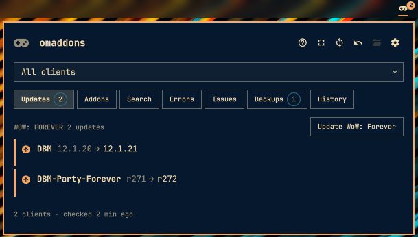
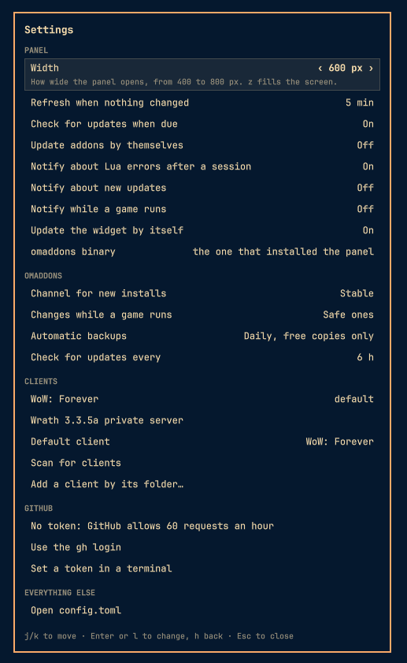
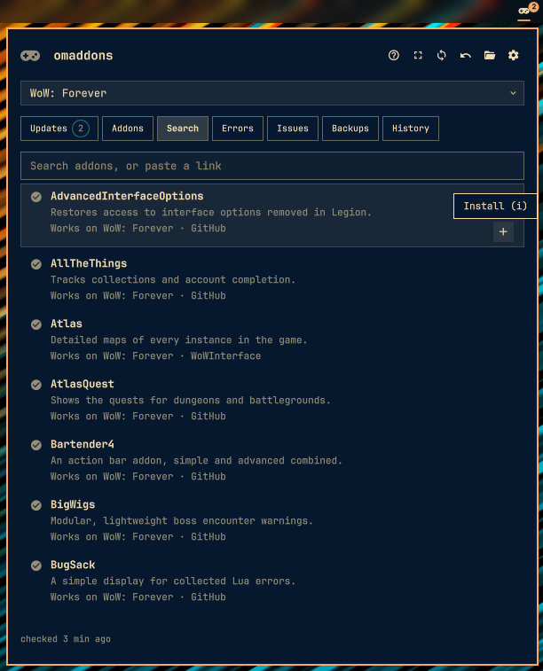
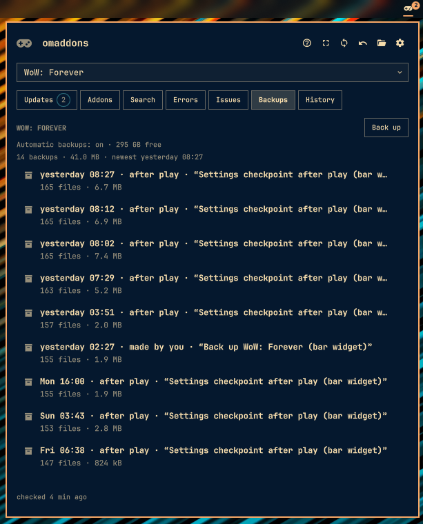

# omaddons for Omarchy

The Omarchy bar widget for [omaddons](https://github.com/a44-io/omaddons), a World of Warcraft addon manager for Linux. It finds every WoW client on the machine and shows pending addon updates, Lua errors and WTF backups, with a keyboard panel to update, undo, back up and restore. Every change it makes is an omaddons command line, recorded in omaddons' history and undoable.

<table>
<tr>
<td valign="top" width="50%">


</td>
<td valign="top" width="50%">


</td>
</tr>
</table>

This repository is the widget itself: what `omarchy plugin add` clones is what runs, and `omarchy plugin update` updates it. The widget does the work through the omaddons program, which you install first.

## Requirements

- Omarchy with shell plugin support.
- Linux on x86_64, the platform omaddons is built for.
- omaddons 0.3.0 or later (its JSON contract 1.2 or a later 1.x), installed with mise, which Omarchy ships:

  ```bash
  mise use -g github:a44-io/omaddons
  ```

  Omarchy activates mise in your shell and desktop session, which puts `omaddons` on your `PATH`. omaddons' own [installation guide](https://github.com/a44-io/omaddons#installation) lists the other ways to install it.

With no omaddons on your `PATH`, the widget shows the command above with **Copy command** and runs nothing else.

## Install

```bash
omarchy plugin add https://github.com/a44-io/omaddons-omarchy.git --enable
```

`omaddons omarchy install` adds this repository through Omarchy the same way, and places the widget on the bar. Bind a key to the panel in `~/.config/hypr/bindings.lua`:

```lua
o.bind("SUPER + ALT + W", "WoW addons", { panel = "a44.omaddons" })
```

## What it runs

Each command is an argument list, never a shell or a string, and runs in your desktop session's environment: the widget sets no variable of its own.

- `omaddons`: the binary its `binary` setting names, or else `omaddons` from your `PATH` until omaddons' `status` reports the path to run it by. Every argument list comes from the widget's fixed command table, or from a command omaddons printed that the widget's classifier accepts. A change that replaces or removes something shows its preview first, and the widget changes addons with no key pressed only for automatic updates, which are off until you turn them on.
- `inotifywait`, on the directory omaddons' `status` names, to hear when omaddons' state changed.
- `wl-copy`, with the text it copies on its standard input, never in its arguments, and `wl-paste`, to read an addon list you paste.
- `omarchy-notification-send`, for notifications that carry names and counts only.
- `omarchy-launch-browser`, only for an `https` link to GitHub, WoWInterface, Tukui or WowAce; `xdg-open`, only for a client's `AddOns` folder; `omarchy-launch-config-editor`, only for the `config.toml` path omaddons reported.
- `omarchy-shell shell summon a44.omaddons {}`, to open its panel, only when Omarchy's shell has no summon call.

It never downloads or installs anything, never writes a file, and never changes its own folder: only Omarchy's plugin commands add, update and remove it. Commands it shows for you to run, such as the ones below, it copies to the clipboard and never runs.

## Updating

- The widget: `omarchy plugin update a44.omaddons`.
- omaddons: `mise upgrade github:a44-io/omaddons`.

The widget reads any omaddons whose JSON contract is 1.x from the minimum its manifest names (`omaddons.contract_min`), whatever its version, so either one updates on its own. When they no longer match, the panel turns read-only and says which one to update:

- **omaddons is older than this panel needs**: upgrade omaddons with the mise command above.
- **This panel is older than omaddons**: update the widget with `omarchy plugin update a44.omaddons`.

Each card shows its command with **Copy command**, and **Retry** asks again.

## Removal

```bash
omarchy plugin remove a44.omaddons
```

That removes the widget. `omaddons omarchy remove` does the same and records it in omaddons' history. Neither removes omaddons itself; to remove it as well:

```bash
mise unuse -g github:a44-io/omaddons            # out of mise's global configuration
mise uninstall --all github:a44-io/omaddons     # and off the disk
```

`mise unuse` alone leaves the installed release on the disk.

## IPC

```bash
omarchy-shell a44.omaddons state          # the panel's state as one JSON object
omarchy-shell a44.omaddons refresh        # read omaddons' status again
omarchy-shell a44.omaddons check          # check for addon updates
omarchy-shell a44.omaddons show updates   # open the panel at a view: updates, installed, search, errors, issues, backups or history
```

## License

MIT: the `LICENSE` file beside this README.
